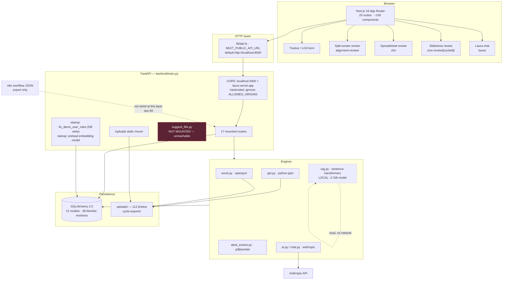
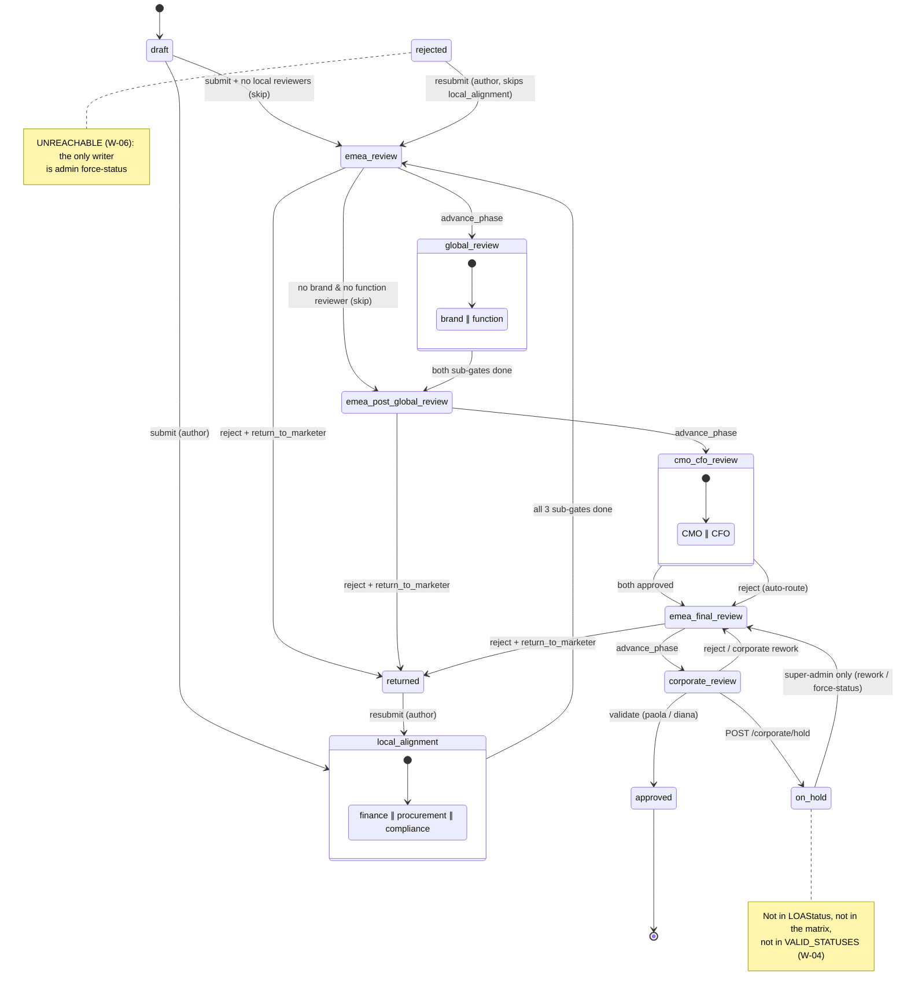

# LAURA CODE EVIDENCE REPORT

> **Purpose.** Forensic, evidence-backed inspection of the LAURA repository, produced for a separate
> "master" conversation that is reconstructing the project history. Every substantive claim carries an
> evidence ID, a file path, and an evidence category. Categories are never upgraded: code that exists is
> not code that runs; a document describing a feature is not the feature.
>
> **This report makes no claims about careers, CVs, or who physically typed any line of code.**

---

## 0. Audit Metadata

| Field | Value |
|---|---|
| Audit date | 2026-08-30 |
| Repository root | `C:/Users/sahar/Desktop/Laura` |
| Remote | `origin` → `github.com/AI-To-Market-Group/CLIENT-ESSILOR-LAURA-LOA-Agent.git` (private; no credentials embedded in the URL) |
| Branch at audit time | `refactor/architecture-stabilization` |
| HEAD commit | `aa77118` — *"test: regression suite covering all three status-writing paths"*, 2026-08-28 13:20:47 +0200 |
| Total commits (all refs) | 35 |
| Tracked files at HEAD | 325 |
| Auditor mode | Read-only. No production source modified. Nothing committed or pushed. |

### 0.1 Branches inspected

| Branch | Local | Remote | Tip | Tip date | Relation to HEAD |
|---|---|---|---|---|---|
| `refactor/architecture-stabilization` | yes | **no** | `aa77118` | 2026-08-28 | HEAD (audited branch) |
| `feature/sync-dropdown-rules-v2` | yes | yes | `7fb24f0` | 2026-08-27 | 2 behind, 0 ahead |
| `main` | yes | yes | `b9bea85` | 2026-06-05 | **29 behind, 0 ahead** |
| `save/before-approval-workflow-2026-06-05` | yes | yes | `b9bea85` | 2026-06-05 | identical to `main` |

All four refs sit on a single linear ancestry. There are **no merge commits anywhere in the repository**;
every branch is a fast-forwardable prefix of HEAD.

### 0.2 Initial `git status --short`

```
 M backend/api/review_stage.py
 M frontend/src/app/cmo-review/[cycleId]/components/PhotoUploader.tsx
 M frontend/src/app/cmo-review/[cycleId]/components/slides/LensInvestmentSlide.tsx
 M frontend/src/app/cmo-review/[cycleId]/components/slides/LensOverviewSlide.tsx
 M frontend/src/components/alignment-review/StageStepper.tsx
 M frontend/src/components/review/ReviewWorkspace.tsx
 M frontend/src/styles/redesign.css
?? backend/tests/test_lens_photo_frames.py
?? backend/tests/test_reviewer_queue_scope.py
```

### 0.3 Final `git status --short`

Recorded in §0.7 at the end of the audit. The only intended delta is the addition of
`docs/laura-forensics/LAURA_CODE_EVIDENCE.md`.

### 0.4 Important limitations of this audit

| # | Limitation |
|---|---|
| L-1 | **No runtime observation of the application.** No server started, no page loaded, no API called. Nothing here is `RUNTIME-VERIFIED` on the basis of live observation of the running product. |
| L-2 | **No database was contacted.** No migration applied, no seed run, no ETL executed. All database claims are read from model and migration source. |
| L-3 | **No external service was called.** No Anthropic API call, no n8n webhook, no cloud provider. AI behaviour is inferred from source, never from a response. |
| L-4 | **Git attribution is not authorship.** All 35 commits carry one identity. This report records that fact and draws no conclusion about who composed, generated, or typed any code. See §15. |
| L-5 | **A 27-day history gap.** Commit `9dae8cf` (2026-08-27) squashes 203 files / 35,326 insertions covering all work after 2026-07-31. Fine-grained history for that period does not exist in git and is not recoverable from this repository. |
| L-6 | **Confidential inputs were not read for content.** Client Excel/PPT/CSV inputs and uploaded photos were inspected for shape only. |
| L-7 | **`.pytest_cache` is historical, not current.** It evidences a past run, not the state of the code today. |

### 0.5 Confidentiality posture found during the audit

| ID | Finding | Category | Confidence |
|---|---|---|---|
| SEC-01 | `.env` exists in the working tree and **was never committed** — `git log --all -- .env` is empty and it is absent from `git ls-files`. `.gitignore` line 2 covers it. Its 18 variable **names** appear in §9; **no value is reproduced anywhere in this report**. | GIT-HISTORY | high |
| SEC-02 | `backend/laura_dev.db` **is tracked in git**. However every blob for that path in the entire object database is **0 bytes** (`git rev-list --objects --all` + `git cat-file -s` → `0 backend/laura_dev.db`). No database contents were ever committed. It is an empty placeholder, not a data leak. | GIT-HISTORY | high |
| SEC-03 | 112 PNG files exist on disk — 89 in `uploads/loa_photos/`, 23 in `backend/uploads/loa-photos/`. **Zero are tracked** (`git ls-files '*.png'` → 0); `.gitignore` excludes `uploads/`. These are user-uploaded campaign photos, treated as client data: counted and located only, never opened. | CODE-EXISTS | high |
| SEC-04 | Client business inputs present on disk and **untracked** (covered by `.gitignore` rules `*.csv`, `*.xlsx`, `*.pptx`, `*.pdf`): the root `EMEA PS - LOA template … .csv` (372 KB), `data/decks/*.pptx`, `data/decks/*.pdf`, `data/session_*.xlsx`. Contents excluded from this report. | CODE-EXISTS | high |
| SEC-05 | Two `.docx` security-response documents and one `.xlsx` database-audit workbook **are** tracked under `docs/`. See §11 — internal working documents, summarised structurally, sensitive specifics withheld. | CODE-EXISTS | high |
| **SEC-06** | **Hardcoded credentials DO exist in tracked source.** Three confirmed locations, all **local/POC** credentials rather than production secrets. Values are withheld; paths and lines given instead. See the corrected verdict below. | CODE-EXISTS | high |

#### SEC-06 detail — committed credentials

| Path:line | What it is | Severity |
|---|---|---|
| `backend/scripts/ingest_ppt.py:32-35` | `DB_URL = os.getenv("DATABASE_URL", "postgresql://postgres:<REDACTED>@localhost:5432/laura_db")` — a **hardcoded database password as the fallback default**. Points at `localhost`, so it is a local-dev credential, but it is committed in plaintext and would be used silently whenever `DATABASE_URL` is unset. | medium |
| `backend/seeds/seed_users.py:11,24` | A module docstring stating the shared POC password for all seeded accounts, plus `DEFAULT_PASSWORD = "<REDACTED>"`. One shared password across the seeded user population (45 users per commit `e437a09`). It is at least hashed via passlib before storage (`:27-28`, `:129`, `:151`). | medium |
| `frontend/_verify_live.py:4` | A tracked verification script that logs into the running backend using the same POC password, hardcoded, alongside a real client email address. Also notable simply for being a Python script committed inside the Next.js app directory. | medium |

**Corrected net secret-exposure verdict.** An earlier draft of this section stated that no credential had
ever been committed. That was wrong, and the correction matters for the master conversation:

- **No production secret, API key, cloud token, or private key has been committed.** `.env` was never
  tracked (SEC-01), no database rows were ever committed (SEC-02), and the API-key/token screen across the
  whole tree returns nothing.
- **But three local/POC credentials are committed in plaintext** (SEC-06), and one shared POC password
  governs every seeded account.
- Practical consequence: the repository is safe to hand over with respect to production access, and **not**
  safe to treat as free of credentials. Anyone reusing `ingest_ppt.py` or the seed data outside a throwaway
  local environment inherits a known password. This is recorded as a finding only — nothing was rotated,
  removed, or modified.

### 0.6 Commands executed by the lead auditor

All read-only. Domain-auditor commands are recorded separately in §10.

| # | Command | Purpose | Outcome |
|---|---|---|---|
| 1 | `git rev-parse --show-toplevel` / `--abbrev-ref HEAD` | repo root, branch | ok |
| 2 | `git status --short` | working-tree state (before + after) | ok |
| 3 | `git branch -vv` / `git branch -a` / `git remote -v` | branch + remote inventory | ok |
| 4 | `git rev-list --all --count` | commit count → 35 | ok |
| 5 | `git log --all --reverse --format=… --date=iso` | earliest/latest commit | ok |
| 6 | `git shortlog -sne --all` | contributor identities | ok |
| 7 | `git log --all --shortstat` | per-commit churn | ok |
| 8 | `git log --all --numstat` piped to awk | all-time insertions/deletions | ok |
| 9 | `git rev-list --left-right --count A...B` (×4) | branch divergence | ok |
| 10 | `git merge-base main refactor/architecture-stabilization` | fork point | ok |
| 11 | `git log --all --diff-filter=D --name-only` | deleted-file history | ok |
| 12 | `git log --all --name-only` piped to `sort \| uniq -c` | file churn ranking | ok |
| 13 | `git ls-files` (+ `--error-unmatch`, `-z` piped to `xargs ls`) | tracked inventory, sizes | ok |
| 14 | `git log --all -- .env` ; `git rev-list --objects --all` filtered to `*.db` + `git cat-file -s` | secret-exposure check | ok — see SEC-01/02 |
| 15 | `git ls-tree -r --name-only 0e77f5c` | day-1 scaffold | ok |
| 16 | `git log --all --diff-filter=A -- <path>` (×10) | module introduction dates | ok |
| 17 | `git diff --stat` | uncommitted work | ok |
| 18 | `find` / `ls -la` over the tree (node_modules, venv, .next, `__pycache__` pruned) | file inventory, artifact mtimes | ok |
| 19 | `python` over `.pytest_cache/v/cache/nodeids` | historical test-run evidence | ok — 354 node ids |
| 20 | `cat .pytest_cache/v/cache/lastfailed` | historical failure set | ok — `{}` |
| 21 | `grep -oE '^[A-Za-z_]+' .env .env.example` | env **variable names only**; values never read | ok |
| 22 | `mkdir -p docs/laura-forensics` | create report directory | ok — the only write performed by the lead |

---

## 1. Repository and Git History

### 1.1 Timeline visible in git

| Metric | Value |
|---|---|
| First commit | `0e77f5c` — *"feat: initial LAURA scaffold"* — **2026-05-13 12:25:53 +0200** |
| Last commit | `aa77118` — *"test: regression suite covering all three status-writing paths"* — **2026-08-28 13:20:47 +0200** |
| Elapsed span | 107 days (≈15.3 weeks) |
| Commits | 35 |
| Distinct commit days | 16 |
| All-time churn | **+112,087 / −31,753 lines** |
| Tracked files at HEAD | 325 (frontend 168, backend 76, alembic 37, docs 12, scripts 6, evals 4, plus root-level loose files) |

**G-1.1 — Commit density by month** `GIT-HISTORY` · confidence high

| Month | Commits | Character of the work (from messages + diffstat) |
|---|---|---|
| 2026-05 | 5 (all on 05-13) | Scaffold → working end-to-end LOA flow in a single day |
| 2026-06 | 8 | "Sprint 2 / 2.5 / 4": roles + permissions, scope filtering, workflow state machine, theming, PPT photos |
| 2026-07 | 18 | Densest month: redesign, RAG, the "rock 1–7" workflow series, PPT pipeline, cycles |
| 2026-08 | 4 | Squash commit, campaign library, then two test-only commits |

Development is **bursty, not continuous**: 16 active days out of 107. Five commits landed on the first day;
five more on 2026-07-11 alone.

**G-1.2 — Earliest implementation evidence** `GIT-HISTORY` · confidence high

The day-1 tree (`git ls-tree -r --name-only 0e77f5c`) contained 11 files:

```
.env.example   .gitignore   README.md   backend/requirements.txt
backend/api/health.py   backend/config.py   backend/engines/ai.py
backend/main.py   backend/models/loa.py
docs/dev-setup.md   n8n/loa-submission-workflow.json
```

Two facts follow. First, `backend/engines/ai.py` and `n8n/loa-submission-workflow.json` existed on **day one**
— the AI engine and the n8n workflow are original design intent, not later additions. Second, `README.md`
and `docs/dev-setup.md` were written **before** almost all implementation, which is why several README claims
describe an intended stack rather than the delivered one (§11).

**G-1.3 — Module introduction dates** `GIT-HISTORY` · confidence high

| Module | First appears | Commit | Interpretation |
|---|---|---|---|
| `backend/engines/ai.py` | 2026-05-13 | `0e77f5c` | day-1 |
| `backend/engines/excel.py` | 2026-05-13 | `f24dec8` | day-1 |
| `backend/engines/ppt.py` | 2026-06-05 | `b9bea85` | month 2 |
| `backend/engines/rag.py` | 2026-07-03 | `be26905` | month 3 |
| `frontend/src/lib/workflow.ts` | 2026-07-31 | `b15bdd2` | month 3 |
| `backend/api/cycles.py` | 2026-08-27 | `9dae8cf` | inside the squash |
| `backend/api/review_stage.py` | 2026-08-27 | `9dae8cf` | inside the squash |
| `backend/services/cycle_service.py` | 2026-08-27 | `9dae8cf` | inside the squash |
| `frontend/src/components/review/ReviewWorkspace.tsx` | 2026-08-27 | `9dae8cf` | inside the squash |
| `frontend/src/components/NightLensPage.tsx` | 2026-08-27 | `9dae8cf` | inside the squash |

Everything introduced by `9dae8cf` has **no incremental history** — see G-1.6.

### 1.2 Major development periods

| Period | Commits | Theme | Evidence |
|---|---|---|---|
| **P1 — Scaffold sprint**, 2026-05-13 | `0e77f5c` → `3cf2593` (5) | Scaffold, Excel engine, backend running, LOA detail page with approval/preview/download. `97142ba` is a Next.js security bump (+6,882 lines = lockfile). | day-1 tree; `f24dec8` +1,433 |
| **P2 — Roles & workflow**, 2026-06-05 → 06-16 | `b9bea85` → `63d3dd7` (8) | Sprint 2 role/permission system (**33 roles, 307 matrix entries, 45 users** per `e437a09`), scope-based filtering, workflow state machine with `is_locked`, premium theme, Sprint 4 PPT photos + review screen. | `e437a09` +1,656; `63d3dd7` 21 files |
| **P3 — Redesign + RAG**, 2026-07-03 → 07-08 | `be26905` → `efed393` (7) | `be26905` is a 113-file / +25,247 bomb introducing `rag.py`, evals, logging. Then "Editorial Finance" redesign across all pages (`ed0e2f4`, 39 files / +7,679), New LOA form remap, PPT pipeline. | diffstat |
| **P4 — The "rock" series**, 2026-07-11 → 07-16 | `a218db3` → `7976ff7` (8) | Systematic numbered workflow rebuild: rock 1+2 (9-status workflow, parallel gates, 7 permissions, **321** matrix entries), rock 3 (engine rewrite, +1,950), rock 4a/4b (permissions incl. `can_delete`/`can_duplicate`), rock 5 (comment pin coordinates), rock 7 (admin route guard). | commit messages + diffs |
| **P5 — Auth, RAG router, cycles**, 2026-07-21 → 07-31 | `af22f8b` → `b15bdd2` (3) | Welcome auth flow, "RAG smart router + re-ranking", session isolation, then `local_alignment` workflow + LOA cycles + role expansion (+8,318). | see §7, §5 |
| **P6 — The squash + hardening**, 2026-08-27 → 08-28 | `9dae8cf` → `aa77118` (4) | One 203-file squash, then campaign library + closed-cycle guards, then **two test-only commits**. | see G-1.6, G-1.7 |

**G-1.4 — "Rock 1–7" is a numbered, verifiable work programme** `GIT-HISTORY` · confidence high
Rocks 1,2,3,4a,4b,5,7 all appear as commit subjects between 2026-07-11 and 2026-07-16. **Rock 6 has no commit.**
Two verification scripts exist for the series — `backend/scripts/verify_rock1.py`, `verify_rock2.py` — with no
equivalents for rocks 3–7. This is the most systematically-executed sequence in the history.

**G-1.5 — The permission matrix grew, and the numbers are checkable** `GIT-HISTORY` · confidence high
`e437a09` (2026-06-11) claims *33 roles, 307 matrix entries, 45 users*; `a218db3` (2026-07-11) claims
*9-status workflow, parallel gates, 7 permissions, 321 matrix entries*. §5 tests these figures against the
seed code at HEAD.

### 1.3 Significant commits and large architectural changes

| Commit | Date | Files | Lines | Why it matters |
|---|---|---|---|---|
| `9dae8cf` | 2026-08-27 | **203** | **+35,326 / −9,869** | Largest by far. Message: *"my latest work before RAG merge"*. Introduces cycles, review stages, ReviewWorkspace, NightLensPage, the CMO deck UI, services layer. **Squashes ~27 days of work.** |
| `be26905` | 2026-07-03 | 113 | +25,247 / −3,291 | *"RAG evals 100%, UX redesign, logging, all working"*. Introduces `rag.py`, `evals/`, logging. Also adds `backend/laura_dev.db` (0 bytes). |
| `b15bdd2` | 2026-07-31 | 43 | +8,318 / −551 | `local_alignment` workflow, LOA cycles, role expansion. Introduces `frontend/src/lib/workflow.ts`. |
| `9a24bd8` | 2026-07-07 | 24 | +6 / **−7,971** | Deletes 22 `.bak*` files and adds ignore rules. See G-1.9. |
| `ed0e2f4` | 2026-07-06 | 39 | +7,679 / −2,855 | "Editorial Finance" design system applied across every page. |
| `7fb24f0` | 2026-08-27 | 24 | +1,997 / −923 | Campaign library + reuse flow + closed-cycle guards. |
| `5e98690` | 2026-07-11 | 3 | +1,950 / −160 | Workflow engine rewrite — parallel gates, auto-advance, skip logic, matrix-based delete. |
| `340ba2c` | 2026-07-11 | 2 | **−1,757** | Removes temp patch files (`rock3_patch.py`, `patch_workflow_v3.py`). |
| `97142ba` | 2026-05-13 | 4 | +6,882 | Next.js security update — almost entirely `package-lock.json`. |

**G-1.6 — The squash commit destroys 27 days of history** `GIT-HISTORY` · confidence high · **contradiction risk**
`9dae8cf` covers everything between 2026-07-31 and 2026-08-27 in one step. The entire cycles/review-stage/
CMO-deck subsystem — arguably the product's centrepiece — has **no incremental commit trail**. For that
subsystem it is impossible to establish from git: build order, what was tried and discarded, how long any
part took, or whether a given file was written once or iterated. Any narrative about that period must come
from outside the repository. **Flagged for the master conversation as a hard evidentiary boundary.**

**G-1.7 — Development ends on test-writing, not features** `GIT-HISTORY` · confidence high
The final two commits are test-only: `9f84556` (*"repair Excel suite + document on_hold workflow defect"*,
+197/−86) and `aa77118` (*"regression suite covering all three status-writing paths"*, 5 files, **+1,733,
zero deletions**). The project's last recorded activity is hardening and defect documentation. Note the
phrase *"document … defect"* — `backend/tests/test_workflow_known_defects.py` is a test file whose purpose is
to record known-broken behaviour rather than assert correct behaviour (§5, §14).

### 1.4 File additions, deletions, and replacements

**G-1.8 — Most-churned files** `GIT-HISTORY` · confidence high

| Touches | File | Reading |
|---|---|---|
| 14 | `backend/api/loa.py` | central, repeatedly reworked; 60 KB at HEAD |
| 11 | `frontend/src/lib/api.ts` | the single frontend↔backend seam |
| 11 | `backend/models/loa.py` | schema churned continuously — matches 38 migrations |
| 10 | `frontend/src/app/loa/[id]/page.tsx` | the LOA detail screen |
| 9 | `frontend/src/types/loa.ts`, `app/page.tsx`, `app/loa/new/page.tsx` | type contract + tracker + creation form |
| 8 | `frontend/src/app/login/page.tsx` | auth UI reworked 8× |
| 7 | `backend/main.py`, `backend/api/comments.py`, `app/globals.css` | |

**G-1.9 — `.bak` files were committed, then purged: evidence of a live-editing workflow** `GIT-HISTORY` · confidence high
22 backup files were tracked and later deleted, with suffixes encoding the work phase they preceded:
`.bak`, `.bak2`, `.bak3`, `.bak_cycle`, `.bak_wf3`, `.bak_photos`, `.bak_predetail`. Examples:
`backend/api/loa.py.bak_wf3`, `frontend/src/app/loa/[id]/page.tsx.bak_predetail`,
`frontend/src/styles/tokens.ts.bak2`. Removed in `9a24bd8` (2026-07-07) with `*.bak*` added to `.gitignore`.
This documents a manual copy-before-edit safety habit through the first two months, abandoned once the
ignore rules landed.

**G-1.10 — Replaced implementations visible as deletions** `GIT-HISTORY` · confidence high

| Deleted | Replaced by | Evidence |
|---|---|---|
| `frontend/src/components/loa-detail/ExcelTable.tsx` | `components/cfo/CFOSpreadsheet.tsx` + `LOALinesGrid.tsx` | both deleted and added paths |
| `frontend/src/components/loa-detail/SlideViewer.tsx` | `app/cmo-review/[cycleId]/components/SlideViewer.tsx` | moved into the CMO route |
| `backend/seed_demo_loas.py` | `backend/seeds/seed_demo_loas.py` | seeds consolidated into a package |
| `rock3_patch.py`, `patch_workflow_v3.py` | folded into `5e98690` | removed in `340ba2c` |
| `check_chat.py`, `check_cols.py`, `check_logs.py`, `check_logs2.py`, `check_samples.py`, `fix_embedtext.py`, `fix_final.py`, `loa_api_dump.txt` | — | throwaway debugging scripts, committed then removed |
| `frontend/src/app/admin/admin-tokens.css` | `admin/console-tokens.css` | design-token rename |

The `check_*.py` / `fix_*.py` cluster is direct evidence of **iterative debugging against real data** — those
scripts were written to inspect state, then discarded.

### 1.5 Git attribution

**G-1.11 — Single git identity across the entire history** `GIT-HISTORY` · confidence high

```
35  Saharbenrejab0 <benrejabsahar2@gmail.com>
```

`git shortlog -sne --all` returns exactly one line. There are no co-author trailers, no merge commits, and
no second committer identity anywhere in the object database.

**What this establishes:** every commit in this repository was *made* by one configured git identity.

**What this does NOT establish** (per L-4, and stated explicitly for the master conversation):

- It does not establish that the named person manually typed any given line.
- It does not distinguish hand-written code from generated, pasted, scaffolded, or vendored code.
- It does not distinguish original work from inherited or templated work.
- Large single commits (203 files / 35,326 insertions in `9dae8cf`) are **inconsistent with line-by-line
  manual authorship inside a single commit event**, but that is a statement about commit granularity, not
  about authorship. It cannot be resolved from git.

**G-1.12 — Areas where authorship cannot be determined at all** `UNKNOWN` · confidence high

| Area | Why undeterminable |
|---|---|
| Everything introduced by `9dae8cf` (203 files) | squashed; no intermediate commits |
| Everything introduced by `be26905` (113 files) | same |
| `frontend/package-lock.json` (294 KB) | machine-generated by npm |
| `frontend/tsconfig.tsbuildinfo` (154 KB) | machine-generated by tsc; should not be tracked (G-1.15) |
| The 8 design HTML files under `docs/` (up to 2.0 MB each) | tool-generated artifacts (§11) |
| Vendored/templated scaffolding (`alembic/env.py`, `script.py.mako`, `next-env.d.ts`, `postcss.config.js`) | framework-provided |

### 1.6 Uncommitted work

**G-1.13 — In-flight changes at audit time** `CODE-EXISTS` · confidence high
Seven modified files, +215/−70, plus two untracked test files:

| File | Δ | Domain |
|---|---|---|
| `backend/api/review_stage.py` | +121 net-heavy | review-stage transitions (§5) |
| `frontend/src/components/alignment-review/StageStepper.tsx` | 35 | stage stepper UI |
| `frontend/src/components/review/ReviewWorkspace.tsx` | 33 | shared review workspace |
| `frontend/src/styles/redesign.css` | +40, no deletions | additive styling |
| `.../slides/LensOverviewSlide.tsx` | 21 | CMO deck slide |
| `.../slides/LensInvestmentSlide.tsx` | 19 | CMO deck slide |
| `.../components/PhotoUploader.tsx` | 16 | photo upload |

**G-1.14 — Two substantial test files were never committed** `CODE-EXISTS` · confidence high · **notable**

| File | Lines | Node ids in last run | Status |
|---|---|---|---|
| `backend/tests/test_reviewer_queue_scope.py` | 265 | 26 | **untracked** |
| `backend/tests/test_lens_photo_frames.py` | 243 | 10 | **untracked** |

508 lines of test code — 36 collected tests — exist on disk, were part of the last executed run, and are
absent from every branch. If this repository were cloned fresh, that coverage would vanish. This is the
single most actionable finding in §1.

### 1.7 Generated and anomalous files

**G-1.15 — Generated artifacts tracked in git** `CODE-EXISTS` · confidence high

| Path | Size | Assessment |
|---|---|---|
| `frontend/tsconfig.tsbuildinfo` | 154 KB | tsc incremental cache — **should not be tracked**; committed 3× |
| `frontend/package-lock.json` | 294 KB | correctly tracked |
| `backend/laura_dev.db` | 0 B | empty placeholder, tracked (SEC-02) |
| `evals/results/eval_2026-07-02_18-23-44.json` | 150 KB | an evaluation **result** — genuine historical evidence (§7) |
| `docs/*.html` (8 files) | 0.6–2.0 MB each, ≈7.4 MB total | design artifacts (§11) |

**G-1.16 — An orphaned directory from a failed shell command** `DEAD-OR-UNUSED` · confidence high
Two empty, untracked directories exist at the repo root:

```
./{frontend,backend
./{frontend,backend/{api,engines,models,tests,logs},n8n,etl,security,docs}
```

These are the residue of `mkdir -p {frontend,backend/{api,engines,models,tests,logs},n8n,etl,security,docs}`
executed in a shell without brace expansion (PowerShell or cmd), which created a literal directory named
after the pattern. Harmless, never tracked, still present on disk. It corroborates that the scaffold in
`0e77f5c` was created on **Windows**, and it names the intended layout — including `etl/`, `security/`, and
`backend/logs/`, three directories the README documents but which **do not exist** in the repository (§11).

**G-1.17 — Root-level runtime artifacts from PPT generation** `RUNTIME-VERIFIED (historical, narrow)` · confidence high

| File | Size | mtime |
|---|---|---|
| `test_slide.pptx` | 30 KB | Jun 13 15:15 |
| `test_slide_photos.pptx` | 4.53 MB | Jun 13 22:19 |
| `test_photo_slide.pptx` | 4.53 MB | Jun 15 10:14 |

Untracked (`.gitignore` excludes `*.pptx`). These are **real generated output files**, so PowerPoint
generation demonstrably executed on 2026-06-13 and 2026-06-15 — bracketing commit `63d3dd7`
(*"Sprint 4 complete — PPT photos …"*, 2026-06-16). This is the strongest runtime evidence available in the
repository, and it is narrow: it proves generation ran **then**, not that it works **now**. See §8.

**G-1.18 — Historical test-run evidence from the pytest cache** `INTEGRATION-TESTED (historical)` · confidence high
`.pytest_cache/v/cache/` was last written **2026-08-28 16:00** — 2h40m *after* the final commit.

- `nodeids` contains **354 collected test node ids** across 12 files.
- `lastfailed` contains **`{}` — an empty failure set.**

An empty `lastfailed` after a completed run means **no test failed in that run**. Distribution:

| Tests | File |
|---|---|
| 90 | `test_authorization_matrix.py` |
| 65 | `test_workflow_transitions.py` |
| 38 | `test_loa_writes.py` |
| 30 | `test_reference_data_ssot.py` |
| 29 | `test_slide_rows.py` |
| 26 | `test_reviewer_queue_scope.py` *(untracked)* |
| 23 | `test_closed_cycle_guards.py` |
| 20 | `test_campaign_reuse.py` |
| 17 | `test_excel.py` |
| 10 | `test_lens_photo_frames.py` *(untracked)* |
| 5 | `test_workflow_known_defects.py` |
| 1 | `test_smoke_fixture.py` — **does not exist and has no git history** |

Caveats, stated plainly: this is a **cache artifact, not a test report**. It carries no timestamps per test,
no assertion counts, and no pass/fail detail beyond the empty failure set. `test_smoke_fixture.py` was
present on disk at run time and has since been deleted without ever being committed — a further instance of
G-1.14. §10 records what the auditor could reproduce today.

### 1.8 Evidence of AI-assisted development

Recorded **only** where the repository directly documents it; nothing is inferred from code style, commit
size, or velocity.

**G-1.19** `DOCUMENTATION-ONLY` · confidence high — Present in the repository:
`.claude/settings.local.json` (Claude Code project settings), `memory/project-cycle-code-deferred.md`
(an agent memory note), and 8 large single-file HTML design artifacts under `docs/` bearing the structure of
generated artifact bundles. §11 details their contents. `.env.example` and the README both name
`ANTHROPIC_API_KEY` / `CLAUDE_MODEL` — but those describe the **product's** use of an LLM at runtime, which is
a different claim from AI assistance during development. The two must not be conflated.

**No conclusion is drawn here about which code was AI-assisted.** The artifacts above are recorded as
artifacts. §15 holds the ownership matrix.

---

## 2. Architecture Overview

### 2.1 Component inventory

| Layer | Technology (as found in code, not docs) | Evidence |
|---|---|---|
| Frontend | **Next.js 16.2.6** (App Router), React 18.3, TypeScript 5.4.5, Tailwind 3.4.4 | `frontend/package.json` |
| Frontend state / forms | `zustand` 4.5, `react-hook-form` 7.51 + `zod` 3.23 + `@hookform/resolvers` | `frontend/package.json` |
| Frontend HTTP | `axios` 1.7 **and** native `fetch` (both are used) | `frontend/src/lib/api.ts:13`, `:194` |
| Frontend markdown | `react-markdown` 10.1 + `remark-gfm` 4.0 (added for the chat surface) | `frontend/package.json` |
| Backend | **FastAPI 0.111.0**, uvicorn 0.29 (standard) | `backend/requirements.txt`, `backend/main.py:22` |
| ORM / migrations | SQLAlchemy 2.0.30, Alembic 1.13.1, `psycopg2-binary` 2.9.12 | `backend/requirements.txt` |
| Logging | `structlog` 24.1.0 | `backend/main.py:11,20` |
| Document generation | `python-pptx` 0.6.23, `openpyxl` 3.1.2 | `backend/engines/ppt.py`, `excel.py` |
| Document *ingestion* | `pdfplumber` (undeclared) + `python-pptx` | `backend/engines/deck_extract.py:378` |
| LLM | `anthropic` 0.26.1 | `backend/engines/ai.py`, `chat.py` |
| Embeddings | `sentence-transformers` — **local model, not an API** (undeclared) | `backend/engines/rag.py:45`; `backend/main.py:99` comment cites a "2 GB" local model |
| Auth crypto | `PyJWT` + `bcrypt` **imported**; `python-jose` + `passlib[bcrypt]` **declared** | `backend/api/auth.py:27-28` vs `requirements.txt` |
| ETL | `pandas` (undeclared) | `scripts/ingest_session_excels.py:25` |
| Evals config | `PyYAML` (undeclared) | `scripts/run_evals.py:33` |
| Orchestration | n8n — **exported JSON only**, no running integration found at this layer | `n8n/loa-submission-workflow.json` |

**A-01 — Six third-party packages are imported but absent from `backend/requirements.txt`**
`CODE-EXISTS` + `STATICALLY-VERIFIED` · confidence **high** · **severity: high**

Method: extracted every top-level `import` / `from X` across `backend/`, `scripts/`, `etl_load_loas.py`;
subtracted the Python 3.11 stdlib and first-party packages; diffed against `requirements.txt`.

| Undeclared package | Imported at | Consequence of a clean install |
|---|---|---|
| `sentence_transformers` | `backend/engines/rag.py:45`, `scripts/vectorize_loas.py:40` | **the entire embedding/retrieval stack fails to import** |
| `pandas` | `scripts/ingest_session_excels.py:25` | session-Excel ingestion fails |
| `pdfplumber` | `backend/engines/deck_extract.py:378` | PDF deck extraction fails |
| `jwt` (PyJWT) | `backend/api/auth.py:27` | **authentication fails to import** |
| `bcrypt` | `backend/api/auth.py:28` | password verification fails to import |
| `yaml` (PyYAML) | `scripts/run_evals.py:33` | the evaluation harness fails |

All six **are** present in the local `venv/Lib/site-packages/`, so the developer machine works. A fresh
`pip install -r backend/requirements.txt` would produce a **non-functional backend**. Contradiction:
`requirements.txt` declares `python-jose[cryptography]` and `passlib[bcrypt]`, but the code imports the
*different* libraries `jwt` and `bcrypt` directly — `jose` and `passlib` are declared-and-unused, `jwt` and
`bcrypt` are used-and-undeclared. Both `jose` and `jwt` are installed in the venv, so the mismatch is
invisible locally. Reproduction: `pip install -r backend/requirements.txt` in a clean venv, then
`python -c "import backend.main"`.

*(`the` appears in the raw import scan as a false positive from a wrapped docstring at
`backend/services/comment_visibility.py:210`; it is not a package.)*

### 2.2 Frontend / backend boundary

**A-02 — A single HTTP seam, environment-configurable, defaulting to localhost** `CODE-EXISTS` · high

`frontend/src/lib/api.ts:10` — `export const API_BASE = process.env.NEXT_PUBLIC_API_URL || 'http://localhost:8000'`
and `:13` builds an axios instance on the same value. There is **no** Next.js API-route proxy layer
(`frontend/src/app/**/route.ts` does not exist), so the browser calls the FastAPI service directly and CORS
is load-bearing.

`backend/main.py:30-36` — CORS is **hardcoded, not configuration-driven**:
`allow_origins=["http://localhost:3000", "https://laura.vercel.app"]`, `allow_credentials=True`,
methods `GET/POST/PUT/PATCH/DELETE`, headers `Authorization`, `Content-Type`.

Two observations. (a) `.env.example` declares an `ALLOWED_ORIGINS` variable that `main.py` **does not read** —
`CONFIGURATION-ONLY`, and a live contradiction between the intended and actual config surface. (b) The
literal `https://laura.vercel.app` is the clearest deployment-intent evidence in the codebase, but it is an
allow-list entry, **not** proof that a deployment exists (§9).

The frontend seam is split across seven modules by domain: `api.ts` (core LOA), `admin-api.ts`,
`cycles-api.ts`, `review-api.ts`, `historical-api.ts`, `campaign-library.ts`, `templates.ts`.

### 2.3 Entry points

| # | Entry point | Path | Notes |
|---|---|---|---|
| 1 | FastAPI ASGI app | `backend/main.py:22` — `app = FastAPI(...)` | `docs_url` is exposed **only** when `ENVIRONMENT == "development"` (`:26`); `redoc_url=None` always. A deliberate production-hardening choice. |
| 2 | Next.js App Router | `frontend/src/app/layout.tsx` + 25 `page.tsx` files | §6 |
| 3 | Alembic migration runner | `alembic/env.py`, `alembic.ini` | 38 revision files, §4 |
| 4 | Seed scripts | `backend/seeds/*.py` (7) | manually invoked, §4 |
| 5 | ETL / ingestion scripts | `etl_load_loas.py`, `scripts/ingest_session_excels.py`, `backend/scripts/import_historical_loas.py`, `backend/scripts/ingest_ppt.py` | manually invoked, §4 |
| 6 | Eval harness | `scripts/run_evals.py` | manually invoked, §7 |
| 7 | Static file mount | `backend/main.py:41` — `/uploads` → `backend/uploads/` | serves campaign photos |
| 8 | Loose root scripts | `smoke_test.py`, `test_endpoint.py`, `test_hybrid.py`, `test_similarity.py`, `test_log.py`, `test_cmo_perms.py`, `show_*.py` (5), `write_page.py`, `backend/diag_duplicate.py` | ad-hoc developer tooling committed to the repo root; §3 |

**A-03 — Two startup hooks, one of which writes to the database on every boot** `CODE-EXISTS` · high · **severity: medium**

`backend/main.py:49-95` — `@app.on_event("startup") async def fix_demo_user_roles()` creates `regional_cmo` /
`regional_cfo` roles if absent and assigns `role_id` to **four hardcoded email addresses** (two `@laura-demo.local`
demo accounts and two `@essilor.com` addresses). It is idempotent and wrapped in a bare
`except Exception` that only logs a warning.

Three concerns, recorded not fixed: (i) it is **schema/data migration logic living in application startup**
rather than in Alembic, so it runs on every boot in every environment; (ii) it **hardcodes named client user
identities in tracked source** — the emails are not reproduced in this report, path and line are given
instead (personal-data exposure in a private repo, `severity: medium`); (iii) the blanket exception handler
means a failure here is silent, so a boot where role assignment fails still reports "ready".

`backend/main.py:99-115` — `preload_resources()` fires `_load_model_background()` as a detached
`asyncio.create_task`, which calls `backend.engines.rag._get_embed_model()` in a thread. The inline comment
states the model is ~2 GB and would otherwise cost "~40s" on first Deep Search. This is a real performance
decision with a documented rationale (§13), and it is also the clearest evidence that **embeddings are
computed locally, not via an API** (§7).

### 2.4 Router mounting — and one fully-implemented endpoint that is not reachable

`backend/main.py:118-134` mounts 17 routers:

| Prefix | Router | Prefix | Router |
|---|---|---|---|
| `/health` | health | *(none)* | comments |
| `/auth` | auth | *(none)* | duplicate |
| `/loa` | loa | *(none)* | chat |
| *(none)* | draft | *(none)* | templates |
| *(none)* | permissions | *(none)* | corporate |
| *(none)* | reference | *(none)* | review |
| *(none)* | admin | *(none)* | review_stage |
| `/api/reference` | reference_tables | *(none)* | cycles, historical |

Only 4 of 17 carry a prefix; the remaining 13 declare their own full paths inside the module. That is a
consistency risk but not a defect.

**A-04 — `backend/api/suggest_fills.py` is complete, tested by nothing, and mounted nowhere**
`DEAD-OR-UNUSED` · confidence **high**

`backend/api/suggest_fills.py:27` defines `router = APIRouter()` and `:41-42` decorates
`POST /loa/{loa_id}/suggest-fills`. The module implements a real feature — for each empty field on a draft
LOA it finds the most likely value from comparable approved LOAs in the same cluster
(`_SUGGESTABLE_FIELDS`, 13 fields, `:32-39`), returning `{field, value, source_count, confidence}` with helper
functions `_is_empty` (`:90`) and `_propose` (`:100`).

It is **absent from the import block at `backend/main.py:13-17` and from every `include_router` call**.
`grep -rn 'import suggest_fills|from backend.api.suggest_fills'` across `backend/` and `frontend/` returns
**zero results**. The only other mention in the repository is prose inside
`backend/scripts/inspect_autofill.py:13,129`, which describes what the function *would* suggest.

The endpoint therefore **cannot be called over HTTP**. Its own docstring calls it "slice 3" and says
"A real RAG retriever plugs in here later without changing the contract" — it reads as a deliberate
placeholder that was superseded by `backend/engines/rag.py` (introduced 2026-07-03, `be26905`) and then left
in the tree. §13 records this as a superseded-implementation decision.

*(By contrast `backend/api/ordering.py` has no router and is **not** dead — it is a shared helper imported by
seven modules: `comments`, `cycles`, `historical`, `loa`, `review`, `review_stage`, `templates`.
`backend/api/permission_middleware.py` is likewise a helper, not a router.)*

**A-05 — Deliberate, documented logic duplication across the language boundary** `CODE-EXISTS` · high

`frontend/src/lib/sort.ts:2-4` carries the comment *"Shared list ordering — LAURA frontend. Mirror of
`backend/api/ordering.py`."* The same ordering rules (`newest_first`, `thread_order`) exist in both Python and
TypeScript, and the duplication is acknowledged in a comment rather than accidental. The same pattern recurs
for display titles (`backend/engines/loa_display.py` vs `frontend/src/lib/slideRows.ts`, §8) and for the
workflow (`backend/` workflow engine vs `frontend/src/lib/workflow.ts`, §5). This is the repository's
single most consistent structural risk: **three separate pieces of business logic are maintained twice, in
two languages, with no shared source of truth and no cross-language test.**

### 2.5 Data flow

Creation and approval path, as traced through code:

1. A user authenticates at `frontend/src/app/login/page.tsx` → `POST /auth/...` (`backend/api/auth.py`).
2. The tracker (`frontend/src/app/page.tsx` → `components/TrackerPage.tsx`) lists LOAs via `lib/api.ts`
   → `GET /loa`, scope-filtered server-side (introduced `dfe0476`, 2026-06-11).
3. Creation (`app/loa/new/page.tsx`, 88 KB) posts a draft → `backend/api/loa.py` / `draft.py` → `LOA` model.
4. Reference values (clusters, brands, activity types) come from `backend/api/reference_tables.py`
   under `/api/reference`, backed by `backend/reference_data.py` (§4).
5. Submission moves the LOA through the status machine — `backend/api/review_stage.py` + the workflow engine —
   gated by the role × status × permission matrix (`backend/api/permissions.py`, §5).
6. Reviewers act through one of three surfaces: split-screen (`components/alignment-review/`),
   spreadsheet (`components/cfo/`), or slideshow (`app/cmo-review/[cycleId]/`) — §6.
7. Comments flow through `backend/api/comments.py` with visibility resolved by
   `backend/services/comment_visibility.py`.
8. Export renders real files via `backend/engines/excel.py` (openpyxl) and `backend/engines/ppt.py`
   (python-pptx); photos are served from the `/uploads` static mount — §8.
9. Chat / retrieval runs `backend/api/chat.py` → `backend/engines/chat.py` → `backend/engines/rag.py`
   (local sentence-transformers embeddings) → `anthropic` for generation, logged to `rag_log` — §7.

### 2.6 External integrations (summary; classified in §9)

| Integration | Evidence in code | Classification |
|---|---|---|
| Anthropic API | `anthropic==0.26.1`; `ANTHROPIC_API_KEY`; `backend/engines/ai.py`, `chat.py` | operational-capable, key-dependent |
| sentence-transformers | local model load, `backend/engines/rag.py:45` | local, no network |
| n8n | `n8n/loa-submission-workflow.json`; `N8N_WEBHOOK_URL` in `.env.example` | see §9 |
| Redis | `redis==5.0.4` declared | see §9 — no import found in the scan |
| Azure Blob / AWS S3 | `.env.example` keys only | `CONFIGURATION-ONLY` |
| Vercel | CORS allow-list entry only | `CONFIGURATION-ONLY` |
| PostgreSQL | `psycopg2-binary` declared; `DATABASE_URL` | see §4 for what is actually configured |

### 2.7 Architecture diagram (as implemented)



### 2.8 Implemented vs planned vs legacy

| Architecture | Status | Evidence |
|---|---|---|
| Next.js frontend ↔ FastAPI backend over HTTP | **implemented** | §2.2 |
| SQLAlchemy + Alembic persistence | **implemented** | §4 |
| Excel + PowerPoint generation | **implemented** | §8 |
| Role × status permission matrix | **implemented** | §5 |
| Local-embedding retrieval + Anthropic generation | **implemented** | §7 |
| Redis cache | **planned / declared only** — declared in `requirements.txt` and `.env.example`, no import found | A-01 scan |
| Azure Blob / AWS S3 file storage | **planned** — env keys only; files are written to the local filesystem | §9 |
| n8n orchestration | **see §9** — JSON export present, wiring unverified at the app layer | §9 |
| Vercel deployment | **configuration-only** — a CORS allow-list entry | §9 |
| `suggest_fills` structured autofill | **legacy / superseded** — complete but unmounted | A-04 |
| `etl/`, `security/`, `backend/logs/` directories from the README | **absent** — they exist only in the README and in the orphaned brace directory (G-1.16) | §11 |

### 2.9 Contradictions between code and documentation (detail in §11)

| # | README / config claim | What the code shows |
|---|---|---|
| C-1 | `requirements.txt` declares `python-jose` + `passlib` | `backend/api/auth.py:27-28` imports `jwt` + `bcrypt` |
| C-2 | `.env.example` declares `ALLOWED_ORIGINS` | `backend/main.py:32` hardcodes the origin list |
| C-3 | README: repo contains `etl/`, `security/`, `backend/logs/` | none of the three exists |
| C-4 | README: "Cache: Redis" | declared, never imported |
| C-5 | README: "File storage: Azure Blob / AWS S3" | local filesystem + `/uploads` static mount |
| C-6 | README: AI is "Claude API" | generation is Claude; **retrieval is a local sentence-transformers model the README never mentions**, and which `requirements.txt` omits |
| C-7 | README: model `claude-sonnet-4-20250514` | verified against `backend/config.py` and engine defaults in §7 |

---

## 3. Backend and API

> Domain audit. Evidence IDs are local to this section. Secret values found during this audit were
> redacted at consolidation time and are shown as `<REDACTED-PW>`.


Repository: `c:\Users\sahar\Desktop\Laura`
Branch at audit time: `refactor/architecture-stabilization` (HEAD `aa77118`)
Auditor mode: READ-ONLY. No repository file was created, modified or deleted. No server started, no external API called, no production DB touched.

**Evidence categories used** (never upgraded): CODE-EXISTS, CODE-REACHABLE, CODE-REFERENCED, GIT-HISTORY, UNIT-TESTED, INTEGRATION-TESTED, STATICALLY-VERIFIED, CONFIGURATION-ONLY, DOCUMENTATION-ONLY, PARTIALLY-IMPLEMENTED, DEAD-OR-UNUSED, UNKNOWN.

Note on "CODE-REACHABLE": used here to mean *the route is mounted on the ASGI app by `include_router`, so a request can reach the handler*. It is a static-wiring claim, not a runtime observation. Nothing in this report is RUNTIME-VERIFIED or BUILD-VERIFIED — the app was never started.

---

### 3.0 Scale

| Metric | Count |
|---|---|
| Python files under `backend/` (excl. tests/scripts/seeds) | 35 |
| Lines of Python under `backend/` (excl. tests/scripts/seeds) | 12,967 |
| API modules in `backend/api/` | 20 files (18 carry an `APIRouter`, 2 are helper modules) |
| Routers mounted in `main.py` | 17 |
| Router files NOT mounted | 1 (`suggest_fills.py`) |
| **HTTP routes reachable on the app** | **101** |
| HTTP routes defined but unreachable | 1 |
| **Total routes defined** | **102** |
| Root-level loose scripts | 13 (`smoke_test.py`, 5 × `test_*.py`, 5 × `show_*.py`, `write_page.py`, `etl_load_loas.py`) + `backend/diag_duplicate.py` |

---

### 3.1 Entry point & app wiring — `backend/main.py`

Full file is 136 lines. Every construct in it:

#### App object
`backend/main.py:22-28` — `app = FastAPI(title="LAURA API", version="0.1.0", docs_url="/docs" if settings.ENVIRONMENT == "development" else None, redoc_url=None)`.
**B-01** `main.py:26` — Swagger UI is gated on `settings.ENVIRONMENT == "development"`; ReDoc is disabled unconditionally. `/openapi.json` is **not** gated — FastAPI serves it independently of `docs_url`, so the full schema stays public in every environment. Category: CODE-EXISTS. Confidence: high.

#### Middleware
`main.py:30-36` — exactly one middleware, `CORSMiddleware`:
- `allow_origins=["http://localhost:3000", "https://laura.vercel.app"]` (hardcoded literal list, no secrets)
- `allow_credentials=True`
- `allow_methods=["GET","POST","PUT","PATCH","DELETE"]` — note `OPTIONS` is not listed; Starlette's CORS middleware handles preflight itself so this is not a defect
- `allow_headers=["Authorization","Content-Type"]`

**B-02** `main.py:32` vs `backend/config.py:14` — `Settings.ALLOWED_ORIGINS` exists as a configuration knob with a default and is present in `.env`/`.env.example`, but `main.py` hardcodes the origin list and never reads it. The setting is inert. Category: DEAD-OR-UNUSED (setting) / CODE-EXISTS (middleware). Confidence: high. **Contradiction: configuration promises an env-tunable CORS allow-list; the code ignores it.**

#### Static mounts
`main.py:39-41` — `app.mount("/uploads", StaticFiles(directory=backend/uploads), name="uploads")`. The directory is `mkdir(parents=True, exist_ok=True)`-ed at import time.
**B-03** `main.py:41` — `/uploads` is served with **no authentication**. Every uploaded photo (execution images, title backgrounds, category overview images, lens column images) is publicly readable by anyone who can guess or is given the filename. Filenames are `uuid4().hex`-based (`review.py:652`, `review.py:996`) so they are unguessable, but they are handed to the browser verbatim in `_photo_out` (`review.py:224`) and therefore leak through any deck payload. Category: CODE-EXISTS. Confidence: high.
Mitigating: `review.py:46-51` derives the file extension from the *validated* MIME type, never from the client filename, which the comment explicitly records as a fix for a stored-XSS vector on this same static mount.

#### Startup hooks (2) — no shutdown hooks
1. `main.py:49-91` `fix_demo_user_roles()` — an idempotent data migration that runs **on every boot**. It creates `regional_cmo` / `regional_cfo` roles if absent and assigns `role_id` to four hardcoded email addresses (two `@laura-demo.local`, two `@essilor.com`). Wrapped in a bare `except Exception` that only logs a warning.
   **B-04** `main.py:49-91` — production application startup performs an unconditional write migration against the live database, keyed on hardcoded personal email addresses, and silently swallows every failure. Category: CODE-EXISTS. Confidence: high.
2. `main.py:108-115` `preload_resources()` — fire-and-forget `asyncio.create_task(_load_model_background())`; `_load_model_background` (`main.py:98-105`) calls `backend.engines.rag._get_embed_model` in a thread. Failure is logged as a warning only.

**B-05** — There is **no** `@app.on_event("shutdown")`, no `lifespan` handler, no `@app.exception_handler(...)`, and no custom `RequestValidationError`/`HTTPException` handler anywhere in `backend/`. `grep -rn "@app\." backend/` returns only the two startup decorators. Unhandled exceptions therefore fall through to Starlette's default 500. Category: DEAD-OR-UNUSED (absent feature) / STATICALLY-VERIFIED (absence). Confidence: high.

#### Router registrations (`main.py:118-134`) — verbatim

| # | Module | `include_router` prefix | tags | Router-internal prefix | Effective base |
|---|---|---|---|---|---|
| 1 | `health` | `/health` | `["health"]` | — | `/health` |
| 2 | `auth` | `/auth` | `["auth"]` | — | `/auth` |
| 3 | `loa` | `/loa` | `["loa"]` | — | `/loa` |
| 4 | `draft` | — | `["draft"]` | — | *(routes hardcode `/loa/...`)* |
| 5 | `permissions` | — | — | `/permissions` | `/permissions` |
| 6 | `reference` | — | — | `/reference-data` | `/reference-data` |
| 7 | `admin` | — | — | `/admin` | `/admin` |
| 8 | `comments` | — | `["comments"]` | — | *(routes hardcode `/loa/...` and `/comments/...`)* |
| 9 | `duplicate` | — | `["duplicate"]` | — | *(hardcodes `/loa/...`)* |
| 10 | `chat` | — | `["chat"]` | — | *(hardcodes `/loa/...` and `/chat/...`)* |
| 11 | `templates` | — | `["templates"]` | — | *(hardcodes `/templates`)* |
| 12 | `corporate` | — | — | `/corporate` | `/corporate` |
| 13 | `review` | — | `["review"]` | — | *(hardcodes `/review/...` and `/admin/...`)* |
| 14 | `review_stage` | — | `["review-stage"]` | — | *(hardcodes `/review-stage/...`)* |
| 15 | `cycles` | — | — | `/cycles` | `/cycles` |
| 16 | `historical` | — | — | `/historical` | `/historical` |
| 17 | `reference_tables` | `/api/reference` | — | — | `/api/reference` |

**B-06** — Prefixing is inconsistent by construction: three routers get their prefix from `include_router` (`health`, `auth`, `loa`, `reference_tables`), five get it from `APIRouter(prefix=...)` (`permissions`, `reference`, `admin`, `corporate`, `cycles`, `historical`), and eight hardcode the full path inside every decorator. Category: CODE-EXISTS. Confidence: high.

**B-07** `main.py:134` — `reference_tables` is the only router mounted under `/api/*`. Every other route is served at the bare root. There are therefore **two mutually incompatible URL conventions** in one app: `/api/reference/clusters` and `/reference-data/`. Both are live and both are called by the frontend (`/api/reference/clusters` from `frontend/src/lib` reference lookups; `/reference-data/` only from `backend/tests/test_reference_data_ssot.py`). Category: CODE-EXISTS + CONTRADICTION. Confidence: high.

#### Routers that exist as files but are NOT included

**B-08 (DEAD ROUTER)** `backend/api/suggest_fills.py:27` declares `router = APIRouter()` and `backend/api/suggest_fills.py:41` registers `POST /loa/{loa_id}/suggest-fills`. `main.py:13-17` does not import `suggest_fills`, and `grep -rl "suggest_fills" backend --include=*.py` returns only the file itself. **The entire 156-line module — the endpoint, `_is_empty`, `_propose`, `_SUGGESTABLE_FIELDS` — is unreachable.** No frontend caller, no test caller. Category: **DEAD-OR-UNUSED**. Confidence: high.

Non-router modules in `backend/api/` (correctly not mounted): `ordering.py` (query-ordering helpers, imported by 7 modules) and `permission_middleware.py` (FastAPI dependency factory, imported by `draft.py` and `loa.py`).

---

### 3.2 Complete route table (101 reachable + 1 unreachable)

Column key:
- **Auth** — the dependency that establishes identity/authorisation on the handler signature.
- **FE?** — referenced from `frontend/src/**` (excluding `.next/`, `node_modules/`). ✅ = called; ❌ = no caller found; ⚠️ = called with a mismatched method/path.
- **Test?** — exercised by `backend/tests/*.py` via `TestClient`.

#### 3.2.1 `health` — 2 routes · `backend/api/health.py`

| Method | Full path | Handler | file:line | Body | Response model | Auth | Services/engines | DB models | FE? | Test? |
|---|---|---|---|---|---|---|---|---|---|---|
| GET | `/health/` | `health` | health.py:10 | — | none (dict) | **NONE** | — | — | ❌ | ❌ |
| GET | `/health/ready` | `ready` | health.py:19 | — | none (dict) | **NONE** | — | — | ❌ | ❌ |

**B-09** `health.py:18-22` — `/health/ready` is advertised in its own docstring as "Deeper check — database + redis reachable" and contains a literal `# TODO: add DB ping and Redis ping here`. It returns `{"status": "ready"}` unconditionally. As a readiness probe it is a lie: it will report ready with the database down. Category: **PLANNED-NOT-IMPLEMENTED**. Confidence: high.

**B-10** — Both health routes are unreferenced by the frontend and by the test suite. `/health/` requires the trailing slash (prefix `/health` + route `"/"`); `GET /health` will 307-redirect. Category: DEAD-OR-UNUSED (as used today). Confidence: med.

#### 3.2.2 `auth` — 2 routes · `backend/api/auth.py`

| Method | Full path | Handler | file:line | Body | Response | Auth | DB models | FE? | Test? |
|---|---|---|---|---|---|---|---|---|---|
| POST | `/auth/login` | `login` | auth.py:102 | `LoginRequest` | dict `{token, user{…}}` | **NONE** (this is the login) | `User` | ✅ `lib/api.ts:42` | ❌ |
| GET | `/auth/me` | `get_me` | auth.py:127 | — | dict | **broken — see B-11** | `User` | ❌ | ❌ |

**B-11 (DEFECT)** `backend/api/auth.py:127` — signature is `async def get_me(authorization: str = "", db: Session = Depends(get_db))`. `authorization` is annotated as a plain `str` with a plain default and is **not** wrapped in `Header(...)`. Under FastAPI's parameter rules a non-path, non-model scalar with a plain default becomes a **query parameter**. `GET /auth/me` therefore reads `?authorization=Bearer%20…` from the query string and never looks at the HTTP header. The `from fastapi import Header` on line 129 is *inside the function body* and does nothing.
Contrast with the working dependency `get_current_user` at `auth.py:84-85`, which correctly declares `authorization: str = Header(default="", alias="Authorization")`.
Consequence: any header-bearing call to `/auth/me` returns 401 "Not authenticated". Category: **CODE-EXISTS / PARTIALLY-IMPLEMENTED (broken)**. Confidence: high.
Mitigating: no frontend code calls `/auth/me` (the login response already carries the user object), so this defect is currently latent. The module docstring at `auth.py:4` advertises the endpoint anyway. **Contradiction: docstring says the frontend calls this on app load; nothing does, and it would fail if it did.**

**B-12** `auth.py:148-203` `seed_users()` — 15 POC accounts, all sharing one hardcoded password constant at `auth.py:188`. This is a module-level function, not a route; it is invoked from `backend/seeds/seed_users.py`, not from `main.py`. The literal password value is present in the file; it is not reproduced here. Category: CODE-EXISTS. Confidence: high.

#### 3.2.3 `loa` — 22 routes · `backend/api/loa.py` (prefix `/loa`)

| Method | Full path | Handler | file:line | Body | Auth / permission dep | Services / engines | DB models | FE? | Test? |
|---|---|---|---|---|---|---|---|---|---|
| GET | `/loa` | `get_loas` | loa.py:613 | query `status`, `cluster` | `Depends(get_current_user)` + `_apply_scope_filter` + RolePermission status filter | `hidden_cycle_ids`, `ordering.newest_first`, `engines.loa_display` | `LOA`, `LOALine`, `RolePermission`, `Role` | ✅ `lib/api.ts:74` | ❌ |
| GET | `/loa/export/excel` | `export_excel` | loa.py:664 | query `status`, `cluster` | `Depends(get_current_user)` + `_apply_scope_filter` | `engines.excel` (`loas_to_rows`, `export_excel_bytes`, `safe_filename`) | `LOA` | ✅ `TrackerPage.tsx:156` | ❌ |
| GET | `/loa/export/excel/approved` | `export_approved_excel` | loa.py:704 | — | **NONE** | `engines.excel` | `LOA` | ❌ | ❌ |
| POST | `/loa` | `create_loa` | loa.py:732 | `LOACreate` | **NONE** | `cycle_service.resolve_cycle_for_new_loa` | `LOA`, `LOALine`, `LoaCycle` | ✅ `lib/api.ts:86` | ❌ |
| GET | `/loa/{loa_id}` | `get_loa` | loa.py:767 | — | `Depends(get_current_user)` + `can_view_cycle` + `role.matches_loa` | `cycle_service.can_view_cycle` | `LOA`, `LoaCycle`, `Role` | ✅ `lib/api.ts:81` | ✅ `test_authorization_matrix` |
| PATCH | `/loa/{loa_id}` | `update_loa` | loa.py:797 | `LOACreate` | `Depends(get_current_user)` + `Depends(require_permission('edit'))` | `assert_cycle_open_for_writes` | `LOA`, `LOALine` | ✅ `lib/api.ts:91` | ✅ `test_loa_writes` |
| GET | `/loa/{loa_id}/excel` | `export_loa_excel_row` | loa.py:839 | — | `Depends(get_current_user)` (identity only — **no scope check**) | `engines.excel` | `LOA` | ✅ `lib/api.ts:194` | ❌ |
| POST | `/loa/{loa_id}/submit` | `submit_loa` | loa.py:865 | — | `Depends(get_current_user)` + author-only check (loa.py:877) | `assert_cycle_open_for_writes`, `assert_cycle_accepts_submissions`, `notify_n8n` | `LOA`, `LOAReviewStage` | ✅ `lib/api.ts:96` | ✅ `test_workflow_transitions` |
| POST | `/loa/{loa_id}/validate` | `validate_workflow_step` | loa.py:995 | — | `Depends(get_current_user)` + `_check_workflow_permission` / `compute_permissions` | `assert_cycle_open_for_writes`, `notify_n8n` | `LOA`, `Permission`, `RolePermission`, `Role` | ✅ `lib/api.ts:121` | ✅ `test_workflow_transitions` |
| POST | `/loa/{loa_id}/approve` | `approve_loa` | loa.py:1163 | — | delegates to `validate_workflow_step` | same as above | same | ✅ `lib/api.ts:103` | ❌ |
| POST | `/loa/{loa_id}/reject` | `reject_loa` | loa.py:1202 | `RejectRequest` | `Depends(get_current_user)` + `_check_workflow_permission` | `assert_cycle_open_for_writes`, `notify_n8n` | `LOA` | ✅ `lib/api.ts:108` | ✅ `test_workflow_transitions` |
| POST | `/loa/{loa_id}/comment` | `add_comment` | loa.py:1320 | `CommentRequest` | `Depends(get_current_user)` + matrix lookup | `assert_cycle_open_for_writes` | `LOA`, `Permission`, `RolePermission` | ❌ | ❌ |
| POST | `/loa/{loa_id}/lock` | `lock_loa` | loa.py:1381 | — | `Depends(get_current_user)` + `role.can_override_lock` | `assert_cycle_open_for_writes`, `notify_n8n` | `LOA`, `Role` | ✅ `lib/api.ts:130` | ❌ |
| POST | `/loa/{loa_id}/unlock` | `unlock_loa` | loa.py:1417 | — | `Depends(get_current_user)` + `role.can_override_lock` | `assert_cycle_open_for_writes`, `notify_n8n` | `LOA`, `Role` | ✅ `lib/api.ts:138` | ❌ |
| GET | `/loa/{loa_id}/validate` | `validate_loa` | loa.py:1455 | — | **NONE** | — | `LOA` | ⚠️ see B-16 | ❌ |
| DELETE | `/loa/{loa_id}` | `delete_loa` | loa.py:1466 | — | `Depends(get_current_user)` + matrix `delete` + owner check | `assert_cycle_open_for_writes` | `LOA`, `Permission`, `RolePermission`, `Role` | ✅ `lib/api.ts:143` | ❌ |
| GET | `/loa/{loa_id}/pptx` | `download_loa_pptx` | loa.py:1516 | — | **NONE** | `engines.ppt.generate_loa_slide` | `LOA` | ✅ `lib/api.ts:180` | ❌ |
| POST | `/loa/ai/validate-description` | `validate_description` | loa.py:1535 | `DescriptionValidateRequest` | **NONE** | `engines.ai.validate_description` | — | ✅ `lib/api.ts:171` | ❌ |
| POST | `/loa/ai/suggest` | `suggest_content` | loa.py:1541 | `SuggestRequest` | **NONE** | `engines.ai.suggest_loa_content` | — | ✅ `lib/api.ts:155` | ❌ |
| POST | `/loa/{loa_id}/photos` | `upload_photo` | loa.py:1561 | multipart `file` | **NONE** | `assert_cycle_open_for_writes` | `LOA` | ✅ `lib/api.ts:211` | ❌ |
| GET | `/loa/{loa_id}/photos/{index}` | `get_photo` | loa.py:1595 | — | **NONE** | — | — (filesystem) | ✅ (implicit URL) | ❌ |
| DELETE | `/loa/{loa_id}/photos/{index}` | `delete_photo` | loa.py:1607 | — | **NONE** (self-documented) | `assert_cycle_open_for_writes` | `LOA` | ✅ `lib/api.ts:218` | ❌ |

No route in this module declares a `response_model=`. All return raw dicts or ORM objects.

**B-13 (HIGH)** `backend/api/loa.py:731-732` — `POST /loa` (`create_loa`) has **no authentication dependency at all**. Its body model `LOACreate` includes `requestor_email: str = ""` (`loa.py:163`), which is written straight into the row via `LOA(**fields)` at `loa.py:747-755`. An unauthenticated caller can therefore create an LOA attributed to any email address, inside whatever cycle `resolve_cycle_for_new_loa` returns. Category: CODE-EXISTS / CODE-REACHABLE. Confidence: high.

**B-14** `loa.py:751` — `create_loa` hardcodes `is_demo=True` on every LOA it creates. `backend/api/duplicate.py:312-315` carries an explicit comment that the *duplicate* path used to do exactly this and that it was wrong because "demo rows are filtered out of reporting and the tracker". The same bug remains in the primary creation path. **Contradiction: `duplicate.py` fixed this and documented why; `loa.py` did not.** Category: CODE-EXISTS. Confidence: high.

**B-15** `loa.py:797-825` — `PATCH /loa/{loa_id}` accepts the full `LOACreate` model, which includes `requestor_email`. `updates.pop("cycle_id")` is done (line 821) but `requestor_email` is not popped, so any holder of the `edit` permission can rewrite the LOA's author. That field is the sole source of truth for draft authorship in `permissions.compute_permissions` (`permissions.py:58`, `permissions.py:84`), so rewriting it transfers draft ownership. Category: CODE-EXISTS. Confidence: high.

**B-16 (CONTRADICTION)** — `GET /loa/{loa_id}/validate` (`loa.py:1454`, unauthenticated, returns field-validation issues) and `POST /loa/{loa_id}/validate` (`loa.py:994`, authenticated, advances the workflow state machine) share one path and differ only in verb. The frontend template literal at `frontend/src/lib/api.ts:121` is `POST`, so it hits the workflow one; but the collision means a mistyped verb silently performs a completely different operation, and the GET variant leaks LOA validation detail to anyone. Category: CODE-EXISTS + CONTRADICTION. Confidence: high.

**B-17** `loa.py:1162-1169` — `POST /loa/{loa_id}/approve` is a pure alias that `await`s `validate_workflow_step(loa_id, db, user)`. Both are called from the frontend (`api.ts:103` and `api.ts:121`, plus `ApprovalPanel.tsx:100` and `TrackerPage.tsx:1953`). Two public names for one operation. Category: CODE-EXISTS (duplicate surface). Confidence: high.

**B-18** `loa.py:703-711` — `GET /loa/export/excel/approved` has no auth and its own docstring says "no user auth (internal endpoint). In production, protect with API key or internal-only network." No such protection exists in code. It dumps **every approved LOA in the system** as a workbook, bypassing `_apply_scope_filter` entirely. Category: CODE-EXISTS / **PLANNED-NOT-IMPLEMENTED** (the protection). Confidence: high.

**B-19** `loa.py:1560-1591` and `review.py:660-702` — **two independent photo-upload subsystems.** `loa.py` writes to a relative `uploads/loa_photos` (`loa.py:1556`, resolved against the *process CWD*), keys files by `{loa_id}_photo{index}`, validates the extension from the **client filename** (`loa.py:1580`), has no auth, and has no DB record. `review.py` writes to an absolute `backend/uploads/loa-photos` (`review.py:43`), keys files by `uuid4`, validates the **MIME type** and derives the extension from it (`review.py:46-51`), enforces a 10 MB cap, requires `get_current_user` + `_can_upload`, and persists an `LOAPhoto` row. Both are mounted and both are called from the frontend. Category: CODE-EXISTS + CONTRADICTION (duplicated concept, divergent security posture). Confidence: high.

**B-20** `loa.py:1606-1620` — `DELETE /loa/{loa_id}/photos/{index}` carries an in-code comment stating "this endpoint has no auth dependency — it deletes a file off disk for any caller who knows the LOA id. Left as-is". A known, documented, unfixed defect. Category: CODE-EXISTS (self-documented). Confidence: high.

**B-21** `loa.py:84-95` `notify_n8n` — reads `os.getenv("N8N_WEBHOOK_URL")` directly rather than `settings.N8N_WEBHOOK_URL` (which exists at `config.py:40`). Returns silently when unset; wraps the POST in a bare `except Exception: pass`. Fired from `submit`, `validate`, `reject`, `lock`, `unlock`. Category: CODE-EXISTS + CONTRADICTION (bypasses the settings object). Confidence: high.

**B-22** `loa.py:663` — the comment `# ── Excel export (BEFORE /{loa_id} routes) ──` documents deliberate route-ordering. It is load-bearing: `/loa/export/excel` (line 663) must precede `/loa/{loa_id}/excel` (line 838) or `loa_id` would capture `"export"`. Correct as written. Category: STATICALLY-VERIFIED. Confidence: high.

#### 3.2.4 `draft` — 1 route · `backend/api/draft.py`

| Method | Full path | Handler | file:line | Body | Auth | Services | DB models | FE? | Test? |
|---|---|---|---|---|---|---|---|---|---|
| PATCH | `/loa/{loa_id}/field` | `update_loa_field` | draft.py:56 | `FieldUpdate` | `Depends(get_current_user)` + `Depends(require_permission("edit"))` | `assert_cycle_open_for_writes` | `LOA`, `Role` | ✅ `InlineEditField.tsx:82` | ✅ `test_loa_writes` |

Guards a 22-name `_PROTECTED` frozenset (`draft.py:43-52`) and a 423 lock check.
**B-23** `draft.py:43-52` vs `loa.py:797-825` — `PATCH /loa/{id}/field` refuses to touch `requestor_email`, `status`, `is_demo`, totals, etc.; `PATCH /loa/{id}` accepts a full `LOACreate` and protects only `cycle_id` and `lines`. Two write paths onto the same rows with materially different field guards. Category: CODE-EXISTS + CONTRADICTION. Confidence: high.

#### 3.2.5 `permissions` — 2 routes · `backend/api/permissions.py` (prefix `/permissions`)

| Method | Full path | Handler | file:line | Body | Auth | DB models | FE? | Test? |
|---|---|---|---|---|---|---|---|---|
| GET | `/permissions/loa/{loa_id}` | `get_my_permissions_on_loa` | permissions.py:193 | — | `Depends(get_current_user)` | `LOA`, `Role`, `RolePermission`, `Permission` | ✅ `lib/api.ts:231` | ❌ (indirectly, heavily) |
| GET | `/permissions/my-role` | `get_my_role` | permissions.py:210 | — | `Depends(get_current_user)` | `Role` | ✅ `lib/api.ts:240` | ❌ |

`compute_permissions` (`permissions.py:44-119`) is the authorisation kernel: imported by `permission_middleware.py:29`, `corporate.py:22`, `comments.py:171`, `chat.py` (indirectly), `loa.py:605/1026/1053`.

**B-24 (CONTRADICTION)** `permissions.py:6` — the module docstring says "Main endpoint: **GET /loa/{loa_id}/my-permissions**". The actual mounted path is `GET /permissions/loa/{loa_id}` (router prefix at `permissions.py:41` + route at `permissions.py:192`). The documented path does not exist. The frontend uses the real one. Category: **DOCUMENTATION-ONLY** (the documented endpoint). Confidence: high.

#### 3.2.6 `reference` — 2 routes · `backend/api/reference.py` (prefix `/reference-data`)

| Method | Full path | Handler | file:line | Auth | Source | FE? | Test? |
|---|---|---|---|---|---|---|---|
| GET | `/reference-data/` | `get_reference_data` | reference.py:26 | **NONE** | `backend/reference_data.py` (817-line Python constant module) | ❌ | ✅ `test_reference_data_ssot.py:86,94,98,104,107,114` |
| GET | `/reference-data/version` | `get_reference_data_version` | reference.py:66 | **NONE** | same | ❌ | ✅ `test_reference_data_ssot.py:102` |

**B-25 (DEAD DUPLICATE FILE)** — `backend/reference.py` is **byte-identical** to `backend/api/reference.py` (verified by `diff`, exit 0). It declares the same `APIRouter(prefix="/reference-data")` and the same two routes at the same line numbers. `main.py:14` imports `reference` **from `backend.api`**, so `backend/reference.py` is never imported by anything (`grep -rn "backend.reference\b"` over the repo, excluding `venv/` and `__pycache__/`, returns nothing). 71 lines of exact duplicate. Category: **DEAD-OR-UNUSED**. Confidence: high.

**B-26** — `/reference-data/*` is called by the test suite but by **no frontend code**. The only frontend mention is a prose comment at `frontend/src/lib/slideRows.ts:12`. The frontend's live reference lookups go to `/api/reference/*` instead (see 3.2.17). Category: DEAD-OR-UNUSED *from the product's perspective*, INTEGRATION-TESTED *from the suite's*. Confidence: med. **Contradiction: two reference-data systems, one Python-constant-backed (tested, unused by UI) and one DB-backed (used by UI, barely tested). `test_reference_data_ssot.py:111` explicitly acknowledges the split.**

#### 3.2.7 `admin` — 14 routes · `backend/api/admin.py` (prefix `/admin`)

All except the last use `Depends(require_super_admin)` (`admin.py:53-59`, checks `role.can_override_lock`).

| Method | Full path | Handler | file:line | Body | Auth | Services | DB models | FE? | Test? |
|---|---|---|---|---|---|---|---|---|---|
| GET | `/admin/stats` | `get_dashboard_stats` | admin.py:94 | — | `require_super_admin` | — | `LOA`, `User`, `Role` | ✅ `admin-api.ts:68` | ❌ |
| GET | `/admin/users` | `get_users` | admin.py:210 | — | `require_super_admin` | — | `User`, `Role` | ✅ `admin-api.ts:73` | ❌ |
| PATCH | `/admin/users/{user_id}/role` | `change_user_role` | admin.py:236 | `RoleAssignment` | `require_super_admin` | — | `User`, `Role` | ✅ `admin-api.ts:84` | ❌ |
| POST | `/admin/users` (201) | `create_user` | admin.py:260 | `CreateUserRequest` | `require_super_admin` | `auth.hash_password` | `User`, `Role` | ✅ `admin-api.ts:90` | ❌ |
| PATCH | `/admin/users/{user_id}/deactivate` | `deactivate_user` | admin.py:301 | — | `require_super_admin` | — | `User` | ✅ `admin-api.ts:96` | ❌ |
| PATCH | `/admin/users/{user_id}/reactivate` | `reactivate_user` | admin.py:320 | — | `require_super_admin` | — | `User` | ✅ `admin-api.ts:102` | ❌ |
| GET | `/admin/roles` | `get_roles` | admin.py:337 | — | `require_super_admin` | — | `Role` | ✅ `admin-api.ts:78` | ❌ |
| GET | `/admin/permission-matrix` | `get_permission_matrix` | admin.py:361 | — | `require_super_admin` | — | `RolePermission`, `Role`, `Permission` | ✅ `app/admin/page.tsx:1320` | ❌ |
| GET | `/admin/permissions` | `list_permissions` | admin.py:385 | — | `require_super_admin` | — | `Permission` | ✅ `app/admin/page.tsx:1321` | ❌ |
| PATCH | `/admin/permission-matrix` | `update_permission_matrix` | admin.py:408 | `MatrixBatchUpdate` | `require_super_admin` | — | `RolePermission`, `Role`, `Permission` | ✅ `app/admin/page.tsx:1467` | ❌ |
| POST | `/admin/loa/{loa_id}/force-status` | `force_loa_status` | admin.py:472 | `ForceStatusRequest` | `require_super_admin` | `assert_cycle_open_for_writes` | `LOA` | ❌ | ❌ |
| POST | `/admin/cycle/start` | `start_cycle` | admin.py:527 | `CycleStartRequest` | `require_super_admin` | — | `LoaCycle` | ❌ | ❌ |
| GET | `/admin/cycle/active` | `get_active_cycles` | admin.py:571 | — | `require_super_admin` | — | `LoaCycle` | ❌ | ❌ |
| GET | `/admin/cycle/current` | `get_current_cycle_context` | admin.py:587 | — | **`get_current_user` only** (documented as deliberate, `admin.py:591-593`) | `cycle_service.can_view_cycle` | `LoaCycle`, `LOA` | ✅ `TrackerPage.tsx:270` | ❌ |

**B-27 (CONTRADICTION — duplicated concept)** `admin.py:526-567` `POST /admin/cycle/start` vs `cycles.py:196-264` `POST /cycles`. Both create an `LoaCycle`. They disagree on every material point:

| | `POST /admin/cycle/start` | `POST /cycles` |
|---|---|---|
| Resulting status | never sets `status` (relies on model default); sets `is_active=True` | `status="draft"`, `is_active=False` |
| Cycle code | **not generated** | `generate_cycle_code(...)` (`cycles.py:250`) |
| Emergency `reason` | not required, not stored | required, 422 if missing (`cycles.py:233-238`) |
| Emergency `authorized_emails` | accepted, unvalidated | required non-empty, normalised lowercase (`cycles.py:239-246`) |
| One-open-normal-cycle guard | absent — instead *deactivates* all others (`admin.py:545-547`) | 409 on clash (`cycles.py:392-406`) |
| `end_date > start_date` | unchecked | 422 (`cycles.py:223`) |

`POST /admin/cycle/start` is the weaker, older path, has no frontend caller, and its silent omission of `generate_cycle_code` is a concrete mechanism for the "cycle code deferred" condition. Category: CODE-EXISTS + **CONTRADICTION**. Confidence: high.

**B-28 (CONTRADICTION — duplicated concept)** `admin.py:570-583` `GET /admin/cycle/active` returns active cycles for super-admins only, with no `can_view_cycle` confidentiality filter — while `admin.py:613-616` (`/admin/cycle/current`, open to every authenticated user) *does* apply `can_view_cycle`, and `cycles.py:130` (`GET /cycles`) also does. Three overlapping cycle-listing endpoints with three different visibility rules. `/admin/cycle/active` has no caller. Category: CODE-EXISTS + DEAD-OR-UNUSED. Confidence: high.

**B-29 (CONTRADICTION — doc vs code)** `admin.py:15` — the module docstring advertises `GET /admin/activity → recent workflow transitions`. **No such route exists** anywhere in the file (`grep "@router" admin.py` yields 14 decorators, none `/activity`). Category: **DOCUMENTATION-ONLY / PLANNED-NOT-IMPLEMENTED**. Confidence: high.

**B-30** `admin.py:47-49` — `VALID_STATUSES` is derived by importing `WORKFLOW_ORDER` from `backend.api.loa`, with an explicit comment recording that the previously hand-typed copy had drifted (missing `local_alignment`, `emea_post_global_review`, `emea_final_review`; containing a phantom `global_functions_review`). This creates an `admin → loa` module dependency at import time. Category: CODE-EXISTS (fixed drift). Confidence: high. Note: the phantom `global_functions_review` string **still survives** in generated frontend source at `write_page.py:20` and `write_page.py:27` (see B-56).

**B-31** `admin.py:482-491` — `force_loa_status` blocks writes to closed cycles with a long comment stating this is "TEMPORARILY ABSOLUTE" because "the override reason is currently discarded … and there is no audit table". The endpoint does echo `body.reason` in its response (`admin.py:514`) and persists nothing. There is no audit table anywhere in `backend/models/`. Category: **PLANNED-NOT-IMPLEMENTED** (the audit trail). Confidence: high.

#### 3.2.8 `comments` — 8 routes · `backend/api/comments.py` (no prefix)

| Method | Full path | Handler | file:line | Body | Auth / permission | Services | DB models | FE? | Test? |
|---|---|---|---|---|---|---|---|---|---|
| POST | `/loa/{loa_id}/comments` | `create_comment` | comments.py:151 | `CommentCreate` | `get_current_user` + `compute_permissions.can_comment` + lock guard + `allowed_severities` | `assert_cycle_open_for_writes`, `comment_visibility.default_visibility` | `LOA`, `Comment`, `Role` | ✅ `CommentComposer.tsx:37` | ❌ |
| GET | `/loa/{loa_id}/comments` | `list_comments` | comments.py:258 | query ×5 | `get_current_user` + `filter_visible_comments` | `ordering.thread_order`, `comment_visibility` | `LOA`, `Comment` | ✅ `CommentsRail.tsx:62` | ❌ |
| GET | `/loa/{loa_id}/comments/summary` | `comments_summary` | comments.py:309 | — | `get_current_user` + `filter_visible_comments` | `comment_visibility` | `LOA`, `Comment` | ✅ `TrackerPage.tsx:408` | ❌ |
| PATCH | `/comments/{comment_id}` | `edit_comment` | comments.py:371 | `CommentEdit` | `get_current_user` + author-only + 5-min window | `_assert_comment_cycle_open` | `Comment`, `LOA` | ❌ | ❌ |
| POST | `/comments/{comment_id}/resolve` | `resolve_comment` | comments.py:410 | — | `get_current_user` + `can_resolve_comment` | `assert_cycle_open_for_writes` | `Comment`, `LOA` | ⚠️ **see B-32** | ❌ |
| POST | `/comments/{comment_id}/reopen` | `reopen_comment` | comments.py:447 | — | `get_current_user` + `can_reopen_comment` | `assert_cycle_open_for_writes` | `Comment`, `LOA` | ✅ `CommentCard.tsx:54` | ❌ |
| DELETE | `/comments/{comment_id}` | `delete_comment` | comments.py:484 | — | `get_current_user` + author-or-`super_admin` | `_assert_comment_cycle_open` | `Comment` | ❌ | ❌ |
| GET | `/comments/mine` | `list_my_comments` | comments.py:518 | — | `get_current_user` | — | `Comment` | ✅ `lib/api.ts:334` | ❌ |

**B-32 (HIGH — LIVE CONTRADICTION: frontend calls a route that does not exist)**
Backend registers `@router.post("/comments/{comment_id}/resolve")` at `backend/api/comments.py:409`. **There is no PATCH handler for that path.**
Three frontend call sites use **PATCH**:
- `frontend/src/lib/api.ts:325` — `api.patch(\`/comments/${commentId}/resolve\`)`
- `frontend/src/app/loa/[id]/page.tsx:211` — `api.patch(\`/comments/${id}/resolve\`)`
- `frontend/src/components/TrackerPage.tsx:1946` — `api.patch(\`/comments/${commentId}/resolve\`)`

All three will receive **405 Method Not Allowed**. Two of the three (`page.tsx:211`, `TrackerPage.tsx:1946`) swallow the error in a bare `catch {}`, so the failure is silent: the UI calls `fetchComments()` / `fetchAll()` afterwards and simply re-renders the unchanged, still-unresolved comment.
A fourth site is correct: `frontend/src/components/comments/CommentCard.tsx:54` uses `api.post(\`/comments/${comment.id}/${action}\`)`.
Category: **CONTRADICTION / CODE-REFERENCED-BUT-BROKEN**. Confidence: high.

**B-33** `comments.py:178-183` — dead defensive branch. `permission_used = "comment"` is assigned a constant on line 178, then line 179 tests `if permission_used not in ("comment", "edit", "validate", "advance_phase")`. The condition is statically always false; the `raise` is unreachable. Category: **DEAD-OR-UNUSED**. Confidence: high.

**B-34** `comments.py` (module) vs `review.py` `ReviewComment` vs `loa.py:1319` `cmo_comment` — **three separate comment systems** on the same domain object:
- `Comment` (rich: anchors, severity, visibility, threads, soft delete, resolve/reopen) — `models/comment.py`
- `ReviewComment` (flat: `slide_id`, `text`, `anchor`) — `models/review.py`, served by `review.py:486/514`
- `LOA.cmo_comment` — a single **append-only text blob** that `loa.py:1360-1366` concatenates timestamped entries into, separated by `\n\n---\n\n`

All three are mounted; the first two are called from the frontend. `LOA.cmo_comment` is written by `POST /loa/{id}/comment` which has **no frontend caller**. Category: CODE-EXISTS + **CONTRADICTION** (triplicated concept); the third is DEAD-OR-UNUSED from the UI. Confidence: high.

#### 3.2.9 `corporate` — 3 routes · `backend/api/corporate.py` (prefix `/corporate`)

| Method | Full path | Handler | file:line | Body | Auth | Services | DB models | FE? | Test? |
|---|---|---|---|---|---|---|---|---|---|
| POST | `/corporate/approve/{loa_id}` | `approve` | corporate.py:64 | — | `get_current_user` + `_authorize` (`compute_permissions.can_validate` OR `can_override_lock`) | `assert_cycle_open_for_writes` | `LOA` | ✅ `corporate-review/page.tsx:107` | ✅ `test_authorization_matrix` |
| POST | `/corporate/hold/{loa_id}` | `hold` | corporate.py:80 | — | same | same | `LOA` | ✅ `corporate-review/page.tsx:88` | ✅ |
| POST | `/corporate/rework/{loa_id}` | `rework` | corporate.py:93 | — | same | same | `LOA` | ✅ `corporate-review/page.tsx:88` | ✅ |

**B-35** `corporate.py:30` — `IA_YEAR = 2026` is a module-level literal. `_next_ia_code` (`corporate.py:51-60`) scans `LOA.ia_code LIKE '2026-%'` and issues `2026-NNNN`. The year will not roll over; a 2027 approval will be stamped `2026-`. Also note the sequence is computed with a non-atomic `SELECT … max+1` — concurrent approvals can collide. Category: CODE-EXISTS. Confidence: high.

**B-36 (CONTRADICTION)** `corporate.py:86` sets `loa.status = "on_hold"`, and `corporate.py:99` sets `"emea_final_review"`. `"on_hold"` is **not** in `loa.WORKFLOW_ORDER` (`loa.py:359-362`) and **not** a key or value in `WORKFLOW_TRANSITIONS` (`loa.py:348-356`). It is therefore also not in `admin.VALID_STATUSES` (`admin.py:49`). An LOA moved to `on_hold` cannot be advanced by `POST /loa/{id}/validate` (rejected at `loa.py:1012-1016`) and cannot be force-statused back by `/admin/loa/{id}/force-status` (rejected at `admin.py:493-497` — `on_hold` is not a valid *target*, though it can be a source). This matches the "on_hold workflow defect" recorded in commit `9f84556`. Category: CODE-EXISTS + **CONTRADICTION**. Confidence: high.

**B-37** — Corporate keeps a `can_validate` gate rather than a role check (`corporate.py:38-43`), consistent with the project's documented decision that only specific roles reach `approved`. Not a defect. Category: CODE-EXISTS. Confidence: high.

#### 3.2.10 `cycles` — 10 routes · `backend/api/cycles.py` (prefix `/cycles`)

| Method | Full path | Handler | file:line | Body | Auth | Services | DB models | FE? | Test? |
|---|---|---|---|---|---|---|---|---|---|
| GET | `/cycles` | `list_cycles` | cycles.py:97 | query `status`, `cycle_type` | `get_current_user` + `can_view_cycle` filter | `cycle_stats`, `user_reviewed_count`, `can_view_cycle`, `newest_first` | `LoaCycle`, `LOA`, `ReviewVerdict` | ✅ `cycles-api.ts:79` | ❌ |
| GET | `/cycles/{cycle_id}` | `get_cycle` | cycles.py:135 | — | `get_current_user` + `_get_cycle(…, user)` | `cycle_stats`, `cycle_export_path` | `LoaCycle` | ✅ `cycles-api.ts:108` | ❌ |
| GET | `/cycles/{cycle_id}/loas` | `get_cycle_loas` | cycles.py:151 | — | `get_current_user` + `_get_cycle(…, user)` | `review._loa_out`, `newest_first` | `LoaCycle`, `LOA` | ✅ `campaign-library.ts:257` | ❌ |
| POST | `/cycles` (201) | `create_cycle` | cycles.py:197 | `CreateCycleBody` | `get_current_user` + `_require_admin` | `generate_cycle_code`, `cycle_stats` | `LoaCycle` | ✅ `cycles-api.ts:103` | ❌ |
| PATCH | `/cycles/{cycle_id}` | `update_cycle` | cycles.py:276 | `UpdateCycleBody` | `_require_admin` | `cycle_stats` | `LoaCycle` | ✅ `cycles-api.ts:135` | ❌ |
| POST | `/cycles/{cycle_id}/status` | `set_cycle_status` | cycles.py:356 | `StatusBody` | `_require_admin` | `cycle_stats` | `LoaCycle` | ✅ `cycles-api.ts:119` | ❌ |
| POST | `/cycles/{cycle_id}/close` | `close_cycle_endpoint` | cycles.py:415 | — | `_require_admin` | `cycle_service.close_cycle` (→ Excel export + n8n/Teams webhook) | `LoaCycle`, `LOA`, `CycleCloseNotification` | ✅ `cycles-api.ts:140` | ❌ |
| GET | `/cycles/{cycle_id}/export/excel` | `download_cycle_excel` | cycles.py:429 | query `regenerate` | `get_current_user` + `_get_cycle(…, user)` | `cycle_export_path`, `generate_cycle_excel` → `engines.excel` | `LoaCycle`, `LOA` | ✅ `cycles-api.ts:174` | ❌ |
| DELETE | `/cycles/{cycle_id}` | `delete_test_cycle` | cycles.py:457 | — | `_require_admin` + `is_test`-or-empty guard | — | `LoaCycle`, `LOA`, `ReviewVerdict`, `ReviewComment`, `ReviewSubmission`, `LOAPhoto`, `CycleTitleConfig`, `CycleCloseNotification` | ✅ `cycles-api.ts:157` | ❌ |
| GET | `/cycles/{cycle_id}/notifications` | `get_cycle_notifications` | cycles.py:516 | — | `get_current_user` + `_get_cycle(…, user)` | — | `CycleCloseNotification` | ❌ | ❌ |

**B-38 (CONTRADICTION)** `cycles.py:39-48` `_require_admin` accepts `user.role` (the **legacy string** column) in `{"admin","approver","super_admin"}` *or* `role_obj.can_override_lock`. `admin.py:53-59` `require_super_admin` accepts **only** `role_obj.can_override_lock`. `review.py:613` uses a third rule: `current_user.role in ("admin","approver")` — legacy string only, no `can_override_lock` fallback. **Three different definitions of "admin" across three modules.** The `cycles.py` version is the most permissive: any user whose legacy `role` string is `"approver"` — which per `auth.py:158-187` includes the seeded CMO, CFO, Global Brand, Global Function and Corporate demo accounts — can create, edit, close and **delete** cycles. Category: **CONTRADICTION**. Confidence: high.

**B-39** `cycles.py:414-423` — `close_cycle_endpoint` calls `_get_cycle(cycle_id, db)` **without the `user` argument**, so the emergency-cycle confidentiality check (`can_view_cycle`, `cycles.py:57-58`) is skipped on this one route. Every other route in the module passes `current_user`. `_require_admin` still runs, so the exposure is limited to admins/approvers, but the asymmetry is unintentional-looking. Category: CODE-EXISTS. Confidence: med.

**B-40** `cycles.py:456-512` `delete_test_cycle` performs a hard cascade delete across 8 tables. Guarded by `is_test` OR zero-LOA. Category: CODE-EXISTS. Confidence: high.

#### 3.2.11 `duplicate` — 1 route · `backend/api/duplicate.py`

| Method | Full path | Handler | file:line | Body | Auth | Services | DB models | FE? | Test? |
|---|---|---|---|---|---|---|---|---|---|
| POST | `/loa/{loa_id}/duplicate` | `duplicate_loa` | duplicate.py:258 | — | `get_current_user` + `role.matches_loa` OR `can_override_lock` | `cycle_service.resolve_cycle_for_new_loa`, `reference_data.normalise_activity_type` | `LOA`, `LOALine` | ✅ `CreationChooser.tsx:95`, `campaign-library.ts:281` | ✅ `test_campaign_reuse.py` |

The only route in the module. 367 lines, of which ~215 are the value-normalisation mapping tables and helpers. Explicitly re-attributes `requestor_email` to the caller (`duplicate.py:309`), forces `status="draft"`, `is_demo=False`, `is_locked=False`, and re-resolves `cycle_id` from the open cycle rather than inheriting the source's. Category: CODE-EXISTS, INTEGRATION-TESTED. Confidence: high.

**B-41** `duplicate.py:54-58` — an in-code note states the previous activity-type mapping "never fired in production (no row has `duplicated_from_id`)". That is a documented statement that this feature had **zero production usage** at the time of writing. Category: **DOCUMENTATION-ONLY** claim about runtime; not independently verified here (no row data was read). Confidence: low (as a runtime claim).

#### 3.2.12 `chat` — 3 routes · `backend/api/chat.py`

| Method | Full path | Handler | file:line | Body | Auth | Engines | DB models | FE? | Test? |
|---|---|---|---|---|---|---|---|---|---|
| GET | `/loa/{loa_id}/chat/alerts` | `chat_alerts` | chat.py:231 | — | `get_current_user` + `_is_reviewer_or_admin` (chat.py:97) | `engines.chat.generate_alerts` | `LOA`, `RolePermission`, `Role` | ✅ `ChatPanel.tsx:44` | ❌ |
| POST | `/loa/{loa_id}/chat/ask` | `chat_ask_loa` | chat.py:285 | `ChatRequest` | `get_current_user` **only** | `engines.chat` (`summarize_comments`, `generate_sql`, `format_sql_answer`, `_validate_sql`), `engines.rag.ask_rag` | `LOA`, `Comment`, `RagLog` | ✅ `ChatPanel.tsx:86`, `LauraProvider.tsx:195` | ❌ |
| POST | `/chat/ask` | `chat_ask_global` | chat.py:402 | `ChatRequest` | `get_current_user` **only** | same | `RagLog` | ✅ `ChatPanel.tsx:86`, `LauraProvider.tsx:196` | ❌ |

**B-42 (HIGH)** `chat.py:451` and the equivalent in `chat_ask_loa` — `db.execute(text(sql_used))` executes **LLM-generated SQL** against the live session. Defences are (a) `engines.chat._validate_sql` (an allow/deny check in the engines layer — covered by the engines auditor), and (b) `_inject_scope_into_sql` (`chat.py:40-64`), a **string-manipulation** scope injector that:
- finds `"WHERE"` by `sql_upper.index("WHERE")` and splices `f" {clause} AND"` at that offset (`chat.py:58-60`);
- falls back to splicing after the literal `"FROM LOAS"` (`chat.py:61-63`);
- **short-circuits and returns the SQL unmodified** if `"cluster" in sql.lower()` and any scope value appears anywhere in the string (`chat.py:53-54`) — including inside a string literal or a column alias.
Interpolates cluster names into the SQL as raw single-quoted literals (`chat.py:55`). Scope enforcement is textual, not structural. Category: CODE-EXISTS. Confidence: high.

**B-43** `chat.py:48`, `chat.py:424`, `chat.py:441` — three separate function-local `from backend.api.templates import _extract_scope_values`. An API module importing a **private** (underscore-prefixed) helper from a sibling API module, three times, lazily. Also `chat.py:124` lazily imports `backend.engines.rag._call_claude` — another private symbol crossing a layer boundary. Category: CODE-EXISTS. Confidence: high.

**B-44** `chat.py:438-445` vs `chat.py:421-428` — the scope hint for the "stats" path is built by string-formatting an English instruction into the LLM prompt ("Always add WHERE cluster IN (…) to every query"), then *also* enforced by `_inject_scope_into_sql`. The comment `# R10: scope filter for Stats in global endpoint` marks it. Prompt-level enforcement is advisory only; the code correctly does not rely on it alone. Category: CODE-EXISTS. Confidence: high.

#### 3.2.13 `templates` — 2 routes · `backend/api/templates.py`

| Method | Full path | Handler | file:line | Body | Auth | Engines | DB models | FE? | Test? |
|---|---|---|---|---|---|---|---|---|---|
| GET | `/templates` | `list_templates` | templates.py:283 | 10 query params | `get_current_user` + `_scope_query` | `engines.loa_display.compute_display_title`, `ordering.newest_first` | `LOA`, `LoaCycle`, `ImportBatch` | ❌ **see B-45** | ❌ |
| POST | `/templates/search` | `search_templates` | templates.py:410 | `BriefSearchRequest` | `get_current_user` + `_get_scope_sql_conditions` | `engines.rag._get_embed_model` (sentence-transformers) + raw pgvector SQL | `LOA`, `LoaCycle`, `ImportBatch` | ✅ `CreationChooser.tsx:82` | ❌ |

**B-45 (DEAD ROUTE)** `templates.py:283` `GET /templates` has **no caller**. `grep` across `frontend/src` (excluding `.next`) finds only a prose reference at `frontend/src/app/past-campaigns/page.tsx:8`, which reads: *"it read `GET /templates`, which had no source filter at all"* — i.e. the page was migrated **off** this endpoint. Past Campaigns now goes through `campaign-library.ts` → `/cycles/{id}/loas` + `/historical/*`. The 79-line handler and its `_reusable_score`, `sort=most_reusable`, `viewer_scope` payload are unreachable in practice. Category: **DEAD-OR-UNUSED**. Confidence: high.

**B-46 (CONTRADICTION — doc vs mount)** `templates.py:4` and `templates.py:9` document the endpoints as `GET /loa/templates` and `POST /loa/templates/search`. `main.py:128` mounts the router with **no prefix**, and the decorators are `"/templates"` / `"/templates/search"`. The real paths are `/templates` and `/templates/search`. The frontend uses the real path (`CreationChooser.tsx:82`), and `CreationChooser.tsx:8` documents it correctly — so the *backend* docstring is the one that is wrong. Category: **DOCUMENTATION-ONLY** error. Confidence: high.

**B-47** `templates.py:547-576` — `search_templates` wraps the entire pgvector path in a bare `except Exception:` and silently falls through to a keyword matcher. A pgvector outage, a missing embedding model, or a genuine bug all degrade to keyword search with no signal to the caller and no log line. Category: CODE-EXISTS. Confidence: high.

**B-48** `templates.py:308` — `LOA.customer.ilike(like) if hasattr(LOA, "customer") else False` inside an `or_()`. When the attribute is absent this passes the Python literal `False` into SQLAlchemy's `or_`, which is legal but produces a constant-false clause; the guard is vestigial (`customer` does exist on the model). Minor. Category: CODE-EXISTS. Confidence: med.

#### 3.2.14 `review` — 17 routes · `backend/api/review.py` (no prefix)

| Method | Full path | Handler | file:line | Body | Auth | Services | DB models | FE? | Test? |
|---|---|---|---|---|---|---|---|---|---|
| GET | `/review/{cycle_id}/deck` | `get_deck` | review.py:284 | — | `get_current_user` (**no `can_view_cycle`** — B-49) | `ordering.newest_first` | `LoaCycle`, `LOA`, `LOAPhoto`, `CycleTitleConfig`, `LOAReviewStage` | ✅ `review-api.ts:73` | ✅ `test_lens_photo_frames` |
| GET | `/review/{cycle_id}/verdicts` | `get_verdicts` | review.py:373 | — | `get_current_user` | — | `ReviewVerdict`, `ReviewSubmission` | ✅ `review-api.ts:78` | ❌ |
| POST | `/review/{cycle_id}/verdict` | `upsert_verdict` | review.py:396 | `VerdictBody` | `get_current_user` + submitted-lock | `assert_cycle_open_for_writes`, `_get_writable_cycle` | `ReviewVerdict`, `LOA` | ✅ `review-api.ts:88` | ✅ `test_closed_cycle_guards` |
| POST | `/review/{cycle_id}/bulk-verdict` | `bulk_verdict` | review.py:441 | `BulkVerdictBody` | `get_current_user` + submitted-lock | same | `ReviewVerdict`, `LOA` | ❌ | ✅ `test_closed_cycle_guards.py:128` |
| GET | `/review/{cycle_id}/comments` | `get_comments` | review.py:487 | query `loa_id` | `get_current_user` | `ordering.thread_order` | `ReviewComment`, `User` | ✅ `review-api.ts:98` | ❌ |
| POST | `/review/{cycle_id}/comment` | `add_comment` | review.py:515 | `CommentBody` | `get_current_user` | `assert_cycle_open_for_writes`, `_get_writable_cycle` | `ReviewComment` | ✅ `review-api.ts:108` | ❌ |
| POST | `/review/{cycle_id}/submit` | `submit_review` | review.py:541 | — | `get_current_user` | same | `ReviewSubmission`, `ReviewVerdict` | ✅ `review-api.ts:147` | ❌ |
| GET | `/admin/review-modes` | `get_review_modes` | review.py:588 | — | **`get_current_user` only — no admin check** (B-50) | — | `ReviewMode` | ✅ `review-api.ts:154` | ❌ |
| PUT | `/admin/review-modes` | `upsert_review_mode` | review.py:607 | `ReviewModeBody` | `get_current_user` + `current_user.role in ("admin","approver")` (legacy string) | — | `ReviewMode` | ✅ `review-api.ts:168` | ❌ |
| POST | `/review/{cycle_id}/loa/{loa_id}/photos` | `upload_loa_photo` | review.py:661 | multipart + query `photo_type` | `get_current_user` + `_can_upload` | `assert_cycle_open_for_writes`, `_save_upload` | `LOAPhoto`, `LOA` | ✅ `review-api.ts` (photo upload) | ❌ |
| DELETE | `/review/{cycle_id}/photos/{photo_id}` | `delete_photo` | review.py:706 | — | `get_current_user` + `_can_upload` | `assert_cycle_open_for_writes` | `LOAPhoto` | ✅ `review-api.ts:197` | ❌ |
| POST | `/review/{cycle_id}/title-photo` | `upload_title_photo` | review.py:739 | multipart | `get_current_user` + `_can_upload` | same | `LOAPhoto` | ✅ `review-api.ts` | ❌ |
| POST | `/review/{cycle_id}/overview-photo/{category_slug}` | `upload_overview_photo` | review.py:776 | multipart + query `photo_type` | `get_current_user` + `_can_upload` | same | `LOAPhoto` | ✅ `review-api.ts` | ❌ |
| GET | `/review/{cycle_id}/title-config` | `get_title_config` | review.py:863 | — | `get_current_user` | — | `CycleTitleConfig` | ✅ (via deck) | ❌ |
| PUT | `/review/{cycle_id}/title-config` | `upsert_title_config` | review.py:876 | `TitleConfigBody` | `get_current_user` + `_can_upload` | `assert_cycle_open_for_writes` | `CycleTitleConfig` | ✅ `review-api.ts:277` | ✅ `test_lens_photo_frames` |
| PATCH | `/review/{cycle_id}/photos/{photo_id}/crop` | `update_photo_crop` | review.py:944 | `CropBody` | `get_current_user` + `_can_upload` | same | `LOAPhoto` | ✅ `review-api.ts:251` | ❌ |
| POST | `/review/{cycle_id}/lens-photo/{category}/{column_id}` | `upload_lens_photo` | review.py:973 | multipart | `get_current_user` + `_can_upload` | same | `LOAPhoto` | ✅ `review-api.ts` | ✅ `test_lens_photo_frames` |

**B-49 (CONTRADICTION)** `review.py:135-139` — `review.py` defines its own `_get_cycle(cycle_id, db)` that takes **no user** and therefore performs **no `can_view_cycle` check**. `cycles.py:51-59` defines a same-named helper that *does* take a user and 404s on an unauthorised emergency cycle, with an explicit comment ("404 rather than 403, so the reply cannot confirm it is there"). Every one of the 17 review routes uses the weaker helper. Consequence: **any authenticated user can read `GET /review/{cycle_id}/deck` for a confidential emergency cycle** — the full LOA payload plus photos — provided they hold the cycle id. `loa.py:782-785` and `review_stage.py:183-185` both go out of their way to enforce this confidentiality; `review.py` does not. Category: **CONTRADICTION / CODE-EXISTS**. Confidence: high.

**B-50** `review.py:587-603` — `GET /admin/review-modes` sits under the `/admin/` namespace and is called from `review-api.ts:154`, but has **only** `Depends(get_current_user)`. Any authenticated user can read the role→mode configuration. Its sibling `PUT` (line 613) does check `current_user.role in ("admin","approver")`. Category: CODE-EXISTS. Confidence: high.

**B-51** `review.py:587` / `review.py:606` — two routes in the `/admin/*` namespace are served by the **review** router, while all other `/admin/*` routes come from `admin.py` with `require_super_admin`. Two modules own one namespace, with two different guard implementations. Category: **CONTRADICTION**. Confidence: high.

**B-52 (bug)** `review.py:396-405`, `441-450`, `515-524`, `541-549`, `661-671`, `706-714`, `739-747`, `776-786`, `876-884`, `944-953`, `973-983` — in **eleven** handlers the `"""docstring"""` is placed **after** the first executable statement (`assert_cycle_open_for_writes(...)`). A string literal that is not the first statement in a function body is a no-op expression, not a docstring. `help()`, `inspect.getdoc`, and the generated OpenAPI description for these operations are all empty. Category: CODE-EXISTS (cosmetic/tooling defect). Confidence: high.

**B-53 (duplicated logic)** `review.py:641-655` `_save_upload` derives `ext` from a **locally re-declared** dict literal `{"image/jpeg": "jpg", ...}` (line 651) rather than from the module-level `_MIME_EXT` constant defined at `review.py:51` for exactly that purpose. `upload_lens_photo` (`review.py:995`) uses `_MIME_EXT` correctly and re-implements the whole read/size-check/write sequence inline instead of calling `_save_upload`. Two copies of the upload path, one of which ignores the shared constant. Category: CODE-EXISTS. Confidence: high.

**B-54** `review.py:54-57` `_can_upload` — authorisation by **substring match on the legacy role string**: `return "cmo" not in role and "cfo" not in role`. Any future role code containing those three letters is silently made read-only; conversely a genuine CMO whose legacy `role` string is `"approver"` (which is exactly what `auth.py:177-178` seeds for `regional-cmo@laura-demo.local`) **passes** the check and can upload. Category: CODE-EXISTS + **CONTRADICTION** with the seeded data. Confidence: high.

**B-55** `review.py:194` and `review.py:197` — `_loa_out` sets the key `"description"` twice in the same dict literal. The second wins; harmless but indicative. Category: CODE-EXISTS. Confidence: high.

**B-56** `review.py:283-296` — `get_deck` filters to LOAs having ≥ `len(ALIGNMENT_STAGES)` approved `LOAReviewStage` rows. `review_stage.py:42-64` carries a long comment establishing that **nothing in the live workflow ever flips a `loa_review_stage` row to `approved` for the two global stages** — reviewers submit through `POST /loa/{id}/validate`, which writes the `*_review_done` booleans and never touches `loa_review_stage`. The only writer of `approved` on those rows is `POST /review-stage/{loa_id}/approve` (`review_stage.py:298`), which is gated on role codes `global_function_review` / `global_brand_review`. If that endpoint is not used, `get_deck` returns an **empty LOA list** for every cycle. Category: CODE-EXISTS + **CONTRADICTION** (the deck's inclusion criterion depends on a table the main workflow does not write). Confidence: med — the two mechanisms are documented as separate by `review_stage.py:303-320` itself.

#### 3.2.15 `review_stage` — 3 routes · `backend/api/review_stage.py`

| Method | Full path | Handler | file:line | Body | Auth | Services | DB models | FE? | Test? |
|---|---|---|---|---|---|---|---|---|---|
| GET | `/review-stage/queue` | `get_reviewer_queue` | review_stage.py:152 | query `stage` (required) | `get_current_user` + `role.matches_loa` scope filter | `hidden_cycle_ids`, `ordering.newest_first` | `LOA`, `LOAReviewStage`, `Role` | ✅ `review-api.ts:123` | ✅ `test_reviewer_queue_scope.py` |
| GET | `/review-stage/{loa_id}/stages` | `get_loa_stages` | review_stage.py:225 | — | `get_current_user` (identity only) | — | `LOA`, `LOAReviewStage`, `User` | ✅ `review-api.ts:133` | ❌ |
| POST | `/review-stage/{loa_id}/approve` | `approve_stage` | review_stage.py:247 | `ApproveBody` | `get_current_user` + `STAGE_ROLES` role-code match OR `can_override_lock` | `assert_cycle_open_for_writes` | `LOA`, `LOAReviewStage`, `Role` | ✅ `review-api.ts:142` | ✅ `test_workflow_transitions` |

**B-57 (INTERNAL CONTRADICTION, self-documented)** `review_stage.py:36-40` `STAGE_ROLES` treats the three stages as sequential, and `approve_stage` enforces a strict predecessor check at `review_stage.py:281-288`. `review_stage.py:65-80` `STAGE_STATUS` / `STAGE_DONE_FLAGS` then **contradict** that model, mapping `global_function_review` and `global_brand_review` both onto the single `global_review` status because they are parallel, not sequential. The module's own comment block (`review_stage.py:42-64`) explains that the sequential reading "made the Global Brand queue permanently empty". The queue was fixed; **`approve_stage`'s sequence check at line 281 was not** — it still requires `global_function_review` to be `approved` before `global_brand_review` can be, for two gates the comment says are parallel. Category: **CONTRADICTION / PARTIALLY-IMPLEMENTED**. Confidence: high.

**B-58** `review_stage.py:319-320` — `approve_stage` advances the LOA only when `_all_stages_approved(...)` **and** `loa.status == "local_alignment"`, in which case it moves to `emea_review`. A long comment (`review_stage.py:303-318`) records that this previously wrote `cmo_cfo_review` unguarded, skipping four gates, and that "Two approved LOAs still carry stage rows and were exposed to exactly that." A data-integrity claim about production rows. Category: **DOCUMENTATION-ONLY** as a runtime claim (no row data read here). Confidence: low as a runtime claim, high as a record of the code change.

**B-59** `review_stage.py:225-243` — `GET /review-stage/{loa_id}/stages` applies **no** scope or cycle-confidentiality check; any authenticated user can read the approval history (including approver full names, `review_stage.py:115`) of any LOA by id. Its sibling `queue` route carefully applies both. Category: CODE-EXISTS. Confidence: high.

#### 3.2.16 `historical` — 5 routes · `backend/api/historical.py` (prefix `/historical`)

| Method | Full path | Handler | file:line | Query | Auth | Services/engines | DB models | FE? | Test? |
|---|---|---|---|---|---|---|---|---|---|
| GET | `/historical/import-batches` | `list_import_batches` | historical.py:61 | — | `get_current_user` | `ordering.newest_first` | `ImportBatch`, `LOA` | ✅ `historical-api.ts:63` | ❌ |
| GET | `/historical/loas` | `list_historical_loas` | historical.py:79 | `import_batch_id`, `limit≤5000`, `offset` | `get_current_user` | `review._loa_out`, `newest_first` | `LOA` | ❌ | ❌ |
| GET | `/historical/deck` | `historical_deck` | historical.py:102 | `import_batch_id` | `get_current_user` | `review._loa_out`, `newest_first` | `LOA`, `ImportBatch` | ✅ `historical-api.ts:68` | ❌ |
| GET | `/historical/excel` | `historical_excel_grid` | historical.py:145 | `import_batch_id` | `get_current_user` | `review._loa_out`, `newest_first` | `LOA`, `ImportBatch` | ✅ `historical-api.ts:79` | ❌ |
| GET | `/historical/export` | `export_historical` | historical.py:184 | `import_batch_id` | `get_current_user` | `engines.excel` | `LOA`, `ImportBatch` | ✅ `historical-api.ts:86` | ❌ |

**B-60** `historical.py:86`, `:109`, `:152` — three function-local `from backend.api.review import _loa_out`. A **private** serializer is imported across module boundaries from `historical.py`, `cycles.py:157`, making `review.py` a de-facto shared serialization library that nothing declares. Category: CODE-EXISTS. Confidence: high.

**B-61** `historical.py:79` — `GET /historical/loas` has no frontend caller and no test. The three sibling view endpoints (`deck`, `excel`, `export`) cover the UI. Category: DEAD-OR-UNUSED. Confidence: med.

**B-62** — All five historical routes require only `get_current_user`. There is **no role-scope filter** (`_apply_scope_filter` / `role.matches_loa` are never called). Every authenticated user, regardless of cluster or brand scope, can read and export the entire historical LOA corpus. Contrast `loa.py:631` and `templates.py:299`, which both scope-filter the same table. Category: CODE-EXISTS + **CONTRADICTION**. Confidence: high.

#### 3.2.17 `reference_tables` — 4 routes · `backend/api/reference_tables.py` (mounted prefix `/api/reference`)

| Method | Full path | Handler | file:line | Query | Auth | DB access | FE? | Test? |
|---|---|---|---|---|---|---|---|---|
| GET | `/api/reference/clusters` | `get_clusters` | reference_tables.py:19 | — | **NONE** | raw `text("SELECT id, name FROM clusters …")` | ✅ | ✅ `test_reference_data_ssot.py` |
| GET | `/api/reference/countries` | `get_countries` | reference_tables.py:25 | `cluster_id` (required) | **NONE** | raw SQL, bound param | ✅ | ❌ |
| GET | `/api/reference/legal-entities` | `get_legal_entities` | reference_tables.py:34 | `country_id` (required) | **NONE** | raw SQL, bound param | ✅ | ❌ |
| GET | `/api/reference/brands` | `get_brands` | reference_tables.py:43 | — | **NONE** | raw SQL | ✅ | ❌ |

All four use bound parameters — no injection. All four are unauthenticated.
**B-63** `reference_tables.py:45` — `WHERE is_active = true` is Postgres-specific boolean literal syntax; it will fail on the SQLite fallback that `config.py:17` and `models/database.py:13` both default to. Category: CODE-EXISTS. Confidence: high.

#### 3.2.18 `suggest_fills` — 1 route · **NOT MOUNTED**

| Method | Intended path | Handler | file:line | Auth | Status |
|---|---|---|---|---|---|
| POST | `/loa/{loa_id}/suggest-fills` | `suggest_fills` | suggest_fills.py:42 | `get_current_user` | **UNREACHABLE — router not in `main.py`** |

See B-08.

---

### 3.3 Configuration — `backend/config.py`

48 lines. `class Settings(BaseSettings)` (pydantic-settings v2), `env_file = ".env"`, `case_sensitive = True`, instantiated once at module scope as `settings` (`config.py:48`).

**Setting names and defaults (NAMES AND DEFAULT SHAPES ONLY — no `.env` values are reproduced):**

| Group | Name | Type | Default in code | Read anywhere in `backend/`? |
|---|---|---|---|---|
| App | `ENVIRONMENT` | str | `"development"` | ✅ `main.py:26`, `main.py:136` |
| App | `LOG_LEVEL` | str | `"INFO"` | ❌ **never read** |
| App | `ALLOWED_ORIGINS` | str | comma-joined localhost + vercel literal | ❌ **never read** (B-02) |
| DB | `DATABASE_URL` | str | `"sqlite:///./laura_dev.db"` | ❌ **never read via `settings`** (B-64) |
| Cache | `REDIS_URL` | str | `"redis://localhost:6379"` | ❌ **never read** |
| Auth | `JWT_SECRET` | str | a placeholder dev string | ✅ `auth.py:36` |
| Auth | `JWT_EXPIRY_HOURS` | int | `8` | ❌ **never read** (B-65) |
| AI | `ANTHROPIC_API_KEY` | str | `""` | (engines layer — not audited here) |
| AI | `CLAUDE_MODEL` | str | a model id string | (engines layer) |
| AI | `CLAUDE_MAX_TOKENS` | int | `500` | (engines layer) |
| AI | `ANONYMISE_BEFORE_LLM` | bool | `True` (commented "EL security requirement") | (engines layer) |
| Storage | `AZURE_STORAGE_CONNECTION_STRING` | str | `""` | ❌ never read |
| Storage | `AWS_ACCESS_KEY_ID` | str | `""` | ❌ never read |
| Storage | `AWS_SECRET_ACCESS_KEY` | str | `""` | ❌ never read |
| Storage | `AWS_S3_BUCKET` | str | `""` | ❌ never read |
| Storage | `AWS_REGION` | str | an eu region string | ❌ never read |
| n8n | `N8N_WEBHOOK_URL` | str | `""` | ❌ **never read via `settings`** (B-21) |
| n8n | `N8N_API_KEY` | str | `""` | ❌ never read |

**Missing-key behaviour:** every field has a default, so `Settings()` **never raises** on a missing environment variable. The app boots with a placeholder JWT secret, a SQLite URL and empty API keys rather than failing fast. There is no `ENVIRONMENT == "production"` assertion anywhere.
**B-66** `config.py:23` — `JWT_SECRET` defaults to a literal placeholder string containing the words "change-in-production". A deployment that forgets to set it signs tokens with a value that is public in the repository. Nothing checks for this. Category: CODE-EXISTS. Confidence: high.

**B-64 (CONTRADICTION — two config systems)** `config.py:17` declares `DATABASE_URL` on `Settings`. `backend/models/database.py:11-13` ignores `Settings` entirely and does `load_dotenv(); DATABASE_URL = os.getenv("DATABASE_URL", "sqlite:///./laura_dev.db")`. `etl_load_loas.py:22,29` does the same. `loa.py:88` does the same for `N8N_WEBHOOK_URL`. So there are **two parallel configuration mechanisms** — a pydantic `Settings` object that is read for exactly two values (`ENVIRONMENT`, `JWT_SECRET`), and scattered `os.getenv` calls with independently re-typed defaults. Category: **CONTRADICTION**. Confidence: high.

**B-65** `config.py:24` `JWT_EXPIRY_HOURS = 8` is never read. `auth.py:38` hardcodes `JWT_EXPIRY_H = 24` instead. The configured session lifetime is 8 h; the actual one is 24 h. Category: **CONTRADICTION**. Confidence: high.

**B-67** `backend/config.py:2` and `:16` and `:26` contain mojibake (`â€"`) where em-dashes should be — the file was written/saved with an encoding mismatch. Same class of damage appears as a UTF-8 BOM (`\ufeff`) at the head of every root-level `test_*.py` and `show_*.py`. Cosmetic. Category: CODE-EXISTS. Confidence: high.

**Secrets:** `.env` exists at the repo root, is listed in `.gitignore:3`, and `git ls-files` confirms it is **not tracked**. Its key names match `.env.example` exactly. Its values were not read and are not reproduced. `.env.example` **is** tracked and contains placeholder-shaped values only.

---

### 3.4 Auth mechanism as implemented — honest classification

#### Verdict: **real HS256 JWT with bcrypt password verification — but with a placeholder-defaulted secret, no refresh/revocation, and one broken endpoint.** Not a dev shim; not production-hardened either.

**Token issuance** — `backend/api/auth.py:66-74`:
```
def create_token(user: User) -> str:
    payload = {
        "sub": str(user.id), "email": user.email, "role": user.role,
        "cluster": user.cluster,
        "exp": datetime.utcnow() + timedelta(hours=JWT_EXPIRY_H),
    }
    return jwt.encode(payload, JWT_SECRET, algorithm=JWT_ALGORITHM)
```
`JWT_ALGORITHM = "HS256"` (`auth.py:37`), `JWT_EXPIRY_H = 24` (`auth.py:38`), `JWT_SECRET = getattr(settings, 'JWT_SECRET', <fallback literal>)` (`auth.py:36`).

**Password handling** — `auth.py:60-64`: `bcrypt.hashpw(..., bcrypt.gensalt())` / `bcrypt.checkpw(...)`. Real bcrypt, not a stub. Note `backend/requirements.txt` pins `passlib[bcrypt]` and `python-jose[cryptography]`, but the code imports bare `jwt` (PyJWT) and bare `bcrypt` — **the pinned auth libraries are not the ones used**. Category: CODE-EXISTS + CONTRADICTION (dependency manifest vs imports). Confidence: high.

**Token verification** — `auth.py:76-82`: `jwt.decode(token, JWT_SECRET, algorithms=[JWT_ALGORITHM])`, distinguishing `ExpiredSignatureError` → 401 "Token expired" from `InvalidTokenError` → 401 "Invalid token". Algorithm is pinned to a single-element list, so the `alg: none` confusion attack is closed.

**The dependency every protected route uses** — `auth.py:84-96`:
```
def get_current_user(
    authorization: str = Header(default="", alias="Authorization"),
    db: Session = Depends(get_db)
) -> User:
    if not authorization.startswith("Bearer "):
        raise HTTPException(status_code=401, detail="Not authenticated")
    token = authorization[7:]
    payload = decode_token(token)
    user = db.query(User).filter(User.email == payload["email"]).first()
    if not user or not user.is_active:
        raise HTTPException(status_code=401, detail="User not found")
    return user
```
Header-based Bearer. Note the lookup is by **`payload["email"]`**, not by `payload["sub"]` — the id is carried but never used. An email change would invalidate every outstanding token; more importantly, identity is keyed on a mutable, user-facing column.

**B-68** — There is **no** `OAuth2PasswordBearer`, no `HTTPBearer` security scheme, and no `dependencies=[...]` on any `include_router` call. Consequence: FastAPI's OpenAPI schema records **no security requirement** for any operation, and `/docs` (in development) offers no Authorize button. Auth is enforced per-handler by hand. Category: CODE-EXISTS. Confidence: high.

**B-69** — No refresh tokens, no token revocation/blacklist, no logout server-side (the module docstring at `auth.py:5` says "POST /auth/logout → client-side only (just clears token)" — and indeed **no `/auth/logout` route exists**). Deactivating a user via `PATCH /admin/users/{id}/deactivate` does take effect on the next request, because `get_current_user` re-checks `user.is_active` on every call (`auth.py:94`). Category: PARTIALLY-IMPLEMENTED. Confidence: high.

**B-70 — Two parallel authorisation models coexist.**
1. **Legacy string** `User.role` ∈ `{editor, finance, approver, admin}`, seeded at `auth.py:158-187`, embedded in the JWT payload (`auth.py:70`), and used as the authorisation predicate at `cycles.py:43-46`, `review.py:613`, `review.py:56`.
2. **Matrix model** `User.role_obj → Role → RolePermission → Permission`, keyed on `(role_id, loa_status)`, computed by `permissions.compute_permissions` (`permissions.py:44-119`) and enforced by `permission_middleware.require_permission` (`permission_middleware.py:42-91`).

The two disagree in practice: `auth.py:177` seeds `regional-cmo@laura-demo.local` with legacy `role="approver"`, which satisfies `cycles.py:_require_admin` and `review.py:613`'s admin check while simultaneously being subject to the matrix elsewhere. `main.py:49-91` exists **solely** to paper over this by back-filling `role_id` for four hardcoded emails at every boot. Category: **CONTRADICTION**. Confidence: high.

**`require_permission` — `backend/api/permission_middleware.py:42-91`.** A dependency factory over `{'view','comment','edit','validate'}` → `{'can_view','can_comment','can_edit','can_validate'}`. It reads the LOA id from `request.path_params.get('loa_id') or request.path_params.get('id')` (line 63), loads the LOA, calls `compute_permissions`, and 403s with a structured detail body.
**B-71** — Despite being the project's designated permission middleware, `require_permission` is used on exactly **two** of the 101 routes: `loa.py:802` (`PATCH /loa/{loa_id}`) and `draft.py:61` (`PATCH /loa/{loa_id}/field`). Its own docstring (`permission_middleware.py:9`) shows `@router.post("/loa/{loa_id}/approve")` as the example — and the real `POST /loa/{loa_id}/approve` (`loa.py:1162`) does **not** use it. Every other authorisation decision is hand-rolled inside the handler. Category: **PARTIALLY-IMPLEMENTED / CONTRADICTION**. Confidence: high.

**B-72** — Unauthenticated reachable routes (13 of 101): `/health/`, `/health/ready`, `POST /auth/login` (expected), `GET /reference-data/`, `GET /reference-data/version`, `GET /api/reference/clusters|countries|legal-entities|brands`, **`POST /loa`**, **`GET /loa/export/excel/approved`**, `GET /loa/{loa_id}/validate`, `GET /loa/{loa_id}/pptx`, `POST /loa/ai/validate-description`, `POST /loa/ai/suggest`, `POST /loa/{loa_id}/photos`, `GET /loa/{loa_id}/photos/{index}`, `DELETE /loa/{loa_id}/photos/{index}` — plus the entire `/uploads` static mount. Category: STATICALLY-VERIFIED. Confidence: high.

---

### 3.5 Loose root-level scripts

`pytest` has **no configuration file** in this repository: there is no `pytest.ini`, no `pyproject.toml`, no `setup.cfg`, no `tox.ini` (verified by `ls`). Therefore `testpaths` is unset and `python_files` keeps its default `test_*.py *_test.py`. **Running bare `pytest` from the repository root collects the root-level files below in addition to `backend/tests/`.** All of them execute their work at **module import time** (no `def test_*` functions), so collection alone runs them.

| File | Tracked in git? | What it does | Real pytest test? | Collected by bare `pytest`? | Hits live services? |
|---|---|---|---|---|---|
| `smoke_test.py` (134 L) | ✅ | Builds 3 `FakeLOA` objects, calls `engines.excel.loas_to_rows` / `export_excel_bytes` / `export_single_loa_row`, asserts ~20 invariants incl. **formula-injection neutralisation** (`smoke_test.py:116-119`). Writes `sample.xlsx` to CWD (line 92). | ❌ — module-level `assert`s, no test functions | ✅ — matches default `*_test.py` | ❌ (pure, offline) |
| `test_endpoint.py` (10 L) | ✅ | `httpx.post('http://localhost:8000/chat/ask', …)` with a **hardcoded Bearer JWT**. | ❌ | ✅ | ✅ — **live HTTP to a running backend** |
| `test_cmo_perms.py` (21 L) | ✅ | Opens `SessionLocal()`, raw `SELECT id FROM loas WHERE status='cmo_cfo_review'`, calls `compute_permissions` for two hardcoded `@essilor.com` emails, prints. | ❌ | ✅ | ✅ — **live database** |
| `test_hybrid.py` (57 L) | ✅ | Loads `SentenceTransformer("intfloat/multilingual-e5-large")` (multi-GB), then three raw pgvector `<=>` queries against `loas`. | ❌ | ✅ | ✅ — **live DB + multi-GB model download/load** |
| `test_log.py` (23 L) | ✅ | **Inserts a row** into `rag_logs` via `SessionLocal()` and commits. | ❌ | ✅ | ✅ — **writes to the live database** |
| `test_similarity.py` (30 L) | ✅ | Loads the same SentenceTransformer, one pgvector similarity query, prints. | ❌ | ✅ | ✅ — **live DB + model** |
| `show_ab.py` (7 L) | ✅ | Prints `backend/main.py` and `backend/engines/chat.py` to stdout. | ❌ | ❌ (name doesn't match) | ❌ |
| `show_creation.py` (15 L) | ✅ | Prints first 4000 chars of two frontend files. | ❌ | ❌ | ❌ |
| `show_files.py` (20 L) | ✅ | Prints first 3000 chars of four files. | ❌ | ❌ | ❌ |
| `show_search.py` (11 L) | ✅ | Greps `backend/api/templates.py` for `def`/`@router`/`search` and prints windows. | ❌ | ❌ | ❌ |
| `show_templates.py` (7 L) | ✅ | Prints first 3000 chars of `backend/api/templates.py`. | ❌ | ❌ | ❌ |
| `write_page.py` (18.7 KB) | ✅ | A **code generator**: holds an entire Next.js page (`frontend/src/app/loa/[id]/page.tsx`) as one raw string literal and writes it to disk. | ❌ | ❌ | ❌ (writes into the repo) |
| `etl_load_loas.py` (11.5 KB) | ✅ | Argparse CLI (`--file path.csv`) that bulk-loads historical LOAs into Postgres via its **own** engine built from `os.getenv("DATABASE_URL")`. | ❌ | ❌ | ✅ when invoked |
| `backend/diag_duplicate.py` (23 L) | ✅ | Prints the 3 newest LOAs' `requestor_email` / `is_demo` / `duplicated_from_id`. Uses **relative** imports (`from models.database import …`, line 5) so it only runs with CWD=`backend/`. | ❌ | ❌ | ✅ — live database |

**B-73 (HIGH — committed credential)** `test_endpoint.py:2` assigns a module-level constant holding a complete, signed **JWT bearer token** for a real named user account. The file is tracked in git (`git ls-files` confirms) and the token is therefore in the repository history. The value is deliberately **not reproduced in this report**. Anyone with repository access can replay it against any deployment still using the same `JWT_SECRET`; it is valid until its embedded `exp`. Category: **CODE-EXISTS**. Confidence: high.

**B-74 (HIGH)** — Bare `pytest` at the repository root is destructive and non-hermetic: it will (a) attempt an HTTP call to `localhost:8000`, (b) open three separate connections to the configured database, (c) **INSERT a row into `rag_logs`** (`test_log.py:8-15`), and (d) trigger two SentenceTransformer loads. All at *collection* time, before any real test runs. Category: STATICALLY-VERIFIED. Confidence: high.
Note `backend/tests/conftest.py:5-27` documents a careful "ISOLATION CONTRACT" for the real suite — namespaced rows, forced teardown order, an emergency test cycle to dodge `uq_one_open_normal_cycle`. That discipline is entirely undone by the un-namespaced root-level files sharing the same collection root.

**B-75** `smoke_test.py:4` — `import excel as E`. A bare top-level import of a module that lives at `backend/engines/excel.py`. It resolves only when CWD is `backend/engines/`, at which point the relative paths elsewhere break. Collected by pytest from the root, it fails at import with `ModuleNotFoundError`. Category: **DEAD-OR-UNUSED / broken**. Confidence: high.
Its content is not worthless: the formula-injection assertions at `smoke_test.py:116-119` are a real security check that `backend/tests/test_excel.py` may or may not duplicate — worth folding in rather than deleting.

**B-76** `write_page.py` — an 18.7 KB generator that emits a frontend page as a string literal. Its embedded source (`write_page.py:20`, `:27`) contains `'global_functions_review'`, the **phantom workflow status** that `admin.py:41-46` explicitly records as never having existed on any LOA. Running this script would regenerate a page built on a status the backend does not have. Category: **DEAD-OR-UNUSED + CONTRADICTION**. Confidence: high.

**B-77** — Root `backup_before_sprint2.sql` (0 B) and `backend/backup_before_sprint2.sql` (1.1 MB) are untracked (`.gitignore:` `*.sql`). `backend/laura_dev.db` (0 B) **is tracked** despite the project running on Postgres. A 372 KB client CSV (`EMEA PS - LOA template …csv`) sits at the repo root; `.gitignore` lists `*.csv` under "Client data (NEVER commit EL data)" and `git ls-files` confirms it is untracked — but it is present in the working tree. Category: CODE-EXISTS. Confidence: high.

---

### 3.6 Dead / unreachable code — consolidated

| ID | Item | Location | Evidence |
|---|---|---|---|
| B-08 | Entire `suggest_fills` module (156 L, 1 route, 3 helpers) | `backend/api/suggest_fills.py` | not imported in `main.py:13-17`; no grep hit anywhere |
| B-25 | `backend/reference.py` — 71 L, byte-identical duplicate of `backend/api/reference.py` | `backend/reference.py` | `diff` exit 0; zero importers |
| B-45 | `GET /templates` handler + `_reusable_score` + `most_reusable` sort | `templates.py:283-361`, `templates.py:251-275` | no frontend caller; `past-campaigns/page.tsx:8` documents the migration away |
| B-33 | Unreachable 403 branch (`permission_used` is a constant) | `comments.py:178-183` | statically always-false condition |
| B-78 | `ordering.sort_newest_first` | `backend/api/ordering.py:82-90` | defined, documented, **zero call sites** |
| B-29 | Documented-but-absent `GET /admin/activity` | `admin.py:15` | no matching decorator |
| B-24 | Documented-but-absent `GET /loa/{loa_id}/my-permissions` | `permissions.py:6` | no matching decorator |
| B-69 | Documented-but-absent `POST /auth/logout` | `auth.py:5` | no matching decorator |
| B-10 | `/health/`, `/health/ready` | `health.py` | no caller in frontend or tests |
| B-28 | `GET /admin/cycle/active` | `admin.py:571` | no caller |
| B-27 | `POST /admin/cycle/start` | `admin.py:527` | no caller; superseded by `POST /cycles` |
| — | `POST /admin/loa/{loa_id}/force-status` | `admin.py:472` | no frontend caller, no test |
| B-61 | `GET /historical/loas` | `historical.py:79` | no caller |
| B-34 | `POST /loa/{loa_id}/comment` (writes `LOA.cmo_comment`) | `loa.py:1320` | no frontend caller |
| — | `POST /review/{cycle_id}/bulk-verdict` | `review.py:441` | no frontend caller; only reached by `test_closed_cycle_guards.py:128` |
| — | `GET /cycles/{cycle_id}/notifications` | `cycles.py:516` | no caller |
| B-18 | `GET /loa/export/excel/approved` | `loa.py:704` | no caller in repo (documented as an n8n target — external, unverifiable here) |
| B-11 | `GET /auth/me` | `auth.py:127` | no caller, **and structurally broken** |
| B-26 | `/reference-data/*` (2 routes) | `reference.py` | no frontend caller; tests only |
| B-75 | `smoke_test.py` | root | broken import; cannot run from any sane CWD |
| B-76 | `write_page.py` | root | one-shot generator, emits a phantom workflow status |
| B-05 | *(absent)* shutdown hook / exception handlers | `main.py` | none defined |

**Unreferenced-from-frontend route count: 19 of 101 (~19%).**

---

### 3.7 Contradictions — consolidated

| ID | Contradiction | Severity |
|---|---|---|
| **B-32** | Frontend calls `PATCH /comments/{id}/resolve` from 3 sites; backend only registers `POST`. → silent 405; two of three call sites swallow it in `catch {}`. A 4th site (`CommentCard.tsx:54`) uses POST correctly. | **HIGH — live breakage** |
| **B-38** | Three incompatible definitions of "admin": `cycles.py:43-46` (legacy string OR `can_override_lock`), `admin.py:57` (`can_override_lock` only), `review.py:613` (legacy string only). The loosest one guards cycle **deletion**. | **HIGH** |
| **B-49** | `review.py:135` `_get_cycle` omits the `can_view_cycle` confidentiality check that `cycles.py:51` enforces. All 17 review routes, including the full deck payload, are exposed for emergency cycles. | **HIGH** |
| **B-57** | `review_stage.py` fixed the queue for parallel global gates but left `approve_stage`'s sequential predecessor check (line 281) in place for the same two gates. | **HIGH** |
| **B-36** | `corporate.py:86` writes `status="on_hold"`, a value absent from `WORKFLOW_ORDER`, `WORKFLOW_TRANSITIONS` and `admin.VALID_STATUSES`. LOAs land in an unreachable state. | **HIGH** |
| **B-19** | Two photo subsystems with opposite security postures (client-filename extension + no auth vs MIME-validated + auth + size cap), both mounted, both called. | HIGH |
| **B-54** | `_can_upload` substring-matches the legacy role string; the seeded `regional-cmo@…` account carries `role="approver"` and therefore **passes** the check it exists to block. | HIGH |
| **B-14** | `duplicate.py:312-315` fixed and documented the `is_demo=True` bug; `loa.py:751` still has it on the primary creation path. | MED |
| **B-27** | `POST /admin/cycle/start` and `POST /cycles` both create cycles under six materially different rule sets; the former skips `generate_cycle_code`. | MED |
| **B-64** | Two configuration systems: `Settings` (read for 2 values) and scattered `os.getenv` with re-typed defaults. | MED |
| **B-65** | `JWT_EXPIRY_HOURS=8` configured; `auth.py:38` hardcodes 24. | MED |
| **B-70** | Legacy `User.role` string and the `Role`/`RolePermission` matrix both act as authorisation sources; `main.py:49-91` exists solely to reconcile them at boot for four hardcoded emails. | MED |
| **B-71** | `require_permission` is the designated middleware but guards 2 of 101 routes; its own docstring example route doesn't use it. | MED |
| **B-62** | `/historical/*` applies no role scope; `loa.py` and `templates.py` scope the same table. | MED |
| **B-07** | `/api/reference/*` (DB-backed, used by UI) vs `/reference-data/*` (Python-constant-backed, used by tests). Two reference systems; `test_reference_data_ssot.py:111` names the split explicitly. | MED |
| **B-34** | Three comment systems on one domain object (`Comment`, `ReviewComment`, `LOA.cmo_comment`). | MED |
| **B-16** | `GET` and `POST` on `/loa/{id}/validate` do completely different things; GET is unauthenticated. | MED |
| **B-23** | `PATCH /loa/{id}/field` protects 22 fields; `PATCH /loa/{id}` protects 2. | MED |
| **B-46** | `templates.py:4,9` document `/loa/templates`; real paths are `/templates`. | LOW |
| **B-24 / B-29 / B-69** | Three documented endpoints that do not exist. | LOW |
| **B-02** | `ALLOWED_ORIGINS` setting exists and is inert; CORS origins hardcoded. | LOW |
| — | `requirements.txt` pins `python-jose[cryptography]` + `passlib[bcrypt]`; `auth.py:27-28` imports bare `jwt` (PyJWT) and bare `bcrypt`. Neither pinned library is used, and PyJWT is not pinned at all. | MED |

---

### 3.8 Test coverage of the API surface (evidence for other sections)

`backend/tests/` — 11 test modules + `conftest.py`, ~130 KB. Routes exercised through `TestClient` (INTEGRATION-TESTED):

`GET /loa/{id}` · `PATCH /loa/{id}` · `PATCH /loa/{id}/field` · `POST /loa/{id}/submit` · `POST /loa/{id}/validate` · `POST /loa/{id}/reject` · `POST /loa/{id}/duplicate` · `POST /corporate/approve|hold|rework/{id}` · `GET /review-stage/queue` · `POST /review-stage/{id}/approve` · `GET /review/{id}/deck` · `POST /review/{id}/bulk-verdict` (closed-cycle guard only) · `GET /reference-data/` · `GET /reference-data/version` · `GET /api/reference/clusters`.

**~16 of 101 routes (≈16%) have any integration test.** Zero routes in `admin` (14), `comments` (8), `chat` (3), `templates` (2), `cycles` (10), `historical` (5), `permissions` (2), `auth` (2), `health` (2) are covered. `conftest.py:6-9` states the suite runs "against the real development PostgreSQL database" — it is not hermetic.

---

### 3.9 Structural observations (no defect claimed)

- **Layering is not enforced.** `backend/api/*` modules import each other's private helpers freely: `review._loa_out` ← `historical.py` (×3), `cycles.py:157`; `templates._extract_scope_values` ← `chat.py` (×3); `loa.WORKFLOW_ORDER` ← `admin.py:47`; `permissions.compute_permissions` ← 5 modules. `backend/services/` holds only 2 files (764 L) while `backend/api/` holds 8,161 L — most business logic lives in the route handlers.
- **Lazy imports are pervasive** (`from backend.engines.excel import …` inside handler bodies at `loa.py:674,712,845,1520,1536,1542`, `historical.py:190`, `cycles.py:157`, `chat.py:48,124,424,441`, `admin.py:532,602`, `duplicate.py:301`, `templates.py:431`). Some are deliberate (deferring the multi-GB embedding model); most appear to be circular-import workarounds.
- **No `response_model=` anywhere.** `grep -c "response_model" backend/api/*.py` → 0 across all 20 files. Every response is an ad-hoc dict or a raw ORM object, so the OpenAPI schema documents no response shape for any of the 101 operations, and nothing validates outbound payloads. This is the single largest contributor to the API being un-contractable.
- **`_loa_out` (`review.py:163-214`) is the de-facto response schema** for `/review/*`, `/cycles/{id}/loas`, and all of `/historical/*` — a private function in a route module, duplicated in spirit by `_with_display_title` (`loa.py:592-610`) and `_template_dto` (`templates.py:44`). Three serializers, three field sets, one domain object.
- **`backend/laura_dev.db`** is a tracked 0-byte SQLite file, consistent with the SQLite default in `config.py:17` / `database.py:13` being vestigial; the project runs on Postgres (pgvector queries in `templates.py:429-445` and `chat.py`, `nullslast()` in `ordering.py:44`, `is_active = true` in `reference_tables.py:45` all require it).

---

*End of section 3.*

---

## 4. Database, Models, Migrations, and ETL

> Domain audit. Evidence IDs are local to this section. Secret values found during this audit were
> redacted at consolidation time and are shown as `<REDACTED-PW>`.


Repository: `C:\Users\sahar\Desktop\Laura`
Branch at audit: `refactor/architecture-stabilization` (HEAD `aa77118`)
Audit date: 2026-08-30
Method: **read-only**. No file in the repo was modified. No alembic command, no DB
connection, no ETL/seed execution. The local `.db` file was opened read-only for
schema/row-count only (it is 0 bytes / empty — see C-04).

Evidence categories used exactly as defined in the brief. No category is upgraded
beyond what was actually observed.

---

### 1. DB technology — what is actually configured

#### 1.1 The three configuration sources disagree on driver and engine

| Source | Path:line | Value | Category |
|---|---|---|---|
| ORM engine | `backend/models/database.py:13` | `os.getenv("DATABASE_URL", "sqlite:///./laura_dev.db")` | CODE-REACHABLE |
| Pydantic settings | `backend/config.py:17` | `DATABASE_URL: str = "sqlite:///./laura_dev.db"` | CONFIGURATION-ONLY |
| Alembic | `alembic.ini:63` | hard-coded `postgresql+psycopg2://…@localhost:5432/laura_db` | CONFIGURATION-ONLY |
| `.env` (runtime) | `.env` | scheme `postgresql+psycopg2` (credentials not reproduced) | CONFIGURATION-ONLY |
| `.env.example` | `.env.example` | scheme `postgresql` (no driver suffix) | DOCUMENTATION-ONLY |
| Standalone PPT ingest | `backend/scripts/ingest_ppt.py:32-35` | own `psycopg2.connect()` default `postgresql://…/laura_db` | CODE-EXISTS |
| Declared dependency | `backend/requirements.txt:11` | `psycopg2-binary==2.9.12` | CONFIGURATION-ONLY |

**C-01 — The codebase is PostgreSQL-only in practice but SQLite-defaulted in code.**
Category: **STATICALLY-VERIFIED** · Confidence: **high**
The SQLite fallback at `backend/models/database.py:13` and `backend/config.py:17` can
never produce a working system. The models depend on PostgreSQL-only types that SQLite
cannot compile:
- `ARRAY(String)` — `backend/models/loa.py:8,178`
- `postgresql.UUID` — every model
- `postgresql.JSONB` — `backend/models/comment.py:29,154,174`, `backend/models/rag_log.py:8,32,36`
- `func.gen_random_uuid()` server default — `backend/models/rag_log.py:18`
Plus raw-SQL features used in migrations: partial unique index
(`alembic/versions/cycle_traceability.py:156-159`), `ALTER TYPE … ADD VALUE`
(`alembic/versions/sprint2_rolepermissions.py:102`), `EXTRACT(QUARTER …)`
(`alembic/versions/cycle_code_column.py:39`), `ON CONFLICT`
(`alembic/versions/review_tables.py:70`).
So the SQLite default is a **trap, not a fallback**: it silently starts, then fails at
the first model import or first query.

**C-02 — `alembic.ini` hard-codes a database URL including a plaintext password;
`alembic/env.py` never reads `DATABASE_URL`.**
Category: **CONFIGURATION-ONLY** · Confidence: **high**
`alembic/env.py:70-74` builds the engine from `config.get_section(...)`, i.e. from
`alembic.ini:63`, with no environment override. The application connects via
`DATABASE_URL` (`.env`), alembic connects via `alembic.ini`. **Nothing guarantees they
point at the same database.** In any environment where they differ, migrations are
applied to one database and the app runs against another.

**C-03 — README claims are not confirmed by code, and one is contradicted.**
Category: **DOCUMENTATION-ONLY** · Confidence: **high**
`README.md` says "Database: PostgreSQL 15" and "Cache: Redis". Nothing in the code
pins or checks a PostgreSQL *version*; `REDIS_URL` (`backend/config.py:20`) is declared
but I found no Redis client usage in the model/ETL/migration surface I audited. The
README's `etl/` directory ("data migration scripts (laptop → PostgreSQL)") **does not
exist** — the ETL lives at repo root (`etl_load_loas.py`), in `scripts/`, and in
`backend/scripts/`.

**C-04 — A local SQLite file exists but is empty.**
Category: **RUNTIME-VERIFIED** · Confidence: **high**
`backend/laura_dev.db` — 0 bytes, zero tables (`sqlite_master` empty). No client data
present; nothing to redact. It is the artefact of the SQLite default in C-01 having been
touched once. It is not in `.gitignore`'s way of being committed — worth checking, but
it is currently harmless.

**C-05 — There is no `Base.metadata.create_all()` anywhere.**
Category: **STATICALLY-VERIFIED** · Confidence: **high**
Grep over `backend/`, `scripts/`, `alembic/` and root `*.py` finds zero `create_all`.
The **only** supported schema-provisioning path is `alembic upgrade head` — which
makes the missing-migration findings in §4.4 fatal rather than cosmetic.

**Verdict:** PostgreSQL (via psycopg2). SQLite is dead configuration that cannot work.
The README's "PostgreSQL 15" is directionally right but unverified by code; its
project-structure section is stale.

---

### 2. Complete model inventory

18 mapped classes over 15 tables. Base: `backend/models/database.py:17`.

`backend/models/__init__.py:11-34` imports 15 of the 18 (Comment and RagLog are **not**
imported there — see C-06).

#### 2.1 `LOA` — table `loas` — `backend/models/loa.py:156`
85 columns. No `__table_args__` (see C-07). PK `id` UUID.

| Column | Type | Null | Default | Notes | Line |
|---|---|---|---|---|---|
| id | UUID(as_uuid=True) | PK | `uuid.uuid4` | | 160 |
| loa_number | String(50) | Y | | SAP/external | 161 |
| loa_draft_id | String(50) | Y | | **unique** | 162 |
| requestor_email | String(255) | **N** | | | 163 |
| cluster | String(50) | **N** | | free text, no CHECK/FK | 167 |
| country | String(100) | **N** | | free text | 169 |
| legal_entity | String(150) | Y | | free text | 172 |
| category | ARRAY(String) | **N** | | `@validates` at 180-200 | 178 |
| brand | String(200) | Y | | NULL iff multi_brand | 203 |
| loa_type | String(20) | **N** | `'standard'` (+server) | indexed | 208 |
| activity_type | String(50) | Y | | NULL iff multi_activity | 222 |
| event_type | String(100) | Y | | | 228 |
| event_purpose | String(100) | Y | | | 230 |
| sap_event_code | String(100) | Y | | | 233 |
| cost_split_lenses / _frames | Float | Y | | must sum 1.0 (app-only) | 238-239 |
| forecasted_lenses/frames/instruments_sales | Float | Y | | | 243-245 |
| capex_opex | String(10) | Y | `"OpEx"` | | 250 |
| adv_selling | String(20) | Y | `"ADV"` | | 251 |
| cot | String(100) | **N** | | free text | 254 |
| detail / description | Text | Y | | | 259, 264 |
| customer | String(200) | Y | | | 267 |
| vendor | String(300) | Y | | | 269 |
| currency | String(5) | Y | `"EUR"` | free text, no CHECK | 272 |
| num_customers / num_doors | Integer | Y | | | 276, 285 |
| q4_2025, q1_2026…q4_2026 | Float | Y | `0.0` | | 288-292 |
| fy_2025_total, fy_2026_total | Float | Y | `0.0` | derived | 295-296 |
| avg_investment_per_door | Float | Y | | derived | 297 |
| ppt_slide_required | Boolean | Y | `False` | derived, >€50 000 | 300 |
| pct_central_budget | Float | Y | | | 303 |
| cost_justification | Text | Y | | **no migration** (C-11) | 307 |
| tools / kpi / cost_drill_down | Text | Y | | | 308-310 |
| timing | String(200) | Y | | | 311 |
| start_date / end_date | **String(50)** | Y | | **stored as text** (C-24) | 316, 319 |
| status | String(50) | Y | `"draft"` | free text, no CHECK | 322 |
| brand_review_deadline | DateTime | Y | | | 323 |
| cmo_comment | Text | Y | | legacy blob | 324 |
| rejection_reason | Text | Y | | | 325 |
| rejected_by_stage | String(50) | Y | | | 328 |
| duplicated_from_id | UUID | Y | | **no FK declared** | 330 |
| finance_validator_email | String(255) | Y | | | 334 |
| ai_suggestion_used | Boolean | Y | `False` | | 337 |
| ai_suggestion_log_id | String(100) | Y | | | 338 |
| is_demo | Boolean | **N** | `false` (+server) | indexed | 346 |
| is_locked | Boolean | **N** | `false` (+server) | | 350 |
| created_at / updated_at | DateTime | Y | `now()` / onupdate | | 351-352 |
| submitted_at / approved_at | DateTime | Y | | | 353-354 |
| cmo_approved / cfo_approved | Boolean | Y | `False` | **no migration** (C-11) | 355-356 |
| brand_review_done / _skipped | Boolean | Y | `False` | | 359, 361 |
| function_review_done / _skipped | Boolean | Y | `False` | | 360, 362 |
| finance/procurement/compliance_review_done | Boolean | Y | `False` | | 365-367 |
| cycle_id | UUID | Y | | **FK → loa_cycle.id** | 372 |
| is_emergency | Boolean | Y | `False` | | 373 |
| source | String(30) | **N** | — no default | indexed, LOA_SOURCES | 377 |
| import_batch_id | UUID | Y | | **FK → import_batch.id** | 379 |
| ia_code | String(20) | Y | | **no migration** (C-11) | 382 |
| q1_2025, q2_2025, q3_2025, q4_2024, fy_2024_total, h2_2025 | Float | Y | | | 386-391 |
| prioritization | String(50) | Y | | | 394 |
| source_file | String(255) | Y | | | 395 |
| embedding_text | Text / embedded_at DateTime | Y | | | 398-399 |
| *(embedding vector(1024))* | — | — | — | **not in ORM** (comment 400) | 400 |

Relationships: `lines` → `LOALine`, `cascade="all, delete-orphan"`,
`lazy="selectin"`, ordered by `LOALine.position` (`loa.py:403-409`).
Backref `comments` injected by `Comment.loa` (`comment.py:177`).
Business logic: `calculate_totals()` 415, `line_axis_values()` 448,
`validate()` 456, `is_valid()` 580.

#### 2.2 `LOALine` — table `loa_line` — `backend/models/loa.py:590`
19 columns. `id` UUID PK; `loa_id` FK `loas.id ON DELETE CASCADE` NOT NULL (601);
`position` Integer NOT NULL default 0 (602); axis `brand` String(200) / `activity_type`
String(50), exactly one set; `customer`, `vendor`, `detail`, `num_doors`,
`avg_investment_per_door`, `cost_drill_down`; budget `q4_2025`…`q4_2026`,
`fy_2026_total` all Float **NOT NULL** default 0.0 (617-622); `created_at`/`updated_at`.
No `__table_args__` in the model — the two CHECKs live only in the migration.

#### 2.3 `LoaCycle` — table `loa_cycle` — `backend/models/loa_cycle.py:44`
`id` UUID PK; `name` String(120) NOT NULL; `code` String(32) **unique**, nullable (52);
`cycle_type` String(20) NOT NULL default `"normal"`; `status` String(20) NOT NULL
default `"open"`; `start_date`/`end_date` DateTime NOT NULL; `is_active` Boolean default
True (derived mirror of `status=='open'`); `created_by`/`closed_by` String(255);
`created_at` server `now()`; `closed_at` DateTime; `is_test` Boolean NOT NULL server
`false`; **`authorized_emails` JSON (67) — no migration (C-11)**;
`emergency_reason` String(500).
Module constants: `CYCLE_STATUSES = ("draft","open","under_review","closed")` (38),
`CYCLE_EDITABLE_STATUSES` (41). Helpers `is_closed` 73, `accepts_new_loas` 77,
`apply_status` 81.

#### 2.4 `ImportBatch` — table `import_batch` — `backend/models/import_batch.py:21`
`id` UUID PK; `label` String(255) NOT NULL; `imported_at` server `now()`;
`imported_by` UUID nullable **with no FK**; `row_count` Integer NOT NULL default 0;
`source_file_name` String(500); `notes` Text.

#### 2.5 `User` — table `users` — `backend/models/user.py:19`
`id` UUID PK; `email` String(255) unique NOT NULL indexed; `full_name` String(200)
NOT NULL; `hashed_password` String(255) NOT NULL; **legacy** `role` String(20) NOT NULL
default `"editor"` (33) and `cluster` String(50) (34); `role_id` Integer FK `role.id`
nullable indexed (40); `is_active` Boolean NOT NULL default True; `created_at`;
`last_login`. Relationship `role_obj` (48); property `effective_role_code` (54).

#### 2.6 `Role` — table `role` — `backend/models/role.py:52`
`id` Integer PK; `code` String(50) NOT NULL unique indexed; `display_name` String(100)
NOT NULL; `description` Text; `scope_type` String(20) NOT NULL indexed; `scope_value`
JSON; `can_override_lock` Boolean NOT NULL default False; `created_at`.
Relationships `role_permissions` (cascade delete-orphan), `users`.
Scope constants 124-128: `all|cluster|brand|function|author_only`.
Helpers `_normalise_brand` 31, `_brand_matches` 44, `matches_loa` 74.

#### 2.7 `Permission` — table `permission` — `backend/models/permission.py:27`
`id` Integer PK; `code` String(20) NOT NULL unique indexed; `display_name` String(50)
NOT NULL; `description` Text; `hierarchy_level` Integer NOT NULL default 0; `created_at`.
Constants 44-56: `view, comment, validate, edit, advance_phase`.
`implies()` 59.

#### 2.8 `RolePermission` — table `role_permission` — `backend/models/role_permission.py:29`
`id` Integer PK; `role_id` FK `role.id ON DELETE CASCADE` NOT NULL; `loa_status`
String(50) NOT NULL (**free text — the permission matrix keys on a status string with no
FK and no CHECK**); `permission_id` FK `permission.id ON DELETE CASCADE` NOT NULL;
`created_at`.
`__table_args__`: `UniqueConstraint('role_id','loa_status','permission_id',
name='uq_role_status_perm')` (39).

#### 2.9 `Comment` — table `comments` — `backend/models/comment.py:115`
`id` **UUID(as_uuid=False)** PK, default `str(uuid4())`; `loa_id` UUID(as_uuid=False)
FK `loas.id ON DELETE CASCADE` NOT NULL indexed; `anchor_type` String NOT NULL default
`'loa'`; `field_key` String; `section` String NOT NULL default `'general'`;
`anchor_x`/`anchor_y` Float; `parent_comment_id` self-FK `ON DELETE SET NULL`;
`author_email` (indexed) / `author_name` / `author_role` String NOT NULL; `content` Text
NOT NULL; `content_format` String NOT NULL default `'plain_text'`; `content_json` JSONB;
`written_at_status` String NOT NULL; `visibility` String NOT NULL default
`'loa_participants'`; `severity` String NOT NULL default `'note'`; `resolved` Boolean
NOT NULL default False; `resolved_at` / `resolved_by`; `created_at` NOT NULL default
`datetime.utcnow`; `edited_at`; `deleted_at`; `metadata_` mapped to column `"metadata"`
JSONB NOT NULL default dict.
Constants 37-52 (`ANCHOR_*`, `SEVERITY_*`, `VIS_*`), `FIELD_TO_SECTION` 58-92,
`COMMENTABLE_SECTIONS` 95-102, `derive_section()` 105.
No `__table_args__`; all `String` columns are **unbounded** — the migration created them
unbounded too, so this one is consistent.

#### 2.10 `RagLog` — table `rag_logs` — `backend/models/rag_log.py:14`
`id` UUID PK server `gen_random_uuid()`; `created_at` NOT NULL server
`current_timestamp()`; `user_id`/`loa_context_id` UUID **no FK**; `session_id`
String(100); `question` Text NOT NULL; `tool` String(50) NOT NULL;
`history_length`; `filters_extracted` JSONB; `semantic_query` Text; `sources` JSONB;
`loa_count`; `answer` Text; `sql_generated` Text; `extract_ms`/`search_ms`/`answer_ms`/
`total_ms` Integer; `error` Text.

#### 2.11 Review-system models — `backend/models/review.py`
Module constant `ALIGNMENT_STAGES = ("local_alignment","global_function_review",
"global_brand_review")` (15).

| Class | Table | Line | Key columns / constraints |
|---|---|---|---|
| `ReviewMode` | `review_mode` | 18 | `role_name` String(100) unique NOT NULL; `mode` String(20) NOT NULL default `slideshow`; `updated_at`/`updated_by` |
| `ReviewVerdict` | `review_verdict` | 32 | `cycle_id`/`loa_id`/`reviewer_id` all FK CASCADE NOT NULL; `decision` String(20) NOT NULL (no CHECK); `reason` Text; `UniqueConstraint(cycle_id, loa_id, reviewer_id)` @35-37 |
| `ReviewComment` | `review_comment` | 52 | `cycle_id` FK CASCADE, `slide_id` String(100) NOT NULL, `author_id` FK CASCADE, `text` Text NOT NULL, `anchor` String(200) |
| `ReviewSubmission` | `review_submission` | 69 | `cycle_id`+`reviewer_id` FK CASCADE; `summary` JSON; `UniqueConstraint(cycle_id, reviewer_id)` @72-74 |
| `CycleCloseNotification` | `cycle_close_notification` | 86 | `cycle_id` FK CASCADE NOT NULL; `recipients`/`results` JSON; `teams_message_id`; `excel_file_path`; `webhook_delivered` Boolean default False; `webhook_error` Text |
| `LOAPhoto` | `loa_photo` | 110 | `loa_id`/`cycle_id` FK CASCADE **nullable**; `category_slug` String(100); `photo_type` **String(100)** NOT NULL (migration says 50 — C-13); `file_path` String(500) NOT NULL; `file_name` String(255) NOT NULL; `mime_type` String(100) NOT NULL; `uploaded_by` FK `users.id ON DELETE SET NULL`; `width`/`height`; `focal_x`/`focal_y` Float default 0.5; `zoom` Float default 1.0 |
| `CycleTitleConfig` | `cycle_title_config` | 138 | `cycle_id` FK CASCADE NOT NULL; `title`/`subtitle` String(500); `year` String(20); `title_font_size`/`title_color`/`subtitle_font_size`/`subtitle_color` String(20); `divider_style` String(20); `overview_layouts`/`lens_configs`/`loa_photo_modes` JSON default dict; `UniqueConstraint(cycle_id)` @146-148 |
| `LOAReviewStage` | `loa_review_stage` | 174 | `loa_id` FK CASCADE NOT NULL; `stage` String(50) NOT NULL; `status` String(20) NOT NULL default `pending`; `approved_by` FK SET NULL; `approved_at` DateTime(tz); `UniqueConstraint(loa_id, stage)` @182-184 |

#### 2.12 Tables with **no** ORM model

**C-06 — Five live tables have no SQLAlchemy model, and two models are not registered
on `Base.metadata` for autogeneration.**
Category: **STATICALLY-VERIFIED** · Confidence: **high**
- `clusters`, `countries`, `legal_entities`, `brands` — created by
  `alembic/versions/reference_data_tables.py:24-53`, seeded by
  `backend/seeds/seed_reference_data.py:558-617` via raw SQL, read by the cascade
  endpoints and asserted by `backend/tests/test_reference_data_ssot.py:43,53,60,76`.
  No model, no FK from `loas` (the migration says so explicitly at line 5:
  *"LOA rows continue to store plain strings — no FK enforced on loas table"*).
- `ppt_slides` — **no model AND no migration AND no CREATE TABLE anywhere in the repo.**
  Written by `backend/scripts/ingest_ppt.py:53-93`, read by
  `backend/engines/ppt_match.py`, `backend/scripts/inspect_matches.py`, and deleted from
  by `backend/tests/conftest.py:147,182,255`. The table exists only in whatever database
  someone created it in by hand. **A fresh deploy has no `ppt_slides` table and the PPT
  pipeline plus the test-suite teardown both break.** Category for the table itself:
  **UNKNOWN** (it is referenced by reachable code but its DDL is not in the repository).

**C-07 — `alembic/env.py` registers only 5 of 18 models; the file's own comment warns
this causes silent table drops.**
Category: **STATICALLY-VERIFIED** · Confidence: **high**
`alembic/env.py:29-31`:
```
## (Alembic only sees what's been imported — silent omissions = silent table drops)
from backend.models import loa, user, role, permission, role_permission   # noqa: F401
target_metadata = Base.metadata
```
Missing: `loa_cycle`, `import_batch`, `review` (8 classes), `comment`, `rag_log`.
Any `alembic revision --autogenerate` run today emits `op.drop_table()` for
`loa_cycle`, `import_batch`, `review_mode`, `review_verdict`, `review_comment`,
`review_submission`, `cycle_close_notification`, `loa_photo`, `cycle_title_config`,
`loa_review_stage`, `comments`, `rag_logs`, plus the four reference tables and
`ppt_slides` — **fifteen tables including every review record and every comment.**
Severity: **critical.** This is a live foot-gun, one command away.

**C-08 — The LOA model declares no `__table_args__`; every CHECK constraint exists only
in the database.**
Category: **STATICALLY-VERIFIED** · Confidence: **high**
Grep for `__table_args__` over `backend/models/*.py` returns hits only in
`role_permission.py:38`, `review.py:35,72,146,182`. `loa.py` has **none**, so
`ck_loas_loa_type`, `ck_loas_axis_by_type`, `ck_loa_live_has_cycle`,
`ck_loa_line_one_axis`, `uq_loa_line_position` are invisible to the ORM and to
autogenerate. Combined with C-07, an autogenerate run would also propose dropping them.
Mitigating: `backend/tests/test_loa_writes.py:111-197` asserts these constraints against
a real database, so their behaviour *is* **INTEGRATION-TESTED** even though their
definition is not in the model.

**C-09 — `Comment.id`/`loa_id` use `UUID(as_uuid=False)` while `LOA.id` uses
`UUID(as_uuid=True)`.**
Category: **CODE-EXISTS** · Confidence: **high**
`backend/models/comment.py:119,124` vs `backend/models/loa.py:160`. Same PG type, but
Python-side one side is `str` and the other `uuid.UUID`, so any dict-keyed join or `in`
comparison across the two silently fails. Low severity, real trip hazard.

---

### 3. Enumerations — and where they disagree

This is the highest-yield area of the whole section. There are **four** independent
descriptions of the same controlled vocabularies, and they contradict each other.

#### 3.1 Status

| Source | Values | Category |
|---|---|---|
| `backend/models/loa.py:23-35` `LOAStatus` | draft, local_alignment, emea_review, global_review, emea_post_global_review, cmo_cfo_review, emea_final_review, corporate_review, approved, rejected, returned (**11**) | CODE-EXISTS |
| `backend/reference_data.py:703-718` `LOA_STATUSES` | draft, submitted, brand_review, cmo_review, cfo_review, approved, rejected, in_country_review, in_global_review, in_regional_approval, in_corporate_review, finalized (**12**) | CODE-REACHABLE (served over HTTP) |
| `alembic/versions/wf2_status_v2_workflow_v2_migration.py:36-39` `DEAD_STATUSES` | locked, local_prep, country_review, submitted, brand_review, cmo_review, cfo_review, ceo_validation — **purged from `role_permission`** | STATICALLY-VERIFIED |
| `alembic/versions/d9cb29ca683a_create_loas_table.py:61` PG enum `loastatus` | DRAFT, SUBMITTED, BRAND_REVIEW, CMO_REVIEW, CFO_REVIEW, APPROVED, REJECTED (**7**) | STATICALLY-VERIFIED |
| `backend/seeds/seed_demo_loas.py:33-179` | draft, **local_prep**, **country_review**, global_review, **cmo_review**, **cfo_review**, corporate_review, **ceo_validation**, approved, rejected | CODE-EXISTS |
| DB CHECK constraint on `loas.status` | **none exists** | STATICALLY-VERIFIED |

**C-10 — `/reference-data/` serves the frontend a status list that contains four
statuses the database purged and omits eight statuses the workflow actually uses.**
Category: **CODE-REACHABLE** · Confidence: **high** · Severity: **high**
`backend/reference_data.py:703-718` (+ `STATUS_LABELS` 722-735) is returned verbatim by
`get_all_reference_data()` (line 809) through `backend/reference.py:25-61`. Its comment
at 696-700 describes a workflow that was replaced twice (by `wf2_status_v2` and
`rock1_parallel_gates`). Overlap with the live `LOAStatus` enum: **only `draft`,
`approved`, `rejected`**. It advertises `submitted`, `brand_review`, `cmo_review`,
`cfo_review` — all four explicitly listed in `DEAD_STATUSES` and deleted from
`role_permission` by `wf2_status_v2_workflow_v2_migration.py:84-89` — and five
`in_*`/`finalized` statuses that have never existed. Any UI filter, badge map or
status dropdown built off this payload is wrong.

**C-11 — Five model columns have no migration; two of them are written by a migration
that would therefore fail on a fresh database.**
Category: **STATICALLY-VERIFIED** · Confidence: **high** · Severity: **critical**
Grep across all 34 migration files finds **zero** occurrences of:
`cmo_approved`, `cfo_approved`, `ia_code`, `cost_justification`, `authorized_emails`.
- `loas.ia_code` (`backend/models/loa.py:382`) is created by an out-of-band script,
  `backend/scripts/add_ia_code_column.py:32` — raw `ALTER TABLE loas ADD COLUMN ia_code
  VARCHAR(20)`.
- `loas.cmo_approved` / `cfo_approved` (`loa.py:355-356`) have **no creator at all** in
  the repository, yet `alembic/versions/rock1_parallel_gates.py:65-76` executes
  `UPDATE loas SET status='emea_review', cmo_approved = false, cfo_approved = false …`.
  On a database built from scratch by `alembic upgrade head`, that statement raises
  `column "cmo_approved" of relation "loas" does not exist` and **the migration chain
  aborts at `rock1_parallel_gates`** — 17 revisions short of head.
- `loa_cycle.authorized_emails` (`loa_cycle.py:67`) has no creator; it is read on every
  emergency-cycle visibility check (`backend/services/cycle_service.py:93`) and set by
  `backend/tests/conftest.py` (docstring lines 23-25).
- `loas.cost_justification` (`loa.py:307`) has no creator; it is a mapped ETL target
  (`scripts/ingest_session_excels.py:86`).
Combined with C-05 (no `create_all`), **the repository cannot build its own schema.**

**C-12 — Ten comment columns and seven comment indexes are created by a hand-run Python
script instead of a migration.**
Category: **CODE-EXISTS** · Confidence: **high** · Severity: **high**
`alembic/versions/1fcc624b3c06_add_comments_table.py:23-41` creates `comments` with 12
columns. The model (`backend/models/comment.py`) declares 24. The gap —
`anchor_type, field_key, parent_comment_id, visibility, severity, content_format,
content_json, edited_at, deleted_at, metadata` — plus the `section DROP NOT NULL` and
seven indexes are applied by `backend/scripts/migrate_comments_schema.py:62-126`, which
is documented as a manual step (`"Usage: python backend/scripts/migrate_comments_schema.py"`,
lines 22-24). Only `anchor_x`/`anchor_y` made it into a real migration
(`rock5_comment_pins.py:17-18`). So the alembic revision table can read
`merge_activity_synonyms` (head) while the `comments` table is still on its v1 shape.

**C-13 — Model/migration width drift.**
Category: **STATICALLY-VERIFIED** · Confidence: **high**
| Column | Migration | Model |
|---|---|---|
| `loa_photo.photo_type` | `String(50)` — `cmo_photos_title_config.py:23` | `String(100)` — `review.py:121` |
| `loas.status` | `String(50)` — `rock1_parallel_gates.py:37-42` | `String(50)` — `loa.py:322` ✓ (was 20→30→50) |
No later migration widens `photo_type`. The model's own comment (`review.py:120`) lists
`lens_col_<uuid>` = 45 chars, so it fits 50 today — but the model believes it has 100.

#### 3.2 Activity type — the deepest disagreement

| Source | Vocabulary | Example values | Category |
|---|---|---|---|
| `backend/models/loa.py:38-52` `ActivityType` | **human labels** | `"Tailor Made Seasonal"`, `"Coop Advertising"`, `"Others (non ADV)"` | DEAD-OR-UNUSED |
| `backend/reference_data.py:420-437` `ACTIVITY_TYPE_LABELS` / `ACTIVITY_TYPES` | **UPPER_SNAKE codes** | `TM_SEASONAL`, `COOP_ADVERTISING`, `OTHER` | CODE-REACHABLE |
| `etl_load_loas.py:72-96` `ACTIVITY_MAP` | **human labels** | `"Tailor Made Seasonal"`, `"Other ADV Expenses"` | CODE-EXISTS |
| `scripts/ingest_session_excels.py:115-146` `ACTIVITY_TYPE_MAP` | **UPPER_SNAKE codes** | `TM_SEASONAL`, `COOP_ADVERTISING`, `ALL_FRAMES_UNDER_50K` | CODE-EXISTS |
| `backend/scripts/import_historical_loas.py` | **no normalisation at all** | raw file text | CODE-EXISTS |
| `alembic/versions/merge_activity_synonyms.py:38-43` | UPPER_SNAKE codes | `COOP_ADV → COOP_ADVERTISING` | STATICALLY-VERIFIED |
| `backend/seeds/seed_demo_loas.py:35,51` | reference-data **labels** | `"Seasonal Visibility"`, `"Permanent Visibility"` | CODE-EXISTS |
| DB CHECK on `loas.activity_type` | **none** | — | STATICALLY-VERIFIED |

**C-14 — `LOA.validate()`'s four activity-conditional rules are dead code at HEAD.**
Category: **STATICALLY-VERIFIED** · Confidence: **high** · Severity: **high**
`backend/models/loa.py` compares the stored `activity_type` against human labels:
- line 467 `if self.activity_type == "Events":` → cost-split-must-equal-1.0 rule
- line 523 `if self.activity_type != "Others (non ADV)" and not self.kpi:` → KPI required
- line 531 `if self.activity_type in ("Events", "Medical Affairs"):` → event type/purpose required
- line 554 `if self.activity_type != "Tailor Made Permanent" and not self.end_date:` → end date required
- line 563 `if self.capex_opex == "CapEx" and self.activity_type != "Tailor Made Permanent":` → CapEx warning

The canonical stored values (settled by the 2026-08-25 audit and enforced by
`backend/tests/test_reference_data_ssot.py:141-144`, which asserts
`"Tailor Made Seasonal" not in ACTIVITY_TYPES`) are `EVENTS`, `MEDICAL_AFFAIRS`,
`TM_PERMANENT`, `OTHER`. **None of the five comparisons can ever be true.**
Concrete consequences on any LOA stored with canonical codes:
- an `EVENTS` LOA with `cost_split_lenses=0.30, cost_split_frames=0.30` (sum 0.6)
  passes validation — the "BLOCKING" rule at 473-477 never fires;
- an `EVENTS` LOA with no `event_type`/`event_purpose` passes;
- an `OTHER` (non-ADV) LOA is wrongly *required* to have a KPI (the exemption at 523
  never applies);
- a `TM_PERMANENT` LOA is wrongly *required* to have an `end_date` (the exemption at
  554 never applies) — the model's own comment at 318 says Permanent has no end date.
Confidence high; the "wrongly required" pair is derivable directly from the code and
would be **RUNTIME-VERIFIED** by a single call to `LOA(activity_type="TM_PERMANENT",
…).validate()`.

**C-15 — The reference labels for `TM_SEASONAL`/`TM_PERMANENT` differ between the two
label sources.**
Category: **STATICALLY-VERIFIED** · Confidence: **high**
`reference_data.py:421-422` maps `TM_PERMANENT → "Permanent Visibility"` and
`TM_SEASONAL → "Seasonal Visibility"`, while `loa.py:39-40` calls the same concepts
`"Tailor Made Seasonal"` / `"Tailor Made Permanent"`, and `etl_load_loas.py:73-74`
writes the *latter* strings into the column. So even the "same" vocabulary has two
spellings, and one importer wrote a spelling that neither label map produces.
`ACTIVITY_TYPE_ALIASES` (`reference_data.py:442-444`) is built only from
`ACTIVITY_TYPE_LABELS`, so it can rescue `"seasonal visibility"` but **not**
`"tailor made seasonal"` — the exact string `etl_load_loas.py` wrote 1 300+ times.

**C-16 — `ingest_session_excels` can emit two activity codes that are not in the
canonical list.**
Category: **STATICALLY-VERIFIED** · Confidence: **high**
`scripts/ingest_session_excels.py:144-145` maps `"all frames <50k"`/`"all frames"` →
`ALL_FRAMES_UNDER_50K`, which appears nowhere in `ACTIVITY_TYPE_LABELS`. Worse,
`normalize_activity_type()` (267-271) **falls through to `raw.strip()`** on any unknown
input, so arbitrary spreadsheet text lands in `loas.activity_type` unchanged. There is
no CHECK constraint to stop it.

#### 3.3 Other vocabularies

| Vocabulary | Model enum | reference_data | DB CHECK |
|---|---|---|---|
| Cluster | `ClusterType` `loa.py:81-90` — 9 values, incl. META/EMEA, **no TURKEY** | `CLUSTERS` = `CLUSTER_CASCADE.keys()` `reference_data.py:400` — includes TURKEY | **none** |
| Category | `CategoryType` `loa.py:72-78` — 6 | `CATEGORIES` `reference_data.py:513-520` — same 6 | **none** |
| COT | `COTType` `loa.py:93-102` — 9 | `COT_OPTIONS` `reference_data.py:680-690` — same 9, different order | **none** |
| Event type | `EventType` `loa.py:55-62` — 7 | `EVENT_TYPES` `reference_data.py:487-495` — same 7 | **none** |
| Event purpose | `EventPurpose` `loa.py:65-69` — 4 | `EVENT_PURPOSES` `497-502` — same 4 | **none** |
| CapEx/OpEx | `CapExOpEx` `loa.py:105-107` | `CAPEX_OPEX` `676` | **none** |
| ADV/Selling | `ADVSelling` `loa.py:110-113` | `ADV_SELLING` `678` | **none** |
| Currency | *(none)* | `DEFAULT_CURRENCY = "EUR"` `746` | **none** — explicitly declined, `normalise_currency_eur.py:21-23` |
| LOA source | `LOA_SOURCES` `loa.py:127-134` | — | **`ck_loa_live_has_cycle`** ✓ |
| LOA type | `LOA_TYPES` `loa.py:141-151` | — | **`ck_loas_loa_type`** ✓ |
| Cycle status | `CYCLE_STATUSES` `loa_cycle.py:38` | — | **none** (partial unique index only) |
| Alignment stage | `ALIGNMENT_STAGES` `review.py:15` | — | **none** |
| Review decision | *(none)* — `decision` String(20) | — | **none** |

The model enums are confirmed **DEAD-OR-UNUSED** by
`backend/tests/test_reference_data_ssot.py:150-185`, which asserts that `ClusterType`
and `COTType` are referenced nowhere outside `backend/models/loa.py`, and that
`ClusterType` *has already drifted* from the canonical list (lines 159-169). That test
is an existing, honest measurement — it is worth trusting.

---

### 4. Migration chain

#### 4.1 Inventory — 34 revisions in `alembic/versions/`

| # | File | revision | down_revision | What it does | Hand-written? |
|---|---|---|---|---|---|
| 1 | `d9cb29ca683a_create_loas_table.py` | `d9cb29ca683a` | **None (root)** | creates `loas` (48 cols) with PG enums `activitytype`, `loastatus`(7) | autogen |
| 2 | `c3f4aeb8f496_add_new_loa_fields_v2.py` | `c3f4aeb8f496` | `d9cb29ca683a` | **empty `pass`** | autogen (no-op) |
| 3 | `23214ae13ff8_add_new_loa_fields_v2.py` | `23214ae13ff8` | `c3f4aeb8f496` | **empty `pass`** (duplicate title of #2) | autogen (no-op) |
| 4 | `3d4ae2f1fc0e_add_missing_loa_fields_manual.py` | `3d4ae2f1fc0e` | `c3f4aeb8f496` | +8 cols (sap_event_code, cost splits, forecasts, pct, finance_validator) — **branches from #2** | hand |
| 5 | `a1b2c3d4e5f6_create_users_table.py` | `a1b2c3d4e5f6` | `3d4ae2f1fc0e` | creates `users` | hand |
| 6 | `f38d3d060ee3_merge_heads_collapse_empty_v2_branches.py` | `f38d3d060ee3` | **(`23214ae13ff8`, `a1b2c3d4e5f6`)** | **MERGE #1** | autogen merge |
| 7 | `2739aee08dee_category_to_array_with_data_conversion.py` | `2739aee08dee` | `f38d3d060ee3` | **DESTRUCTIVE DATA CONVERSION** — `loas.category` VARCHAR→ARRAY, drops `users_email_key` | hand |
| 8 | `a691d6968278_add_is_demo_flag_to_loas.py` | `a691d6968278` | `2739aee08dee` | +`is_demo` + index | hand |
| 9 | `sprint2_rolepermissions.py` | `sprint2_rolepermissions` | `a691d6968278` | creates `permission`/`role`/`role_permission`, +`users.role_id`, `ALTER TYPE loastatus ADD VALUE ×6`, **remaps statuses** | hand |
| 10 | `1b7a8cd2e6d6_add_is_locked_flag_to_loas.py` | `1b7a8cd2e6d6` | `sprint2_rolepermissions` | +`is_locked` + index | hand |
| 11 | `wf2_status_v2_workflow_v2_migration.py` | `wf2_status_v2` | `1b7a8cd2e6d6` | **DESTRUCTIVE** — status VARCHAR(20)→(30), 7-way remap, purges 8 dead statuses from `role_permission` | hand |
| 12 | `1fcc624b3c06_add_comments_table.py` | `1fcc624b3c06` | `wf2_status_v2` | creates `comments` (12 cols only — see C-12) | autogen |
| 13 | `migration_rag_columns.py` | `rag_001` | `1fcc624b3c06` | +10 cols (FY24/25 quarters, prioritization, source_file, embedding_text/at); **tags existing rows `source_file='etl_original'`** | hand |
| 14 | `migration_rag_logs.py` | `rag_002_logs` | `rag_001` | creates `rag_logs` + 4 indexes | hand (docstring still says "copy this file to alembic/versions/") |
| 15 | `rock1_parallel_gates.py` | `rock1_parallel_gates` | `rag_002_logs` | status →VARCHAR(50); +4 gate booleans; **DESTRUCTIVE: resets all mid-workflow LOAs to `emea_review` and zeroes cmo/cfo_approved** | hand |
| 16 | `rock2_fix_constraint.py` | `rock2_fix_constraint` | `rock1_parallel_gates` | `uq_role_status` → `uq_role_status_perm` | hand |
| 17 | `rock5_comment_pins.py` | `rock5_comment_pins` | `rock2_fix_constraint` | +`comments.anchor_x/anchor_y` | hand |
| 18 | `wf3_local_alignment_and_cycles.py` | `wf3_local_align_cycles` | `rock5_comment_pins` | creates `loa_cycle`; +`loas.cycle_id` (FK SET NULL), `is_emergency`, 3 local-alignment booleans | hand |
| 19 | `review_tables.py` | `review_tables_v1` | `wf3_local_align_cycles` | creates `review_mode`/`review_verdict`/`review_comment`/`review_submission`; seeds 2 review modes | hand |
| 20 | `cmo_photos_title_config.py` | `cmo_photos_v1` | `review_tables_v1` | creates `loa_photo`, `cycle_title_config` | hand |
| 21 | `cmo_deck_config.py` | `cmo_deck_cfg_v1` | `cmo_photos_v1` | +`divider_style`, `overview_layouts` | hand |
| 22 | `cycle_traceability.py` | `cycle_trace_v1` | `cmo_deck_cfg_v1` | **DESTRUCTIVE BACKFILL** — cycle lifecycle cols, partial unique index, assigns every orphan LOA a cycle, `cycle_id` NOT NULL, creates `cycle_close_notification`; **branch A** | hand |
| 23 | `photo_crop_zoom_lens.py` | `photo_crop_zoom_lens_v1` | `cmo_deck_cfg_v1` | +`focal_x/focal_y/zoom`, `lens_configs`; **branch B** | hand |
| 24 | `loa_source_provenance.py` | `loa_source_v1` | `cycle_trace_v1` | **DESTRUCTIVE** — creates `import_batch`, classifies all rows into 3 sources, reconstructs 3+1 batches, detaches non-live rows from cycles, `ck_loa_live_has_cycle`, `loa_cycle.is_test` | hand |
| 25 | `loa_review_stages.py` | `loa_review_stages_v1` | `loa_source_v1` | creates `loa_review_stage`; +`review_comment.anchor` | hand |
| 26 | `loa_photo_modes.py` | `loa_photo_modes_v1` | `photo_crop_zoom_lens_v1` | +`loa_photo_modes` JSON | hand |
| 27 | `e6b644489c0d_merge_photo_modes_and_review_stages.py` | `e6b644489c0d` | **(`loa_photo_modes_v1`, `loa_review_stages_v1`)** | **MERGE #2** | autogen merge |
| 28 | `cycle_code_column.py` | `cycle_code_column` | `e6b644489c0d` | +`loa_cycle.code`, backfills via window functions, unique constraint | hand |
| 29 | `reference_data_tables.py` | `ref_data_tables` | `cycle_code_column` | creates `clusters`/`countries`/`legal_entities`/`brands` (**no FK to `loas`**) | hand |
| 30 | `multi_loa_lines.py` | `multi_loa_lines` | `ref_data_tables` | +`loas.loa_type`; creates `loa_line`; **3 CHECK constraints**; relaxes `brand`/`activity_type` to nullable | hand |
| 31 | `reject_flow_v2.py` | `reject_flow_v2` | `multi_loa_lines` | +`rejected_by_stage`, `duplicated_from_id` | hand |
| 32 | `cycle_emergency_reason.py` | `cycle_emergency_reason` | `reject_flow_v2` | +`loa_cycle.emergency_reason` | hand |
| 33 | `normalise_currency_eur.py` | `normalise_currency_eur` | `cycle_emergency_reason` | **DESTRUCTIVE DATA CONVERSION** — 6 euro spellings → `EUR` | hand |
| 34 | `merge_activity_synonyms.py` | `merge_activity_synonyms` | `normalise_currency_eur` | **DESTRUCTIVE DATA CONVERSION** — 4 synonym pairs merged in `loas` + `loa_line` | hand |

#### 4.2 Graph and head status

```
d9cb29ca683a (root)
  └─ c3f4aeb8f496 ──┬─ 23214ae13ff8 ─────────────┐
                    └─ 3d4ae2f1fc0e ─ a1b2c3d4e5f6┤
                                                  ├─► f38d3d060ee3   [MERGE 1]
2739aee08dee ─ a691d6968278 ─ sprint2_rolepermissions ─ 1b7a8cd2e6d6
  ─ wf2_status_v2 ─ 1fcc624b3c06 ─ rag_001 ─ rag_002_logs
  ─ rock1_parallel_gates ─ rock2_fix_constraint ─ rock5_comment_pins
  ─ wf3_local_align_cycles ─ review_tables_v1 ─ cmo_photos_v1 ─ cmo_deck_cfg_v1
        ├─ cycle_trace_v1 ─ loa_source_v1 ─ loa_review_stages_v1 ──┐
        └─ photo_crop_zoom_lens_v1 ─ loa_photo_modes_v1 ───────────┤
                                                                  ├─► e6b644489c0d [MERGE 2]
  ─ cycle_code_column ─ ref_data_tables ─ multi_loa_lines ─ reject_flow_v2
  ─ cycle_emergency_reason ─ normalise_currency_eur ─ merge_activity_synonyms  ◄── HEAD
```

**C-17 — The chain is structurally valid: one root, two merges, exactly one head.**
Category: **STATICALLY-VERIFIED** · Confidence: **high**
Derived by reading all 34 `revision`/`down_revision` pairs; **no alembic command was
run.** Every non-root `down_revision` resolves to an existing revision; every revision
except `merge_activity_synonyms` is referenced as someone's parent. **Single head =
`merge_activity_synonyms`.** No orphans, no cycles, no dangling parents.

**C-18 — `migration_state.txt` is stale by 17 revisions.**
Category: **DOCUMENTATION-ONLY** · Confidence: **high**
`migration_state.txt` records `alembic heads` / `alembic current` = `rock5_comment_pins`
and lists 17 migration files. The directory now holds 34 and the head is
`merge_activity_synonyms`. Anyone using this file to reason about deployment state is
17 revisions behind. Related: `backup_before_sprint2.sql` is **0 bytes** — the pre-Sprint-2
backup it claims to be does not exist.

**C-19 — Non-standard filenames: 21 of 34 files are not `<hash>_<slug>.py`.**
Category: **STATICALLY-VERIFIED** · Confidence: **med (impact), high (fact)**
`cmo_deck_config.py`, `cmo_photos_title_config.py`, `cycle_code_column.py`,
`cycle_emergency_reason.py`, `cycle_traceability.py`, `loa_photo_modes.py`,
`loa_review_stages.py`, `loa_source_provenance.py`, `merge_activity_synonyms.py`,
`migration_rag_columns.py`, `migration_rag_logs.py`, `multi_loa_lines.py`,
`normalise_currency_eur.py`, `photo_crop_zoom_lens.py`, `reference_data_tables.py`,
`reject_flow_v2.py`, `review_tables.py`, `rock1_parallel_gates.py`,
`rock2_fix_constraint.py`, `rock5_comment_pins.py`, `sprint2_rolepermissions.py`,
`wf2_status_v2_workflow_v2_migration.py`, `wf3_local_alignment_and_cycles.py`.
Alembic does not care about the filename — it reads `revision` — so this is cosmetic
*except* that several filenames differ from their revision id
(`cmo_deck_config.py` → `cmo_deck_cfg_v1`; `cycle_traceability.py` → `cycle_trace_v1`;
`wf3_local_alignment_and_cycles.py` → `wf3_local_align_cycles`), which makes manual
`alembic downgrade <x>` error-prone.
Two files carry copy-paste artefacts that were never cleaned:
`migration_rag_logs.py:5-8` still instructs *"Copy this file to alembic/versions/ … Update
`down_revision` to your current head"*, and line 17 comments `# ← if your current head is
different, update this`. `photo_crop_zoom_lens.py:7` says `Revises: cmo_deck_config`
(the filename) while the code says `cmo_deck_cfg_v1`.
`1b7a8cd2e6d6_add_is_locked_flag_to_loas.py:3` has the literal placeholder
`Revision ID: <ne touche pas, gardé tel quel>` in its docstring.

**C-20 — Two migrations are pure no-ops with duplicate titles.**
Category: **DEAD-OR-UNUSED** · Confidence: **high**
`c3f4aeb8f496` and `23214ae13ff8` both titled *"add new loa fields v2"*, both
`def upgrade(): pass`. They exist only to be merged away by `f38d3d060ee3` (whose slug
is literally `merge_heads_collapse_empty_v2_branches`). Harmless, but they are 2 of the
34 and inflate the apparent history.

**C-21 — `sprint2_rolepermissions` commits inside a migration and mutates a PG enum;
`wf2_status_v2` then treats the same column as a plain varchar.**
Category: **STATICALLY-VERIFIED** · Confidence: **med** · Severity: **high**
- `d9cb29ca683a:61` creates `loas.status` as PG enum `loastatus` (7 values).
- `sprint2_rolepermissions.py:101-103` runs `ALTER TYPE loastatus ADD VALUE IF NOT
  EXISTS …` followed by `conn.commit()` **inside** `upgrade()`. Committing mid-migration
  breaks alembic's transactional guarantee: a later failure in the same revision leaves
  the enum extended but `alembic_version` unadvanced, i.e. a partially-applied revision.
- `wf2_status_v2_workflow_v2_migration.py:45-50` then issues
  `op.alter_column('loas','status', existing_type=sa.String(20), type_=sa.String(30))`,
  which emits `ALTER TABLE loas ALTER COLUMN status TYPE VARCHAR(30)` **with no `USING`
  clause**. PostgreSQL refuses an enum→varchar `ALTER COLUMN TYPE` without `USING`
  ("column cannot be cast automatically"). On a database built purely from this chain,
  this is a second probable break point, ahead of the C-11 break at `rock1`.
  Confidence **med** because it is possible the deployed database had already been
  converted out-of-band (which is itself the finding).
- `wf3_local_alignment_and_cycles.py:51-53` states the assumption explicitly:
  *"the 'local_alignment' status value is a plain string in the loas.status column
  (String, not a native PG enum)"* — confirming the conversion is assumed to have
  happened but is not recorded anywhere.
- Also note `wf2_status_v2:49` passes `existing_nullable=False` while `d9cb29ca683a:61`
  created the column nullable. Informational to alembic, but it documents the drift.
- `rock1_parallel_gates.py:34-36` comments *"Current: VARCHAR(20), but
  'global_functions_review' (24 chars) already exists in the DB, meaning it was widened
  at some point or Postgres is lenient"* — a written admission that the deployed schema
  had already diverged from the chain.

**C-22 — `2739aee08dee` uses `sa.dialects.postgresql.ARRAY` without importing it.**
Category: **STATICALLY-VERIFIED** · Confidence: **med**
`alembic/versions/2739aee08dee_…py:49` references `sa.dialects.postgresql.ARRAY` while
importing only `import sqlalchemy as sa` (line 26). `sqlalchemy/__init__` does not import
the dialects subpackage. This resolves today only because `alembic/env.py:30` imports
`backend.models.loa`, which does `from sqlalchemy.dialects.postgresql import … ARRAY`
and thereby binds the attribute. Change the env.py import list and this migration
raises `AttributeError`.

#### 4.3 Migrations performing destructive data conversion

Seven, all in the main line:

| Revision | What it destroys / rewrites | Reversible? |
|---|---|---|
| `2739aee08dee` | `loas.category` VARCHAR→ARRAY across 1 330 rows; three hard-coded value rewrites (`Lenses+Instruments`, `Wearables/ Nuance/ Instruments`, `LENSES`); drops `users_email_key` | downgrade joins with `+` — **lossy** for the `Wearables/ Nuance/ Instruments` case, and its `alter_column(nullable=False)` at line 104 fails if any row has NULL category |
| `sprint2_rolepermissions` | remaps `submitted→country_review`, `brand_review→global_review` | partial (`ALTER TYPE` values cannot be removed — acknowledged at line 121) |
| `wf2_status_v2` | remaps 7 statuses; **DELETEs** `role_permission` rows for 8 dead statuses (lines 84-89) and for conflicting pairs (66-75) | downgrade lossy by its own admission (lines 93-94, 116-118) |
| `rock1_parallel_gates` | **UPDATEs every LOA in 4 mid-workflow statuses back to `emea_review` and sets `cmo_approved=false, cfo_approved=false`** (65-76) | **not reversible** — downgrade comment at 80-82 says so |
| `cycle_trace_v1` | assigns a cycle to every orphan LOA by nearest-date heuristic (`_pick_cycle`, 35-67); aborts if any remain (123-127) | downgrade only relaxes NOT NULL; the assignments stay |
| `loa_source_v1` | classifies all rows by `loa_draft_id LIKE 'LAURA-%'`; **NULLs `cycle_id` on every non-`laura_created` row** (140-143); flags the absorbing cycle `is_test` | downgrade drops the columns; the NULLed cycle links are gone |
| `normalise_currency_eur` | rewrites 6 euro spellings → `EUR` | **explicit no-op downgrade** (57-59) |
| `merge_activity_synonyms` | merges 4 synonym pairs in `loas` **and** `loa_line` | **explicit no-op downgrade** (60-62) |

Two of these are unusually well-reasoned and worth crediting: `normalise_currency_eur`
documents *why* it deliberately leaves 19 non-euro rows alone (CHF 14, GBP 4, and one
row `HIST-AE0C8353` where `19000` landed in the currency column — a column shift) and
*why* it adds no CHECK constraint (lines 13-23). `loa_source_provenance` documents the
exact discriminator it chose and why `source_file` was rejected (lines 9-22).

#### 4.4 Chain executability

**C-23 — `alembic upgrade head` on an empty database cannot succeed.**
Category: **STATICALLY-VERIFIED** · Confidence: **high** · Severity: **critical**
Break points, in order of encounter:
1. `wf2_status_v2` (#11) — enum→varchar `ALTER COLUMN TYPE` with no `USING` (C-21).
   Confidence med.
2. `rock1_parallel_gates` (#15) — `UPDATE loas SET … cmo_approved = false` against a
   column no migration ever created (C-11). Confidence **high**.
3. `cycle_trace_v1` (#22) — `_backfill_loas` raises `RuntimeError("Cannot backfill
   loas.cycle_id: no cycles exist…")` (lines 76-80) on a database with zero cycles,
   which is exactly what an empty deploy has. Confidence **high**.
Even if all three were fixed, the resulting schema would still be missing
`ia_code`, `cost_justification`, `authorized_emails`, the 10 extended `comments`
columns, and the entire `ppt_slides` table (C-06, C-11, C-12).
**The deployed database and the migration chain are two different artefacts that have
merely converged by hand.**

---

### 5. Provenance and cycle handling

#### 5.1 The source vocabulary

`backend/models/loa.py:116-134`:
```
SOURCE_LAURA_CREATED     = "laura_created"      # real submission; ALWAYS has a cycle
SOURCE_HISTORICAL_IMPORT = "historical_import"  # bulk client history; NEVER has a cycle
SOURCE_DEMO_SEED         = "demo_seed"          # fixtures; NEVER has a cycle
LOA_SOURCES      = (…3…)
NON_CYCLE_SOURCES = (SOURCE_HISTORICAL_IMPORT, SOURCE_DEMO_SEED)
```

#### 5.2 The DB-enforced rule

`alembic/versions/loa_source_provenance.py:155-159`:
```sql
CONSTRAINT ck_loa_live_has_cycle CHECK (
    (source =  'laura_created' AND cycle_id IS NOT NULL)
 OR (source <> 'laura_created' AND cycle_id IS     NULL)
)
```
Category: **INTEGRATION-TESTED** · Confidence: **high** —
`backend/tests/test_loa_writes.py:179-197` asserts both directions against a real
database.

**This constraint is the reason demo/historical LOAs have `cycle_id = NULL`. It is by
design, not a back-fill gap.** (Consistent with the project's own memory note
*"Cycle linkage is by design"*.)

`loas.source` is `String(30) NOT NULL` with **no server default and no CHECK on its
values** — so an arbitrary string is accepted as long as it is not `'laura_created'`
(in which case the CHECK forces `cycle_id IS NULL`).

#### 5.3 The backfill that created the current state

`cycle_traceability.py` (#22) then `loa_source_provenance.py` (#24) ran back-to-back:
1. `cycle_trace_v1` forced **every** LOA into a cycle by nearest-date match
   (`_pick_cycle`, lines 35-67), then made `cycle_id` NOT NULL (163).
   Emergency cycles were deliberately excluded from matching ordinary LOAs
   (docstring 16-19) — a good decision, documented.
2. `loa_source_v1` immediately **relaxed** that NOT NULL (138) and NULLed the cycle on
   every non-live row (140-143), then applied the conditional CHECK.
   Reported counts in the docstring (9-13): 75 `demo_seed`, 21 `laura_created`,
   2 657 `historical_import`.
3. It flagged the cycle that absorbed the backfill as `is_test = true` (166-169) —
   an honest admission that the intermediate state was junk.

**C-24 — The `cycle_trace_v1` → `loa_source_v1` pair means every historical LOA was
briefly assigned a fabricated cycle, and the assignment for the 21 live rows was made by
a date heuristic, not by a record of what actually happened.**
Category: **STATICALLY-VERIFIED** · Confidence: **high** · Severity: **medium**
`_pick_cycle` (`cycle_traceability.py:35-67`) falls back to "nearest cycle by date
distance", "the earliest" or "the latest", and to `cycles[-1][0]` when `created_at` is
NULL (48-49). For the 21 surviving `laura_created` rows, `cycle_id` is therefore an
inference, and it is now immutable (frozen by `ck_loa_live_has_cycle` plus the closed-cycle
guards). There is no column recording that the value was inferred.

#### 5.4 Cycle lifecycle

`backend/models/loa_cycle.py:12-28` + `backend/services/cycle_service.py`:
- States: `draft → open → under_review → closed` (`CYCLE_STATUSES`, line 38).
- `is_active` is a **derived mirror** of `status == 'open'`, kept in sync only by
  `apply_status()` (81-86). Any code path that sets `status` directly leaves `is_active`
  stale. **Category: CODE-EXISTS, Confidence: high** — a real drift hazard, mitigated
  only by convention.
- **At most one open normal cycle**, enforced by a partial unique index:
  `CREATE UNIQUE INDEX uq_one_open_normal_cycle ON loa_cycle (cycle_type)
   WHERE status = 'open' AND cycle_type = 'normal'`
  (`cycle_traceability.py:156-159`). Emergency cycles are exempt by construction.
  Category: **INTEGRATION-TESTED** (relied on by `backend/tests/conftest.py` docstring
  lines 17-21, which uses an emergency cycle precisely to avoid colliding with it).
- Opening: `resolve_cycle_for_new_loa()` (`cycle_service.py:114-134`) — the submitter
  **never picks** the cycle; it is whichever window is `open`. Raises 409 when none is.
  Emergency LOAs fall back to the normal open cycle (124-127).
- Closing: `close_cycle()` (`cycle_service.py:365+`) — sets status, commits **before**
  the announcement (documented at 368-370), generates the Excel best-effort, fires the
  n8n webhook which "never raises" (333-337), writes a `CycleCloseNotification` audit row
  either way.
- Freezing: `assert_cycle_open_for_writes()` (137-147) raises **423** on a closed cycle;
  `assert_cycle_accepts_submissions()` (149-168) raises 423 outside the `open` window.
- Codes: `generate_cycle_code()` (46-70) uses the same format as the
  `cycle_code_column` migration and walks past taken codes rather than counting rows —
  correct by construction.

**C-25 — `LoaCycle.code` is nullable and the model comment concedes generation is not
wired into creation.**
Category: **PARTIALLY-IMPLEMENTED** · Confidence: **high**
`loa_cycle.py:49-52`: *"Generated by the cycle_code_column migration; set on creation
going forward."* The column is `nullable=True, unique=True`. `generate_cycle_code()`
exists and is correct, but whether the cycle-creation endpoint calls it is outside this
section's scope — the model itself documents that new cycles may have no code.
(Consistent with the project memory note *"Cycle code deferred"*.)

**C-26 — `get_open_cycle` orders by `start_date DESC` and takes `.first()`, silently
tolerating the multiple-open-cycles state the index forbids for normal cycles but
permits for emergency ones.**
Category: **CODE-REACHABLE** · Confidence: **med**
`cycle_service.py:36-43`. For `cycle_type='emergency'` there is no uniqueness guarantee,
so two concurrently-open emergency cycles resolve to "the one that started later" with
no warning. New emergency LOAs would silently land in whichever that is.

---

### 6. LOA schema — the field surface

Full column list is in §2.1. Grouped view of the notable areas:

- **Identity:** `id` UUID, `loa_number` (SAP, free text — but see C-33 where an importer
  overwrites it with a hash), `loa_draft_id` (unique; the *de facto* provenance
  discriminator per `loa_source_provenance.py:15`).
- **Multi-line (`multi_loa_lines`, #30):** `loas.loa_type ∈ {standard, multi_brand,
  multi_activity}` (CHECK `ck_loas_loa_type`); the varying axis is NULL on the parent
  (CHECK `ck_loas_axis_by_type`); children in `loa_line` with `ck_loa_line_one_axis`
  (brand XOR activity_type) and `uq_loa_line_position (loa_id, position)`.
  Parent budgets are **recomputed as the sum of the lines** by
  `LOA.calculate_totals()` (`loa.py:424-432`), which also sums `num_doors`.
  Bounds `MIN_LOA_LINES=2` / `MAX_LOA_LINES=12` (`loa.py:150-151`) are **Python
  constants with no DB enforcement** — nothing stops a `multi_brand` LOA with 1 or 40
  lines at the database level. Category: **CODE-EXISTS**, Confidence high.
- **Category as array:** `ARRAY(String)` NOT NULL with a defensive `@validates`
  normaliser (`loa.py:180-200`) that (a) wraps a bare string, (b) **rejoins a list whose
  every element is 1 character**, repairing the historical `['F','r','a','m','e','s']`
  explosion. See C-32.
- **Currency:** `String(5)`, default `"EUR"`, **no CHECK** — deliberately, per
  `normalise_currency_eur.py:21-23`.
- **Dates:** `start_date` / `end_date` are **`String(50)`, not `Date`**
  (`loa.py:316,319`). This is the single biggest structural data-quality decision in the
  schema and is the root of C-28.
- **Activity classification:** `activity_type` String(50) nullable, no CHECK; the
  conditional fields `event_type`, `event_purpose`, `sap_event_code` are all free
  strings gated only by the (dead — C-14) `validate()` rules.
- **Budget:** `q4_2025`, `q1_2026`…`q4_2026` (current cycle) + `q1_2025`, `q2_2025`,
  `q3_2025`, `q4_2024`, `h2_2025`, `fy_2024_total` (historical, added by `rag_001`).
  Derived: `fy_2025_total` (= q4_2025 only, line 434 — note it is **not** the sum of the
  2025 quarters that `rag_001` added), `fy_2026_total`, `avg_investment_per_door`,
  `ppt_slide_required` (>€50 000, line 446).
- **Photo / crop / zoom / lens:** **not on `loas`.** They live on `loa_photo`
  (`focal_x`, `focal_y`, `zoom`) and `cycle_title_config` (`lens_configs`,
  `overview_layouts`, `loa_photo_modes`). Grep for `photo|crop|zoom` in
  `backend/models/loa.py` returns only false positives on "Lenses".
- **RAG:** `embedding_text`, `embedded_at` in the ORM; **`embedding vector(1024)` is
  explicitly NOT in the ORM** (`loa.py:400`) and is not created by any migration either
  (`migration_rag_columns.py:40-41` defers it to "rag_002 after pgvector is installed",
  but `migration_rag_logs.py` — the actual rag_002 — only creates the `rag_logs` table).
  **The pgvector column has no creator in the repository.** Category:
  **PLANNED-NOT-IMPLEMENTED**, Confidence high.

**C-27 — `fy_2025_total` means two different things depending on which writer produced
the row.**
Category: **STATICALLY-VERIFIED** · Confidence: **high** · Severity: **medium**
- `LOA.calculate_totals()` (`loa.py:434`): `fy_2025_total = q4_2025 or 0.0` — a single
  quarter.
- `scripts/ingest_session_excels.py:396-405`: `fy_2025_total = q1_2025 + q2_2025 +
  q3_2025 + q4_2025 + h2_2025` — a full-year sum **that double-counts**, because
  `h2_2025` overlaps `q3_2025` and `q4_2025` by definition.
- `etl_load_loas.py:258` calls `calculate_totals()`, so its rows use the single-quarter
  meaning.
Any FY-25 report summing this column mixes two definitions, one of which is internally
double-counted.

---

### 7. ETL comparison — the four ingestion paths

#### 7.1 The paths

| # | Path | Input | Last touched | Provenance-aware? |
|---|---|---|---|---|
| A | `etl_load_loas.py` (repo root) | CSV, `;` delimited, positional columns | 2026-06-05 `b9bea85` | **No** |
| B | `scripts/ingest_session_excels.py` | `.xlsx` via pandas, regex header matching | 2026-07-03 `be26905` | **No** |
| C | `backend/scripts/import_historical_loas.py` | `.xlsx` (openpyxl) or `.csv`, exact header map | 2026-08-27 `9dae8cf` | **Yes** |
| D | `backend/scripts/ingest_ppt.py` | `.pptx`/`.pdf` → `ppt_slides`, then matches to `loas` | 2026-07-08 `df1aee5` | n/a (does not create LOAs) |

Path D does not write `loas` rows; it writes `ppt_slides` (a table with no DDL in the
repo — C-06) and then **UPDATEs `loas.embedding_text`** (`ingest_ppt.py:245-248`). It is
included in the table below only where relevant.

#### 7.2 THE COMPARISON TABLE

| Concern | A `etl_load_loas.py` | B `ingest_session_excels.py` | C `import_historical_loas.py` | **Disagree?** |
|---|---|---|---|---|
| **Column mapping** | fixed **positional indices** `COL` :36-67 (col 21 hard-coded as "blank spacer") | **regex on header text**, first-match-wins `COLUMN_PATTERNS` :41-87 | **exact lowercased header** lookup `COLUMN_MAP` :41-76 | ✅ 3 different strategies |
| **Header detection** | scans for a row whose col 2 is in a hard-coded cluster set :177-187 | scans first 5 rows for `LOA\s*#`, defaults to row 2 :453-461 | assumes **row 1** :164,171 | ✅ |
| **Sheet selection** | n/a (CSV) | sheet named `TEMPLATE` (trailing-space tolerant), else first :443-450 | **first sheet, always** :162 | ✅ |
| **Activity type** | → **human labels** `"Coop Advertising"`, `"Tailor Made Seasonal"`; unknown → `"Other ADV Expenses"`; **`PR` folded into `Other ADV`** :88; partial-substring fallback :107-109 | → **UPPER_SNAKE codes** `COOP_ADVERTISING`, `TM_SEASONAL`; unknown → **raw text passthrough** :271; emits non-canonical `ALL_FRAMES_UNDER_50K` :144-145 | **no normalisation** — raw file text :193 | ✅ **3-way. Root cause of C-14/C-30.** |
| **Cluster** | **no normalisation**, `safe_str(...,50)`, `or "Unknown"` :230 | `CLUSTER_MAP` → uppercase canonical; unknown → `raw.upper()` :261-264. Map contains `"south europe"→IBERIA`, `"middle east"→META` | **no normalisation**; blank → `""` (`BLANK_DEFAULTS` :83-88) | ✅ 3-way |
| **Brand** | **no normalisation** :239, `or "Unknown"` | `BRAND_ALIASES` + **substring prefix match** :274-284 (so `"Ray-Ban Meta"` collapses to `"Ray-Ban"` — see C-31) | **no normalisation** :193; blank → `""` | ✅ 3-way |
| **Category** | passes a **bare string** into an ARRAY column :238 (relies on the `@validates` guard) | wraps single string in a list :420-421; **never splits multi-value strings** | **splits on comma** :188-189; default `[]` :283 | ✅ `"Frames, Lenses"` → B: `["Frames, Lenses"]`, C: `["Frames","Lenses"]` |
| **Currency** | `safe_str(...,5)` `or "EUR"`, **no normalisation** :246 | `clean_str`, **no normalisation**; VARCHAR limit **10** vs DB column 5 :427 | **no normalisation** :193 | ✅ all three preserve `EURO`/`Eur`/`€` — this is what `normalise_currency_eur` had to clean up |
| **Number parsing** | `parse_float` :113-130 — regex `^\d{1,3}(\.\d{3})+(,\d+)?$` else strip commas | `to_float` :185-196 — **strips commas unconditionally**, then `float()` | `_to_number` :119-154 — rightmost-separator-wins heuristic, documented :120-129 | ✅ **3 incompatible algorithms. See C-28.** |
| **Integer parsing** | `parse_int` :133-141 — `re.sub(r"[^\d]","")` (**destroys sign and decimal point**) | `to_int` = `int(to_float(v))` — truncates | `_to_number` → **float assigned to an Integer column** (rounds) | ✅ |
| **Percent** | not handled | `to_pct` :211-224 — `≤1 → ×100`, else as-is | not handled | ✅ `cost_split_lenses` written as `30.0` by B but the app expects `0.30` (`loa.py:238` "e.g. 0.30") — **C-29** |
| **Date parsing** | **none** — raw CSV string stored :252-253 | `to_date` :227-238 → **`datetime.date` object** into a `String(50)` column | `datetime` → **`"%d/%m/%Y"` string** :190-191; non-datetime → raw text | ✅ **3 formats in one text column. C-28.** |
| **Status written** | `LOAStatus.APPROVED` :254 | `"approved"` :390 | `"approved"` :288 | ⚠️ same effective value |
| **`source` set?** | ❌ **no** — `NOT NULL` violation at HEAD | ❌ **no** | ✅ `SOURCE_HISTORICAL_IMPORT` :289 | ✅ **A and B are broken at HEAD — C-30** |
| **`cycle_id` set?** | ❌ no | ❌ no | ✅ explicit `None` :291 | ✅ |
| **`import_batch_id`?** | ❌ no | ❌ no | ✅ :290 | ✅ |
| **`is_demo`** | not set → `False` | `False` :389 | `False` :292 | — |
| **`loa_draft_id`** | `f"HIST-{uuid[:8].upper()}"` :221 — **random each run** | **not set → NULL** | `= loa_number` (or the natural-key hash) :287 | ✅ |
| **Dedup** | ❌ **none** (`--clear` deletes `HIST-%` wholesale :298) | **MD5 fingerprint** over cluster/country/brand/activity/detail[:60]/fy_total :321-333, loaded from all `is_demo=False` rows :336-356 | **SHA1 natural key** over country/brand/activity/customer/vendor/detail/fy_2026_total/dates :103-112, compared against `loa_number` of existing `historical_import` rows :237-241 | ✅ **incompatible key shapes — C-33** |
| **Description** | not set | **copies `detail` into `description`** :385-386 | maps a real `description` column if present :54 | ✅ B conflates HOW with WHY |
| **`ppt_slide_required`** | derived from FY-26 via `calculate_totals()` | derived from **FY-25 or FY-24** :408-410 | derived from FY-26 :310 | ✅ |
| **Error handling** | try/except around the **whole insert loop**, `raise`s :320-323 | per-row `except` collects into `errors` :559-560, but **`db.commit()` at :556/:563 is outside the try** — one bad row kills the batch | validates first, whole-file transaction, **rolls back on any failure** :318-321 | ✅ C is the only safe one |
| **Truncation limits** | matches the DB (`safe_str(v, 50/100/…)`) | `VARCHAR_LIMITS` :424-430 — **several exceed the real column width** (C-34) | **none** | ✅ |
| **Transaction shape** | `bulk_save_objects` in batches of 100, commit per batch :303-310 | commit every 50 rows :554-557 | single transaction for the whole file :313 | ✅ A and B leave partial loads on failure |

#### 7.3 The disagreements that cause data corruption

**C-28 — Three mutually incompatible number parsers and three date formats write into
the same columns.**
Category: **STATICALLY-VERIFIED** · Confidence: **high** · Severity: **critical**

*Numbers.* Take the European value `"234,56"` (two hundred thirty-four euros fifty-six):
- **A** `etl_load_loas.parse_float` :123 — the regex `^\d{1,3}(\.\d{3})+(,\d+)?$`
  requires at least one `.NNN` group, so `"234,56"` does **not** match; the `else`
  branch at :126 runs `cleaned.replace(",", "")` → `"23456"` → **23456.0**.
  **A 100× inflation of every European decimal that has no thousands separator.**
- **B** `to_float` :190 — `.replace(",", "")` → `"23456"` → **23456.0**. Same bug.
- **C** `_to_number` :145-149 — one separator, tail length 2 ≠ 3 → treated as decimal →
  **234.56**. Correct.
So the same cell yields **23456.0** from two importers and **234.56** from the third.
Reciprocally, `"1.250"` (European thousands): A → 1250 ✓, B → `float("1.250")` = **1.25**
✗, C → 1250 ✓.
And `"1,250"` (US thousands): A → 1250 ✓, B → 1250 ✓, C → tail length 3 → 1250 ✓.
There is no combination of inputs on which all three agree across the range.

*Dates.* `start_date`/`end_date` are `String(50)`:
- **A** stores the raw CSV cell verbatim (`safe_str`, :252-253) — whatever the file had.
- **B** stores a `datetime.date` object (`to_date` :231/:235) into a `String` column.
  SQLAlchemy's `String` type does no conversion, so psycopg2 adapts it to a
  `'YYYY-MM-DD'::date` literal — PostgreSQL has no automatic date→varchar assignment
  cast, so this raises. The exception surfaces at the `db.commit()` on :556/:563, which
  is **outside** the per-row `try` at :522, so a single date cell aborts the whole file.
  (Confidence **med** on the exact failure mode; **high** that A/B/C write different
  representations.)
- **C** stores `"%d/%m/%Y"` (`_map_row` :190-191).
Result: the column holds a mixture of raw source text, `DD/MM/YYYY`, and (from the app)
`YYYY-MM-DD` — `backend/seeds/seed_demo_loas.py:45` writes `"2026-02-01"`. **No consumer
can parse this column reliably**, and no ORDER BY on it is meaningful.

**C-29 — `cost_split_lenses`/`cost_split_frames` are written on two different scales.**
Category: **STATICALLY-VERIFIED** · Confidence: **high** · Severity: **high**
`backend/models/loa.py:238-239` documents the unit as a fraction (`# e.g. 0.30`) and
`validate()` :467-477 checks `lenses + frames ≈ 1.0`. `scripts/ingest_session_excels.py`
maps both fields through `to_pct` (:79-80), which multiplies anything `≤ 1` by 100
(:216, :222). A file holding `0.30 / 0.70` is stored as `30.0 / 70.0`, summing to
**100.0**, not 1.0. The same applies to `pct_central_budget` (:74). The blocking
validation would flag every such row — except it cannot, because of C-14.

**C-30 — Two of the three LOA importers cannot run at HEAD: they never set the NOT NULL
`source` column.**
Category: **STATICALLY-VERIFIED** · Confidence: **high** · Severity: **critical**
`loas.source` became `NOT NULL` in `loa_source_provenance.py:150` (Aug 2026).
`etl_load_loas.py:225-256` (last touched 2026-06-05) and
`scripts/ingest_session_excels.py:546-550` (2026-07-03) both build `LOA(...)` without
`source`, and the model declares no default (`loa.py:377`). Every insert raises
`NotNullViolation`. Neither script has been updated since the constraint landed.
Only `import_historical_loas.py` (2026-08-27) is correct.
**These two scripts are dead ingestion paths that still look live** — they are in the
repo root and `scripts/`, they have `--dry-run` flags and usage docstrings, and nothing
marks them as retired.

**C-31 — Brand normalisation in path B collapses distinct brands.**
Category: **STATICALLY-VERIFIED** · Confidence: **high** · Severity: **medium**
`scripts/ingest_session_excels.py:280-283` falls back to a **substring** scan:
```python
for alias, canonical in BRAND_ALIASES.items():
    if alias in key:
        return canonical
```
`BRAND_ALIASES` contains `"rb": "Ray-Ban"` (:152) and `"oo": "Oakley"` (:154). Any brand
string containing the letters `rb` or `oo` anywhere is rewritten. Concretely:
- `"Ray-Ban Meta"` → contains `"ray-ban"` → **`"Ray-Ban"`**. The model comment at
  `loa.py:201-202` states explicitly *"Ray-Ban ≠ Ray-Ban Meta (separate entries,
  confirmed Vanessa Mtg 2)"*. The importer merges the two.
- Dict iteration order means `"rayban"` is tested before `"rb"`, so the damage is
  bounded, but any brand whose name contains `oo` (e.g. a customer-specific label) hits
  `"oo" → "Oakley"`.
Paths A and C do not normalise brand at all, so the same brand appears as `"HB - Ray-Ban"`
(A), `"Ray-Ban"` (B) and whatever the file said (C).

**C-32 — The category-as-array explosion bug is real, is documented in the model, and
its repair heuristic is itself lossy.**
Category: **STATICALLY-VERIFIED** · Confidence: **high** · Severity: **medium**
`backend/models/loa.py:180-200` `@validates("category")` exists specifically to stop
`"Frames"` being written to an `ARRAY(String)` column and exploding into
`['F','r','a','m','e','s']` — the docstring says so (185-188). The producer is
`etl_load_loas.py:238`, which passes a bare `safe_str(...)` string.
The guard works today (the validator fires in `LOA.__init__`, before
`bulk_save_objects`), but:
- it did **not** exist when the historical load ran — the bug is in the data's history;
- the repair heuristic at :197-198 (`if len(parts) > 1 and all(len(p)==1: rejoin`)
  would silently corrupt any *legitimate* multi-element array of single-character
  values. No current category is one character, so the risk is theoretical.
- `2739aee08dee` (#7) is the migration that converted the column and had to
  special-case `'Lenses+Instruments'` and `'Wearables/ Nuance/ Instruments'` by hand —
  evidence that the pre-array data had multi-value strings that no importer split.
  Path B still does not split them (:420-421); only path C does (:188-189).

**C-33 — Three incompatible deduplication schemes; cross-path dedup is guaranteed to
fail, and path C pollutes a business column with its hash.**
Category: **STATICALLY-VERIFIED** · Confidence: **high** · Severity: **high**
- **A** has no dedup whatsoever. Every run mints fresh UUIDs and fresh
  `HIST-<random>` draft ids (`etl_load_loas.py:220-221`), so re-running the same file
  duplicates the entire dataset. The only guard is `--clear`, which
  `DELETE`s **every** `loa_draft_id LIKE 'HIST-%'` row (:298) — including rows that
  path C created, since C also writes `HIST-` prefixed ids (:112).
  **Running `etl_load_loas.py --clear` deletes path C's imports.**
- **B** fingerprints on `md5(cluster|country|brand|activity_type|detail[:60]|fy_total)`
  (:321-333) computed from **normalised** values, compared against a set built from
  **stored** values (:336-356). Since paths A and C store un-normalised values, the
  comparison cannot match: B computes `"tm_seasonal"` while A stored
  `"tailor made seasonal"` and C stored whatever the file said. **Every row already
  loaded by A or C is re-inserted as a duplicate by B.**
- **C** hashes `sha1(country|brand|activity|customer|vendor|detail|fy_2026_total|
  start|end)` → `HIST-<16 hex>` and **writes it into `loa_number`** when that field is
  empty (:250), then uses `loa_number` as the lookup key (:237-241). Two consequences:
  (a) `loa_number` — documented at `loa.py:161` as *"From SAP / external Lens site"* —
  is polluted with synthetic hashes, so any SAP reconciliation on that column breaks;
  (b) rows that *do* carry a real `loa_number` keep it, so their natural key is never
  stored and **re-importing the same file duplicates every row that had a real LOA
  number**. The idempotency claimed in the docstring (:12-21) holds only for the
  numberless subset.
- Additionally C sets `loa_draft_id = row["loa_number"]` (:287) into a **unique** column.
  A file containing the same LOA number twice raises `UniqueViolation` and rolls back
  the whole batch.

**C-34 — Path B's truncation table is wrong in six places; four of them overflow the
real column.**
Category: **STATICALLY-VERIFIED** · Confidence: **high** · Severity: **medium**
`scripts/ingest_session_excels.py:424-430` vs `backend/models/loa.py`:
| Field | B truncates to | Actual column | Effect |
|---|---|---|---|
| `activity_type` | 100 | `String(50)` | **overflow → StringDataRightTruncation** |
| `customer` | 255 | `String(200)` | **overflow** |
| `legal_entity` | 255 | `String(150)` | **overflow** |
| `capex_opex` | 50 | `String(10)` | **overflow** |
| `adv_selling` | 50 | `String(20)` | **overflow** |
| `currency` | 10 | `String(5)` | **overflow** |
| `brand` | 100 | `String(200)` | needless truncation of long brand names |
Any row exceeding the real width raises at commit — and because the commit is outside
the per-row `try` (:522/:556), it takes the whole file down.

**C-35 — Path A's `parse_int` destroys sign and decimal information.**
Category: **STATICALLY-VERIFIED** · Confidence: **high** · Severity: **low**
`etl_load_loas.py:137`: `re.sub(r"[^\d]", "", val.strip())`. `"-5"` → `5`;
`"1.5"` → `15`; `"1,200"` → `1200` ✓. Applied to `num_customers` and `num_doors`
(:243-244). `num_doors` feeds `avg_investment_per_door` (`loa.py:441-442`), so a
mis-parsed door count silently distorts the per-door investment metric.

**C-36 — Path A's data-start detector uses a cluster list that matches neither the model
enum nor the canonical list.**
Category: **STATICALLY-VERIFIED** · Confidence: **high** · Severity: **medium**
`etl_load_loas.py:177-179`:
```python
clusters = {"france","italy","dach","iberia","east","benelux","nordics","uk",
            "middle east","africa","south europe","north europe","central europe"}
```
Missing from it: `NORTH`, `META`, `RUSSIA`, `EMEA` (all in `ClusterType`
`loa.py:81-90` and in `CLUSTERS`). Present but non-canonical: `benelux`, `nordics`,
`uk`, `africa`, `north europe`, `central europe`. If the first data row's cluster is
`NORTH` or `META`, `data_start` stays `None` and the script **`sys.exit(1)`s with
"Could not find data rows"** (:189-191) — it silently refuses files it should accept.
Conversely `south europe` is in the set, which is exactly the non-canonical cluster
value that `backend/tests/test_reference_data_ssot.py:205` records as already present in
live data (`known = {"META","EMEA","South Europe"}`) — **this line is the likely origin
of that row**.

**C-37 — `migrate_cmo_comments.py` builds JSONB by string-replacing a Python `repr`,
which produces invalid JSON whenever a value is `None`.**
Category: **STATICALLY-VERIFIED** · Confidence: **high** · Severity: **high**
`backend/scripts/migrate_cmo_comments.py:237-243`:
```python
"metadata": str({
    "migrated_from": "loas.cmo_comment",
    "parse_ok": entry["parse_ok"],
    "timestamp_raw": entry["timestamp_raw"],
    …
}).replace("'", '"').replace("True", "true").replace("False", "false"),
```
`entry["timestamp_raw"]` is `None` for the `SIMPLE_RE` branch (:102) and for every
unparseable entry (:111). `str({...})` renders that as `None`, and the replace chain
does **not** map `None → null`. The resulting string `{"timestamp_raw": None}` is not
valid JSON; inserting it into the `jsonb` column raises, `db.rollback()` fires
(:262), and **the entire comment migration is lost**. Additionally, `.replace("'", '"')`
corrupts any comment content or draft id containing an apostrophe, and
`source_loa_draft_id` is interpolated from data.
This is the last step of a two-script manual migration (`migrate_comments_schema.py` →
`migrate_cmo_comments.py`, chained by the former's closing message at line 132), so the
failure mode is: schema extended, legacy blobs never migrated, `loas.cmo_comment`
silently retained as the only copy.

**C-38 — `ingest_ppt.py` writes to a table whose DDL does not exist in the repository.**
Category: **CODE-EXISTS** · Confidence: **high** · Severity: **high**
Covered in C-06. Additional detail: the `ON CONFLICT (source_file, slide_index)` clause
(:73) requires a unique constraint on those two columns that is likewise undefined
anywhere in the repo. `insert_slides` also does `SELECT content_hash FROM ppt_slides`
into a Python set on **every** run (:101-102) — an unbounded full-table read that will
degrade as decks accumulate.

---

### 8. Data-quality bug summary (severity-ordered)

| ID | Bug | Path:line | Severity | Category | Conf. | Present at HEAD? | Tested? |
|---|---|---|---|---|---|---|---|
| C-23 | `alembic upgrade head` cannot build the schema (3 break points) | `rock1_parallel_gates.py:68`, `wf2_status_v2:45`, `cycle_traceability.py:76` | **critical** | STATICALLY-VERIFIED | high | yes | no |
| C-11 | 5 model columns have no migration; 2 are written by a migration | `loa.py:355,356,382,307`, `loa_cycle.py:67` | **critical** | STATICALLY-VERIFIED | high | yes | no |
| C-07 | `env.py` registers 5/18 models → autogenerate drops 15 tables | `alembic/env.py:29-31` | **critical** | STATICALLY-VERIFIED | high | yes | no |
| C-28 | 3 incompatible number parsers; 3 date formats in a text column | `etl_load_loas.py:113`, `ingest_session_excels.py:185,227`, `import_historical_loas.py:119` | **critical** | STATICALLY-VERIFIED | high | yes | no |
| C-30 | 2 of 3 LOA importers violate `source NOT NULL` | `etl_load_loas.py:225`, `ingest_session_excels.py:549` | **critical** | STATICALLY-VERIFIED | high | yes | no |
| C-14 | 5 `validate()` rules compare labels against stored codes → all dead | `loa.py:467,523,531,554,563` | **high** | STATICALLY-VERIFIED | high | yes | no |
| C-10 | `/reference-data/` serves a 12-status list with 4 purged + 5 fictional statuses | `reference_data.py:703-735` | **high** | CODE-REACHABLE | high | yes | partially (`test_reference_data_ssot.py` checks clusters/categories, **not** statuses) |
| C-33 | 3 incompatible dedup schemes; `--clear` deletes another path's rows; hash written into `loa_number` | `etl_load_loas.py:298`, `ingest_session_excels.py:321`, `import_historical_loas.py:250` | **high** | STATICALLY-VERIFIED | high | yes | no |
| C-29 | `cost_split_*` / `pct_central_budget` written ×100 by path B | `ingest_session_excels.py:74,79,80,216,222` | **high** | STATICALLY-VERIFIED | high | yes | no |
| C-12 | 10 `comments` columns + 7 indexes created by a hand-run script | `migrate_comments_schema.py:62-126` | **high** | CODE-EXISTS | high | yes | no |
| C-37 | `migrate_cmo_comments.py` emits invalid JSON on `None` → whole migration rolls back | `migrate_cmo_comments.py:237-243` | **high** | STATICALLY-VERIFIED | high | yes | no |
| C-38 / C-06 | `ppt_slides` has no DDL anywhere; 5 tables have no model | `ingest_ppt.py:53-93`, `reference_data_tables.py` | **high** | CODE-EXISTS | high | yes | teardown depends on it (`conftest.py:147`) |
| C-21 | `conn.commit()` inside a migration; enum→varchar `ALTER` with no `USING` | `sprint2_rolepermissions.py:103`, `wf2_status_v2:45` | **high** | STATICALLY-VERIFIED | med | yes | no |
| C-31 | Substring brand matching merges `Ray-Ban Meta` into `Ray-Ban` | `ingest_session_excels.py:280-283` | **medium** | STATICALLY-VERIFIED | high | yes | no |
| C-34 | 6 wrong truncation limits, 4 overflow the real column | `ingest_session_excels.py:424-430` | **medium** | STATICALLY-VERIFIED | high | yes | no |
| C-36 | Path A's cluster detector misses NORTH/META/RUSSIA/EMEA and admits `south europe` | `etl_load_loas.py:177-179` | **medium** | STATICALLY-VERIFIED | high | yes | the resulting row is pinned by `test_reference_data_ssot.py:205` |
| C-27 | `fy_2025_total` means "q4 only" (app) vs "sum incl. double-counted h2" (path B) | `loa.py:434` vs `ingest_session_excels.py:396-405` | **medium** | STATICALLY-VERIFIED | high | yes | no |
| C-32 | Category-string explosion; repair heuristic is lossy | `loa.py:180-200`, `etl_load_loas.py:238` | **medium** | STATICALLY-VERIFIED | high | guarded now | no |
| C-24 | 21 live LOAs' `cycle_id` is a date heuristic, now immutable | `cycle_traceability.py:35-67` | **medium** | STATICALLY-VERIFIED | high | yes | n/a |
| C-40 | Demo seed writes 5 purged statuses | `seed_demo_loas.py:49,65,99,115,147` | **medium** | CODE-EXISTS | high | yes | no |
| C-13 | `loa_photo.photo_type` model 100 vs migration 50 | `review.py:121` vs `cmo_photos_title_config.py:23` | **low** | STATICALLY-VERIFIED | high | yes | no |
| C-35 | `parse_int` strips sign and decimal point | `etl_load_loas.py:137` | **low** | STATICALLY-VERIFIED | high | yes | no |
| C-09 | `Comment` UUID `as_uuid=False` vs `LOA` `as_uuid=True` | `comment.py:119` vs `loa.py:160` | **low** | CODE-EXISTS | high | yes | no |
| C-22 | `sa.dialects.postgresql` used without import (works by accident) | `2739aee08dee:49` | **low** | STATICALLY-VERIFIED | med | yes | no |
| C-26 | `get_open_cycle` silently picks one of N open emergency cycles | `cycle_service.py:36-43` | **low** | CODE-REACHABLE | med | yes | no |

**Top 8 by severity × blast radius:** C-23, C-11, C-07, C-28, C-30, C-14, C-33, C-10.

---

### 9. Seed and demo data

| Script | Inserts | Rows | Flagged? | Idempotent? |
|---|---|---|---|---|
| `backend/seeds/seed_demo_loas.py` | LOAs, one per (obsolete) workflow status | **10** (`DEMO_LOAS` :31-195) | ✅ `is_demo=True` :223 **and** `source='demo_seed'` :246 | ✅ upsert on `loa_draft_id` :237 |
| `backend/seeds/seed_roles_and_permissions.py` | `permission`, `role`, `role_permission` | 7 permissions × 30 roles × 9 statuses (docstring :16-18); **wipes `role_permission` and rebuilds** (:20) | n/a | ✅ by design |
| `backend/seeds/seed_users.py` | `users` | not counted; all with `DEFAULT_PASSWORD = "<REDACTED-PW>"` (:24) | n/a | — |
| `backend/seeds/seed_reference_data.py` | `clusters`/`countries`/`legal_entities`/`brands` via raw SQL `ON CONFLICT DO NOTHING` (:558-617) | full cascade + brand list | n/a | ✅ stated :3 |
| `backend/seeds/seed_alignment_roles.py` | alignment-stage roles | — | n/a | — |
| `backend/seeds/seed_advance_permission.py` | `advance_phase` permission + matrix rows | 4 transitions × 2 roles | n/a | ✅ stated |
| `backend/seeds/seed_cmo_deck_ready.py` | **`LOAReviewStage` rows + advances LOA statuses** | the open cycle's LOAs | n/a | ✅ stated :23 |

**C-39 — Demo data cannot leak into cycle reporting, but it can leak into the
`is_demo=False` dedup set.**
Category: **STATICALLY-VERIFIED** · Confidence: **high**
Positive: `seed_demo_loas.py:246` sets `source='demo_seed'`, and `ck_loa_live_has_cycle`
then **forces `cycle_id IS NULL`**, so demo rows are structurally excluded from every
cycle-scoped query (`cycle_stats` filters `LOA.cycle_id == cycle_id`,
`cycle_service.py:197`). The provenance design does its job.
Negative: `scripts/ingest_session_excels.py:342` builds its dedup set from
`LOA.is_demo == False`, which includes **both** `historical_import` and `laura_created`
rows — so a real submission can suppress the import of a genuinely different historical
campaign that happens to fingerprint the same, and vice versa.

**C-40 — The demo seed writes five statuses that `wf2_status_v2` purged.**
Category: **CODE-EXISTS** · Confidence: **high** · Severity: **medium**
`backend/seeds/seed_demo_loas.py` statuses: `draft`(:33), **`local_prep`**(:49),
**`country_review`**(:65), `global_review`(:81), **`cmo_review`**(:99),
**`cfo_review`**(:115), `corporate_review`(:131), **`ceo_validation`**(:147),
`approved`(:163), `rejected`(:179). The five bolded are in
`wf2_status_v2_workflow_v2_migration.py:36-39` `DEAD_STATUSES` — deleted from
`role_permission`, meaning **no role has any permission on them**. Since `loas.status`
has no CHECK, the seed succeeds and creates 5 LOAs that no role can view, comment on,
edit or validate — permanently stuck rows. `seed_advance_permission.py` likewise grants
`advance_phase` on `local_prep → country_review` and `country_review → global_review`,
two transitions that no longer exist.
Its activity types (`"Seasonal Visibility"`, `"Permanent Visibility"` :35,51) are
reference-data **labels**, not the canonical codes — a third spelling variant injected
by a seed (C-15).

---

### 10. Constraints, NOT NULL gaps and corruption risk

#### 10.1 What the database actually enforces

**CHECK constraints — 4 total, all added in the last 2 months:**
| Name | Table | Definition | Source |
|---|---|---|---|
| `ck_loa_live_has_cycle` | `loas` | live ⟺ has cycle | `loa_source_provenance.py:155-159` |
| `ck_loas_loa_type` | `loas` | `loa_type IN ('standard','multi_brand','multi_activity')` | `multi_loa_lines.py:81-85` |
| `ck_loas_axis_by_type` | `loas` | brand/activity nullability per `loa_type` | `multi_loa_lines.py:94-100` |
| `ck_loa_line_one_axis` | `loa_line` | brand XOR activity_type | `multi_loa_lines.py:73-78` |

All four are **INTEGRATION-TESTED** by `backend/tests/test_loa_writes.py:111-197`.

**Unique constraints / indexes:**
`loas.loa_draft_id` (implicit, `d9cb29ca683a:72`) · `users.email` +`ix_users_email` ·
`uq_role_status_perm(role_id, loa_status, permission_id)` (`rock2_fix_constraint.py:26`)
· `uq_loa_cycle_code(code)` · **partial** `uq_one_open_normal_cycle` ·
`uq_verdict_cycle_loa_reviewer` · `uq_submission_cycle_reviewer` ·
`uq_title_config_cycle` · `uq_loa_review_stage(loa_id, stage)` ·
`uq_loa_line_position(loa_id, position)` · `role.code`, `permission.code`,
`review_mode.role_name`, `clusters.name`, `countries.name`, `brands.code`.

**Indexes:** `ix_loas_is_demo`, `ix_loas_is_locked`, `ix_loas_cycle_id`,
`ix_loas_source`, `ix_loas_import_batch_id`, `ix_loas_loa_type`,
`ix_comments_loa_id`, `ix_comments_author_email` (+7 from the manual script, C-12),
`ix_loa_photo_loa_id`, `ix_loa_photo_cycle_id`, `ix_review_comment_cycle_slide`,
`ix_loa_review_stage_loa_id`, `ix_loa_line_loa_id`, `ix_rag_logs_*` (4),
`ix_role_permission_lookup`, `ix_role_code`, `ix_role_scope_type`, `ix_permission_code`,
`ix_users_role_id`, `ix_countries_cluster_id`, `ix_legal_entities_country_id`,
`ix_brands_code`.

#### 10.2 The gaps

**C-41 — Nine controlled-vocabulary columns are free text with no CHECK and no FK.**
Category: **STATICALLY-VERIFIED** · Confidence: **high** · Severity: **high**
`loas.status`, `loas.cluster`, `loas.country`, `loas.legal_entity`,
`loas.activity_type`, `loas.cot`, `loas.currency`, `loas.capex_opex`,
`loas.adv_selling` — plus `loa_cycle.status`, `loa_cycle.cycle_type`,
`review_verdict.decision`, `loa_review_stage.stage`/`.status`,
`role_permission.loa_status`, `loas.source`.
The reference tables `clusters`/`countries`/`legal_entities`/`brands` exist but
`reference_data_tables.py:5` states plainly: *"LOA rows continue to store plain strings
— no FK enforced on loas table."*
`backend/tests/test_reference_data_ssot.py:224-234` asserts this gap as a *documented
current state* and explains the consequence at 220-221: *"loas.cluster is free text with
no FK or CHECK, so only the Pydantic validator stands in the way and something bypassed
it."* The test at 198-222 records a real junk row created 2026-08-28 with a blank
`requestor_email` and blank `cluster` sitting in the live open cycle.
**Every finding in §3 and §7 is downstream of this: the database will accept any string
any importer produces.**

**C-42 — NOT NULL columns are satisfied with empty strings by path C.**
Category: **STATICALLY-VERIFIED** · Confidence: **high** · Severity: **medium**
`backend/scripts/import_historical_loas.py:83-88`:
```python
BLANK_DEFAULTS = {"requestor_email": "", "cluster": "", "cot": "", "brand": ""}
```
`""` satisfies `NOT NULL` and satisfies `ck_loas_axis_by_type` (which only tests
`IS NOT NULL`). The result is rows that are formally valid and semantically empty:
un-attributable `requestor_email`, cluster-less LOAs. `cycle_stats` explicitly filters
`LOA.cluster != ""` (`cycle_service.py:243`) and `LOA.brand != ""` (:225) — i.e. the
reporting layer already works around this.

**C-43 — Foreign keys that were not declared.**
Category: **STATICALLY-VERIFIED** · Confidence: **high** · Severity: **medium**
- `loas.duplicated_from_id` (`loa.py:330`, `reject_flow_v2.py:25`) — plain UUID, **no FK
  to `loas.id`**. A deleted source LOA leaves a dangling audit pointer.
- `import_batch.imported_by` (`import_batch.py:28`) — UUID, no FK to `users.id`.
- `rag_logs.user_id`, `rag_logs.loa_context_id` (`rag_log.py:22,24`) — no FKs.
- `role_permission.loa_status` — no FK/CHECK to any status vocabulary (C-41).
- `loas.cluster/country/legal_entity/brand` → the reference tables — no FKs, by explicit
  design decision (`reference_data_tables.py:5`).

**C-44 — Cascade behaviour is inconsistent across the LOA's children.**
Category: **STATICALLY-VERIFIED** · Confidence: **high**
| Child | On LOA delete | On cycle delete |
|---|---|---|
| `loa_line` | `ON DELETE CASCADE` + ORM `delete-orphan` | — |
| `comments` | `ON DELETE CASCADE` | — |
| `review_verdict` | CASCADE | CASCADE |
| `loa_photo` | CASCADE | CASCADE |
| `loa_review_stage` | CASCADE | — |
| `review_comment` | — | CASCADE |
| `review_submission` | — | CASCADE |
| `cycle_title_config` | — | CASCADE |
| `cycle_close_notification` | — | CASCADE |
| **`loas.cycle_id`** | — | **`ON DELETE SET NULL`** (`wf3_local_alignment_and_cycles.py:42`) |
| `ppt_slides.loa_id` | **unknown — no DDL** (C-06); `conftest.py:147,182,255` deletes rows manually, implying **no** cascade | — |

**C-45 — `ON DELETE SET NULL` on `loas.cycle_id` directly contradicts
`ck_loa_live_has_cycle`.**
Category: **INTEGRATION-TESTED** · Confidence: **high** · Severity: **high**
Deleting a cycle sets `cycle_id = NULL` on its LOAs; the CHECK then forbids exactly that
for any `source='laura_created'` row. So **deleting a cycle that contains any live LOA
raises a constraint violation** rather than cascading — the two rules were added by
different migrations (`wf3_local_align_cycles` #18 and `loa_source_v1` #24) and were
never reconciled. This is already known to the test suite:
`backend/tests/conftest.py` (docstring lines 27-30) forces teardown order —
*"LOAs are deleted BEFORE the cycle … dropping the cycle first would raise on the
constraint."* The workaround exists in the tests; there is no equivalent guard in the
admin delete path within this section's scope.

---

### 11. What is genuinely good here

Worth recording so the report is not read as uniformly negative:

- **`ck_loa_live_has_cycle`** is a well-chosen invariant, correctly enforced at the
  database level, and covered by real integration tests. The provenance model
  (3 sources, cycle membership derived from source) is coherent.
- **`multi_loa_lines`** is the best-engineered migration in the set: three CHECK
  constraints that make the parent/child axis rule unrepresentable-if-wrong, plus a
  downgrade that back-fills before restoring NOT NULL.
- **`normalise_currency_eur`** and **`merge_activity_synonyms`** are exemplary: they
  state their evidence, name the rows they deliberately did *not* touch and why, and
  refuse to write a lying downgrade.
- **`import_historical_loas.py`** is the only ETL path that is provenance-aware,
  transactional, validated-before-write, and documents its number-parsing heuristic.
- **`backend/tests/test_reference_data_ssot.py`** and
  **`backend/tests/test_loa_writes.py`** are honest instruments: they pin known
  divergences rather than papering over them, and `TestDeadEnums` (lines 150-185)
  explicitly documents that the model enums are dead code. Several findings above are
  corroborations of measurements this suite already made.
- **`conftest.py`**'s isolation contract (lines 4-30) is unusually rigorous — it runs
  against the real database *on purpose*, so the constraints are actually exercised.

The structural problem is not carelessness in the recent work; it is that the recent,
careful work (constraints, provenance, tests) sits on top of an older layer
(three divergent ETL scripts, out-of-band DDL scripts, a reference-data status list from
two workflows ago) that was never retired, and nothing in the repository marks the old
layer as dead.

---

### 12. Evidence index

| ID | Category | Confidence | One-line |
|---|---|---|---|
| C-01 | STATICALLY-VERIFIED | high | SQLite default cannot work; PG-only types everywhere |
| C-02 | CONFIGURATION-ONLY | high | `alembic.ini` hard-codes a URL+password; env.py ignores `DATABASE_URL` |
| C-03 | DOCUMENTATION-ONLY | high | README's PG15/Redis/`etl/` claims unverified or false |
| C-04 | RUNTIME-VERIFIED | high | `backend/laura_dev.db` = 0 bytes, 0 tables |
| C-05 | STATICALLY-VERIFIED | high | No `create_all()` anywhere; alembic is the only provisioning path |
| C-06 | STATICALLY-VERIFIED | high | 5 tables have no model; `ppt_slides` has no DDL at all |
| C-07 | STATICALLY-VERIFIED | high | env.py registers 5/18 models → autogenerate drops 15 tables |
| C-08 | STATICALLY-VERIFIED | high | LOA model has no `__table_args__`; CHECKs live only in the DB |
| C-09 | CODE-EXISTS | high | Comment/LOA UUID `as_uuid` mismatch |
| C-10 | CODE-REACHABLE | high | `/reference-data/` serves a 12-status list from two workflows ago |
| C-11 | STATICALLY-VERIFIED | high | 5 model columns have no migration; `rock1` writes 2 of them |
| C-12 | CODE-EXISTS | high | 10 `comments` columns + 7 indexes created by a hand-run script |
| C-13 | STATICALLY-VERIFIED | high | `loa_photo.photo_type` width drift 50 vs 100 |
| C-14 | STATICALLY-VERIFIED | high | 5 `validate()` rules dead — labels vs codes |
| C-15 | STATICALLY-VERIFIED | high | TM_SEASONAL/TM_PERMANENT have two label spellings |
| C-16 | STATICALLY-VERIFIED | high | Path B emits non-canonical codes and passes unknowns through |
| C-17 | STATICALLY-VERIFIED | high | Chain structurally valid: 1 root, 2 merges, 1 head |
| C-18 | DOCUMENTATION-ONLY | high | `migration_state.txt` stale by 17 revisions; backup is 0 bytes |
| C-19 | STATICALLY-VERIFIED | high | 21/34 non-standard filenames; several differ from revision id |
| C-20 | DEAD-OR-UNUSED | high | 2 empty duplicate-titled migrations |
| C-21 | STATICALLY-VERIFIED | med | `conn.commit()` mid-migration; enum→varchar without `USING` |
| C-22 | STATICALLY-VERIFIED | med | `sa.dialects.postgresql` used without import |
| C-23 | STATICALLY-VERIFIED | high | `alembic upgrade head` cannot succeed on an empty DB |
| C-24 | STATICALLY-VERIFIED | high | Live LOAs' cycle_id is an immutable date heuristic |
| C-25 | PARTIALLY-IMPLEMENTED | high | `LoaCycle.code` nullable; generation not wired into creation |
| C-26 | CODE-REACHABLE | med | Multiple open emergency cycles resolve silently |
| C-27 | STATICALLY-VERIFIED | high | `fy_2025_total` has two meanings, one double-counted |
| C-28 | STATICALLY-VERIFIED | high | 3 number parsers, 3 date formats, same columns |
| C-29 | STATICALLY-VERIFIED | high | `cost_split_*` written ×100 by path B |
| C-30 | STATICALLY-VERIFIED | high | 2 of 3 importers violate `source NOT NULL` |
| C-31 | STATICALLY-VERIFIED | high | Substring brand match merges Ray-Ban Meta into Ray-Ban |
| C-32 | STATICALLY-VERIFIED | high | Category explosion; repair heuristic lossy |
| C-33 | STATICALLY-VERIFIED | high | 3 dedup schemes; `--clear` cross-deletes; hash in `loa_number` |
| C-34 | STATICALLY-VERIFIED | high | 6 wrong truncation limits, 4 overflow |
| C-35 | STATICALLY-VERIFIED | high | `parse_int` strips sign and decimal point |
| C-36 | STATICALLY-VERIFIED | high | Path A cluster detector wrong in both directions |
| C-37 | STATICALLY-VERIFIED | high | `migrate_cmo_comments` emits invalid JSON on `None` |
| C-38 | CODE-EXISTS | high | `ingest_ppt` writes to an undefined table with an undefined constraint |
| C-39 | STATICALLY-VERIFIED | high | Demo data cannot reach cycles, but pollutes path B's dedup set |
| C-40 | CODE-EXISTS | high | Demo seed writes 5 purged statuses + label-form activity types |
| C-41 | STATICALLY-VERIFIED | high | 9+ controlled columns are free text with no CHECK/FK |
| C-42 | STATICALLY-VERIFIED | high | Path C satisfies NOT NULL with empty strings |
| C-43 | STATICALLY-VERIFIED | high | 5 missing foreign keys |
| C-44 | STATICALLY-VERIFIED | high | Cascade behaviour inconsistent across LOA children |
| C-45 | INTEGRATION-TESTED | high | `SET NULL` on cycle delete contradicts `ck_loa_live_has_cycle` |

---

## 5. Workflow, Roles, and Permissions

> Domain audit. Evidence IDs are local to this section. Secret values found during this audit were
> redacted at consolidation time and are shown as `<REDACTED-PW>`.


Repo: `c:\Users\sahar\Desktop\Laura` · Branch `refactor/architecture-stabilization` · HEAD `aa77118`
Method: static reading + read-only git. No code executed, no DB touched, nothing modified.
Evidence categories per the brief. A test file existing is only `UNIT-TESTED`/`INTEGRATION-TESTED` **coverage**, never proof of a pass.

---

### 0. Where the workflow engine actually lives

There is **no `workflow.py` module**. The engine is spread across five files, and three of them write `loa.status`:

| File | Role | Evidence |
|---|---|---|
| `backend/api/loa.py:346-368` | `WORKFLOW_TRANSITIONS`, `WORKFLOW_ORDER`, `VALIDATION_STATUSES`, `ADVANCE_PHASE_STATUSES` — the transition table | CODE-EXISTS |
| `backend/api/loa.py:864-1169` | `submit_loa`, `_check_workflow_permission`, `validate_workflow_step`, `approve_loa` — the executor | CODE-REACHABLE |
| `backend/api/loa.py:1201-1312` | `reject_loa` — the branch paths | CODE-REACHABLE |
| `backend/api/corporate.py:63-102` | second status writer (`approve`/`hold`/`rework`) | CODE-REACHABLE |
| `backend/api/review_stage.py:246-330` | third status writer (stage approval) | CODE-REACHABLE |
| `backend/api/admin.py:472-513` | fourth status writer (`force_loa_status`, super-admin) | CODE-REACHABLE |
| `backend/api/permissions.py:44-190` | `compute_permissions` — the authorization core | CODE-REACHABLE |

`backend/engines/` contains **no** workflow engine (ai, chat, deck_extract, excel, loa_display, ppt, ppt_match, rag only).

Commits: `a218db3` "rock 1+2 — 9-status workflow, parallel gates, 7 permissions, 321 matrix entries"; `5e98690` "rock 3 — workflow engine rewrite"; `b15bdd2` "local_alignment workflow + LOA cycles + role expansion". GIT-HISTORY.

---

### 1. Complete status list — side by side

#### W-01 · Status vocabulary is defined in **eight** places and no two agree · CODE-EXISTS · high

| status | (a) `LOAStatus` enum<br>`models/loa.py:23-35` | (b) `WORKFLOW_ORDER`<br>`api/loa.py:359` | (c) DB constraint | (d) seed `ALL_STATUSES`<br>`seed_roles_and_permissions.py:55` | (e) `admin.VALID_STATUSES`<br>`api/admin.py:49` | (f) FE `LOAStatus`<br>`types/loa.ts:9-22` | (g) FE `statusBadge`<br>`styles/tokens.ts:66-81` | (h) `reference_data.LOA_STATUSES`<br>`reference_data.py:703` |
|---|---|---|---|---|---|---|---|---|
| `draft` | ✅ | ✅ | none | ✅ | ✅ | ✅ | ✅ | ✅ |
| `local_alignment` | ✅ | ✅ | none | ✅ | ✅ | ✅ | ✅ | ❌ |
| `emea_review` | ✅ | ✅ | none | ✅ | ✅ | ✅ | ✅ | ❌ |
| `global_review` | ✅ | ✅ | none | ✅ | ✅ | ✅ | ✅ | ❌ |
| `emea_post_global_review` | ✅ | ✅ | none | ✅ | ✅ | ✅ | ✅ | ❌ |
| `cmo_cfo_review` | ✅ | ✅ | none | ✅ | ✅ | ✅ | ✅ | ❌ |
| `emea_final_review` | ✅ | ✅ | none | ✅ | ✅ | ✅ | ✅ | ❌ |
| `corporate_review` | ✅ | ✅ | none | ✅ | ✅ | ✅ | ✅ | ❌ |
| `approved` | ✅ | ✅ | none | ✅ | ✅ | ✅ | ✅ | ✅ |
| `rejected` | ✅ | ❌ (branch) | none | ✅ | ✅ | ✅ | ✅ | ✅ |
| `returned` | ✅ | ❌ (branch) | none | ✅ | ✅ | ✅ | ✅ | ❌ |
| **`on_hold`** | **❌ FLAG** | ❌ | none | **❌ FLAG** | **❌ FLAG** | ✅ | ✅ | ❌ |
| **`archived`** | **❌ FLAG** | ❌ | none | ❌ | ❌ | ✅ | ✅ | ❌ |
| **`closed`** | ❌ | ❌ | none | ❌ | ❌ | ❌ | **✅ FLAG** | ❌ |
| `submitted`, `brand_review`, `cmo_review`, `cfo_review`, `in_country_review`, `in_global_review`, `in_regional_approval`, `in_corporate_review`, `finalized` | ❌ | ❌ | none | ❌ | ❌ | ❌ | ❌ | **✅ FLAG (9 dead values)** |

**Count at HEAD:** the enum declares **11**; the linear happy path is **9** (`WORKFLOW_ORDER`); the transition table has **7 edges**. The commit slogan "9-status workflow" refers to `WORKFLOW_ORDER` (8 chain gates + `approved`) and does **not** count `rejected`/`returned`. The enum's own comment `# -- Workflow order (7 active + 2 terminal) ---` (`models/loa.py:24`) is wrong on both numbers — there are 8 non-terminal gates and 3 terminal/branch states. DOCUMENTATION-ONLY defect.

#### W-02 · There is **no DB constraint on `loas.status` at all** · STATICALLY-VERIFIED · high
`alembic/versions/d9cb29ca683a_create_loas_table.py:61` created `status` as PG enum `loastatus` with 7 UPPERCASE members. `sprint2_rolepermissions.py:93-103` added 6 more via `ALTER TYPE`. `rock1_parallel_gates.py:37-42` then did `op.alter_column('loas','status', type_=sa.String(50))` — converting it to a plain VARCHAR. `wf3_local_alignment_and_cycles.py:51-53` states this explicitly: *"the 'local_alignment' status value is a plain string in the loas.status column (String, not a native PG enum), so no ALTER TYPE is needed."*
Grep for `CheckConstraint` / `create_check_constraint` across `alembic/versions/` returns exactly one hit — `ck_loa_live_has_cycle` in `loa_source_provenance.py:155`, which constrains `cycle_id`, **not** `status`. **Any string whatsoever is a valid LOA status at the database level.** The migration series also contradicts itself on width: `wf2` sets `String(30)`, `rock1` sets `String(50)`, and `wf2` runs *after* `1b7a8cd2e6d6` while `rock1` runs after `rag_002_logs` — two divergent branches later merged by `f38d3d060ee3_merge_heads_collapse_empty_v2_branches.py`.

#### W-03 · `reference_data.LOA_STATUSES` is entirely stale and is served to clients · CODE-REFERENCED · high
`backend/reference_data.py:703-717` lists 12 statuses, **none of which except `draft`/`approved`/`rejected` exist in the workflow**, and it is exported at `reference_data.py:809` as `"loa_statuses": LOA_STATUSES` from the `/reference-data` endpoint. Its own header comment (`:694-700`) still describes "Old workflow (currently in use): draft → submitted → approved/rejected". `STATUS_LABELS` (`:721-735`) mirrors the same dead vocabulary with Tailwind dark-theme classes the app no longer uses.

#### W-04 · `on_hold` — the documented dead-end · PARTIALLY-IMPLEMENTED · high
Written at `backend/api/corporate.py:86` (`loa.status = "on_hold"`). Absent from `LOAStatus`, from `WORKFLOW_TRANSITIONS`, from `WORKFLOW_ORDER`, from seed `ALL_STATUSES`, and from `admin.VALID_STATUSES` — so **no role has a single `role_permission` row for `on_hold`**, meaning `compute_permissions` returns all-False for everyone, and `admin.force_loa_status` cannot even set it. Rendered by the frontend (`types/loa.ts:21`, `types/loa.ts:475`, `tokens.ts:80`).
Two undocumented escapes DO exist for super-admins: `POST /admin/loa/{id}/force-status` validates only `new_status`, not the current one; and `corporate._authorize` (`corporate.py:39`) accepts `can_override_lock` regardless of status, so `POST /corporate/rework` moves an `on_hold` LOA to `emea_final_review`. For every non-admin it is genuinely terminal.

#### W-05 · `archived` and `closed` are frontend-only · DEAD-OR-UNUSED · high
`archived` appears in `types/loa.ts:22`, `types/loa.ts:476`, `tokens.ts:79` and in `seed_cmo_deck_ready.py:45` (`TERMINAL = {"approved","rejected","archived","closed"}`) but **no backend code path ever writes it**. `closed` exists in `tokens.ts:78` and the same TERMINAL set; it is a *cycle* status (`LoaCycle.status`), not an LOA status — the two vocabularies are conflated in `statusBadge`.

---

### 2. Full state machine

#### 2.1 The declared table

`backend/api/loa.py:348-356`:
```
local_alignment         -> emea_review
emea_review             -> global_review
global_review           -> emea_post_global_review
emea_post_global_review -> cmo_cfo_review
cmo_cfo_review          -> emea_final_review
emea_final_review       -> corporate_review
corporate_review        -> approved
```
`draft` is deliberately absent (submission is not an "advance"), and `approved` is absent as a key — that absence *is* the terminal guard (`test_workflow_transitions.py:97-99`).

#### 2.2 Every legal transition

| # | from → to | Trigger | Who may trigger | Guards | Ref |
|---|---|---|---|---|---|
| T1 | `draft` → `local_alignment` | `POST /loa/{id}/submit` | **author only** (`loa.requestor_email == user.email`) — not a matrix permission | cycle open for writes; cycle accepts submissions; `loa.validate()` has no errors (422) | `loa.py:875-921` |
| T2 | `draft` → `emea_review` | same call, **auto-skip** | author | fires when `_compute_local_alignment_skip_flags` finds no fin/proc/comp role with users for the cluster | `loa.py:910-913`, `482-493` |
| T3 | `rejected` → `emea_review` | `POST /submit` | author | **skips `local_alignment` entirely** (legacy path); clears `rejection_reason`, `rejected_by_stage` | `loa.py:886-888, 922-925` |
| T4 | `returned` → `local_alignment` | `POST /submit` | author | full restart | `loa.py:890-892` |
| T5 | `local_alignment` → `emea_review` | `POST /loa/{id}/validate` | role code ending `_finance` / `_procurement` / `_compliance` flips its own flag; `can_override_lock` flips all three | needs `can_validate` **or** `can_comment` from `compute_permissions`; cycle open; not `is_locked` (423); advances only when all 3 flags true | `loa.py:1051-1078` |
| T5b | `local_alignment` → `emea_review` | `POST /review-stage/{id}/approve` | role code in `STAGE_ROLES[stage]` (`local_alignment`/`global_function_review`/`global_brand_review`) or `can_override_lock` | all 3 `LOAReviewStage` rows approved **and** `loa.status == 'local_alignment'`; sequence check (previous stage approved) | `review_stage.py:246-330`, esp. `:319-320` |
| T6 | `emea_review` → `global_review` | `POST /validate` | `advance_phase` holder — **`super_admin` only** in the seeded matrix | `_compute_skip_flags` runs first | `loa.py:1104-1113` |
| T7 | `emea_review` → `emea_post_global_review` | `POST /validate`, **skip logic** | same | fires when neither a brand nor a function reviewer role with users matches the LOA; `skipped=['global_review']` in the n8n payload | `loa.py:1108-1112`, `411-461` |
| T8 | `global_review` → `emea_post_global_review` | `POST /validate` | `role.scope_type=='brand'` → `brand_review_done`; `'function'` → `function_review_done`; `can_override_lock` → both | needs `can_validate` or `can_comment`; advances only when **both** flags true | `loa.py:1026-1049` |
| T9 | `emea_post_global_review` → `cmo_cfo_review` | `POST /validate` | `advance_phase` → `super_admin` only | linear branch | `loa.py:1116-1124` |
| T10 | `cmo_cfo_review` → `emea_final_review` | `POST /validate` | `regional_cmo` → `cmo_approved`; `regional_cfo` → `cfo_approved`; **anyone else passing `_check_workflow_permission` sets BOTH** | requires `validate` (VALIDATION_STATUSES) | `loa.py:1080-1102` |
| T11 | `emea_final_review` → `corporate_review` | `POST /validate` | `advance_phase` → `super_admin` only | linear | `loa.py:1116-1124` |
| T12 | `corporate_review` → `approved` | `POST /validate` | `validate` at `corporate_review` → **`corporate_paola`, `corporate_diana`** (+ `super_admin` via `advance_phase`) | stamps `approved_at`; fires `loa_approved` n8n event | `loa.py:1116-1131, 1146-1157` |
| T13 | `corporate_review` → `approved` | `POST /corporate/approve/{id}` | `can_validate` **at the LOA's current status**, or `can_override_lock` | assigns sequential `ia_code` `2026-XXXX`; **no status guard** (see W-19) | `corporate.py:63-76` |
| T14 | `corporate_review` → `on_hold` | `POST /corporate/hold/{id}` | same as T13 | no status guard; **dead end** (W-04) | `corporate.py:79-89` |
| T15 | `corporate_review` → `emea_final_review` | `POST /corporate/rework/{id}` | same as T13 | no status guard | `corporate.py:92-102` |
| T16 | EMEA stage → *itself* | `POST /reject` `choice="edit_myself"` | `advance_phase` at that status, or any `can_override_lock` admin anywhere in the chain | `reason` non-empty (422); `choice` mandatory (422); not locked (423) | `loa.py:1252-1277` |
| T17 | EMEA stage → `returned` | `POST /reject` `choice="return_to_marketer"` | same | `_reset_all_gates()` clears all 9 gate booleans | `loa.py:1278-1280, 1179-1190` |
| T18 | `cmo_cfo_review` \| `corporate_review` → `emea_final_review` | `POST /reject` (no choice) | non-admin holding `validate` there | resets `cmo_approved`/`cfo_approved` only; records `rejected_by_stage` | `loa.py:1282-1291` |
| T19 | *any* → *any* in `VALID_STATUSES` | `POST /admin/loa/{id}/force-status` | `require_super_admin` (`can_override_lock`) | cycle must be open (deliberately absolute — see comment `admin.py:481-489`); `new_status` in the 11 valid values; **reason is discarded, no audit row** | `admin.py:472-513` |
| — | `* → rejected` | **UNREACHABLE** — see W-06 | — | — | `loa.py:1292-1296` |

#### W-06 · The `rejected` status is unreachable through the workflow · DEAD-OR-UNUSED · high
`reject_loa` computes `offers_choice = actor_is_admin or previous_status in _EMEA_STAGES` (`loa.py:1249-1250`). The `else` fallback that sets `loa.status = "rejected"` (`:1292-1296`) can only be reached when the actor is **not** an admin, the status is **not** an EMEA stage, and **not** in `_AUTO_ROUTE_TO_EMEA_FINAL` — i.e. `local_alignment` or `global_review`. But `_check_workflow_permission` is called first (`:1241`) and raises **400** for any status outside `VALIDATION_STATUSES ∪ ADVANCE_PHASE_STATUSES`, which excludes exactly those two. The branch is dead code. `rejected` is therefore only producible by `admin/force-status` — yet `submit_loa` still special-cases it (T3), `compute_permissions` special-cases it (`permissions.py:98`), and the seed grants marketers `edit`+`duplicate` on it.

#### 2.3 Mermaid



---

### 3. Parallel gates

#### W-07 · Gates are boolean columns on `loas`, not rows · CODE-EXISTS · high
Nine booleans on `backend/models/loa.py:355-367`:

| Gate | Columns | Set by | Completion predicate |
|---|---|---|---|
| `local_alignment` | `finance_review_done`, `procurement_review_done`, `compliance_review_done` | `loa.py:1063-1073` from `role.code.endswith('_finance'|'_procurement'|'_compliance')`, or all three for `can_override_lock` | `_is_local_alignment_complete` — `loa.py:491-494` |
| `global_review` | `brand_review_done`, `function_review_done` (+ `brand_review_skipped`, `function_review_skipped`) | `loa.py:1039-1046` from `role.scope_type == 'brand'|'function'`, or both for `can_override_lock` | `_is_global_review_complete` — `loa.py:464-466` |
| `cmo_cfo_review` | `cmo_approved`, `cfo_approved` | `loa.py:1085-1095` from `role.code == 'regional_cmo'|'regional_cfo'`, **else BOTH** | inline `loa.cmo_approved and loa.cfo_approved` — `loa.py:1097` |

**Auto-advance rule** — identical in all three branches: flip your own flag, then
```python
if <all sides satisfied>:
    loa.status = WORKFLOW_TRANSITIONS[current_status]
else:
    db.commit(); db.refresh(loa); return loa      # early return, no advance
```
(`loa.py:1042-1049`, `1075-1078`, `1097-1102`). A reviewer can never advance the gate alone. INTEGRATION-TESTED by `test_workflow_transitions.py:257-327` (`TestParallelGates`).

#### W-08 · Skip logic pre-marks gates done when no reviewer exists · CODE-REACHABLE · high
`_compute_skip_flags` (`loa.py:453-461`) sets `brand_review_skipped = not has_brand` **and** `brand_review_done = not has_brand` ("pre-mark done if skipped"), same for function. `_has_brand_reviewer` (`:411-429`) walks every `Role` with `scope_type=='brand'`, matches `loa.brand` or `loa.line_axis_values()` against `scope_value`, and requires `db.query(User).filter(User.role_id == role.id).count() > 0`.
**Defect:** the docstrings say *"with active users"* but the query never filters `User.is_active`. A deactivated reviewer keeps the gate open forever. Same bug in `_has_local_role_reviewer` (`:468-479`). CODE-EXISTS, high confidence.
**Second defect:** `_compute_skip_flags` does a raw brand-string `in scope_values` comparison, whereas `Role.matches_loa` uses the prefix-normalising `_brand_matches` (`models/role.py:44-50`). An LOA stored as `Oakley` (no `HB - ` prefix) will be judged *reviewer-less* and skipped, while `matches_loa` would have matched it.

#### W-09 · `local_alignment` has a **second, parallel, incompatible** gate implementation · PARTIALLY-IMPLEMENTED · high
`loa_review_stage` rows (`models/review.py:174-194`, migration `loa_review_stages.py`) model the same three stages as **rows** and `review_stage.py:246-330` approves them with a strict `_previous_stage` sequence check. The comment block at `review_stage.py:303-320` documents the reconciliation: *"Advancing the LOA is NOT this endpoint's job… The gate itself is the `*_review_done` booleans"*. Historically it wrote `loa.status = "cmo_cfo_review"` unguarded, dragging approved LOAs backwards and skipping four gates — pinned now by `test_workflow_transitions.py:464-503` (`TestReviewStagePath`).
The residue: two role vocabularies for one gate. `STAGE_ROLES` (`review_stage.py:36-40`) authorises literal role codes `local_alignment` / `global_function_review` / `global_brand_review`; the `/validate` gate authorises `*_finance` / `*_procurement` / `*_compliance` and `scope_type` brand/function. Neither knows about the other.

#### In-flight working-tree change (uncommitted)
#### W-10 · `review_stage.py` queue rewritten: sequential → status+flag+scope · CODE-EXISTS · high
`git diff backend/api/review_stage.py` (+86/−35). The queue previously required a `pending` `loa_review_stage` row **and** the previous stage `approved`. Since nothing in the live workflow ever flips those rows to `approved` for the two global stages, the Global Brand queue was permanently empty for every brand role. New model, added in this diff:
- `STAGE_STATUS` (`:65-69`) — `local_alignment→local_alignment`, and **both** global stages → `global_review` (they are parallel, not sequential).
- `STAGE_DONE_FLAGS` (`:74-80`) + `_stage_is_open` (`:83-87`) — actionability now reads the same booleans `loa.py` reads.
- **Scope enforcement added**: `role.matches_loa(loa)` (`:195`). Before this diff the queue applied **no scope at all** — every brand team was handed every other brand's LOAs. This is a live authorization fix sitting uncommitted.
- Emergency-cycle confidentiality: `hidden_cycle_ids` filter (`:183-185`).
Covered by the untracked `backend/tests/test_reviewer_queue_scope.py` (16 tests). Category for the fix: CODE-EXISTS + UNIT-TESTED-coverage; **not** verified as passing.

#### W-11 · `StageStepper.tsx` in-flight change is cosmetic only · CODE-EXISTS · high
`git diff frontend/src/components/alignment-review/StageStepper.tsx` (+24/−11): hard-coded hex (`#C9A678`, `#1D6B45`, `#FAF5EA`, `#7C9A87`, …) replaced by `var(--step-*)` custom properties so the rail inverts with the dark theme. No logic, no gating, no state change. (`frontend/src/styles/redesign.css` is also modified — the new `--step-*` tokens.)

---

### 4. Role inventory

#### W-12 · **51 roles at HEAD**, from two seeds that do not know about each other · CODE-EXISTS · high

`backend/seeds/seed_roles_and_permissions.py` builds **48** (`ROLES_DATA`, `:116-331`):

| # | Group | Codes | Scope type | Scope value | override lock |
|---|---|---|---|---|---|
| 8 | Local Marketers | `{france,italy,dach,iberia,north,meta,east,russia}_marketer` | `cluster` | `[CLUSTER]` | no |
| 8 | Local Finance | `…_finance` | `cluster` | `[CLUSTER]` | no |
| 8 | Local Procurement | `…_procurement` | `cluster` | `[CLUSTER]` | no |
| 8 | Local Compliance | `…_compliance` | `cluster` | `[CLUSTER]` | no |
| 2 | Regional leadership | `regional_cmo`, `regional_cfo` | `all` | null | no |
| 6 | Global Brand | `global_brand_rayban`, `_oakley`, `_essilor_lenses`, `_transitions`, `_license`, `_other_hb` | `brand` | brand lists | no |
| 3 | Global Function | `global_function_pr_events`, `_medical`, `_trade` | `function` | activity lists | no |
| 2 | Corporate | `corporate_paola`, `corporate_diana` | `all` | null | no |
| 2 | EMEA | `emea_creator`, `emea_commenter_tm` | `all` | null | no |
| 1 | Super-Admin | `super_admin` | `all` | null | **yes** |

`backend/seeds/seed_alignment_roles.py:41-54` adds **3 more**: `local_alignment`, `global_function_review`, `global_brand_review` — all `scope_type='all'`, `can_override_lock=False`.
`backend/main.py:56-75` (startup hook) will additionally *create* `regional_cmo`/`regional_cfo` on a fresh DB if absent — with **no matrix rows**.

**Delta vs. commit claims:** `e437a09` "33 roles, 307 matrix entries, 45 users"; `a218db3` "321 matrix entries"; the seed's own docstring at `seed_roles_and_permissions.py:16` still says **"30 roles"**. Actual: **48 + 3 = 51**. DOCUMENTATION-ONLY drift of +18/+21.

#### W-13 · Three roles are deliberately deleted but still referenced in five live files · CODE-REFERENCED · high
`seed_roles_and_permissions.py:552-557` deletes `ceo_validator`, `emea_ps_editor`, `ai_to_market_admin` on every run. Still referenced by:
- `backend/services/comment_visibility.py:51-72` — `emea_ps_editor` and `ai_to_market_admin` are in `_GOVERNANCE_ROLES`, `_ADMIN_ROLES`, `_EMEA_AND_ABOVE`; `can_resolve_comment:248`, `can_reopen_comment:273` special-case `emea_ps_editor`.
- `backend/seeds/seed_users.py:73` assigns `emea_ps_editor` to `<user>@essilor.com` → the user is **silently skipped** (`seed_users.py:135-137`).
- `backend/seeds/seed_advance_permission.py:50` requires `emea_ps_editor` and calls `sys.exit(1)` if missing (`:78-81`).
- `models/role.py:8`, `models/role_permission.py:15` docstrings.
- `frontend/src/lib/workflow.ts:59,61,63` — the `owner` label for all three EMEA gates is "EMEA PS Editor", a role that cannot exist.

#### W-14 · `seed_users.py` references two role codes that the role seed never creates · CODE-EXISTS · high
`seed_users.py:56-57,69` use `east_gr_marketer` and `east_gr_finance` with cluster `'EAST & GR'`. `CLUSTERS` in the role seed is `[... 'EAST', 'RUSSIA']` → the generated codes are `east_marketer`, `east_finance` (`seed_roles_and_permissions.py:120`). Three users (`aude@`, `ionela@`, `finance-east@`) plus `<user>@essilor.com` are skipped. **4 of the 40 declared user accounts never get created.** The seed's own docstring (`:23-25`) admits the normalisation was applied to `EAST` but the user seed was not updated. Reported as counts only, per the brief.

#### W-15 · The "34 omitted roles" decision has silently expired · DOCUMENTATION-ONLY · high
The standing decision (project memory `corporate-keeps-validate-gate.md`) records: *"the 34 roles the spec's table omitted (24 local `*_finance`/`*_procurement`/`*_compliance`, 7 `global_brand_*`, 3 `global_function_*`) keep today's behaviour on purpose — they resolve to the `tracker` interface."* `frontend/src/lib/roles.ts:153-155` and `:217-218` still say exactly this in comments.
**The code no longer does it.** `interfaceFor` (`roles.ts:63-77`) now routes all 34 to `alignment`:
```ts
if (code.endsWith('_finance') || code.endsWith('_procurement') || code.endsWith('_compliance')) return 'alignment'
if (code.startsWith('global_brand_') || code.startsWith('global_function_') || code === 'emea_commenter_tm') return 'alignment'
```
Walking all 51 seeded codes through `interfaceFor`: 1 admin + 1 cmo + 1 cfo + 1 emea + 2 corporate + 34 alignment + 8 marketer + 3 alignment (canonical stage roles) = **51. Zero roles reach `tracker`.** The `tracker` interface, its template set `['deck']` (`roles.ts:167`), the `landsOnFolder` early-return for it (`:219`), and `canSeeLOAList`'s `iface === 'tracker'` clause (`:123`) are all **DEAD-OR-UNUSED**. The behavioural consequence is real: those 34 roles now get `allowedTemplates = ['split']`, land on `/loas` instead of the tracker (`routes.ts:52-55`, `roles.ts:219-222`), and get no view toggle.

#### W-16 · `author_only` scope is declared but never used, and the two implementations disagree · DEAD-OR-UNUSED · high
`SCOPE_AUTHOR_ONLY` (`models/role.py:128`), documented at `:20-23` and in `sprint2_rolepermissions.py:60`. No seeded role has it. If one ever did, the two enforcement paths disagree: `Role.matches_loa` returns `True` unconditionally with a comment *"Caller must additionally check user.email == loa.requestor_email"* (`role.py:89-91`), while `_apply_scope_filter` correctly filters `LOA.requestor_email == user.email` (`loa.py:390-391`). `compute_permissions` calls `matches_loa` and does **not** perform the extra check — so an `author_only` role would see everything on the detail page.

---

### 5. Permission inventory + the matrix

#### W-17 · 7 permission codes in the seed, 5 in the Python constants, 4 in the middleware · CODE-EXISTS · high

| code | display | hierarchy_level (seed) | in `ALL_PERMISSION_CODES`<br>`models/permission.py:50` | in `PERMISSION_FLAG_MAP`<br>`permission_middleware.py:34` | honoured by `implies()` |
|---|---|---|---|---|---|
| `view` | View | 1 | ✅ | ✅ | ✅ |
| `comment` | Comment | 2 | ✅ | ✅ | ✅ |
| `validate` | Validate | 2 | ✅ | ✅ | ✅ |
| `edit` | Edit | 3 | ✅ | ✅ | ✅ |
| `advance_phase` | Advance Phase | **4** | ✅ | ❌ | ✅ (super-permission) |
| `delete` | Delete | 1 | **❌** | ❌ | ❌ (standalone, `permissions.py:186-187`) |
| `duplicate` | Duplicate | 1 | **❌** | ❌ | ❌ (standalone, `permissions.py:188-189`) |

`seed_advance_permission.py:66` creates `advance_phase` with `hierarchy_level=2`; `seed_roles_and_permissions.py:95` uses `4`. The seed docstring at `:25` calls this out as a "fix applied", but the older seed file was never updated — running them in the documented order (`seed_advance_permission.py:24` says "Run after seed_roles_and_permissions.py") would leave the wrong level. In practice `seed_advance_permission.py` is unrunnable anyway (W-13), and `implies()` special-cases `advance_phase` by string (`permission.py:88-89`) rather than by level, so the field is decorative.

**Hierarchy semantics** (`models/permission.py:59-106`): `advance_phase` ⊃ {view, comment, edit, validate}; `edit` ⊃ {comment, view} but **not** validate; `validate` ⊃ {view} only; `comment` ⊃ {view}. `validate` and `edit` are explicitly non-comparable axes. The model docstring (`:5`) still says *"There are 4 permissions in LAURA"*.

#### W-18 · Matrix storage and the actual entry count · STATICALLY-VERIFIED · high
Storage: `role_permission(role_id, loa_status, permission_id)` with `UniqueConstraint('role_id','loa_status','permission_id')` (`models/role_permission.py:38-40`). The constraint was widened by `alembic/versions/rock2_fix_constraint.py` from the original `UNIQUE(role_id, loa_status)` — **multiple grants per cell are now legal and the seed relies on it** (marketers hold `edit`+`delete`+`duplicate` on `draft`).

`build_matrix()` (`seed_roles_and_permissions.py:338-520`) emits, by hand-trace:

| Block | rows/role | roles | subtotal |
|---|---|---|---|
| Marketers (`:386-401`) — draft ×3, rejected ×2, local_alignment ×1, 6 review statuses ×1, approved ×2 | 14 | 8 | **112** |
| Finance + Procurement + Compliance (`:405-414`) — draft ×1, local_alignment ×2, 6 review ×1, approved ×1 | 10 | 24 | **240** |
| `emea_creator` (`:418-426`) | 18 | 1 | **18** |
| `emea_commenter_tm` (`:432-438`) | 16 | 1 | **16** |
| Global Brand (`:450-462`) | 8 | 6 | **48** |
| Global Function (`:473-485`) | 8 | 3 | **24** |
| `regional_cmo` + `regional_cfo` (`:491-501`) | 5 | 2 | **10** |
| Corporate (`:507-509`) | 2 | 2 | **4** |
| `super_admin` (`:515-518`) — 11 statuses × {advance_phase, delete, duplicate} | 33 | 1 | **33** |
| | | **48** | **505** |

**505 entries** vs. the commit claims of 307 (`e437a09`) then 321 (`a218db3`). The three roles from `seed_alignment_roles.py` contribute **0** — see W-21.
Coverage gaps that fall straight out of the trace:
- Nobody except `super_admin` has any grant on **`returned`**. Authors are rescued only by the hard-coded branch in `compute_permissions` (`permissions.py:98-104`).
- Global Brand / Global Function roles have **no** grant on `draft`, `local_alignment`, `emea_review`, `rejected` or `returned` — an LOA is invisible to them until it reaches `global_review`.
- `advance_phase` is granted to **exactly one role**: `super_admin`. Since `ADVANCE_PHASE_STATUSES = {emea_review, emea_post_global_review, emea_final_review}` (`loa.py:366`), **the three EMEA gates can only ever be advanced by a super-admin**, while the whole UI labels them "EMEA PS Editor" (W-13).
- Dead helper: `statuses_from()` (`:365-368`) and `status_order` (`:360-363`) are defined and never called; `status_order` is also missing `local_alignment` and `returned`.

#### W-19 · `compute_permissions` — full algorithm · CODE-REACHABLE · high
`backend/api/permissions.py:44-119`.

1. **`:51-66`** Build the result dict, defaults all `False`. `user_role` from `role.code`, `is_author = (loa.requestor_email == user.email)`, `loa_status = loa.status`.
2. **`:68-69`** No `role_obj` → return all-False. (Legacy `user.role` string is **not** consulted here, unlike `comment_visibility._role_code`.)
3. **`:71`** `can_override_lock = role.can_override_lock`.
4. **`:74`** `is_scope_match = role.matches_loa(loa)` — computed but, for the next two branches, ignored.
5. **`:77-93` `draft` branch (short-circuits, matrix hierarchy bypassed):**
   - `can_override_lock` → `is_scope_match=True`, `can_view=True`, then `_apply_matrix_permissions` for delete/duplicate, **return**.
   - not the author → **return all-False** (drafts are private).
   - author → `is_scope_match/can_view/can_edit/can_comment = True` *hard-coded, regardless of the matrix*, then matrix, **return**.
6. **`:98-104` `rejected`/`returned` + author branch (same hard-coded grant), return.**
7. **`:106-108`** `result['is_scope_match'] = is_scope_match`; if False → return (all-False except `can_override_lock`).
8. **`:111`** `_apply_matrix_permissions(role, loa, db, result)` — `:158-189`: one query joining `permission`↔`role_permission` filtered on `(role.id, loa.status)`, collecting **all** codes; then for each code, four `implies()` tests set `can_view/can_comment/can_validate/can_edit`; `delete`/`duplicate` are matched literally with no hierarchy.
9. **`:118` `_suppress_completed_reviewer`** (`:122-155`) — the completed-reviewer lockout. If the actor's own parallel-gate flag is already set, force `can_comment=can_validate=can_edit=False` (`can_view` survives). Keyed by `role.scope_type` at `global_review`, by `role.code` suffix at `local_alignment`, by `role.code` at `cmo_cfo_review`. `can_override_lock` roles are exempt (`:126-127`).

Consumers: `permission_middleware.require_permission` (`:42-91`, used by `PATCH /loa/{id}` and `PATCH /loa/{id}/field`), `corporate._authorize` (`corporate.py:38`), `comments.create_comment` (`comments.py:171-177`), `loa.validate_workflow_step` for the two comment-gates (`loa.py:1029, 1055`), and `GET /permissions/loa/{id}` (`permissions.py:192-206`).

#### W-20 · The admin console flattens multi-grant cells and can silently revoke · CODE-REACHABLE · high
`GET /admin/permission-matrix` (`admin.py:359-381`) does `matrix[role.code]["permissions"][rp.loa_status] = perm.code` — **last row wins**. A marketer's `draft` cell holds `edit`+`delete`+`duplicate` but the console shows one of them, non-deterministically. `PATCH` (`admin.py:406-467`) then treats a cell write as "this is now *the* grant" and deletes the siblings (`:452-465`), so an admin who opens the grid and saves it converts every multi-grant cell into a single grant. The endpoint's own comment acknowledges the read/write asymmetry only for the delete path.

#### W-21 · The three alignment-chain roles have **zero** matrix rows · PARTIALLY-IMPLEMENTED · high
`local_alignment`, `global_function_review`, `global_brand_review` are created by `seed_alignment_roles.py` and never appear in `build_matrix()`. Consequences, all live:
- `compute_permissions` → every flag `False` for them at every status.
- `GET /loa` returns `[]` for them: `loa.py:632-644` filters on the distinct `RolePermission.loa_status` set and **early-returns `[]` when the set is empty**.
- `POST /loa/{id}/validate` at `local_alignment`/`global_review` → 403 (`loa.py:1055-1060`).
- `POST /loa/{id}/comments` → 403 (`comments.py:172-177`).
- But `POST /review-stage/{id}/approve` **succeeds** — it authorises from `STAGE_ROLES`, not from the matrix (`review_stage.py:270-278`).
- And `GET /review-stage/queue` returns rows for them, because `scope_type='all'` makes `matches_loa` always true.
So these three roles can see a queue and sign off stage rows they can neither open nor comment on.

---

### 6. Role-resolution: user → roles → scope → visible LOAs

| Function | File:line | What it does | Notes |
|---|---|---|---|
| `User.effective_role_code` | `models/user.py:53-61` | `role_obj.code` else legacy `user.role` string | The legacy fallback returns `'editor'`/`'approver'`/`'finance'`/`'admin'`, which are **not** role codes — anything matching on them fails |
| `Role.matches_loa` | `models/role.py:74-120` | scope predicate: `all`→True, `author_only`→True(!), `cluster`→`loa.cluster in scope`, `brand`→`_brand_matches` with prefix normalisation + walk `loa.lines`, `function`→`activity_type` + walk `loa.lines` | Prefix-normalising |
| `_normalise_brand` / `_brand_matches` | `models/role.py:31-50` | strips `hb -`, `hb-`, `lb -`, `lb-`, `essilor -`, `essilor-`, lowercases | |
| `_apply_scope_filter` | `api/loa.py:373-408` | the SQL equivalent for `GET /loa` and the Excel exports | **W-22 below** |
| `get_loas` status filter | `api/loa.py:632-644` | non-admins see only statuses their role has ≥1 matrix row for; empty → `[]` | |
| `get_loas` draft filter | `api/loa.py:651-654` | non-admins: `status != 'draft' OR requestor_email == me` | |
| `get_loa` (detail) | `api/loa.py:766-793` | emergency-cycle 404 cloak, draft-privacy 403, `matches_loa` 403 | |
| `hidden_cycle_ids` / `can_view_cycle` | `services/cycle_service.py:82-111` | emergency cycles visible only to `authorized_emails` + admins | |
| `get_reviewer_queue` | `api/review_stage.py:151-221` | status ∈ `STAGE_STATUS[stage]`, stage flag still open, `role.matches_loa`, minus hidden cycles | scope filter is **uncommitted** (W-10) |
| `duplicate_loa` | `api/duplicate.py:273-282` | `can_override_lock or role.matches_loa(source)` | Does **not** consult the `duplicate` matrix permission |
| `delete_loa` | `api/loa.py:1478-1505` | matrix `delete` row at the current status **and** (admin or own LOA) | |
| `_is_reviewer_or_admin` | `api/chat.py:97-112` | any matrix row at the LOA's status, or admin | Weakest check in the codebase — presence of *any* row, no code check |

#### W-22 · `_apply_scope_filter` and `Role.matches_loa` disagree on brand and multi-axis matching · CODE-EXISTS · high
`loa.py:381-387`:
```python
query = query.filter(LOA.brand.in_(scope) | LOA.lines.any(LOALine.brand.in_(scope)))
```
Exact string equality — **no prefix normalisation**, unlike `matches_loa`. The seeded scopes use the prefixed form (`'HB - Oakley'`), so an LOA whose `brand` is stored bare (`'Oakley'`) is visible on the detail page and in the reviewer queue but **absent from the list**, and vice-versa. `test_reviewer_queue_scope.py:158-180` (`TestBrandSpellingIsNormalised`) covers the queue side only. The same mismatch applies to `function` scope (SQL `in_` vs. Python `in` — those happen to agree) and to `author_only` (W-16).

---

### 7. Comment permissions — `backend/services/comment_visibility.py`

Three visibility levels on `Comment.visibility`. Wired into `api/comments.py` at `:38-42, 120-121, 186, 212, 294, 332, 425, 462`.

| Rule | Implementation | Detail |
|---|---|---|
| **Default visibility** | `default_visibility` `:124-135` | `global_brand_*` / `global_function_*` → `role_scoped`; everyone else → `loa_participants` |
| **`loa_participants`** | `can_view_comment:167-170` | returns `True` unconditionally — the endpoint is assumed to have already proved view access. `list_comments` (`comments.py:257+`) does gate on `compute_permissions` upstream |
| **`role_scoped`** | `:173-197` | visible to: (1) the same role code (`_same_role_group` is plain `==`, so Oakley cannot read Ray-Ban), (2) `_GOVERNANCE_ROLES`, (3) the LOA owner, (4) local finance of the same cluster, (5) the comment author. Else deny |
| **`private_admin`** | `:163-164` | `_ADMIN_ROLES` = `{super_admin, ai_to_market_admin}` only |
| **Soft-deleted** | `:159-160` | hidden from everyone except `_ADMIN_ROLES` |
| **Unknown visibility** | `:199-200` | default deny |
| **Resolve** | `can_resolve_comment:225-255` | author, `super_admin`, `emea_ps_editor`, or the LOA owner |
| **Reopen** | `can_reopen_comment:258-276` | author, `super_admin`, `emea_ps_editor` |
| **Severity** | `allowed_severities:283-300` | everyone: `note`, `suggestion`; `+blocking` for `_EMEA_AND_ABOVE` or any `global_brand_*`/`global_function_*` |

#### W-23 · Comment visibility is **not stage-aware at all** · CODE-EXISTS · high
The module header advertises *"who can see/write which comments, per stage"* and `can_resolve_comment:247` says *"EMEA PS Editor can resolve during editable steps"* — but no function takes the LOA status as an input. `written_at_status` is recorded on the comment (`comments.py:230`) and never read for authorization. The per-stage rules exist only in prose.

#### W-24 · Two of the four governance role codes do not exist · CODE-REFERENCED · high
`_GOVERNANCE_ROLES`, `_ADMIN_ROLES`, `_EMEA_AND_ABOVE` all contain `emea_ps_editor` and/or `ai_to_market_admin`, deleted by the role seed (W-13). Consequences: `private_admin` comments are readable only by `super_admin`; nobody but the author/owner/`super_admin` can resolve; `emea_ps_editor`'s carve-outs are unreachable. Also note `_GOVERNANCE_ROLES` omits `emea_creator` and `emea_commenter_tm`, the two EMEA roles that actually exist — so an EMEA commenter cannot read a `role_scoped` brand comment.

#### W-25 · `_normalize_author_role` reconstructs a role code from a display string · CODE-EXISTS · med
`:203-218`. Prefers `metadata_['author_role_code']` (set at `comments.py:221-223`), otherwise derives it from the display name: `"Global Brand - Ray-Ban"` → `global_brand_ray-ban`, which never matches the real code `global_brand_rayban`. Legacy comments written before the metadata field therefore fail rule (1) and fall through to the governance/owner checks. Also `:175` assigns `author_role` to a local `author_role` that is then never used (dead line).

#### W-26 · The legacy comment endpoint bypasses the visibility service entirely · CODE-REACHABLE · high
`POST /loa/{id}/comment` (`loa.py:1319-1375`) appends free text to `loa.cmo_comment` with its own inline matrix query (`:1340-1358`) and **no** visibility, severity, anchoring or filtering. Anyone with `comment|validate|edit|advance_phase` at the current status writes into a field everyone with view access can read. It is covered by `test_closed_cycle_guards.py` ("legacy comment") so it is live, not vestigial.

---

### 8. Approve vs. validate

#### W-27 · `validate` ≠ "approve"; the distinction is a permission axis, and the corporate claim holds · STATICALLY-VERIFIED · high

- **`validate`** = an explicit approval *decision*. `VALIDATION_STATUSES = {'cmo_cfo_review', 'corporate_review'}` (`loa.py:363`). Held by exactly four roles: `regional_cmo`, `regional_cfo` (on `cmo_cfo_review`, `seed:493`) and `corporate_paola`, `corporate_diana` (on `corporate_review`, `seed:508`).
- **`advance_phase`** = a phase-opening act, not a decision. `ADVANCE_PHASE_STATUSES = {'emea_review','emea_post_global_review','emea_final_review'}` (`loa.py:366`). Held by `super_admin` only.
- `implies('edit','validate') == False` and `implies('validate','edit') == False` — deliberately different axes (`permission.py:80-82, 100-104`). `advance_phase` is the only super-permission (`:88-89`).
- `_check_workflow_permission` (`loa.py:944-991`) picks the required code from the status, then accepts `advance_phase` as a universal override (`:975-978`).
- `POST /loa/{id}/approve` is a **pure alias** for `/validate` (`loa.py:1162-1169`).

**Verified claim:** `corporate_review → approved` is the last edge in `WORKFLOW_TRANSITIONS` and the *only* roles holding `validate` on `corporate_review` are **`corporate_paola`** and **`corporate_diana`** (`seed_roles_and_permissions.py:507-509`). `super_admin` reaches it only through `advance_phase` (`seed:516`). Removing corporate's `validate` would strand every LOA one gate short of `approved`. `frontend/src/lib/roles.ts:51-61` documents this and `keepsValidateGate()` (`:80-82`) encodes it — **but that function is never called anywhere** (see W-31). Matches the standing project decision in `corporate-keeps-validate-gate.md`.

#### W-28 · `corporate.py::_authorize` has no status guard — documented xfail · UNIT-TESTED (xfail) · high
`corporate.py:33-48` checks `can_validate` at the LOA's **current** status, never that the status is `corporate_review`. `regional_cmo` holds `validate` at `cmo_cfo_review`, so `POST /corporate/approve/{id}` on a `cmo_cfo_review` LOA jumps it straight to `approved`, **skipping `emea_final_review` and `corporate_review` and minting an IA code**. Pinned by `test_workflow_transitions.py:441-462` with `xfail(strict=True)`.

---

### 9. Frontend vs. backend authorization — KEY DELIVERABLE

| # | Gate / action | Frontend belief | Backend enforcement | Verdict |
|---|---|---|---|---|
| 1 | View a LOA | `permissions?.can_view` blocks render (`app/loa/[id]/page.tsx:216`) | `GET /loa/{id}`: `matches_loa` + draft privacy + emergency cloak (`loa.py:776-791`) | **Aligned** |
| 2 | Edit button | `permissions?.can_edit` (`page.tsx:249`) | `PATCH /loa/{id}` + `PATCH /loa/{id}/field` via `require_permission('edit')` (`loa.py:801`, `draft.py:61`) | **Aligned** |
| 3 | Approve / advance | `canApprove = can_validate \|\| can_override_lock \|\| (can_comment && status ∈ {global_review, local_alignment})` (`page.tsx:224-226`) | `/validate`: the two comment-gates accept `can_validate \|\| can_comment` (`loa.py:1030-1035, 1056-1061`); every other status requires `validate`/`advance_phase` | **Aligned in intent**, but see #4 |
| 4 | "Submit review" for `emea_creator` / `emea_commenter_tm` at `global_review` or `local_alignment` | Button enabled — they hold `comment`, and `SplitScreenReview.stageForRole` maps `emea_commenter_tm` to `global_function_review` (`SplitScreenReview.tsx:71`) with sub-gate `'function'` (`:88`) | `/validate` passes the permission check, then **matches no branch**: their `scope_type` is `all`, their code ends in none of `_finance/_procurement/_compliance` (`loa.py:1039-1046, 1063-1073`). **No flag is flipped.** The request 200s and changes nothing — or, if the other side is already done, advances the LOA on a review nobody performed | **DIVERGENCE — silent no-op / phantom advance** |
| 5 | Reject | `SplitScreenReview` never renders reject for `alignment`; `canReject()` says admin/cmo/cfo only (`roles.ts:90-92`) | `/reject` requires `_check_workflow_permission`, which **400s** for `local_alignment` and `global_review` | **Aligned by accident** — the FE helper enforcing it is dead code (W-31) |
| 6 | Corporate approve gate | `CORPORATE_ROLES` get `templates: ['deck']`, described as "view + comment only" (`roles.ts:164`); `keepsValidateGate()` exists but is **never called** | `corporate_paola`/`corporate_diana` hold `validate` on `corporate_review` and are the only path to `approved` | **DIVERGENCE — FE UI hides an action the BE requires**; the escape hatch was written and not wired |
| 7 | CMO/CFO verdicts in the review workspace | `ReviewWorkspace` calls `submitVerdict` (`ReviewWorkspace.tsx:369, 383`); role gating is by route (`cmo`/`cfo` interface only) | `POST /review/{cycle}/verdict`, `/bulk-verdict`, `/comment`, `/submit` (`review.py:395-585`) have **`get_current_user` and nothing else** — no role check, no `compute_permissions`, no scope check, no "is this LOA yours" check | **CRITICAL DIVERGENCE — gated ONLY in the frontend** |
| 8 | Photo upload in the review deck | Upload UI hidden for CMO/CFO | `_can_upload` (`review.py:54-57`) reads the **legacy** `user.role` string and tests `"cmo" not in role`. CMO users carry legacy role `'approver'` (`seed_users.py:114`), so it returns `True` for everyone. Used at `review.py:672,715,748,787,885,954,984` | **DIVERGENCE — check is a no-op** |
| 9 | Admin panel | `canSeeAdmin(iface)` in the menu and `RouteGuard` (`routes.ts:138,153`) | `require_super_admin` on every `/admin/*` route (`admin.py:52-58`) | **Aligned** |
| 10 | Create a LOA | `canCreateLOAs(iface)` gates the menu entry and `/loa/new` (`routes.ts:131,159`) | `POST /loa` (`loa.py:731-763`) has **no `get_current_user` dependency at all** — unauthenticated creation | **CRITICAL DIVERGENCE — enforced only in the frontend.** Listed in `test_authorization_matrix.py:88-94` `KNOWN_UNGUARDED` |
| 11 | LOA photo endpoints | — | `POST /loa/{id}/photos`, `DELETE /loa/{id}/photos/{index}` unauthenticated (`loa.py:1560, 1606`) | **Unguarded** (in `KNOWN_UNGUARDED`) |
| 12 | AI endpoints | — | `POST /loa/ai/suggest`, `/loa/ai/validate-description` unauthenticated and bill the Anthropic API (`loa.py:1534, 1540`) | **Unguarded** (in `KNOWN_UNGUARDED`) |
| 13 | Delete | `can_delete` is on the payload (`usePermissions.ts:17`) | matrix `delete` row **and** (admin or author) (`loa.py:1478-1505`) | **Backend is stricter** — fine |
| 14 | Duplicate | `can_duplicate` on the payload | `duplicate_loa` checks only `can_override_lock or matches_loa` — **never reads the `duplicate` matrix permission** (`duplicate.py:273-282`) | **DIVERGENCE — backend is looser than the matrix implies** |
| 15 | Stage approve | `SplitScreenReview` shows submit when `!readOnly && !allApproved && !mySubGateDone && actingStage !== null`, where `readOnly = marketer \|\| (!ownStage && !isAdmin)` (`SplitScreenReview.tsx:192, 378`) | Two disjoint systems: `STAGE_ROLES` for `/review-stage/approve`, the matrix for `/validate` (W-9, W-21) | **DIVERGENCE — FE has a third, name-pattern model** |
| 16 | Workflow order | `WORKFLOW_ORDER` in `workflow.ts:15-25` | `WORKFLOW_ORDER` in `loa.py:359-362` | **Aligned** (9 values, same order) — the one place they match exactly |
| 17 | Status vocabulary | 13 values incl. `on_hold`, `archived` (`types/loa.ts:9-22`) | 11 in the enum, no `on_hold`/`archived` | **DIVERGENCE** (W-01, W-04, W-05) |
| 18 | Gate ownership labels | "EMEA PS Editor" owns all three EMEA gates (`workflow.ts:59,61,63`) | `emea_ps_editor` is deleted; only `super_admin` holds `advance_phase` | **DIVERGENCE — the UI names a nonexistent owner** |
| 19 | `WhyDisabled` / `StatusHeadline` copy | Keyed on `global_functions_review` (`WhyDisabled.tsx:10`, `StatusHeadline.tsx:26`) | No such status has ever existed (`admin.py:41-44` says so explicitly) | **Dead map entry** |
| 20 | `rejectLOA` client helper | `POST /loa/{id}/reject` with `null` body and `reason` as a **query param** (`lib/api.ts:107-110`) | Expects a JSON `RejectRequest{reason, choice}` → 422 | **Broken**, but the helper has zero call sites |

#### W-29 · Items 7, 8, 10, 11, 12 are the actionable "frontend-only" gates
Five distinct actions are enforced nowhere on the server: creating an LOA, uploading/deleting LOA photos, calling the two AI endpoints, writing CMO/CFO verdicts on any cycle, and uploading review-deck photos as a CMO/CFO. Items 10-12 are already inventoried by `test_authorization_matrix.py` `KNOWN_UNGUARDED` with the explicit note *"These are NOT approved exceptions - each is a fail-open gap awaiting a decision."* **Item 7 is not on that list**, because those routes *do* have `get_current_user` — they are authenticated but not authorized. Any logged-in marketer can `POST /review/{cycle_id}/bulk-verdict` and stamp `rejected` on every LOA in a cycle.

---

### 10. Inconsistencies across code / tests / seeds / migrations / docs

| ID | Both sides | Category |
|---|---|---|
| W-30 | `seed_advance_permission.py` is unrunnable and describes a workflow that no longer exists. `ADVANCE_PHASE_STATUSES = ['local_prep','country_review','global_review','corporate_review']` (`:41-46`) — three of the four were purged by `wf2_status_v2_workflow_v2_migration.py:36-39` `DEAD_STATUSES`. `ADVANCE_PHASE_ROLES` requires `emea_ps_editor` (`:50`) and `sys.exit(1)`s without it (`:78-81`). It also still uses the pre-`rock2` one-permission-per-cell assumption (`.first()` at `:88-91`) that `rock2_fix_constraint.py` invalidated | DEAD-OR-UNUSED |
| W-31 | Five exports in `frontend/src/lib/roles.ts` have **zero call sites**: `keepsValidateGate` (`:80`), `canApproveInReview` (`:85`), `canReject` (`:90`), `canEditLOAs` (`:94`). `canCreateLOAs` is used. The file's own header claims *"the menu and the guard consult the SAME function"* — true for `canAccess`, false for the approve/reject helpers, which encode the whole review-permission policy and are wired to nothing | DEAD-OR-UNUSED |
| W-32 | `roles.ts:153-155, 217-218` comments say the 34 omitted roles "resolve to the `tracker` interface"; `interfaceFor:71-74` routes them to `alignment`; no seeded role reaches `tracker` (W-15) | DOCUMENTATION-ONLY |
| W-33 | `seed_roles_and_permissions.py:16` "30 roles"; actual 48. `:5-7` describes the workflow as `draft -> emea_review -> …` with no `local_alignment`, and says *"rejected (returns to draft)"* — it returns to `emea_review` (`loa.py:886-888`) | DOCUMENTATION-ONLY |
| W-34 | `models/permission.py:5` "There are 4 permissions in LAURA"; there are 7 in the seed, 5 in `ALL_PERMISSION_CODES` | DOCUMENTATION-ONLY |
| W-35 | `models/role_permission.py:18-19` "The unique constraint (role_id, loa_status) means each cell has exactly one permission"; `rock2_fix_constraint.py` replaced it with `(role_id, loa_status, permission_id)` and the seed depends on multiple grants per cell | DOCUMENTATION-ONLY |
| W-36 | `models/role.py:5-9` example roles `emea_ps_editor`, `ceo_validator` — both deleted; `sprint2_rolepermissions.py:17-21` documents statuses `local_prep, country_review, ceo_validation, locked` — all purged | DOCUMENTATION-ONLY |
| W-37 | `models/loa.py:19-20` "Single source of truth, aligné sur backend/api/loa.py WORKFLOW_TRANSITIONS et frontend/src/types/loa.ts LOAStatus" — the enum has 11, `WORKFLOW_TRANSITIONS` covers 8, `types/loa.ts` has 13 | DOCUMENTATION-ONLY |
| W-38 | `types/loa.ts:8` "aligné sur backend WORKFLOW_TRANSITIONS (8 statuts)"; the union lists 13. `:462` "8 statuts" above a 13-entry `STATUS_CONFIG` | DOCUMENTATION-ONLY |
| W-39 | `seed_cmo_deck_ready.py:45` `TERMINAL = {"approved","rejected","archived","closed"}` — `archived` and `closed` are not LOA statuses anywhere in the backend (W-05) | CONFIGURATION-ONLY |
| W-40 | `seed_users.py:32` "USER DEFINITIONS — 40 users"; commit `e437a09` says "45 users"; the list holds 40, of which 4 cannot be created (W-14) | DOCUMENTATION-ONLY |
| W-41 | `styles/tokens.ts:78` puts the **cycle** status `closed` in `statusBadge`, the LOA-status map consumed by `StatusBadge.tsx`, which falls back to `statusBadge.draft` for anything unknown (`StatusBadge.tsx:20`) — an unrecognised status silently renders as "Draft" | CODE-EXISTS |
| W-42 | `_has_brand_reviewer`/`_has_function_reviewer`/`_has_local_role_reviewer` docstrings say "active users"; the queries omit `User.is_active` (W-08) | CODE-EXISTS |
| W-43 | `main.py:50-75` startup hook creates `regional_cmo`/`regional_cfo` roles with **no** matrix rows if the seed never ran, producing roles for which `compute_permissions` returns all-False and `GET /loa` returns `[]` | CODE-REACHABLE |
| W-44 | `permissions.py:14` docstring example still shows `"loa_status": "country_review"`, a status purged by `wf2` | DOCUMENTATION-ONLY |
| W-45 | `admin.py:481-489` `force_loa_status` echoes `body.reason` and persists nothing; the code comment admits *"there is no audit table"*. `GET /admin/activity` is advertised in the module docstring (`:17`) as "recent workflow transitions" with no transition log to read from | PARTIALLY-IMPLEMENTED |
| W-46 | `WhyDisabled.tsx:10` and `StatusHeadline.tsx:26` key on `global_functions_review`; `admin.py:41-44` states no LOA has ever had that status | DEAD-OR-UNUSED |
| W-47 | `lib/api.ts:100-104` `approveLOA` is flagged "DEPRECATED — /approve does not exist in backend Sprint 2.5", yet `POST /loa/{id}/approve` **does** exist (`loa.py:1162`) and is exercised by `test_closed_cycle_guards.py` ("approve alias") | DOCUMENTATION-ONLY |

---

### 11. `backend/tests/test_workflow_known_defects.py` — documented defects, verbatim

The file's header: *"These tests assert the behavior we believe is CORRECT. They are marked `xfail(strict=True)` because the code does not do that yet… Found during the Phase A architecture baseline (2026-08-27)."* Strict mode is deliberate — a fix turns an unexpected pass into a failure, forcing the marker's removal.

| ID | Test | Marker | The test's own description |
|---|---|---|---|
| **D-01** | `test_on_hold_is_a_declared_status` (`:24-31`) | `xfail(strict=True)` | *"on_hold is written by POST /corporate/hold (backend/api/corporate.py) and rendered by the frontend (types/loa.ts), but was never added to the backend LOAStatus enum. Pending: confirm on_hold is a real status."* |
| **D-02** | `test_on_hold_has_an_exit_transition` (`:34-42`) | `xfail(strict=True)` | *"on_hold is a dead end: nothing in the backend can move a LOA out of it once POST /corporate/hold sets it. 0 rows are affected today, so this is a latent trap, not an active incident. Pending: define where a held LOA resumes (most likely back to corporate_review)."* — *audit note: two super-admin escapes do exist (W-04), so "nothing" is slightly overstated for admins* |
| **D-03** | `test_on_hold_is_currently_absent_from_the_happy_path` (`:45-51`) | **not** xfail | Guard, not a defect: *"on_hold is deliberately not a normal workflow step. If on_hold ever appears in WORKFLOW_ORDER it is a real design change, not a bug fix."* |
| **D-04** | `test_every_transition_target_is_a_declared_status` (`:54-59`) | not xfail | Invariant: every `WORKFLOW_TRANSITIONS` source and target is in `LOAStatus` |
| **D-05** | `test_workflow_order_covers_every_transition` (`:62-69`) | not xfail | Invariant: `WORKFLOW_ORDER` (the rollback dropdown) contains every edge endpoint and never moves backwards |

**Two further xfail-documented defects live in the sibling suites:**

| ID | Test | The test's own description |
|---|---|---|
| **D-06** | `test_workflow_transitions.py:441-462` `test_corporate_approve_refuses_a_loa_not_at_corporate_review`, `xfail(strict=True)` | *"backend/api/corporate.py::_authorize checks can_validate at the LOA's CURRENT status but never checks the LOA is actually at corporate_review. regional_cmo holds validate at cmo_cfo_review, so POST /corporate/approve on a cmo_cfo_review LOA jumps it straight to approved - skipping emea_final_review and corporate_review, and assigning an IA code. Found in Phase A regression work; needs a status guard."* (= W-28) |
| **D-07** | `test_authorization_matrix.py:86-94, 117-122` `KNOWN_UNGUARDED`, `pytest.xfail` at runtime | *"Unauthenticated mutating routes found during the Phase A regression work. These are NOT approved exceptions - each is a fail-open gap awaiting a decision."* Five routes: `POST /loa`, `POST /loa/ai/suggest`, `POST /loa/ai/validate-description`, `POST /loa/{loa_id}/photos`, `DELETE /loa/{loa_id}/photos/{index}` (= W-29, items 10-12) |

---

### 12. Test coverage inventory (coverage only — no pass/fail claimed)

| File | Tracked | Scope | Category |
|---|---|---|---|
| `test_workflow_transitions.py` (25.2K) | yes (`aa77118`) | 7 classes: transition table structure, submit, advance, parallel gates, reject, corporate path, review-stage path, "no backward movement". Explicitly *"freezes the OBSERVED behavior of every path so the extraction can be proved behavior-preserving"* | INTEGRATION-TESTED |
| `test_authorization_matrix.py` (17.0K) | yes | structural sweep of all 53 mutating routes via the FastAPI dependency graph (`_is_guarded`, `:60-63`), plus unauthenticated/wrong-role/matrix/scope-isolation classes. Pins `len(MUTATING_ROUTES) == 53` | INTEGRATION-TESTED |
| `test_workflow_known_defects.py` (2.7K) | yes | 5 tests, 2 strict-xfail — section 11 | UNIT-TESTED |
| `test_closed_cycle_guards.py` (7.7K) | yes | 21 parametrised write paths must return 423 on a closed cycle, incl. all four status writers; plus reads-still-work and duplicate-still-works | INTEGRATION-TESTED |
| `test_reviewer_queue_scope.py` (10.6K) | **UNTRACKED** | 16 tests over `GET /review-stage/queue`: brand queue non-empty, parallel independence, brand scope isolation, prefix-spelling normalisation, multi-brand lines, stage gating, contract | INTEGRATION-TESTED (uncommitted) |
| `conftest.py` | yes | `make_actor(role_code, legacy_role, cluster)` **asserts the role is already seeded** (`:92-95`) — the suite cannot run against an unseeded DB | — |

**Uncovered by any test:** `POST /review/{cycle}/verdict` / `bulk-verdict` / `submit` authorization (only their closed-cycle behaviour is covered); `compute_permissions` for the three alignment-chain roles; the `emea_creator`/`emea_commenter_tm` no-op submit; `_can_upload`; the brand-normalisation mismatch between `_apply_scope_filter` and `matches_loa`; comment visibility (only `backend/scripts/verify_rock2.py:56-66` imports the functions, and that is an import-smoke script, not a test).

---

### 13. Top findings, ranked

| Rank | ID | Finding | Category | Confidence |
|---|---|---|---|---|
| 1 | W-29 / #7 | `POST /review/{cycle}/verdict`, `/bulk-verdict`, `/comment`, `/submit` are authenticated but **not authorized** — any logged-in user can write or bulk-reject verdicts on any cycle. Gated only by the frontend route. Not on the `KNOWN_UNGUARDED` list | CODE-REACHABLE | high |
| 2 | W-29 / #10 | `POST /loa` creates an LOA with **no authentication dependency at all** | CODE-REACHABLE | high |
| 3 | W-21 | `local_alignment`, `global_function_review`, `global_brand_review` have **zero** matrix rows — they can approve stage records but see an empty `GET /loa` and get 403 on comment and validate | PARTIALLY-IMPLEMENTED | high |
| 4 | W-9 + W-10 | Two incompatible models of the same alignment gate (`loa_review_stage` rows vs. `*_review_done` booleans) with two disjoint role vocabularies; the queue fix reconciling them is **uncommitted** in the working tree | PARTIALLY-IMPLEMENTED | high |
| 5 | #4 in §9 | `emea_creator` / `emea_commenter_tm` "Submit review" is a **silent no-op** at both comment-gates — passes the permission check, matches no branch, flips no flag; can advance the LOA on a review nobody performed if the other side is already done | CODE-REACHABLE | high |
| 6 | W-28 / D-06 | `corporate.py::_authorize` has no status guard — a CMO can approve a `cmo_cfo_review` LOA straight to `approved`, skipping two gates and minting an IA code | UNIT-TESTED (xfail) | high |
| 7 | W-18 | Only `super_admin` holds `advance_phase`, so **all three EMEA gates are super-admin-only**, while every UI label attributes them to a deleted `emea_ps_editor` role | STATICALLY-VERIFIED | high |
| 8 | W-02 + W-01 | No DB constraint of any kind on `loas.status`, and the vocabulary is defined in eight mutually inconsistent places (505-entry matrix vs. 11-value enum vs. 13-value TS union vs. 12 dead values served from `/reference-data`) | STATICALLY-VERIFIED | high |
| 9 | W-04 / D-01 / D-02 | `on_hold` is writable, undeclared, permissionless and (for non-admins) terminal | PARTIALLY-IMPLEMENTED | high |
| 10 | W-15 + W-31 | The documented "34 roles stay on `tracker`" decision has been silently reversed in code; `tracker` is now unreachable; and the five role-policy helpers encoding approve/reject/validate rules (`canApproveInReview`, `canReject`, `keepsValidateGate`, `canEditLOAs`) have **zero call sites** | DEAD-OR-UNUSED | high |
| 11 | W-22 | `_apply_scope_filter` (SQL, exact match) and `Role.matches_loa` (Python, prefix-normalising) disagree on brand scope — a role can hold permissions on an LOA that never appears in its list | CODE-EXISTS | high |
| 12 | W-13 + W-14 + W-24 | Three deleted roles are still referenced across `comment_visibility.py`, `seed_users.py`, `seed_advance_permission.py` and `workflow.ts`; four seeded users can never be created; two of four "governance" comment roles do not exist | CODE-REFERENCED | high |
| 13 | W-06 | The `rejected` status is unreachable through the workflow; its `reject_loa` branch is dead code, yet three modules still special-case it | DEAD-OR-UNUSED | high |
| 14 | W-20 | `GET /admin/permission-matrix` flattens multi-grant cells to one value; `PATCH` then deletes the siblings on save — opening and saving the grid silently revokes permissions | CODE-REACHABLE | high |
| 15 | #8 in §9 | `_can_upload` reads the legacy `user.role` string and always returns `True`; the CMO/CFO read-only upload rule is enforced nowhere | CODE-REACHABLE | high |
| 16 | W-08 / W-42 | Skip logic never filters `User.is_active`, and uses raw brand comparison where the rest of the system normalises prefixes — gates can be skipped or stuck for the wrong reason | CODE-EXISTS | med |
| 17 | W-23 + W-26 | Comment visibility is advertised as per-stage and is not stage-aware at all; the legacy `POST /loa/{id}/comment` bypasses the service entirely | CODE-EXISTS | high |
| 18 | W-45 | `force_loa_status` discards its `reason` and writes no audit row; `/admin/activity` claims to show "workflow transitions" with no transition log in existence | PARTIALLY-IMPLEMENTED | med |

---

## 6. Frontend and User Experiences

> Domain audit. Evidence IDs are local to this section. Secret values found during this audit were
> redacted at consolidation time and are shown as `<REDACTED-PW>`.


Forensic audit, read-only. Repository: `c:\Users\sahar\Desktop\Laura`
Branch: `refactor/architecture-stabilization` · HEAD `aa77118` · Date 2026-08-30

**Scope:** `frontend/src/` (Next.js 15 App Router, TypeScript, axios, no state library).
**Method:** static reading + import-graph analysis only. Nothing was built, run, or modified.
No finding in this document is `RUNTIME-VERIFIED` or `BUILD-VERIFIED` — the auditor executed nothing.

**Inventory totals**
| Thing | Count |
|---|---|
| Route files (`app/**/page.tsx`) | 22 |
| Distinct URL paths served | 22 (incl. 2 dynamic segments + 1 catch-all-ish `design/[screen]`) |
| Files under `components/` | 74 |
| Files under `app/cmo-review/[cycleId]/components/` | 16 (10 panels + 6 slide templates) |
| Files under `app/design/` | 18 (12 screens + registry + chrome + seed data + 3 route files) |
| **Total component-ish files** | **108** |
| `lib/` modules | 17 |
| Hooks | 2 (`useCycleWindow`, `usePermissions`) + 2 local (`useCycleView`, `useAnchorPopover`) |
| **Never-imported component files (true dead code)** | **23** |
| Components rendering fabricated data | 13 (12 design screens + 1 seed module), all quarantined under `/design` |

---

### 6.1 Route inventory

Legend for **Reachable**: *menu* = offered by `destinationsFor()` in `lib/routes.ts`; *link* = reachable
by an in-app `<Link>`/`router.push`; *url-only* = resolves but nothing in the app links to it.

| # | Path | File | Renders | Role target | Reachable | Status |
|---|---|---|---|---|---|---|
| R-01 | `/` | `app/page.tsx` | `RootRedirect` — no UI, `router.replace(landingFor(iface))` | all | menu (implicit) | implemented |
| R-02 | `/login` | `app/login/page.tsx` | account-picker grid, 60 hardcoded accounts | pre-auth | middleware | implemented (dev shim) |
| R-03 | `/welcome` | `app/welcome/page.tsx` | brand hero + "Continue with Microsoft SSO" button | pre-auth | after login | **partial** (button is `router.replace('/')`) |
| R-04 | `/cycles` | `app/cycles/page.tsx` | `NightLensPage` + `EmeaViewChooser` | admin, cmo, cfo, emea, corporate | menu | implemented |
| R-05 | `/cycles/[id]/deck` | `.../deck/page.tsx` | `CycleViewFrame` → `ReviewWorkspace embedded` | cmo, corporate, tracker, admin, emea | link (folder open) | implemented |
| R-06 | `/cycles/[id]/sheet` | `.../sheet/page.tsx` | `CycleViewFrame` → `CFOSpreadsheet` | cfo, emea, admin | link | implemented |
| R-07 | `/cycles/[id]/both` | `.../both/page.tsx` | `SplitScreenReview` (cycle-scoped) | emea, admin | link | implemented |
| R-08 | `/cycles/[id]/list` | `.../list/page.tsx` | plain roster, `la-rolelist` markup | admin only | link | implemented |
| R-09 | `/cycles/[id]/corporate-review` | `.../corporate-review/page.tsx` | approve / on-hold / rework grid + bulk approve | corporate_paola, corporate_diana | **url-only** | implemented but **orphaned** |
| R-10 | `/loas` | `app/loas/page.tsx` | `RoleLOAList` (marketer/alignment) or `TrackerPage` (admin/tracker) | marketer, alignment, admin, tracker | menu | implemented |
| R-11 | `/loa/[id]` | `app/loa/[id]/page.tsx` | `LOASplitScreen` (split roles) or `LOALegacyDetail` | all | link | implemented |
| R-12 | `/loa/new` | `app/loa/new/page.tsx` | 1301-line creation form | marketer, admin | menu | implemented |
| R-13 | `/loa/new/type` | `app/loa/new/type/page.tsx` | activity-type chooser interstitial | marketer, admin | url-only¹ | implemented |
| R-14 | `/campaigns` | `app/campaigns/page.tsx` | Campaign Library, 2 tabs (closed cycles / imported history) | all | menu | implemented |
| R-15 | `/historical` | `app/historical/page.tsx` | `CFOSpreadsheet readOnly` over `/historical/excel` | all | link (from `/campaigns`) | implemented |
| R-16 | `/past-campaigns` | `app/past-campaigns/page.tsx` | redirect → `/campaigns` | all | url-only | implemented (compat) |
| R-17 | `/admin` | `app/admin/page.tsx` (+ `layout.tsx`) | 11-screen Admin Console, 5 live / 6 `PendingScreen` | admin | menu | **partial** (by design) |
| R-18 | `/cmo-review` | `app/cmo-review/page.tsx` | `router.replace('/?view=review')` | — | url-only | **BROKEN** (see D-06) |
| R-19 | `/cmo-review/[cycleId]` | `.../[cycleId]/page.tsx` | `ReviewWorkspace` standalone | cmo | link (from SplitScreenReview only) | implemented |
| R-20 | `/cfo-review` | `app/cfo-review/page.tsx` | `router.replace('/?view=excel')` | — | url-only | **BROKEN** (see D-06) |
| R-21 | `/design` | `app/design/page.tsx` + `layout.tsx` | gallery of 12 static mock screens | none — sandbox | url-only, **public** | mocked sandbox |
| R-22 | `/design/[screen]` | `app/design/[screen]/page.tsx` | one mock screen full-size, 12 slugs | none — sandbox | url-only, **public** | mocked sandbox |

¹ `/loa/new/type` is pushed only from `CreationChooser.tsx:*` — which is dead code (see D-14). It is
therefore reachable only by typing the URL, even though `/loa/new` is in the menu.

#### D-01 · `design/[screen]` is a public, static design sandbox — not a feature
`app/design/[screen]/page.tsx:9-16` · `app/design/screens/registry.tsx:22-35`
`generateStaticParams()` enumerates a 12-entry `REGISTRY` (`cmo-deck`, `cmo-queue`, `cmo-portfolio`,
`cmo-present`, `cmo-complete`, `tracker`, `tracker-deck`, `tracker-excel`, `loa-create`, `admin`,
`admin-emergency`, `admin-submit`). Every screen imports its content from `app/design/_data.ts`
(444 lines of hand-written arrays: `rows`, `slideComments`, `queueDeck`, `flagged`, `permRows`,
`excelRows`, `tree`, `pipeline`, `adminTasks`, `notifs`, `matrix`, `emergencies`, `brandGroups`, …).
It makes **zero API calls**. `middleware.ts:11` explicitly exempts it from auth
(`path === '/design' || path.startsWith('/design/')`) and `AppShell.tsx:28` renders it bare (no
`RouteGuard`, no `TopNav`). Nothing in the real app links to it.
→ **MOCKED**, Confidence: high.

#### D-02 · `/cycles/[id]/corporate-review` is fully built but unreachable
`app/cycles/[cycleId]/corporate-review/page.tsx:1-242`
This is the only screen in the frontend that calls `POST /corporate/{approve|hold|rework}/{id}`
(`:88`, `:107`) and the only one that renders the IA-code result (`:216`). A repo-wide grep for
`corporate-review` outside this file returns **no inbound links** — not `destinationsFor()`, not
`TopNav`, not `NightLensPage`, not `CycleViewFrame`. `canAccess()` (`lib/routes.ts:147-162`) also
does not recognise it: `templateOfPath()` returns `null` for this path (it only matches
`/sheet|/both|/deck|/list`), so it falls through to `return true` — any authenticated role can open
it by URL. Meanwhile the two corporate roles' only allowed template is `deck` (`lib/roles.ts:164`),
so they land on `ReviewWorkspace`, which has no on-hold/rework action at all.
→ **CODE-EXISTS** (not CODE-REACHABLE), Confidence: high.

---

### 6.2 Auth / session handling

#### D-03 · Auth is a **development shim**, not real authentication
**Verdict: dev shim with a real backend JWT behind it.** Three separate facts:

**(a) The login screen is an account switcher with a hardcoded shared password.**
`app/login/page.tsx:37-157` defines `GROUPS`, a 60-account literal spanning 7 groups
(Local Markets, Local Alignment, Global Brands, Global Functions, CMO/CFO, Corporate Finance,
Administration). There is **no password field**. Selecting an avatar calls:
```
app/login/page.tsx:213   const POC_PASSWORD = '<REDACTED-PW>'
app/login/page.tsx:270   await login(account.email, POC_PASSWORD)
```
Anyone who can load `/login` can sign in as any of the 60 identities — including the four
`super_admin` accounts (`:151-155`) — with one click. The header renders a "Preview" chip (`:322`).
→ **CODE-EXISTS / MOCKED**, Confidence: high.

**(b) The "Microsoft SSO" button does not do SSO.**
`app/welcome/page.tsx:25` — `const continueToTracker = () => router.replace('/')` — is wired to the
button labelled "Continue with Microsoft SSO" at `:92`/`:109`, complete with the four-colour Microsoft
squares glyph (`:104-107`). It is pure decoration; the session was already established at `/login`.
→ **PLANNED-NOT-IMPLEMENTED**, Confidence: high.

**(c) Token storage is dual and both copies are JS-readable.**
`lib/api.ts:41-49`:
```ts
export const login = async (email: string, password: string) => {
  const { data } = await api.post('/auth/login', { email, password })
  localStorage.setItem('laura_token', data.token)
  localStorage.setItem('laura_user', JSON.stringify(data.user))
  document.cookie = `laura_token=${data.token}; path=/; max-age=86400`
}
```
- **API transport** = `Authorization: Bearer` header, attached by an axios request interceptor
  reading `localStorage` (`lib/api.ts:18-24`). This is the real gate — the backend validates it.
- **Routing gate** = the `laura_token` **cookie**, read by `middleware.ts:8`. It is set from
  JavaScript, so it is **not `HttpOnly`, not `Secure`, not `SameSite`-annotated**. Middleware checks
  only for *presence*, never validity (`middleware.ts:14`): any non-empty `laura_token` cookie
  satisfies the route gate. Server-rendered pages are therefore trivially reachable without a valid
  session, though every data fetch behind them still 401s.
- **401 handling** (`lib/api.ts:27-38`) clears `localStorage` and hard-navigates to `/login` — but
  **does not clear the cookie**, so a 401 leaves middleware still believing the user is signed in.
- `getStoredUser()` (`:60-66`) `JSON.parse`s the cached user blob with no try/catch — a corrupt
  value throws during render in `TopNav.tsx:51`, `ReviewWorkspace.tsx:251`, `both/page.tsx:31`.
→ **STATICALLY-VERIFIED**, Confidence: high.

#### D-04 · `RouteGuard` — permissions only, never auth
`components/RouteGuard.tsx:27-51`. Wraps every non-bare route via `AppShell.tsx:40`. Reads
`useMyRole()` → `interfaceFor()` → `canAccess(iface, pathname)`.
```ts
:35  const denied = !loading && !error && !canAccess(iface, pathname)
:39  if (denied) router.replace(landingFor(iface))
```
Two deliberate abstentions, both documented in its header: it never redirects to `/login`
(middleware owns auth), and it decides nothing while `loading` — so a hard reload always renders the
page briefly before any redirect. `error` (a failed `/permissions/my-role`) is treated as *allow*,
not *deny*, so an API outage opens every route to the client shell.
→ **CODE-REACHABLE**, Confidence: high.

#### D-05 · `PermissionGuard.tsx` is dead code
`components/PermissionGuard.tsx:54-83` implements a clean declarative `<PermissionGuard action="edit">`
wrapper over the `LOAPermissions` payload. **It is imported by nothing** (verified by exhaustive grep
across `app/`, `components/`, `lib/`, `hooks/`). Its 30-line JSDoc example block is the only usage.
Per-LOA permission gating in live code is done ad hoc: `usePermissions(loaId)` is called directly by
`app/loa/[id]/page.tsx:20` and `TrackerPage.tsx:29` (`getMyPermissionsOnLOA`), each testing flags inline.
→ **DEAD-OR-UNUSED**, Confidence: high.

`hooks/usePermissions.ts` itself exports two hooks, both live:
- `usePermissions(loaId)` → `GET /permissions/loa/{id}` → `LOAPermissions` (11 boolean flags).
- `useMyRole()` → `GET /permissions/my-role` → `UserRole` (`role_code`, `role_scope_*`,
  `can_override_lock`). **Every routing decision in the app funnels through this one hook** — 9 call
  sites. It has no cache: each consumer fires its own request. On a single deck page render,
  `TopNav`, `RouteGuard`, and `CycleViewFrame` each issue an independent `GET /permissions/my-role`.
→ **CODE-REACHABLE / PARTIALLY-IMPLEMENTED** (no memoisation), Confidence: high.

#### D-06 · `/cmo-review` and `/cfo-review` are broken redirects
`app/cmo-review/page.tsx:8` → `router.replace('/?view=review')`
`app/cfo-review/page.tsx:11` → `router.replace('/?view=excel')`
Both targets assume `/` renders `TrackerPage`, which reads `?view=` (`TrackerPage.tsx:293-307`,
`:338-343`). But `app/page.tsx:22-33` is now a pure redirector that reads **no search params** and
immediately `router.replace(landingFor(iface))`. The `?view=` is dropped. A user hitting `/cmo-review`
lands on `/cycles` or `/loas` with no explanation.
The same stale assumption appears in three more places:
- `app/cycles/[cycleId]/corporate-review/page.tsx:136` — `href="/?scope=current"` labelled "← Back to tracker"
- `components/cfo/CFOSpreadsheet.tsx:55` — `href="/"` labelled "← Tracker"
- `components/review/ReviewWorkspace.tsx:654` and `app/cmo-review/[cycleId]/components/ReviewTopBar.tsx`
  — `href="/"` labelled "← Back to tracker"
- `app/design/_chrome.tsx:11` — `HREF = { tracker: '/', review: '/cmo-review', admin: '/admin' }`
For a CMO or CFO, `landingFor` returns `/cycles`, so "Back to tracker" reaches the folder page, not
the tracker. For a marketer it reaches `/loas`. The label is wrong for every role.
→ **STATICALLY-VERIFIED** (defect), Confidence: high.

---

### 6.3 Role routing

#### The frontend's complete role vocabulary
`lib/roles.ts` reduces every backend role code to one of **8 `Interface` values**. It does not hold a
list of every role; it holds explicit lists plus four suffix/prefix rules (`interfaceFor`, `:63-77`):

| Interface | Matched by | Explicit codes | Allowed templates | Landing |
|---|---|---|---|---|
| `admin` | `isAdmin \|\| code==='super_admin'` | `super_admin` | `deck, sheet, split, list` | `/cycles` |
| `cmo` | `CMO_ROLES` (`:29`) | `regional_cmo` | `deck` | `/cycles` |
| `cfo` | `CFO_ROLES` (`:32`) | `regional_cfo` | `sheet` | `/cycles` |
| `emea` | `EMEA_ROLES` (`:49`) | `emea_creator` | `deck, sheet, split` | `/cycles` |
| `corporate` | `CORPORATE_ROLES` (`:61`) | `corporate_paola`, `corporate_diana` | `deck` | `/cycles` |
| `alignment` | `ALIGNMENT_ROLES` (`:38`) + 4 pattern rules | `local_alignment`, `global_function_review`, `global_brand_review`; **plus** `*_finance`, `*_procurement`, `*_compliance` (`:72`), `global_brand_*`, `global_function_*`, `emea_commenter_tm` (`:74`) | `split` | `/loas` |
| `marketer` | `code.endsWith('_marketer')` (`:75`) | 8 cluster marketers | `split` | `/loas` |
| `tracker` | **fallback** (`:76`) | everything else — documented as "the 34 roles outside the spec's table" | `deck` | `/loas` |

Landing route resolution — `lib/routes.ts:52-55`:
```ts
export function landingFor(iface: Interface): string {
  if (landsOnFolder(iface)) return ROUTES.cycles
  return ROUTES.loas
}
```
`landsOnFolder` (`roles.ts:205-223`) is derived, not enumerated: `tracker` → false; a single-template
`split` role → false; everything else → true. So **only `marketer`, `alignment`, and `tracker` land
on `/loas`**; the other five land on `/cycles`.

The login page's `roleDisplayName` map (`app/login/page.tsx:159-210`) is the closest thing to a
complete role list in the frontend — 49 entries. Note `global_function_trade` appears there (`:187`)
but the account seeded at `:119` uses `emea_commenter_tm`; the display map entry is unreachable.

#### D-07 · Four exported role predicates are **never called** — the permission rules they encode are unenforced
`lib/roles.ts` exports these with careful doc comments, and grep across the whole tree finds **zero
call sites** for any of them:
- `canApproveInReview(iface)` (`:85-87`) — "Corporate is view + comment on everything except its own approve gate"
- `canReject(iface)` (`:90-92`) — "Nobody but admin rejects from these screens; alignment explicitly cannot"
- `canEditLOAs(iface)` (`:94-96`)
- `keepsValidateGate(roleCode)` (`:80-82`)

The consequence is concrete. `SlideViewer.tsx:94` gates the approve/reject buttons purely on submission state:
```ts
const canDecide = isLOA && !isSubmitted
```
`ReviewWorkspace.tsx:256-258` computes `canEdit` from `canPrepareDeck(user?.role)` (a string
`includes('cmo')/includes('cfo')` test, `ReviewWorkspace.tsx:44-47`) and `decisionsLocked` from
`isSubmitted || readOnly` — **no `Interface` check anywhere**. Therefore any role whose template is
`deck` (which includes `corporate` and all 34 `tracker` roles) gets working Approve and Reject
buttons in the slideshow. The stated rule "corporate is view + comment only" is documented but not
implemented on the frontend.
Separately, `TrackerPage.tsx:559` declares a *local* `const canSeeHistorical = role?.can_override_lock === true`
that shadows the imported-name concept from `roles.ts:107` (which returns `true` for everyone) — two
different answers to the same question under one name.
→ **DEAD-OR-UNUSED** (the predicates) / **PARTIALLY-IMPLEMENTED** (the rule), Confidence: high.

#### Comparison with `lib/workflow.ts`
`lib/workflow.ts` is a **different axis** and does not overlap with `roles.ts`. It owns:
- `WORKFLOW_ORDER` (`:15-25`) — 9 statuses, documented as matching `backend/api/loa.py` exactly.
- `GATE_DISPLAY` (`:50-66`) — per-gate label/short/owner metadata, 8 entries. Deliberately does *not*
  split `global_review` or `cmo_cfo_review` into parallel sub-gates.
- `buildChain()`, `chainStatusLabel()`, `isOffChain()`.
- `getSectionVisibility(roleCode)` (`:148-152`) — **the one place `workflow.ts` touches roles**, and it
  uses raw role codes (`regional_cmo` → PPT only, `regional_cfo` → Excel only) rather than `Interface`.
  This is a second, independent role→UI mapping living outside `roles.ts`. It is consumed by
  `app/loa/[id]/page.tsx` (legacy detail lane).

No contradiction found between the two modules, but `getSectionVisibility` is the one place a role
rule escapes `roles.ts` — exactly the drift the `roles.ts` header warns against.
→ **STATICALLY-VERIFIED**, Confidence: high.

---

### 6.4 Per-persona experience inventory

#### P-01 · Marketer (`*_marketer` → `marketer`) — **implemented**
- Land: `/loas` → `components/loas/RoleLOAList.tsx` with `iface='marketer'`. Filters `getLOAs()`
  client-side to `l.requestor_email === myEmail` (`:64-69`), on top of the API's cluster scope.
- Create: `/loa/new` (`app/loa/new/page.tsx`, 1301 lines) — the largest route in the app. Uses
  `components/loa/LoaLineRows.tsx`, `components/PhotoUpload.tsx`, `components/VoiceInput.tsx`
  (browser `SpeechRecognition`, `VoiceInput.tsx:17`), `components/ReviewBeforeSubmit.tsx`,
  `components/useFormGuard.ts` (autosave + leave-confirm).
- Gate: `hooks/useCycleWindow.ts` → `GET /admin/cycle/current`; disables creation when no normal
  cycle is open, with per-status copy (`:27-31`).
- Read own LOA: `/loa/[id]` → `LOASplitScreen` branch (`app/loa/[id]/page.tsx:56-58`) → read-only
  `SplitScreenReview`.
- Type chooser `/loa/new/type` exists but its only caller is dead (D-14).

#### P-02 · Local-alignment reviewer (`local_alignment`, `*_finance`, `*_procurement`, `*_compliance`) — **implemented**
- Land: `/loas` → `RoleLOAList` with `iface='alignment'`; queue from `fetchAlignmentQueue('local_alignment')`
  (`RoleLOAList.tsx:20,63`, `lib/review-api.ts:123` → `GET /review-stage/queue?stage=`).
- Review: `/loa/[id]` → `SplitScreenReview`. Sub-gate resolved by `subGateForRole()`
  (`SplitScreenReview.tsx:83-90`): `*_finance`→`finance`, `*_procurement`→`procurement`,
  `*_compliance`→`compliance`, canonical→`all`.
- Approve: `validateWorkflowStep(loa.id)` (`SplitScreenReview.tsx:300` → `POST /loa/{id}/validate`).

#### P-03 · Global-brand reviewer (`global_brand_*`) — **implemented**
Same component path as P-02. `stageForRole` (`SplitScreenReview.tsx:72`) maps
`global_brand_*` → `global_brand_review`; `subGateForRole` (`:87`) → `'brand'`. Six seeded accounts
(`app/login/page.tsx:102-107`).

#### P-04 · Global-function reviewer (`global_function_*`, `emea_commenter_tm`) — **implemented**
Same path. `emea_commenter_tm` is an explicit outlier handled in **four** separate places:
`roles.ts:74`, `SplitScreenReview.tsx:71` and `:88`, `RoleLOAList.tsx:34`. Each duplicates the same
rule; there is no shared helper.

#### P-05 · CMO (`regional_cmo`) — **implemented**
- Land: `/cycles` → `NightLensPage` with `role='cmo'` copy (`app/cycles/page.tsx:42-44`).
- Only template `deck` → `resolveFolderOpen` routes straight to `/cycles/[id]/deck`, no chooser
  (`routes.ts:101-105`). Renders `ReviewWorkspace embedded` inside `CycleViewFrame`.
- Deck is **read-only for preparation**: `canPrepareDeck()` returns false for any role string containing
  `cmo` (`ReviewWorkspace.tsx:44-47`), so `SlideSetupPanel` and all photo uploaders are withheld.
  Approve/reject/comment/fullscreen remain.

#### P-06 · CFO (`regional_cfo`) — **implemented**
- Land: `/cycles` with `role='cfo'` copy; only template `sheet` → `/cycles/[id]/sheet` →
  `CFOSpreadsheet`. Same `canPrepareDeck` exclusion applies were they to reach a deck.

#### P-07 · Corporate finance (`corporate_paola`, `corporate_diana`) — **partial / mis-routed**
- `roles.ts:164` gives them `['deck']` only, so they land on `/cycles` then `ReviewWorkspace`.
- The purpose-built screen for their gate — `/cycles/[id]/corporate-review`, with Approve / On hold /
  Rework, bulk approve, and IA-code display — is **not linked from anywhere** (D-02).
- The deck they *do* land on gives them Approve/Reject via `submitVerdict` (a cycle review verdict),
  not the `POST /corporate/approve/{id}` workflow transition. Two different actions behind one label.
→ **PARTIALLY-IMPLEMENTED**, Confidence: high.

#### P-08 · Admin (`super_admin` / `can_override_lock`) — **partial by explicit design**
- Land: `/cycles`, all 4 templates, chooser always shown (`canRememberTemplate` returns false for
  admin, `roles.ts:200-202`).
- Console: `/admin` → `app/admin/page.tsx` (1587 lines) + `app/admin/_nav.ts`. **11 screens; 5 live,
  6 blocked.** The blocked six render `PendingScreen` (`app/admin/page.tsx:44-64`) which names the
  missing table rather than faking it:
  `views` (needs `role_view_access`, `_nav.ts:55`), `emergency` (`emergency_settings`, `:71`),
  `refdata` (`reference_value`, `:77`), `audit` (`audit_log`, `:88`), `notifs`
  (`notification_rule`, `:94`), and `chain` (read-only pending `approval_chain`/`approval_gate`, `:60`).
  The header comment is explicit: *"stubbing them with placeholder data would make an unbuilt screen
  look finished"*.
- Also reaches `TrackerPage` at `/loas` with the full filter/board/deck/excel/review/alignment view set.
→ **PARTIALLY-IMPLEMENTED** (honestly declared), Confidence: high.

#### P-09 · EMEA (`emea_creator`) — **implemented**
Three templates (`deck, sheet, split`) → `EmeaViewChooser` interstitial on folder open, with a
"remember" checkbox persisted per cycle in `localStorage` under `laura.cycleView.<cycleId>`
(`components/cycles/cycleViewChoice.ts:19,36-39`).

#### P-10 · The 34 unnamed roles (`tracker`) — **legacy, deliberately untouched**
Fall through `interfaceFor`'s final `return 'tracker'` (`roles.ts:76`). Land on `/loas` →
`TrackerPage`. Template = `deck`. `roles.ts:155` and `:216-218` both state this is a standing decision.

---

### 6.5 The three review surfaces

#### S-A · Split-screen review — `components/alignment-review/` (12 files, 708-line core)
| Aspect | Finding |
|---|---|
| Entry | `/cycles/[id]/both`, `/loa/[id]` (split roles), `TrackerPage ?view=alignment` (`TrackerPage.tsx:943-950`) |
| Data load | 3 sequential effects: `fetchCycle` (`:179`), then `fetchAlignmentQueue(stage)` (`:204`) with a `getLOA` fallback for deep links not in the queue (`:227-228`), then `fetchLoaStages` + `fetchComments` per LOA (`:265,273`) |
| API | `GET /cycles/{id}`, `GET /review-stage/queue?stage=`, `GET /review-stage/{loaId}/stages`, `GET /review/{cycleId}/comments`, `POST /review/{cycleId}/comment`, `POST /loa/{id}/validate`, `GET /loa/{id}/pptx` (lazy-imported, `:309`) |
| Keyboard | **Escape only** (`:319-327`) — closes popover/drawer. No arrow navigation, no approve hotkey. |
| Fullscreen | **None** |
| Comment pinning | **Richest of the three.** Two anchor namespaces (`anchors.ts:8-9`): `field:<loa_column>` (Excel cell) and `section:<slide_block>` (slide region). 20+ named columns (`anchors.ts:39-60`). `useAnchorPopover.ts` measures `[data-anchor="…"]` and places the popover below→above→right→left with caret offset (`:30-32`, `:45-59`). One popover for the whole pane (`SplitScreenReview.tsx:506-509`). Anchor state is owned by the parent so a rail pin, an Excel cell, a slide zone and the drawer all highlight the same thread. |
| Submit / lock | No cycle-level submit. Per-LOA `validateWorkflowStep` behind `ApproveConfirmModal`. Marketers get a read-only face (`isLocalMarketer`, `:134-136`). `allApproved` renders a banner. |
| State | 18 `useState` hooks, no reducer. `reloadNonce` (`:172`) forces refetch. |
| Layout | `components/layout/SplitPaneShell.tsx` owns the collapse contract (`'none' \| 'top' \| 'bottom'`). |
| Classification | **implemented** · CODE-REACHABLE · high |

#### S-B · CFO spreadsheet — `components/cfo/` (6 files, 705 + 686 + 488 lines)
| Aspect | Finding |
|---|---|
| Entry | `/cycles/[id]/sheet`, `/historical` (readOnly), `TrackerPage ?view=excel` (`TrackerPage.tsx:937-942`) |
| Data load | LOAs are **passed in as a prop** — not fetched here. Loaded by `useCycleView` (`/cycles/{id}/loas`) or `fetchHistoricalGrid`. Only verdicts + comments are fetched: `Promise.all([fetchVerdicts, fetchComments])` (`CFOSpreadsheet.tsx:390`). |
| API | `GET /review/{id}/verdicts`, `GET /review/{id}/comments`, `POST /review/{id}/verdict`, `POST /review/{id}/comment`, `POST /review/{id}/submit` |
| Keyboard | Modal-scoped only: Escape in `RejectReasonModal.tsx:27` / `SubmitReviewModal.tsx:23` / `CommentPopover.tsx:58`; Enter-to-send in `LOALinesGrid.tsx:669`. **No grid navigation.** |
| Fullscreen | **None** |
| Comment pinning | Per-LOA, not per-cell. Summary tab positions a floating `CommentPopover` from a captured `DOMRect` (`CFOSpreadsheet.tsx:368,682-687`); Lines tab uses an inline composer (`LOALinesGrid.tsx:601`). Comments carry no anchor. |
| Submit / lock | `const isSubmitted = submittedFromApi \|\| readOnly` (`:360`) — one flag, two sources. This is how `/historical` reuses the grid: `readOnly` + `cycleId={null}` (`app/historical/page.tsx:127-132`) puts it in exactly the post-submit locked state. Bulk approve via `Promise.allSettled` (`:520`). |
| Views | Two tabs — `lines` (`LOALinesGrid`, frozen headers, category/family collapse) and `summary` (`SummaryPivot`, quarter columns). 8 filter dimensions (`:372-381`). |
| Palette | **Hardcoded light-only hex** (`CFOSpreadsheet.tsx:26-35`, `LOALinesGrid.tsx`, `SummaryPivot.tsx`) — this surface does not respond to the dark theme. |
| Classification | **implemented** (theme: **partial**) · CODE-REACHABLE · high |

#### S-C · Slideshow / deck — `components/review/ReviewWorkspace.tsx` + `app/cmo-review/[cycleId]/components/` (16 files)
| Aspect | Finding |
|---|---|
| Entry | 3 (see 6.6) |
| Data load | `Promise.all([fetchDeck, fetchVerdicts, fetchComments])` (`:268`), then `generateDeck()` (`types/review.ts`) composes slides client-side from LOAs + title config + photos. |
| API | `GET /review/{id}/deck`, `/verdicts`, `/comments`; `POST /verdict`, `/comment`, `/submit`; photo endpoints `POST /review/{id}/loa/{loaId}/photos`, `/title-photo`, `/overview-photo/{cat}`, `/lens-photo/{cat}/{colId}`, `PATCH /photos/{id}/crop`, `DELETE /photos/{id}`; `PUT /review/{id}/title-config` |
| Keyboard | **Richest.** `ReviewWorkspace.tsx:538-560`: `←/↑` prev, `→/↓` next, `A` approve, `R` reject, `C` toggle comments, `F` fullscreen, `Esc` close comments. Guarded against INPUT/TEXTAREA (`:542`) and disabled while fullscreen is open (`:539`). `FullScreenPresentation.tsx:67-84` re-implements the same set minus `F`, with `Esc` closing comments-then-overlay. |
| Fullscreen | **CSS overlay, not the browser Fullscreen API.** `FullScreenPresentation.tsx` renders `position:fixed` black; controls auto-hide after 3s (`:56-60`); honours `prefers-reduced-motion` (`:39-41`, `:86`). Repo-wide grep for `requestFullscreen`/`fullscreenElement` returns **zero hits**. |
| Comment pinning | **None.** Comments are slide-scoped only (`slideId`); the deck's `CommentPanel` is a 352px thread + composer (`app/cmo-review/[cycleId]/components/CommentPanel.tsx:12-19`). No `anchor` is sent. |
| Submit / lock | Three-level lock: `readOnly = state.isClosed` (closed cycle, whole review frozen, backend 423), `isSubmitted` (verdicts locked), `canEdit = canPrepareDeck(role) && !isSubmitted && !readOnly` (deck preparation). Submit is *always* clickable — if undecided slides remain it opens `ReviewProgressGate` instead of `SubmitReviewModal` (`:813-830`). |
| Deep link | `?loa=<id>` jumps to that LOA's slide once per deck load, guarded by a `jumpedTo` ref (`:323-331`). This is the handoff `SplitScreenReview.tsx` uses. |
| State | `useReducer` — 20 action types, 19 state fields (`:51-190`). The only reducer-based surface. Optimistic verdicts (`:361-371`) and optimistic config saves (`:425-429`) both fall back silently on error. |
| Slide templates | 6: `TitleSlide`, `SectionDividerSlide`, `CategoryOverviewSlide`, `LOADetailSlide`, `LensOverviewSlide`, `LensInvestmentSlide`. |
| Classification | **implemented** · CODE-REACHABLE · high |

---

### 6.6 `ReviewWorkspace` and the CMO entry points

#### D-08 · There are **three** entry points, not two — and all three converge. The known bug is fixed.
`ReviewWorkspace.tsx:6-8` claims two. The code has three:

| # | Path | File:line | Props passed |
|---|---|---|---|
| E-1 | `/cmo-review/[cycleId]` | `app/cmo-review/[cycleId]/page.tsx:12` | `cycleId` only |
| E-2 | `/cycles/[cycleId]/deck` | `app/cycles/[cycleId]/deck/page.tsx:31` | `cycleId`, `cycleName`, `embedded` |
| E-3 | `TrackerPage ?view=review` and `?scope=past` | `TrackerPage.tsx:923-928` and `:933-936` → `TrackerReviewView.tsx:22-28` | `cycleId`, `cycleName`, `embedded`, `onBack`, `backLabel` |

All three render the **same `components/review/ReviewWorkspace.tsx`**. `TrackerReviewView.tsx` is a
7-line pass-through with no logic of its own (`:20-30`). No stripped duplicate exists anywhere:
`SlideNavigator`, `SlideViewer`, `SlideSetupPanel`, `CommentPanel`, `RejectReasonModal`,
`FullScreenPresentation`, `SubmitReviewModal`, `ReviewProgressGate`, `ReviewTopBar` are each imported
exactly once, by `ReviewWorkspace` (or, for `CommentPanel`, additionally by `FullScreenPresentation`).
The deck always comes from `GET /review/{cycleId}/deck` (`:268`), so the LOA counts cannot diverge —
which is precisely the failure mode recorded in the project's memory notes.
→ **STATICALLY-VERIFIED**, Confidence: high.

**The three do differ in chrome, and one difference is a real defect:**
- E-1 passes **no `cycleName`**, so `ReviewWorkspace` falls back to the default `'Review'`
  (`:241`) for the window between mount and the deck resolving. E-2/E-3 show the real name immediately.
- E-1 is **not `embedded`**, so it sizes itself `calc(100vh - 56px)` (`:581`) — correct, since it still
  renders inside `AppShell`'s `TopNav`. E-2/E-3 use `height:100%` (`:577`) and rely on the host.
- E-1 has **no `onBack`**, so the empty-deck escape hatch falls to the raw `<a href="/">Back to
  tracker</a>` (`:653-663`) — which, per D-06, does not go to the tracker.
- **E-1 is barely reachable.** Its only inbound link in the entire codebase is
  `SplitScreenReview.tsx:*` → `router.push('/cmo-review/${cycleId}?loa=${currentLoa.id}')`
  ("Open slide in deck"). The `/cmo-review` index that would front it is a broken redirect (D-06).
→ **PARTIALLY-IMPLEMENTED**, Confidence: high.

---

### 6.7 Mock vs real data — **key deliverable**

#### D-09 · The real application renders **no fabricated data**. All mock data is quarantined under `/design`.
This is the headline result and it is a positive one. Exhaustive grep for `MOCK`, `DEMO`, `FAKE`,
`DUMMY`, `STUB`, `SAMPLE`, `PLACEHOLDER`, `lorem`, `hardcod` across `app/` + `components/` + `lib/` +
`hooks/`, plus a scan of every module-level `const NAME = [...]` array, yields:

**(a) Fabricated-data components — 13 files, ALL under `app/design/`:**

| File | Fabricated payload consumed |
|---|---|
| `app/design/_data.ts` (444 ln) | the seed module itself: `rows`, `slideComments`, `queueDeck`, `flagged`, `permRows`, `excelRows`, `excelFilters`, `tree`, `trackerFilters`, `deckRail`, `tplRows`, `lineComments`, `pipeline`, `adminTasks`, `notifs`, `outputs`, `matrix`, `emergencies`, `marketerChips`, `submitSummary`, `minutes`, `headerFields`, `createLines`, `brandGroups`, `brandPills`, `brandOptions`, `TURNS`, `C`, `FONT` |
| `screens/CmoDeck.tsx` | `rows`, `slideComments` |
| `screens/CmoQueue.tsx` | `queueDeck` |
| `screens/CmoPortfolio.tsx` | `flagged` |
| `screens/CmoPresent.tsx` | `permRows` + hardcoded `HEAD` (`:7`) |
| `screens/CmoComplete.tsx` | `minutes` |
| `screens/Tracker.tsx` | `tree`, `trackerFilters` |
| `screens/TrackerDeck.tsx` | `deckRail`, `tplRows`, `lineComments` + `HEAD` (`:10`) |
| `screens/TrackerExcel.tsx` | `excelFilters`, `excelRows` |
| `screens/LoaCreate.tsx` | `headerFields`, `createLines`, `brandGroups`, `brandPills`, `brandOptions` |
| `screens/Admin.tsx` | `pipeline`, `adminTasks`, `notifs`, `outputs`, `matrix`, `emergencies` |
| `screens/AdminEmergency.tsx` | `marketerChips` |
| `screens/AdminSubmit.tsx` | `submitSummary` |

**Containment verified:** the only import of `app/design/_data.ts` from outside `app/design/` is a
*comment* in `components/TopNav.tsx:16` explaining that the old left rail used to read its palette
from there and no longer does. There is **no code path** from a real route into this data.
→ **MOCKED** (contained), Confidence: high.

**(b) Feature stubs inside live components — 2:**

| ID | Location | Finding |
|---|---|---|
| D-10 | `components/laura/LauraChat.tsx:1282-1332` | `VoiceModeStub` — full-screen orb overlay whose entire content is the string *"Voice mode is coming in Sprint 8"* (`:1324`). Reachable: `VoiceButton` (`:1226`) → `setVoiceModeOpen(true)` (`:169`), rendered at `:172`. **PLANNED-NOT-IMPLEMENTED**, high. |
| D-11 | `components/NightLensPage.tsx:744-757` | The "Download LOA pack (PDF)" / "Export decisions (XLSX)" button on the cycle inspector has an empty handler: `onClick={() => { /* TODO: wire up download/export actions */ }}` (`:752-754`). The button is fully styled and enabled — it renders as working and silently does nothing. **PLANNED-NOT-IMPLEMENTED**, high. |

**(c) Honestly-declared unbuilt screens — 6.** `app/admin/_nav.ts` marks `views`, `emergency`,
`refdata`, `audit`, `notifs` as `pending` (and `chain` as read-only-pending), each naming the missing
table. `PendingScreen` (`app/admin/page.tsx:44-64`) renders that statement instead of a fake screen.
This is the correct pattern and should be preserved. → **PLANNED-NOT-IMPLEMENTED** (declared), high.

**(d) Hardcoded reference data that *is* live and *is* a maintenance risk — 4:**

| ID | Location | Finding |
|---|---|---|
| D-12 | `app/login/page.tsx:37-157` | 60 accounts + 49-entry `roleDisplayName` map (`:159-210`), all literal. Any DB role change requires a frontend deploy. The file header already records one such incident ("vanessa-admin@ was removed from the DB during the workflow-V3 migration"). **CODE-EXISTS**, high. |
| D-13 | `components/cfo/CFOSpreadsheet.tsx:15`, `LOALinesGrid.tsx:11`, `SummaryPivot.tsx:8`, `types/review.ts:331` | `CATEGORY_ORDER = ['Frames','Lenses','Wearables','Audio','Instruments','All cat.']` — **four independent copies** of the same list. **CODE-EXISTS**, high. |
| — | `app/loa/new/page.tsx:580` | `DOOR_MANDATORY_TYPES` — business rule literal in the form. Mirrors backend validation. **CODE-EXISTS**, med. |
| — | `_nav.ts:77` documents the root cause: reference data lives in `backend/reference_data.py`, a Python module, not a table. |

---

### 6.8 Theme system + Night Lens

**Two themes only: `light` and `dark`.** No high-contrast, no per-role, no system-follow-after-first-choice.

**Persistence & application** — `lib/theme.ts` is the single source of truth:
- Key `laura.theme` (`:19`); one-time read-migration from legacy `laura_theme` (`:20`, `:31-36`).
- First visit follows `prefers-color-scheme` (`:40`).
- `applyTheme()` (`:48-63`) writes **both** channels: `.dark` class on `<html>` (drives legacy
  `styles/theme.css` `--laura-*` vars) **and** `data-theme="light|dark"` (drives `styles/redesign.css`
  `--canvas`/`--gold`/`--st-*`).
- Broadcasts a `laura:theme-change` `CustomEvent` (`:61`) so non-hook consumers stay in sync.
- **FOUC prevention:** a blocking inline script in `app/layout.tsx:24` reads the same key and stamps
  `<html>` before first paint.

**Component layer**
- `components/ThemeProvider.tsx` — explicitly a **no-op legacy wrapper** (`:22-24`). Its header records
  that it *used* to be a competing implementation with its own storage key, which caused the
  "dark mode doesn't apply everywhere" bug. Still mounted at `app/layout.tsx:27`. Also exports a
  compat `ThemeToggle` (`:30-67`) that nothing imports.
- `components/ThemeControl.tsx` — the live control, three variants (`icon`, `menu-item`, `inline`).
  Rendered in `TopNav` twice (`:178` icon, `:139` + `:195` menu-item) and on the two pre-auth screens
  (`login/page.tsx:314`, `welcome/page.tsx:34`). Explicitly role-free (`:10-11`).
- `styles/tokens.ts` (137 ln) — a JS object tree (`color`, `statusBadge`, `originBadge`, `font`,
  `type`, `space`, `radius`, `motion`, `layout`, `shadow`) whose leaves are all `var(--laura-*)`
  strings, i.e. a typed accessor over `theme.css` rather than a value store.

**CSS budget:** `redesign.css` 1248 ln (`:root` at `:17`, `[data-theme="dark"]` at `:115`) ·
`globals.css` 697 ln (has its **own** `:root`/`.dark`/`[data-theme]` blocks at `:30`, `:101`,
`:588`, `:631`) · `theme.css` 122 ln (`:root` `:6`, `:root.dark` `:60`) ·
`admin/console-tokens.css` 245 ln.

#### D-14 · Three stylesheets independently define theme variables
`globals.css` declares `:root`, `.dark`, `[data-theme="light"]` **and** `[data-theme="dark"]` blocks
of its own (`:30`, `:101`, `:588-589`, `:631`) alongside `redesign.css` (`:17`, `:115`) and
`theme.css` (`:6`, `:60`). Import order in `app/layout.tsx:3-5` (`globals` → `theme` → `redesign`)
is what resolves collisions. A variable renamed in one file silently falls back to another's value.
→ **STATICALLY-VERIFIED** (fragility), Confidence: med.

#### D-15 · Two live surfaces opt out of theming entirely
- **The 1280×720 slide canvas** — deliberate and documented (`ReviewWorkspace.tsx:572-574`,
  `deck/page.tsx:8-9`): it is exported to PPTX, so it stays brand-fixed in both themes. **Correct.**
- **The CFO spreadsheet** — `components/cfo/CFOSpreadsheet.tsx:26-35` hardcodes `gridLine #D9D5CD`,
  `headerBg #F4F3F0`, `background:'#fff'` (`:47`) etc.; `LOALinesGrid.tsx` and `SummaryPivot.tsx` do
  the same. This is **not** documented as deliberate, and the sheet is a CFO's entire landing
  experience. A dark-mode CFO gets a white slab. → **PARTIALLY-IMPLEMENTED**, high.

**Night Lens** — `components/NightLensPage.tsx` (784 ln). Reconstructed verbatim from
`docs/LAURA Welcome - Night Lens.html` (`:5`). Real data via `fetchCycles()` / `deleteTestCycle()`
(`:14`). Its token block `D` (`:21-43`) maps every design colour to a CSS custom property, so the
"night" design works in light mode too — except `folderSkin()` (`:48-52`), which returns fixed dark
greys/golds for the folder SVG in both themes (intentional: it is an illustration). Renders
`TestCycleBanner` with its delete action. Replaces `CycleFolderPage.tsx`, now dead (D-16).

---

### 6.9 Loading / error / empty states

| Route | Loading | Error | Empty |
|---|---|---|---|
| `/` | ✅ `la-boot` splash | ⚠️ swallowed — `error` read but unused (`page.tsx:32`) | n/a |
| `/cycles` | ⚠️ SR-only `<span class="la-sr-only">` (`page.tsx:70`) — no visible indicator | ❌ none | delegated to `NightLensPage` |
| `/cycles/[id]/{deck,sheet,both,list}` | ✅ `CycleViewFrame` (`:80`) | ✅ `role="alert"` (`:79`) | ✅ deck + list; ⚠️ sheet/both delegate |
| `/cycles/[id]/corporate-review` | ⚠️ `loading ? null` (`:161`) — blank screen | ✅ toasts | ✅ "Nothing at corporate review" |
| `/loas` | ✅ `"Loading…"` | ❌ none at route level (`RoleLOAList` has its own) | ✅ in `RoleLOAList` |
| `/loa/[id]` | ✅ | ⚠️ 1 mention only | ✅ |
| `/loa/new` | ✅ | ✅ 43 error mentions — most thorough in the app | ✅ |
| `/campaigns` | ✅ per-tab | ✅ | ✅ |
| `/historical` | ✅ | ✅ `role="alert"` (`:117`) | ✅ (`:121`) |
| `/admin` | ✅ | ✅ | ✅ + `PendingScreen` |
| `/login` | ✅ per-account spinner | ✅ toast | n/a |
| `/welcome` | ❌ | ❌ | n/a |
| `/cmo-review`, `/cfo-review`, `/past-campaigns` | ❌ / partial | ❌ | n/a (redirects) |
| `/cmo-review/[cycleId]` | delegated to `ReviewWorkspace` | delegated | delegated |
| `/design`, `/design/[screen]` | n/a — static | `notFound()` on bad slug (`:16`) | n/a |

**Best-in-class:** `ReviewWorkspace.tsx:218-235` `describeLoadError()` translates axios failures into
actionable prose — distinguishing "cannot reach the API, is the backend on port 8000?" from
"session expired" from "the backend is running an older build without the review routes". It always
renders `ReviewTopBar` even in the error state (`:595-604`, "there must always be a way out") and
offers a Retry that bumps `reloadKey` (`:629`).

#### D-16 · `/cycles` has no visible loading state and no error state
`app/cycles/page.tsx:70` renders `{loading && <span className="la-sr-only">Loading your role…</span>}`.
`la-sr-only` is screen-reader-only, so a sighted user on the app's primary landing route sees an
un-annotated `NightLensPage` with `iface` defaulting to `'tracker'` (`interfaceFor(undefined)` →
`roles.ts:76`) until `/permissions/my-role` returns. If it *fails*, `role` stays `null` forever, the
user is silently treated as `tracker`, and clicking a folder routes them to a `deck` they may not be
entitled to. `useMyRole`'s `error` is destructured nowhere on this page.
→ **PARTIALLY-IMPLEMENTED**, Confidence: high.

---

### 6.10 Dead or replaced screens

#### D-17 · 23 component files are never imported (true dead code)
Determined by exhaustive import-graph analysis: for every file under `components/`, `hooks/`, `lib/`,
`types/`, `styles/`, grep for any `from '…<basename>'` or `import('…<basename>')` elsewhere in the
tree, then resolve basename collisions by full path, then close transitively.

**Direct (never imported by anything) — 19:**

| # | File | Lines | Replaced by |
|---|---|---|---|
| 1 | `components/ChatPanel.tsx` | 247 | `components/laura/LauraChat.tsx` (1333 ln) |
| 2 | `components/CommentPanel.tsx` | 196 | `app/cmo-review/[cycleId]/components/CommentPanel.tsx` |
| 3 | `components/CycleFolderPage.tsx` | — | `components/NightLensPage.tsx` — confirmed by `NightLensPage.tsx:7` |
| 4 | `components/DesignScreenHost.tsx` | 28 | orphaned by D-06: its own doc says *"Used by /cmo-review and /cfo-review"*, both now redirect stubs |
| 5 | `components/DuplicateLOA.tsx` | 210 | `lib/campaign-library.ts` `useAsStartingPoint` |
| 6 | `components/LauraPicks.tsx` | — | — |
| 7 | `components/NavHeader.tsx` | — | `components/TopNav.tsx` |
| 8 | `components/OriginBadge.tsx` | — | — |
| 9 | `components/PermissionGuard.tsx` | 83 | nothing — the pattern was abandoned (D-05) |
| 10 | `components/Sidebar.tsx` | 482 | `components/TopNav.tsx` — `AppShell.tsx:9-12` confirms the 68px rail was removed |
| 11 | `components/StatusHeadline.tsx` | — | — |
| 12 | `components/WhyDisabled.tsx` | — | — |
| 13 | `components/alignment-review/ReviewNavigator.tsx` | — | inline queue nav in `SplitScreenReview` |
| 14 | `components/comments/CommentsRail.tsx` | 252 | per-surface comment UIs |
| 15 | `components/comments/CommentBadge.tsx` | — | — |
| 16 | `components/draft/DraftHeader.tsx` | — | `components/loa-detail/shared.tsx` |
| 17 | `components/draft/DraftSection.tsx` | — | — |
| 18 | `components/draft/InlineEditField.tsx` | 390 | — |
| 19 | `components/draft/SubmissionReadiness.tsx` | — | `components/ReviewBeforeSubmit.tsx` |
| 20 | `components/laura/LauraPill.tsx` | — | absorbed into `AppShell` topbar per `app/layout.tsx:30` |

**Transitively dead (imported only by dead files) — 3:**

| # | File | Only importer |
|---|---|---|
| 21 | `components/CreationChooser.tsx` (392 ln) | `Sidebar.tsx:20` (dead) |
| 22 | `components/comments/CommentCard.tsx` (205 ln) | `CommentsRail.tsx:19` (dead) |
| 23 | `components/comments/CommentComposer.tsx` | `CommentsRail.tsx:20` (dead) |

**Whole folders that are 100% dead:** `components/comments/` (4/4 files).
**Folders mostly dead:** `components/draft/` — 4 of 5 dead; only `ApprovalPanel.tsx` survives
(`app/loa/[id]/page.tsx:25`).

Approximate dead weight: **~2,900 lines**, ~31% of the `components/` file count.
→ **DEAD-OR-UNUSED**, Confidence: high.

#### D-18 · Resolutions for the specific pairs named in the brief
| Pair | Live | Dead | Evidence |
|---|---|---|---|
| `CycleFolderPage` vs `NightLensPage` | **`NightLensPage`** (`app/cycles/page.tsx:16`) | `CycleFolderPage` | `NightLensPage.tsx:7` states the replacement |
| `TrackerPage` vs `TrackerReviewView` | **Both live** — not a pair. `TrackerPage` (2124 ln) is the tracker; `TrackerReviewView` (30 ln) is a pass-through it *renders* (`TrackerPage.tsx:923,933`) | neither | direct import |
| `CommentPanel` vs `comments/CommentsRail` | **`app/cmo-review/[cycleId]/components/CommentPanel.tsx`** | both `components/CommentPanel.tsx` **and** the entire `comments/` rail | grep: only 2 importers, both pointing at the `app/` copy |

#### D-19 · An unused import survives in the largest component
`components/TrackerPage.tsx:45` — `import NightLensPage from '@/components/NightLensPage';` —
`NightLensPage` appears nowhere else in the 2124-line file. A leftover from when `TrackerPage` hosted
the folder view behind `folderOpen`/`nlCycle` state, removed per the comment at `:914-920`. Harmless
but it pulls a 784-line module into the tracker bundle.
→ **DEAD-OR-UNUSED**, Confidence: high.

#### D-20 · Duplicated component names across surfaces (not dead, but divergent)
Four names exist twice with independent implementations, one per review surface:
`ReviewTopBar` (`alignment-review/` vs `app/cmo-review/.../`), `CommentPopover` (`alignment-review/`
vs `cfo/`), `RejectReasonModal` (`cfo/` vs `app/cmo-review/.../`), `SubmitReviewModal` (`cfo/` vs
`app/cmo-review/.../`). Each pair is imported by exactly one surface, so nothing is dead — but a fix
to a reject-reason modal must be applied twice.
→ **CODE-EXISTS**, Confidence: high.

#### D-21 · `routes.ts` documentation contradicts the code
`lib/routes.ts:28-32` states: *"Campaign Library — the single entry that replaced `/historical` and
`/past-campaigns`. **Both old paths still resolve (they redirect here)**"*.
`/past-campaigns` does redirect (`app/past-campaigns/page.tsx:21`). **`/historical` does not** — it is
a full 137-line page rendering `CFOSpreadsheet readOnly` (`app/historical/page.tsx:127-132`), and
`/campaigns` links *into* it (`app/campaigns/page.tsx:*` → `router.push('/historical…')`).
→ **DOCUMENTATION-ONLY** (stale), Confidence: high.

---

### 6.11 Uncommitted working-tree changes

`git diff --stat` on `frontend/`: 6 source files + `tsconfig.tsbuildinfo`, **+130 / −36**.
Two unrelated but coherent threads of in-flight work; both are bug fixes with unusually explicit
rationale comments, neither is half-finished.

#### Thread 1 — Dark-mode legibility of the alignment stepper
**Files:** `components/alignment-review/StageStepper.tsx` (+24/−11), `styles/redesign.css` (+40/−0)

`StageStepper` hardcoded `GOLD = '#C9A678'`, `GREEN = '#1D6B45'`, `#FAF5EA`, `#F4F7F4`, `#DCE6DC`,
`#7C9A87`. In dark mode it therefore drew a **light champagne pill and put `var(--text-primary)`
(near-white in dark) on top of it** — so the ACTIVE gate, the one thing the rail exists to show, was
unreadable. The diff replaces all of them with **13 new custom properties** (`--step-current-bg`,
`--step-current-border`, `--step-current-fg`, `--step-current-dot-{bg,border,fg}`,
`--step-done-{bg,border}`, `--step-done-dot-{bg,border,fg}`, `--step-line-done`, `--step-record-fg`)
defined twice in `redesign.css` — the light block reproduces the previous shipped values byte-for-byte
(`:71+`), the dark block re-derives them (`:168+`, active pill becomes gold `#E0B15F` with ink text
`#17120A`). One extra token in dark only (`--step-done-dot-border: #4EA97C`) with a comment explaining
why: the cleared disc sits on a green pill in dark and needs a ring to stay a disc.
→ **STATICALLY-VERIFIED**, Confidence: high.

#### Thread 2 — Lens-slide photo frames
**Files:** `app/cmo-review/[cycleId]/components/PhotoUploader.tsx` (+15/−1),
`slides/LensOverviewSlide.tsx` (+17/−4), `slides/LensInvestmentSlide.tsx` (+16/−3)

Two distinct bugs:
1. **Photo-key collision.** Column ids double as the persistence key
   (`photo_type = lens_col_<column id>`), and *both* lens slides seeded `default-1…default-4`. The
   overview slide's column 1 and the investment slide's column A were literally the same stored
   photo — uploading on one replaced the other, removing on one cleared both. Fixed by namespacing
   the seeds: `overview-1…4` and `investment-1…3`. Runtime-added columns already used
   `crypto.randomUUID()`, so these constants were the sole collision source.
2. **Collapsed hit target.** `PhotoUploader`'s frame used `flex: 1` with no height, which is inert
   under a *block* parent — and every child of the FILLED state is absolutely positioned, so the box
   had no in-flow content and collapsed to its 2px border. The photo went invisible and, worse, the
   frame stopped being a hit target: click-to-upload, drag/drop, Replace and Remove all died once the
   frame held a photo. The lens slides supply exactly such a block parent. Fixed to
   `{ flex: 1, height: '100%' }`, with a comment arguing the change is inert at existing flex call
   sites (flex-basis `0%` wins over `height` for the flex base size).
→ **STATICALLY-VERIFIED**, Confidence: high.

#### Thread 3 — Test-cycle banner removed from the deck
**File:** `components/review/ReviewWorkspace.tsx` (+17/−16)

The `state.isTest` red banner block (previously `:694-711`) is **deleted and replaced by a 17-line
comment** justifying the removal: the workspace is presented on-screen and screenshotted, and a red
strip across every slide contaminates both. The flag itself is untouched — `Boolean(deckRes.cycle.isTest)`
is still fetched and stored (`:291`), and the warning still shows on `TestCycleBanner` (cycle page,
with its delete action), the tracker's current-cycle notice, and the Admin Console cycle list. The
comment explicitly scopes the exception: *"This is a presentation-layer exception only; do not
generalise it into hiding the flag elsewhere."*
**Residual:** `state.isTest` is now written but never read inside `ReviewWorkspace` — a dead state
field (and `isTest` remains in `State`, `Action` and `init`).
→ **STATICALLY-VERIFIED**, Confidence: high.

---

### Findings index

| ID | Finding | Category | Confidence |
|---|---|---|---|
| D-01 | `/design/*` is a public, auth-exempt, fully-mocked design sandbox (12 screens, 444-line seed) | MOCKED | high |
| D-02 | `/cycles/[id]/corporate-review` fully built, zero inbound links, not covered by `canAccess` | CODE-EXISTS | high |
| D-03 | Auth is a dev shim: 60 hardcoded accounts + `POC_PASSWORD='<REDACTED-PW>'`; JS-set non-HttpOnly cookie gates routing; 401 doesn't clear it | MOCKED / STATICALLY-VERIFIED | high |
| D-04 | `RouteGuard` guards permissions only; treats `/my-role` failure as *allow* | CODE-REACHABLE | high |
| D-05 | `PermissionGuard.tsx` never imported; per-LOA gating done ad hoc | DEAD-OR-UNUSED | high |
| D-06 | `/cmo-review` + `/cfo-review` redirect to `/?view=…`, which `/` no longer reads; 5 stale "Back to tracker" links | STATICALLY-VERIFIED | high |
| D-07 | `canApproveInReview`/`canReject`/`canEditLOAs`/`keepsValidateGate` never called — corporate & tracker roles can approve/reject in the deck | DEAD-OR-UNUSED / PARTIALLY-IMPLEMENTED | high |
| D-08 | Three CMO entry points, all render one `ReviewWorkspace` — past divergence bug is fixed; E-1 differs in chrome and is barely reachable | STATICALLY-VERIFIED | high |
| D-09 | Real app renders **no fabricated data**; all mock data quarantined under `/design` | MOCKED (contained) | high |
| D-10 | `VoiceModeStub` — "Voice mode is coming in Sprint 8" | PLANNED-NOT-IMPLEMENTED | high |
| D-11 | Night Lens download/export button has an empty `onClick` with a TODO | PLANNED-NOT-IMPLEMENTED | high |
| D-12 | 60 accounts + 49 role labels hardcoded in `login/page.tsx` | CODE-EXISTS | high |
| D-13 | `CATEGORY_ORDER` duplicated in 4 files | CODE-EXISTS | high |
| D-14 | Three stylesheets independently define theme variables; order resolves collisions | STATICALLY-VERIFIED | med |
| D-15 | CFO spreadsheet is hardcoded light-only — undocumented, unlike the deliberate slide-canvas exception | PARTIALLY-IMPLEMENTED | high |
| D-16 | `/cycles` loading state is screen-reader-only; no error state; role failure silently degrades to `tracker` | PARTIALLY-IMPLEMENTED | high |
| D-17 | 23 never-imported component files (~2,900 lines, ~31% of `components/`) | DEAD-OR-UNUSED | high |
| D-18 | Pair resolutions: `NightLensPage` wins; `TrackerPage`+`TrackerReviewView` both live; `app/` `CommentPanel` wins | DEAD-OR-UNUSED | high |
| D-19 | Unused `NightLensPage` import in `TrackerPage.tsx:45` | DEAD-OR-UNUSED | high |
| D-20 | 4 component names duplicated across review surfaces (`ReviewTopBar`, `CommentPopover`, `RejectReasonModal`, `SubmitReviewModal`) | CODE-EXISTS | high |
| D-21 | `routes.ts:28-32` claims `/historical` redirects; it renders a real page | DOCUMENTATION-ONLY | high |

**Categories used:** MOCKED, CODE-EXISTS, CODE-REACHABLE, DEAD-OR-UNUSED, PLANNED-NOT-IMPLEMENTED,
PARTIALLY-IMPLEMENTED, STATICALLY-VERIFIED, DOCUMENTATION-ONLY.
**Not used and not claimed:** RUNTIME-VERIFIED, BUILD-VERIFIED, UNIT-TESTED, INTEGRATION-TESTED —
no frontend test files exist (`frontend/` contains no `*.test.*` / `*.spec.*` / `__tests__/`), and
nothing was executed.

---

## 7. AI, LLM, RAG, and Retrieval

> Domain audit. Evidence IDs are local to this section. Secret values found during this audit were
> redacted at consolidation time and are shown as `<REDACTED-PW>`.


Forensic audit of the LAURA repository, `c:\Users\sahar\Desktop\Laura`, branch `refactor/architecture-stabilization`.
Read-only. No code modified, no API called, no database touched, no secrets reproduced.

Evidence categories used verbatim from the brief. Categories are never upgraded — where a claim
could only be confirmed by running the system, the finding stays at `CODE-EXISTS` /
`STATICALLY-VERIFIED` and says so.

---

### 0. Executive summary

The system is **two independent LLM subsystems bolted onto one chat endpoint**, plus a genuine
local-embedding vector retrieval path.

1. **Text-to-SQL** (`engines/chat.py`) — Claude writes PostgreSQL, a regex validator screens it, the
   app executes it, Claude prose-formats up to 20 result rows.
2. **Vector retrieval + generation** (`engines/rag.py`) — real dense embeddings from a **local**
   `sentence-transformers` model (`intfloat/multilingual-e5-large`, 1024-dim), stored in a
   pgvector column, retrieved by SQL-prefiltered cosine ANN, then re-ordered by a Python
   arithmetic heuristic, then fed to Claude as flat text context.
3. **Field-suggestion helpers** (`engines/ai.py`) — two one-shot Claude calls behind two
   **unauthenticated** endpoints.

The retrieval half genuinely earns the word "embeddings". It does **not** earn "agentic",
"chunking", "LLM re-ranking", or "evaluated at 100%". There are **zero tool definitions**, **zero
structured-output enforcement**, **zero streaming**, and **no chunking of any kind**. The only
recorded eval run predates the two commits that introduced the router and the re-ranker, and its
headline "100%" is arithmetically inflated by scoring rules that award 60% of the weight for free
on 24 of the 50 questions.

The single biggest correctness/security finding is that the **role-scope filter is missing on one of
the two RAG entry points and is silently discarded on the no-results retry path** (E-24, E-25).

---

### 1. Model + provider

Provider: **Anthropic only**. A repo-wide grep for `openai|langchain_openai|google.generativeai|
genai|mistralai|cohere|ollama` across `.py/.ts/.tsx/.json/.md` returns no application hits (only
`venv/` vendor noise). No embedding provider is called over the network at all — see §3.

#### 1.1 Model IDs

| # | Location | Value | Category | Conf |
|---|---|---|---|---|
| E-01 | `backend/config.py:28` `Settings.CLAUDE_MODEL` | `"claude-sonnet-4-6"` (default) | CONFIGURATION-ONLY | high |
| E-02 | `backend/engines/chat.py:22` module constant `CLAUDE_MODEL` | `os.getenv("CLAUDE_MODEL", "claude-sonnet-4-6")` | CODE-REACHABLE | high |
| E-03 | `backend/engines/rag.py:34` module constant `CLAUDE_MODEL` | `os.getenv("CLAUDE_MODEL", "claude-sonnet-4-6")` | CODE-REACHABLE | high |
| E-04 | `.env:39` | `CLAUDE_MODEL=claude-sonnet-4-6` | CONFIGURATION-ONLY | high |
| E-05 | `.env.example:39` | `CLAUDE_MODEL=claude-sonnet-4-20250514` | CONFIGURATION-ONLY | high |

**E-05 is stale and inconsistent with every other source.** `claude-sonnet-4-20250514` is Claude
Sonnet 4, a **deprecated** model with a published retirement date (2026-06-15) — i.e. it is already
past retirement as of the audit date (2026-08-30). Any operator who provisions from `.env.example`
rather than copying `.env` gets a model ID that will 404. The correct current-generation Sonnet ID
is `claude-sonnet-5`; `claude-sonnet-4-6` (used everywhere else) is still active but is the
previous generation.

**Three separate model-resolution paths exist** and they do not share a mechanism:
`ai.py` reads `settings.CLAUDE_MODEL` (pydantic-settings, which parses `.env` directly);
`chat.py` and `rag.py` read `os.environ` at **module import time**. `load_dotenv()` is called only
as an import side effect of `backend/models/database.py:11` (E-06, CODE-REACHABLE, med). Import
order in `backend/api/chat.py` happens to place `models.database` (line 23) before
`engines.chat` (line 30), so it works today — but this is incidental ordering, not design. Any
refactor that imports `engines/rag.py` before `models/database.py` silently yields an empty API key
and a default model.

#### 1.2 SDK / transport

| # | Location | Finding | Category | Conf |
|---|---|---|---|---|
| E-07 | `backend/requirements.txt:22` | `anthropic==0.26.1` — a May-2024-era SDK, many major versions behind | CONFIGURATION-ONLY | high |
| E-08 | `backend/engines/ai.py:170-177` | Uses the official SDK: `anthropic.Anthropic(api_key=...).messages.create(...)` | CODE-REACHABLE | high |
| E-09 | `backend/engines/chat.py:326-355` | Bypasses the SDK — raw `httpx.AsyncClient().post("https://api.anthropic.com/v1/messages")`, `anthropic-version: 2023-06-01` | CODE-REACHABLE | high |
| E-10 | `backend/engines/rag.py:55-74` | Also raw `httpx`, same headers, separate helper | CODE-REACHABLE | high |

Three distinct `_call_claude` helpers with three different signatures and three different error
behaviours exist in one codebase (`ai._call_claude` sync/SDK, `chat._call_claude` async/httpx
returning error *strings*, `rag._call_claude` async/httpx raising on non-2xx). No shared retry, no
shared timeout policy, no shared logging.

#### 1.3 Token limits / temperature / max_tokens

| # | Call site | `max_tokens` | Category |
|---|---|---|---|
| E-11 | `ai.py:173` | `max_tokens or settings.CLAUDE_MAX_TOKENS` → **500** default (`config.py:29`, `.env:37`) | CODE-REACHABLE |
| E-12 | `ai.py:228` `validate_description` | 300 | CODE-REACHABLE |
| E-13 | `ai.py:314` `suggest_loa_content` | 400 | CODE-REACHABLE |
| E-14 | `chat.py:175` `summarize_comments` | 600 | CODE-REACHABLE |
| E-15 | `chat.py:285` `generate_sql` | **2500** | CODE-REACHABLE |
| E-16 | `chat.py:319` `format_sql_answer` | 600 | CODE-REACHABLE |
| E-17 | `rag.py:142` `extract_filters` | 400 | CODE-REACHABLE |
| E-18 | `rag.py:401` `generate_answer` | 1500 | CODE-REACHABLE |
| E-19 | `api/chat.py:126` `_detect_tool` | **10** | CODE-REACHABLE |

**`temperature`, `top_p`, `top_k`, `thinking`, `output_config`, `effort`, `stream`, `tools`,
`tool_choice`, `cache_control` do not appear in any request body anywhere in the repo.** Every call
is the minimal `{model, max_tokens, messages[, system]}` shape. Confirmed by reading all four
request-construction sites (`ai.py:171-176`, `chat.py:339-343`, `rag.py:62-68`). (E-20,
STATICALLY-VERIFIED, high.)

Consequence: no prompt caching is in use despite `generate_sql` sending a ~600-token static schema
block on **every** stats question (`chat.py:182-224`). That is the single largest recurring token
cost in the system and it is fully cacheable.

---

### 2. Prompt inventory

Every prompt/template that reaches a model. None is versioned, none is in a prompt registry, none
carries an ID or a changelog; all are Python string literals edited in place. `git log` on the two
engine files shows exactly 3 commits total, so prompt provenance is effectively untracked.

| # | File:line | Symbol | Purpose | Approx size | Embeds business rules? | Versioned |
|---|---|---|---|---|---|---|
| E-P1 | `rag.py:81-122` | `FILTER_SYSTEM_PROMPT` | Query→JSON filter extraction | ~42 lines / ~2.4 KB | **Yes, heavily** | No |
| E-P2 | `rag.py:303-331` | `ANSWER_SYSTEM_PROMPT` | RAG answer generation | ~29 lines / ~1.9 KB | **Yes** | No |
| E-P3 | `rag.py:388-399` | inline user prompt in `generate_answer` | Wraps retrieved context | ~12 lines + context | Partial | No |
| E-P4 | `rag.py:135-140` | inline in `extract_filters` | Follow-up carry-over instruction | 4 lines | Yes | No |
| E-P5 | `chat.py:29-35` | `_LOA_CONTEXT` | Domain disambiguation preamble | 7 lines | **Yes** | No |
| E-P6 | `chat.py:182-224` | `_LOAS_SCHEMA` | DB schema description for text-to-SQL | ~43 lines / ~2.2 KB | **Yes — encodes row counts, enum drift, FY semantics** | No |
| E-P7 | `chat.py:261-284` | inline in `generate_sql` | SQL generation rules | ~22 lines | **Yes** | No |
| E-P8 | `chat.py:161-173` | inline in `summarize_comments` | Comment summarisation | ~14 lines | Yes | No |
| E-P9 | `chat.py:304-318` | inline in `format_sql_answer` | Row→prose formatting | ~15 lines | Yes | No |
| E-P10 | `ai.py:203-219` | inline `system` in `validate_description` | WHY-vs-WHAT classifier | ~17 lines | **Yes** | No |
| E-P11 | `ai.py:222-225` | inline user prompt | Description under test | 4 lines | No | No |
| E-P12 | `ai.py:269-292` | inline `system` in `suggest_loa_content` | Field generation | ~24 lines | **Yes** | No |
| E-P13 | `ai.py:303-311` | inline user prompt | LOA facts + KPI hints | ~9 lines | Yes | No |
| E-P14 | `api/chat.py:116-120` | `_ROUTER_SYSTEM_PROMPT` | 3-way tool classification | 5 lines | Yes | No |
| E-P15 | `api/chat.py:365` & `:444` | inline `scope_hint` f-string | Injects the caller's cluster list into the SQL prompt | 1 line | **Yes — access control** | No |
| E-P16 | `api/chat.py:340-346` | inline `loa_context` f-string | Injects the viewed LOA's brand/country/budget/description into the RAG question | 6 lines | Yes | No |
| E-P17 | `ai.py:25-96` | `KPI_TEMPLATES` | 14 activity types × 2–4 KPI strings, injected via `_kpi_hints` | ~70 lines | **Yes — pure business content** | No |

Category for all of E-P1…E-P17: **CODE-REACHABLE**, confidence high (each is referenced from a
live call site verified by reading the caller).

#### Structure and notable content

- **E-P1 `FILTER_SYSTEM_PROMPT`** is the most rule-dense artefact in the system. It enumerates 8
  filter fields with example values pulled from production data ("HB - Ray-Ban Meta", "Reklam
  centar"), a `CRITICAL BRAND RULE` block disambiguating brand-vs-cluster, a `CRITICAL: FOLLOW-UP
  QUESTIONS CARRY OVER FILTERS` block with 5 worked examples, and numeric heuristics encoded in
  prose — e.g. `rag.py:115`: `- "around 100k" → budget_min: 70000, budget_max: 130000 (±30%)`.
  It closes by demanding a bare JSON object with 8 named keys.
- **E-P2 `ANSWER_SYSTEM_PROMPT`** carries a genuinely well-designed epistemic guard —
  `rag.py:308-310`: `- The retrieved LOAs are a SAMPLE (top K by semantic similarity), NOT the full
  dataset. / - NEVER claim "total budget across all X LOAs"...`. It then spends 8 of its 29 lines on
  a `FORMATTING STYLE` block that regulates emoji, headings, and table count. Roughly a third of the
  prompt is cosmetic.
- **E-P6 `_LOAS_SCHEMA`** is the largest per-request payload and encodes facts that will rot:
  `chat.py:218`: `- ~2712 total LOAs (~1337 etl_original historical + ~1337 from session imports +
  ~38 LAURA-created)`. Hard-coded row counts inside a prompt are a maintenance liability; nothing
  recomputes them.
- **E-P5 `_LOA_CONTEXT`** exists solely to suppress one failure mode (LOA ↔ "Leave of Absence").
  It is prepended to `summarize_comments`, `generate_sql`, and `format_sql_answer`, but **not** to
  the RAG path — `rag.py` re-states the same disambiguation independently at the top of both E-P1
  and E-P2. Three separate copies of the same rule, none referencing the others.
- **E-P15 is an access-control rule expressed as a natural-language string.** The prompt asks the
  model to please add a `WHERE cluster IN (...)`. The code comment at `api/chat.py:41-43` is candid
  about this being unreliable and adds a Python "safety net" (`_inject_scope_into_sql`); see §8 for
  why that net has holes.

#### Injected context

- RAG answer context: `rag.py:334-379` `_format_loas_for_prompt` renders each retrieved LOA as a
  `--- LOA {i}: {id} ---` block with up to 16 labelled lines. Text fields are truncated:
  `description[:300]`, `detail[:300]`, `kpi[:200]`, `cost_justification[:200]`.
- Conversation context: `rag.py:130-133` takes `chat_history[-6:]`, truncating each message to 400
  chars; `chat.py:251-253` takes `history[-6:]` truncated to 300 chars. Two different windows and
  two different truncation limits for the same conversation.

---

### 3. Embeddings — what is actually computed

**Real dense embeddings exist.** This is not TF-IDF, not `LIKE`, not string matching.

| # | Location | Finding | Category | Conf |
|---|---|---|---|---|
| E-21 | `rag.py:41-48` `_get_embed_model` | Lazily instantiates `SentenceTransformer("intfloat/multilingual-e5-large")` as a process-global singleton; logs `1024 dim` | CODE-REACHABLE | high |
| E-22 | `scripts/vectorize_loas.py:41` | Same model, loaded for the offline indexing job | CODE-EXISTS | high |
| E-23 | `test_hybrid.py:5`, `test_similarity.py:5` | Same model, ad-hoc scripts | CODE-EXISTS | high |

**Provider: none.** The model runs locally via `sentence-transformers`. No embedding API is called.
`venv/Lib/site-packages` contains `sentence_transformers-5.6.0` and `torch-2.12.1`, so it is
installed on this machine. The model weights (~2 GB, per the docstring at
`scripts/vectorize_loas.py:13`) are downloaded on first use.

#### 3.1 What `generate_embedding_text.py` actually computes

`scripts/generate_embedding_text.py:27-114` `build_embedding_text(loa)` is **string concatenation,
not ML**. It assembles up to 10 labelled prose lines from ORM fields — identity line
(`{brand} {activity} in {country} ({cluster}).`), category/channel/customer, budget with FY label
and door count, event type, description, detail (deduped against description), KPI, cost rationale,
vendor, and a CapEx/OpEx finance line — joined with spaces, then hard-truncated at 1500 chars
(`:110-112`). Empty fields are skipped rather than filled with "N/A", which is the correct choice.

#### 3.2 Two defects in the indexing script

| # | Location | Finding | Category | Conf |
|---|---|---|---|---|
| **E-24** | `scripts/generate_embedding_text.py:133-148` | **The write path is nested inside `if args.dry_run:`.** Running the script *without* `--dry-run` — the documented "update all LOAs" invocation (`:11`) — prints the count and exits having written nothing. Running it *with* `--dry-run` — documented as "preview 5 examples without updating" (`:119`) — commits to the database in 200-row batches. The two modes are inverted relative to their own `--help` text and docstring. | STATICALLY-VERIFIED | high |
| **E-25** | same, `:125-128` vs `:138` | `--force` selects `db.query(LOA)` for the **count only**; the batch loop unconditionally re-filters `LOA.embedding_text == None`. `--force` therefore cannot regenerate anything and will loop-print a `updated/total` line whose denominator is wrong. | STATICALLY-VERIFIED | high |

Note the indentation at `:135-148` is 3-space and inconsistent with the rest of the file, which is
consistent with an editing accident rather than intent.

#### 3.3 Vector storage

| # | Location | Finding | Category | Conf |
|---|---|---|---|---|
| E-26 | `alembic/versions/migration_rag_columns.py:32-33` | Adds `loas.embedding_text TEXT` and `loas.embedded_at TIMESTAMP` | CODE-EXISTS | high |
| **E-27** | `migration_rag_columns.py:40-41` | Comment: *"vector(1024) column will be added in migration rag_002 after pgvector is installed"*. **No such migration exists.** `migration_rag_logs.py:16` claims revision id `rag_002_logs` and creates only the `rag_logs` table. A repo-wide grep for `vector(1024)`, `CREATE EXTENSION`, or `pgvector` finds **no DDL anywhere**. | STATICALLY-VERIFIED | high |
| E-28 | `backend/models/loa.py:400` | `# embedding vector(1024) — handled by raw SQL in migration, not in ORM` — the ORM deliberately omits the column, and the migration it points at does not exist | CODE-EXISTS | high |
| E-29 | `scripts/vectorize_loas.py:100` | Documents are prefixed `f"passage: {t}"`; `rag.py:262` prefixes queries `f"query: {semantic_query}"` — **correct** asymmetric usage for the E5 family | CODE-REACHABLE | high |
| E-30 | `vectorize_loas.py:103`, `rag.py:262` | `normalize_embeddings=True` on both sides — correct for cosine | CODE-REACHABLE | high |
| E-31 | `vectorize_loas.py:108-111` | Vectors serialised to a `"[f1,f2,...]"` string literal and bound as a text parameter to `UPDATE loas SET embedding = :vec` — relies on pgvector's implicit text→vector cast | CODE-EXISTS | high |

**Net:** the schema the entire retrieval path depends on (`loas.embedding`, plus the `vector`
extension, plus any ANN index) is created **out of band by hand**, is not in version control, and is
not reproducible from `alembic upgrade head`. A fresh environment provisioned from this repo will
have a working `embedding_text` column and a missing `embedding` column, and every RAG query will
fail at `rag.py:277`.

#### 3.4 Undeclared dependencies

| # | Location | Finding | Category | Conf |
|---|---|---|---|---|
| **E-32** | `backend/requirements.txt` (whole file) | Declares `anthropic`, `fastapi`, `sqlalchemy`, `psycopg2-binary`, `httpx` … but **not** `sentence-transformers`, **not** `torch`, **not** `pyyaml` (needed by `run_evals.py:33`), **not** `pgvector`. Everything the retrieval path and the eval runner need is absent. | STATICALLY-VERIFIED | high |

The RAG path works on this developer machine because those packages are present in `venv/`. It
would not survive `pip install -r backend/requirements.txt` in a clean container.

---

### 4. Chunking

**There is none.** (E-33, STATICALLY-VERIFIED, high.)

One LOA row → one `embedding_text` string → one 1024-dim vector. No splitter, no overlap, no
parent/child documents, no sentence windowing, no hierarchical summarisation. The only
length-management is a hard character truncation at 1500 chars
(`scripts/generate_embedding_text.py:110-112`) and per-field truncation at prompt-assembly time
(`rag.py:362-368`).

For this corpus (short structured records, ~50–200 words each per the design note at
`generate_embedding_text.py:34`) the absence of chunking is a **defensible design decision**, not
an omission — record-level granularity matches the retrieval unit the user asks about. It should
simply not be described as a chunking strategy, because no strategy exists.

Consequence worth naming: any LOA whose assembled text exceeds 1500 chars is silently truncated
mid-sentence and the tail is **never embedded**, so its content is unreachable by semantic search
while remaining reachable by SQL.

---

### 5. Indexing and vector search at query time

#### 5.1 The actual code path

`backend/engines/rag.py:215-296` `hybrid_search`:

1. `:217-256` — build a `conditions` list of SQL predicates: `embedding IS NOT NULL`, then
   `brand ILIKE`, `country ILIKE`, `cluster ILIKE`, `activity_type ILIKE` (with an `_`→space
   / `TM ` → `Tailor Made ` alternate spelling), `:category = ANY(category)`,
   `COALESCE(fy_2025_total, fy_2026_total, 0) >= / <= budget`, and the role-scope
   `cluster IN (...)`. **All values are bound parameters** — no SQL injection surface here even
   though the values originate from model output. (E-34, STATICALLY-VERIFIED, high.)
2. `:261-264` — encode the query locally, serialise to a bracket string.
3. `:267-282` — one SQL statement, `ORDER BY embedding <=> :query_vec LIMIT :pool_size`.
   `<=>` is the **pgvector cosine-distance operator**. This is a real in-database vector search, not
   brute-force Python.
4. `:283-284` — `pool_size = max(top_k * 3, 15)`; default `top_k=8` → pool of 24.
5. `:288-294` — materialise rows, compute a `budget_display` string.
6. `:296` — hand the 24-row pool to `_rerank` (see §6).

`backend/api/templates.py:429-465` runs a second, independent copy of the same pattern for
"precedent search", reusing `rag._get_embed_model` and issuing its own
`1 - (embedding <=> :vec) AS similarity` query. (E-35, CODE-REACHABLE, high.)

#### 5.2 Complexity and scale

| # | Finding | Category | Conf |
|---|---|---|---|
| **E-36** | **No ANN index is created anywhere in the repo** — no `ivfflat`, no `hnsw`, no `CREATE INDEX` on `loas.embedding`. Postgres will therefore perform a **sequential scan with a full distance computation per surviving row** on every query. | STATICALLY-VERIFIED | high |
| E-37 | Corpus size per the prompt's own note (`chat.py:218`) is ~2712 rows. At 1024 float dims, exact scan latency is on the order of low tens of ms — **acceptable today, linear in corpus size**. | STATICALLY-VERIFIED | med |
| E-38 | The embedding model is a process-global singleton (`rag.py:38-48`) inside a FastAPI app. First request after boot pays the full model load (multi-second, and a ~2 GB download if the HF cache is cold) **inside the request**, with `rag._call_claude`'s 30 s httpx timeout unrelated to it. There is no warm-up hook in `backend/main.py`. | STATICALLY-VERIFIED | high |
| E-39 | `model.encode(...)` is a **synchronous, CPU-bound** call made from inside `async def ask_rag` → `hybrid_search` (`rag.py:262`). It is not offloaded to a threadpool, so it **blocks the event loop** for its duration, stalling every other concurrent request in the worker. | STATICALLY-VERIFIED | high |

E-38 and E-39 together are the practical scale ceiling, well before the sequential scan becomes the
bottleneck.

---

### 6. Verifying the `af22f8b` claims: "smart router" and "re-ranking"

Commit `af22f8b` (2026-07-21, "feat: welcome auth flow + RAG smart router + re-ranking + markdown
rendering") claims, in its body: *"R1: auto tool selection via Claude (replaces keyword-based
_detect_tool)"* and *"R2/R3: re-ranking with exact-match bonuses"*. (E-40, GIT-HISTORY, high.)

#### 6.1 The "smart router"

| # | Location | Finding | Category | Conf |
|---|---|---|---|---|
| E-41 | `backend/api/chat.py:116-132` `_ROUTER_SYSTEM_PROMPT` + `_detect_tool` | It is a **single-label text classifier**: one extra Claude call, `max_tokens=10`, system prompt naming three labels, output `.strip().lower()`-matched against the literal set `("stats","deep_search","summarize")` | CODE-REACHABLE | high |
| E-42 | `api/chat.py:130-132` | Any exception, **and any unrecognised output**, silently falls through to `return "stats"` — i.e. the failure mode of the router is "generate SQL", the most expensive and most privileged branch | CODE-REACHABLE | high |

**What it routes between:** three hard-coded Python branches inside `chat_ask_loa`
(`api/chat.py:310`, `:338`, `:358`) and two inside `chat_ask_global` (`:421`, `:437`). It does not
route between models, prompts, indexes, or retrieval strategies.

**Verdict:** "smart router" overstates it. It is an LLM-backed 3-way intent classifier that replaced
a keyword match. Calling this a router is defensible in the loosest sense; calling it *smart* is
marketing. It is not agentic — the model emits one word, never a tool call, and never gets to
observe the outcome or re-route.

Also note the cost shape: the classifier fires on **every** message where the frontend did not
pin a tool (`api/chat.py:300`, `:412`), so the common path is 3 Claude calls per question
(route + extract + answer) for RAG, or 3 (route + SQL + format) for stats.

#### 6.2 The "re-ranking"

| # | Location | Finding | Category | Conf |
|---|---|---|---|---|
| E-43 | `rag.py:193-212` `_rerank` | **Not an LLM call. Not a cross-encoder. Not a learned model.** It is a fixed-weight arithmetic re-sort. | STATICALLY-VERIFIED | high |

The whole of the scoring, `rag.py:205-211`:

```
similarity = 1 - loa.get("distance", 0)
loa["_composite"] = similarity + brand_score * 0.5 + activity_score * 0.2 + vendor_score * 0.15
results.sort(key=lambda r: r["_composite"], reverse=True)
return results[:top_k]
```

where each `*_score` comes from `_token_match_score` (`rag.py:168-190`), a 4-outcome string
comparator returning `1.0` (exact, case/space-insensitive), `1.0`/`0.5` (token-subset), `0.3`
(substring), or `0.0`.

Three observations:

- **The weights are un-derived.** 0.5 / 0.2 / 0.15 appear in the initial implementation
  (`git show af22f8b -- backend/engines/rag.py`) with no accompanying tuning, sweep, or eval.
  There is no recorded eval run after this commit at all (§12).
- **The bonus can dominate similarity.** Cosine similarity on a normalised E5 corpus of same-domain
  records is compressed into a narrow high band (typically ~0.75–0.95). A `brand_score` of 1.0
  contributes a flat **+0.5**, which is several times the entire spread of the similarity term. In
  practice, when a brand filter is extracted, `_rerank` is close to a **brand-exact-match sort with
  cosine as a tiebreaker** — which may well be the desired behaviour, but it is not what
  "re-ranking with bonuses" implies.
- **It is a re-*ordering* of a pool that was already truncated.** The pool is `max(top_k*3, 15)`
  nearest neighbours (`rag.py:283`). An exact brand match ranked 25th by cosine is never seen by
  `_rerank`. The recall ceiling is set by the vector stage, not raised by the re-ranker.

**Verdict:** "re-ranking" is technically accurate as a word (results are re-ordered) but will be
read by any reviewer as an LLM or cross-encoder re-ranker. It is neither. Describe it as a
**weighted-heuristic re-sort of the top-24 ANN pool**.

#### 6.3 "Hybrid search"

`rag.py:215` `hybrid_search` combines SQL boolean pre-filtering with dense vector ordering. In the
IR literature "hybrid search" normally means **dense + sparse/lexical fusion** (BM25 + embeddings,
combined by RRF or a weighted score). There is **no lexical retriever, no BM25, no `tsvector`, no
reciprocal rank fusion** anywhere in the repo. (E-44, STATICALLY-VERIFIED, high.)

**Verdict:** what exists is **metadata-filtered vector search** with a lexical *bonus* applied after
retrieval. It is a reasonable architecture; "hybrid search" is the wrong label for it.

---

### 7. Context construction, token budget, truncation

| # | Location | Finding | Category | Conf |
|---|---|---|---|---|
| E-45 | `rag.py:334-379` `_format_loas_for_prompt` | Retrieved rows → flat text blocks, `--- LOA {i}: {loa_number or "brand activity in country"} ---` header + up to 16 `Key: value` lines, joined by newlines | CODE-REACHABLE | high |
| E-46 | `rag.py:376` | Each block ends `Relevance score: {1 - distance:.2%}` — the model is shown the raw similarity and may echo it as if it were a confidence | CODE-REACHABLE | med |
| E-47 | `rag.py:362-368` | Per-field truncation: `description[:300]`, `detail[:300]`, `kpi[:200]`, `cost_justification[:200]` | CODE-REACHABLE | high |
| E-48 | `rag.py:363` | `detail` is skipped entirely when byte-identical to `description` — cheap dedup, correct | CODE-REACHABLE | high |
| **E-49** | whole file | **There is no token budget.** No `count_tokens` call, no character/token accounting, no adaptive `top_k`. The context size is whatever 8 LOAs happen to serialise to. | STATICALLY-VERIFIED | high |
| E-50 | `chat.py:298-301` `format_sql_answer` | SQL rows are truncated at **20** and rendered by `str(dict)` — Python `repr`, not JSON — plus a `... and N more rows` line | CODE-REACHABLE | high |

E-50 has a correctness consequence: `format_sql_answer` tells the model `Results ({len(rows)} rows)`
using the **full** count while showing only 20. The prompt (`chat.py:311-317`) then instructs
"highlight the top 3-5" and forbids mentioning the query — so on a 500-row result the model is
asked to characterise 500 rows from a 20-row sample with no instruction that the sample is partial.
The RAG path handles the identical problem correctly (E-P2 sample warning); the stats path does not.
(E-51, STATICALLY-VERIFIED, high.)

Worst-case context estimate for RAG generation: 8 LOAs × up to ~1.1 KB of serialised fields ≈ 9 KB,
plus the ~1.9 KB system prompt — comfortably inside any modern context window, so E-49 is a hygiene
finding rather than an active failure.

---

### 8. Retrieval filters — does RAG leak across roles/clusters?

**Yes. Two independent leaks.**

#### 8.1 The intended mechanism

`rag.py:250-255` adds `cluster IN (:scope_0, …)` when `filters["_scope_clusters"]` is populated;
`rag.py:439-440` populates it from the `user_scope` argument to `ask_rag`. Commit `6956d10` names
this "R10: role-based scope filtering for both deep_search and stats tools" (E-52, GIT-HISTORY,
high).

#### 8.2 Leak 1 — the per-LOA endpoint never passes the scope

| # | Location | Finding | Category | Conf |
|---|---|---|---|---|
| **E-53** | `backend/api/chat.py:347` | `result = await ask_rag(loa_context, db, chat_history=history)` — **no `user_scope` argument**. Compare `api/chat.py:428` on the global endpoint, which does build `_scope` from `user.role_obj.scope_value` and pass it. | STATICALLY-VERIFIED | high |

`POST /loa/{loa_id}/chat/ask` with `tool="deep_search"` therefore performs an **unscoped** retrieval
across the entire `loas` table, and `generate_answer` puts the retrieved rows — brand, country,
customer, vendor, budget, KPI, cost justification — into the answer for a user who may be scoped to
a single cluster. The commit message claims scope filtering for "both … tools"; it is present on
one of the two RAG **entry points**. The stats branch of the same endpoint (`api/chat.py:360-367`)
*does* apply scope, so the leak is specific to deep_search-on-a-LOA.

#### 8.3 Leak 2 — the relaxed-retry discards the scope

| # | Location | Finding | Category | Conf |
|---|---|---|---|---|
| **E-54** | `backend/engines/rag.py:451-457` | `relaxed = {k: None for k in filters}` nulls **every** key — including `_scope_clusters` — then only `semantic_query` is restored. The retry search runs with no cluster restriction at all. | STATICALLY-VERIFIED | high |

```
if not loas and any(v for k, v in filters.items() if k != "semantic_query"):
    relaxed = {k: None for k in filters}
    relaxed["semantic_query"] = filters["semantic_query"]
    loas = hybrid_search(relaxed, db, top_k=top_k)
```

This is the worse of the two, because it fires **precisely when the scoped search returned
nothing** — i.e. exactly when the user has no legitimate results in their own cluster, the system
widens to the whole corpus and answers from it. It affects the *global* endpoint too, where scope
was correctly supplied. The R8 feature this implements ("relaxed-filter note when no exact match is
found", `6956d10`) is user-visible via the `_relaxed` flag at `rag.py:393`, so the leaked answer is
labelled as a broader search — but the labelling is about filters, not about permissions.

#### 8.4 Text-to-SQL scope enforcement

`_inject_scope_into_sql` (`api/chat.py:40-64`) is the Python "safety net" for E-P15. Statically
reproduced behaviour (logic re-implemented in isolation, no DB):

| Input | Output | Verdict |
|---|---|---|
| `SELECT COUNT(*) FROM loas` | `… FROM loas WHERE cluster IN ('ITALY')` | correct |
| `SELECT cluster, COUNT(*) FROM loas GROUP BY cluster` | `… FROM loas WHERE cluster IN ('ITALY') GROUP BY cluster` | correct |
| `SELECT … FROM loas l WHERE l.status='approved' …` | `… FROM loas l WHERE cluster IN ('ITALY') AND l.status=…` | correct-by-luck (unqualified `cluster` still resolves) |
| `SELECT brand FROM loas WHERE id IN (SELECT loa_id FROM comments WHERE resolved=false)` | scope lands in the **outer** WHERE | correct here, but only because the outer WHERE came first |
| `SELECT * FROM users` | **unchanged — no scope, no rejection** | **leak** |

| # | Finding | Category | Conf |
|---|---|---|---|
| E-55 | The injector keys on the *first* literal `WHERE` in the uppercased string (`api/chat.py:57-60`). Where the first `WHERE` belongs to a subquery or a `JOIN … ON … WHERE`, the scope predicate is inserted into the wrong scope. No SQL parser is involved. | STATICALLY-VERIFIED | high |
| E-56 | The early-out at `api/chat.py:52-54` skips injection entirely if the string contains `"cluster"` **and** any of the user's cluster names as a substring — so a query that merely *mentions* the user's cluster in an unrelated position suppresses enforcement. | STATICALLY-VERIFIED | med |
| E-57 | Cluster names are **string-interpolated** into the SQL at `api/chat.py:55` (`f"'{c}'"`), not bound. Values come from `role_obj.scope_value` (DB-controlled, not user-controlled), so this is not currently exploitable — but it is an unparameterised path in the one function whose job is enforcement. | STATICALLY-VERIFIED | med |
| **E-58** | If the generated SQL targets any table other than `loas`, the injector returns it **untouched** and `_validate_sql` permits it (see §10.2). `SELECT * FROM users` passes both gates. | STATICALLY-VERIFIED | high |

---

### 9. Chat orchestration

#### 9.1 Conversation state — where it lives

| # | Location | Finding | Category | Conf |
|---|---|---|---|---|
| E-59 | `frontend/.../laura/LauraProvider.tsx:106-126` | Sessions live **only in browser `localStorage`**, JSON-serialised, capped at `MAX_SESSIONS = 50` (`:93`) | CODE-REACHABLE | high |
| E-60 | `LauraProvider.tsx:94`, `:182` | Only the last `HISTORY_WINDOW = 6` messages are sent to the backend per request | CODE-REACHABLE | high |
| E-61 | `backend/api/chat.py:88-93`, `:135-138` | The server is **stateless** — history arrives in the request body as `List[HistoryMessage]` and is converted to dicts; nothing is read back from `rag_logs` | CODE-REACHABLE | high |
| E-62 | `backend/models/rag_log.py` | `rag_logs.session_id` is stored but never queried — it is write-only telemetry, not state | STATICALLY-VERIFIED | high |

The client is the sole owner of conversation state. A user switching browsers loses history; the
backend cannot reconstruct a conversation; and the "memory" the eval suite tests (§12) is entirely a
function of the 6-message window the client chooses to send.

Second-order finding: chat transcripts — which by design contain retrieved LOA budgets, vendors,
and customer names — are persisted **unencrypted in `localStorage`** on the reviewer's workstation
(E-63, STATICALLY-VERIFIED, med).

#### 9.2 Session isolation (`6956d10`)

| # | Location | Finding | Category | Conf |
|---|---|---|---|---|
| E-64 | `LauraProvider.tsx:78-88` | `_userStorageKey()` reads `localStorage['laura_user']`, parses it, and namespaces the storage key as `laura.chat.{email}.sessions`. `STORAGE_KEY()` / `CURRENT_KEY()` are **functions**, re-evaluated per access — this is the fix the commit describes ("STORAGE_KEY as function, re-evaluated"). | CODE-REACHABLE | high |
| E-65 | same | The isolation is **client-side namespacing only**. It prevents user B seeing user A's transcript in the UI after a switch; it does not delete A's data, and any code with `localStorage` access can read every namespace. There is no server-side session ownership check because there are no server-side sessions. | STATICALLY-VERIFIED | high |
| E-66 | `LauraProvider.tsx:85` | Falls back to the un-namespaced `laura.chat.sessions` when `laura_user` is absent or unparseable — a shared bucket. | STATICALLY-VERIFIED | med |

#### 9.3 Tool use

| # | Finding | Category | Conf |
|---|---|---|---|
| **E-67** | **No `tools` array is ever sent to the Anthropic API.** No tool definitions, no `input_schema`, no `tool_choice`, no `tool_use`/`tool_result` handling, no agentic loop. Verified across all four request-construction sites. | STATICALLY-VERIFIED | high |

The word "tool" in this codebase (`LauraToolButtons.tsx`, `ChatRequest.tool`, `_detect_tool`,
`rag_logs.tool`) refers exclusively to a **UI mode selector** whose value is a string routed by a
Python `if/elif`. It is not model tool use in any sense.

#### 9.4 Structured output

| # | Location | Finding | Category | Conf |
|---|---|---|---|---|
| E-68 | `rag.py:145-150` | JSON is coaxed by prompt (`Respond with ONLY valid JSON`), then **regex-stripped** of markdown fences (`re.sub(r"```json\s*\|\s*```", "", raw)`) and `json.loads`-ed inside a `try` | CODE-REACHABLE | high |
| E-69 | `ai.py:230-231`, `:315-316` | Same pattern, implemented differently: `.replace("```json","").replace("```","")` | CODE-REACHABLE | high |
| E-70 | `chat.py:258-285` | SQL is returned as a bare string with the fence-stripping instruction in the prompt but **no code that strips fences** — a fenced response would be handed straight to `_validate_sql`, fail the `startswith("select")` check, and surface as `_FRIENDLY_SQL_ERROR` | STATICALLY-VERIFIED | high |
| **E-71** | all of the above | **No JSON Schema is enforced.** `output_config.format` / `strict` tool use are not used. Parse failure at `rag.py:148-150` degrades to `filters = {"semantic_query": question}` — a silent, unlogged loss of every extracted filter. | STATICALLY-VERIFIED | high |

E-71's degradation is worth emphasising: a malformed extraction turns a filtered hybrid query into
an unfiltered semantic-only query, which — combined with E-53/E-54 — is a third route to
out-of-scope results. It is logged at WARNING (`rag.py:149`) but the request proceeds normally and
`rag_logs` records the fallback filters as if they were the real ones.

#### 9.5 Citations / sources

| # | Location | Finding | Category | Conf |
|---|---|---|---|---|
| E-72 | `rag.py:407-418` | `generate_answer` returns a `sources` array with `id`, `loa_number`, `brand`, `activity_type`, `country`, `budget`, `distance` for every retrieved LOA | CODE-REACHABLE | high |
| E-73 | `rag.py:314-315` | The system prompt instructs `Cite LOA numbers (e.g. LOA-2024-0421)`, with a fallback citation format | CODE-REACHABLE | high |
| E-74 | `LauraChat.tsx:859-930` | `EvidenceBlock` renders the sources as an "Evidence · N LOAs" panel; `:930` converts distance to a percentage; `6956d10` made the IDs clickable (R6) | CODE-REACHABLE | high |
| E-75 | — | The citations are **retrieval-provenance, not span-grounded**. Nothing verifies that a number in the prose actually came from the LOA it is attributed to. Anthropic's native `citations` feature is not used. | STATICALLY-VERIFIED | high |

So: sources are **real and displayed** (better than most internal RAG builds), but they answer
"what did we retrieve", not "where did this sentence come from".

---

### 10. Guardrails

#### 10.1 `ANONYMISE_BEFORE_LLM` — declared, never enforced

| # | Location | Finding | Category | Conf |
|---|---|---|---|---|
| E-76 | `backend/config.py:30` | `ANONYMISE_BEFORE_LLM: bool = True  # EL security requirement` | CONFIGURATION-ONLY | high |
| E-77 | `.env:38`, `.env.example:43` | `ANONYMISE_BEFORE_LLM=true` | CONFIGURATION-ONLY | high |
| **E-78** | repo-wide | **The setting is never read.** A grep for `ANONYMISE` across `*.py`, `*.ts`, `*.tsx`, `*.md` (excluding `venv/`) returns exactly four hits: the two config declarations above, the module docstring at `ai.py:7`, and the function at `ai.py:149`. There is no `if settings.ANONYMISE_BEFORE_LLM:` anywhere. | STATICALLY-VERIFIED | high |
| **E-79** | `backend/engines/ai.py:149-165` `_anonymise` | The function that implements the control is **never called**. It is defined, documented as *"EL security requirement CTRL-747"*, and referenced by nothing. Both consumers of the module (`validate_description`, `suggest_loa_content`) build prompts directly from their arguments. | DEAD-OR-UNUSED | high |

The control it would have applied is an **allow-list projection** (`ai.py:155-161`) over 18 keys.
Note that even if it were wired up it would be a weak control for this purpose: the allow-list
retains `description`, `detail`, `kpi`, `tools`, `customer`-adjacent context and full budget
figures — i.e. it filters *columns*, not *identifiers inside free text*.

**Meanwhile, the paths that actually send bulk business data to Anthropic never had a hook:**
`format_sql_answer` ships up to 20 raw result rows (`chat.py:298-301`), `summarize_comments` ships
every unresolved comment with **author name and role** (`chat.py:150-157`, populated from
`api/chat.py:322-332`), and `_format_loas_for_prompt` ships vendor, customer, and cost
justification (`rag.py:355-370`).

**Verdict: the anonymisation guardrail is documented, configured, and not implemented.** It is a
compliance artefact with no runtime effect. The related audit columns
`loas.ai_suggestion_used` / `ai_suggestion_log_id` (`models/loa.py:337-338`, also labelled
"CTRL-747") are likewise never written by any AI code path — grep shows only schema definitions,
field-copy lists (`api/draft.py:48`, `api/duplicate.py:103`), a read in `api/review.py:206`, and
hard-coded `False` in seeds/ETL. The `log_id` values that `ai.py:232` and `:317` generate
(`AI-DESC-…`, `AI-SUGG-…`) are returned to the frontend and **never persisted anywhere**
(E-80, DEAD-OR-UNUSED, high).

#### 10.2 SQL guardrails

`_validate_sql` (`chat.py:233-243`) is the only barrier between model output and the database.
Three checks: must start with `select`; must not match `_FORBIDDEN_SQL`; must not contain `;`.

Regex behaviour verified by direct execution of the pattern (no DB, no network):

| Query | Result |
|---|---|
| `SELECT pg_sleep(30)` | **ALLOWED** |
| `SELECT pg_read_file('/etc/passwd')` | **ALLOWED** |
| `SELECT * FROM pg_shadow` | **ALLOWED** |
| `SELECT * FROM users` | **ALLOWED** |
| `SELECT * FROM comments` | **ALLOWED** |
| `SELECT * FROM pg_catalog.pg_tables` | blocked (`pg_catalog` literal) |
| `SELECT 1 -- drop` | blocked (false positive on a comment) |

| # | Finding | Category | Conf |
|---|---|---|---|
| **E-81** | `chat.py:227` — the `pg_` alternative is wrapped in `\b(...)\b`. Because `_` is a word character, `\bpg_\b` requires a non-word char immediately after the underscore, which never occurs in a real identifier. **The `pg_` prefix rule silently matches nothing.** Only the two literal spellings `pg_catalog` and `information_schema` are actually blocked. `pg_sleep`, `pg_read_file`, `pg_ls_dir`, `pg_shadow`, `pg_stat_activity` all pass. | STATICALLY-VERIFIED | high |
| **E-82** | The validator is a **keyword** blacklist with no notion of tables. Any table in the database is reachable — `users`, `comments`, `role_permissions`. Combined with E-58 (scope injector no-ops on non-`loas` queries), a prompt-injection that persuades the model to query another table yields rows that are then **sent to Anthropic** by `format_sql_answer` and rendered to the user. | STATICALLY-VERIFIED | high |
| E-83 | `chat.py:238-239` runs `_FORBIDDEN_SQL.search` twice (once for the boolean, once for `.group()`) — cosmetic. | STATICALLY-VERIFIED | high |
| E-84 | Blacklist matches inside string literals and comments (`WHERE brand = 'Create'` → blocked). False-positive-prone. | STATICALLY-VERIFIED | high |
| **E-85** | `docs/LAURA_AI_ARCHITECTURE.md:207-209` claims defences that **do not exist in code**: *"Forced LIMIT 50: appended if Claude forgot"*, *"Read-only execution: the Postgres user … has SELECT privileges only"*, *"5-second timeout"*. No `LIMIT` injection exists (and `6956d10`/R9 deliberately removed the LIMIT instruction from the prompt); grep for `statement_timeout` / read-only role finds nothing in `backend/`; `api/chat.py:372` executes via the ordinary app session. | DOCUMENTATION-ONLY | high |

E-85 is the most dangerous documentation defect in the section: it describes three layers of
defence-in-depth to a security reviewer, none of which is present. Whether the deployed Postgres
role happens to be read-only is an infrastructure fact this repository neither sets nor verifies.

#### 10.3 Input validation, refusal, output validation

| # | Location | Finding | Category | Conf |
|---|---|---|---|---|
| E-86 | `api/chat.py:296-298`, `:408-410` | Only validation on user input: non-empty after `.strip()`. **No length cap, no rate limit, no prompt-injection screening.** | STATICALLY-VERIFIED | high |
| E-87 | `api/chat.py:71-78` | `_FRIENDLY_ERROR` / `_FRIENDLY_SQL_ERROR` — internals are kept out of responses and the traceback goes to `rag_logs.error`. Correct handling. | CODE-REACHABLE | high |
| E-88 | `chat.py:346-351` | Non-200 Anthropic responses are converted to a **string** that is returned as if it were the model's answer (`f"Claude API error ({resp.status_code}): {err_msg}"`) and then persisted into `rag_logs.answer` as a normal answer. Errors are indistinguishable from content downstream. | STATICALLY-VERIFIED | high |
| E-89 | `ai.py:239-245` | `validate_description` **fails open** — any exception returns `is_valid: True` with the reason in `feedback`. Deliberate and commented (`# Don't block on AI failure`), and correct for a soft advisory check. | CODE-REACHABLE | high |
| **E-90** | all call sites | **`stop_reason` is never inspected.** Every consumer reads `content[0].text` directly (`ai.py:177`, `chat.py:351`, `rag.py:74`). A `max_tokens` truncation, a `refusal`, or a `pause_turn` is silently treated as a complete answer. With `_detect_tool` at `max_tokens=10` and `extract_filters` at 400, truncation is a live risk on both. | STATICALLY-VERIFIED | high |
| E-91 | — | No PII detection, redaction, or masking exists anywhere in the request path. See §10.1. | STATICALLY-VERIFIED | high |
| **E-92** | `backend/api/loa.py:1534-1552` | `POST /loa/ai/validate-description` and `POST /loa/ai/suggest` take **no `Depends(get_current_user)`**. Both are unauthenticated and both bill the Anthropic API. This is already known to the project: `backend/tests/test_authorization_matrix.py:93-94` lists them under `KNOWN_UNGUARDED` with the comment `# bills the Anthropic API`, described at `:87-89` as *"NOT approved exceptions — each is a fail-open gap awaiting a decision"*. | UNIT-TESTED (as a known defect) | high |

E-92 is an unauthenticated, uncapped, internet-reachable path to a paid API — the classic
denial-of-wallet shape. The test suite pins its existence rather than fixing it.

---

### 11. Logging and observability

| # | Location | Finding | Category | Conf |
|---|---|---|---|---|
| E-93 | `backend/models/rag_log.py:14-48` | `rag_logs` table: `id`, `created_at`, `user_id`, `session_id`, `loa_context_id`, `question`, `tool`, `history_length`, `filters_extracted` (JSONB), `semantic_query`, `sources` (JSONB), `loa_count`, `answer`, `sql_generated`, `extract_ms`, `search_ms`, `answer_ms`, `total_ms`, `error` | CODE-EXISTS | high |
| E-94 | `alembic/versions/migration_rag_logs.py:23-64` | Migration creates the table plus 4 indexes (`created_at`, `user_id`, `session_id`, `tool`). Its header (`:5-8`) still reads *"To use: 1. Copy this file to alembic/versions/…"* — a template comment left in a live migration. | CODE-EXISTS | high |
| E-95 | `backend/api/chat.py:154-223` `_log_rag_query` | **Wired into the live path** — called on both endpoints, on both success and failure (`:388-392`, `:465-469`). Wrapped in `try/except` with rollback so a logging failure never breaks a request. | CODE-REACHABLE | high |
| E-96 | `rag.py:434-464` | Latency is instrumented per stage: `extract_ms`, `search_ms`, `answer_ms`; `total_ms` measured at the API layer. | CODE-REACHABLE | high |
| **E-97** | — | **No token counts. No cost. No model ID. No `stop_reason`. No prompt/response IDs (`request-id`).** The `usage` block returned by the API is discarded at `rag.py:73-74` and `chat.py:349-351`. There is no way to attribute spend, detect a silent model change, or reconstruct which prompt version produced a logged answer. | STATICALLY-VERIFIED | high |
| E-98 | `_log_rag_query` | `answer`, `question`, and `sources` are persisted in full and indefinitely — no TTL, no redaction, no retention policy. Combined with §10.1, this is a second durable copy of the same business data. | STATICALLY-VERIFIED | med |
| E-99 | — | The `summarize` tool logs `answer` but never `sources`; the `stats` tool logs `sql_generated` but never the row count. Coverage is uneven across the three branches. | STATICALLY-VERIFIED | med |
| E-100 | `rag_logs` | Written but **never read** by any application code (grep for `RagLog` outside the model and `api/chat.py` returns only `test_log.py`). Its stated purpose — *"eval dataset generation"* (`rag_log.py:3`) — is unrealised; `evals/eval_questions.yaml` is hand-written. | DEAD-OR-UNUSED | med |
| E-101 | `test_log.py` (repo root) | An ad-hoc script that inserts a row into `rag_logs` to reproduce an insert error. Scratch debugging artefact committed to the repo root. | DEAD-OR-UNUSED | high |

---

### 12. Evaluation — verifying the `be26905` "RAG evals 100%" claim

#### 12.1 What exists

| # | Artefact | Content |
|---|---|---|
| E-102 | `evals/eval_questions.yaml` | **Exactly 50 questions**, 5 categories × 10: `structured`, `semantic`, `hybrid`, `memory`, `adversarial`. Tool split: 37 `deep_search`, 13 `stats`. |
| E-103 | `evals/README.md` | 147 lines: usage, scoring table, per-metric remediation advice, cost estimate ("~$0.15 to $0.30 (Sonnet 4.6)"). |
| E-104 | `scripts/run_evals.py` | 497 lines. Runs each case through the **real** pipeline (`ask_rag` or `generate_sql`+`format_sql_answer`), sleeps 1 s between cases, scores, writes `.md` + `.json`. |
| E-105 | `evals/results/eval_2026-07-02_18-23-44.{json,md}` | The **only** results pair in the repo. |

#### 12.2 What the scorer actually measures

`run_evals.py:62-193`, four components combined at `:267-272` (30/30/30/10), pass threshold
`>= 0.7` at `:282`:

- `score_filter_accuracy` (`:62-106`) — per-key comparison of expected vs. extracted filters.
  Strings match on **bidirectional case-insensitive substring**; numbers on ±20%.
  **`if not expected: return 1.0`** (`:64-65`).
- `score_source_relevance` (`:109-149`) — fraction of returned sources whose fields substring-match
  the expected criteria. **`if not expected_where: return 1.0`** (`:114-115`).
- `score_answer_quality` (`:152-177`) — `mentions_score` = fraction of `expected_answer_mentions`
  present as substrings; `avoids_score` = 0 or 1; averaged.
- `score_no_hallucination` (`:180-193`) — **a three-line substring check**: `"leave of absence"`
  → 0.0; `"employee leave"`/`"sick leave"` → 0.5; else 1.0. The `sources` argument is accepted and
  **never used** (`:180`).

| # | Finding | Category | Conf |
|---|---|---|---|
| **E-106** | This is **not an LLM judge**, not a retrieval hit-rate metric (no recall@k, no MRR, no nDCG), and not exact match. It is **keyword and substring matching** with a hand-weighted average. It cannot detect a wrong number, a fabricated budget, or a misattributed citation. | STATICALLY-VERIFIED | high |
| **E-107** | `score_no_hallucination` is a **term-blacklist, inverted**. Because the correct behaviour for the adversarial traps is to *explain* that LOA ≠ Leave of Absence, a correct answer necessarily contains the forbidden phrase and scores **0.0**. The detector penalises the desired behaviour. | RUNTIME-VERIFIED (from the recorded run) | high |

#### 12.3 The recorded result file — actual contents

Read directly from `evals/results/eval_2026-07-02_18-23-44.json`:

```
timestamp : 2026-07-02_18-23-44
total     : 50
passed    : 50
pass_rate : 1.0
avg_scores: filter_accuracy 0.99334 | source_relevance 0.985
            answer_quality  0.94334 | no_hallucination 0.960
            total (weighted) 0.9725
errors    : 0
```

Distribution: 38 of 50 scored exactly 1.000. Lowest scores: `adv_005` 0.750, `adv_010` 0.750,
`hybrid_001` 0.812, then 0.900 (`mem_009`, `struct_003`, `struct_008`). 13 of 50 returned **zero
sources**. No empty answers. It was a **full 50-question run** — the yaml contains exactly 50 and
all 50 appear in the results with per-case timings.

#### 12.4 Verdict on "RAG evals 100%"

The claim is **literally true and materially misleading.** Five independent reasons:

**(a) 60% of the weight is auto-granted on 24 of the 50 questions.** (E-108, STATICALLY-VERIFIED,
high.) Cross-referencing the yaml against the scorer's early-returns:

- 27 cases have no `expected_filters` → free 1.0 on the 30% filter component.
- **46 cases have no `expected_sources_where`** → free 1.0 on the 30% source component.
- **24 cases have neither** → they start at 0.60 and need only 1/6 of the remaining weight to reach
  the 0.70 pass line. Those 24 include **8 of the 10 adversarial** cases and 6 of 10 semantic.

A case with both fields absent passes if `answer_quality` ≥ 0.33 — i.e. mentioning one of three
required keywords, with the hallucination check failed outright, is a pass.

**(b) Two cases were flagged as hallucinations and still passed.** (E-109, RUNTIME-VERIFIED, high.)
`adv_005` and `adv_010` both recorded `no_hallucination: 0.0` and `answer_quality: 0.5`, with
issues logged verbatim in the JSON:

```
adv_005 issues: ["Answer contains forbidden keywords: ['employee leave']",
                 "HALLUCINATION: Answer contains 'Leave of Absence'"]
```

They reached 0.75 purely on the two auto-granted components. Reading the stored answers, the model
behaved **correctly** — it explained the LOA/Leave-of-Absence distinction and declined — so the
detector produced false positives (E-107). But that cuts both ways: the pass/fail line was
determined by scoring artefacts in both directions, not by answer quality.

**(c) The project's own README says this run should have been rejected.** (E-110,
DOCUMENTATION-ONLY vs. RUNTIME-VERIFIED, high.) `evals/README.md`, "Interpreting a good vs bad run":

> **Bad run needing action:** … Any `no_hallucination` = 0

The recorded run has two. By the suite's own published acceptance criteria this is a *bad run*. It
was committed as "100%".

**(d) The run predates the two commits that built the router and re-ranker.** (E-111, GIT-HISTORY,
high.) Timeline from `git log`:

| Date | Commit | Effect |
|---|---|---|
| 2026-07-02 18:23 | — | the eval run recorded in the results file |
| 2026-07-03 11:54 | `be26905` | commits `evals/`, `rag.py`, `chat.py`, `api/chat.py` — subject line *"RAG evals 100%"* |
| 2026-07-21 05:10 | `af22f8b` | +78 lines in `rag.py`: `_rerank`, `_token_match_score`, vendor filter, brand-disambiguation prompt rules, pool widened `top_k`→`max(top_k*3,15)`; `api/chat.py` +39: the LLM router |
| 2026-07-21 13:45 | `6956d10` | +12 in `rag.py` (`user_scope`, `_relaxed`), +15 in `chat.py` (LIMIT removal, tone), +55 in `api/chat.py` (R10 scope) |

`git log --oneline -- evals/` returns **exactly one commit**: `be26905`. The evals have never been
re-run against the re-ranker, the router, the relaxed-retry, the scope filter, or the LIMIT removal
— i.e. against **every RAG behaviour a reviewer would most want measured**. The 100% figure
describes a pipeline that no longer exists.

**(e) Category labels overstate coverage.** (E-112, STATICALLY-VERIFIED, med.) `source_relevance`
— the only component that measures *retrieval* — is exercised on just 4 of 50 cases. The
`semantic` category, whose entire purpose is retrieval quality, has 6 of 10 cases with no source
expectations at all. And 13 of 50 recorded runs returned zero sources yet scored source_relevance
1.0 by early-return.

**Summary judgement:** The pipeline is **not "evaluated"** in any sense that would survive review.
It has a **50-question smoke-test harness with a substring scorer**, one recorded green run from
2026-07-02 whose green-ness is substantially an artefact of default-to-1.0 scoring, and no run at
all against the current code. The harness itself is decent engineering (real pipeline, per-category
breakdown, JSON + MD output, failure detail, remediation guide) and is the right skeleton — but the
"100%" number should not be repeated in any document.

#### 12.5 Related

| # | Location | Finding | Category | Conf |
|---|---|---|---|---|
| E-113 | `scripts/test_rag.py` | 5 hard-coded questions printed to stdout, no assertions | CODE-EXISTS | high |
| E-114 | `test_hybrid.py`, `test_similarity.py` (repo root) | Print-only scripts that load the 2 GB embedding model and run raw `<=>` queries. `test_hybrid.py` demonstrates filter+vector but asserts nothing. Both start with a UTF-8 BOM. | DEAD-OR-UNUSED | high |
| E-115 | `show_search.py`, `show_ab.py` (repo root) | Scripts that `print()` the source of `templates.py` / `chat.py` to a console. Debug scratch, committed. | DEAD-OR-UNUSED | high |
| E-116 | `backend/tests/` | **No test file references `rag`, `ask_rag`, `hybrid_search`, `_rerank`, `_validate_sql`, `generate_sql`, or `_call_claude`.** The only AI-adjacent unit tests are in `test_slide_rows.py:136-160`, covering the pure helpers `_resolve_activities` and `_kpi_hints` and asserting `KPI_TEMPLATES` keys are canonical codes. | UNIT-TESTED (partial) | high |

So `_validate_sql` — the sole SQL security barrier, with the two defects at E-81/E-82 — has **zero
unit tests**, despite being trivially testable as a pure function.

---

### 13. Frontend AI surface

| # | Component | Lines | Finding | Category | Conf |
|---|---|---|---|---|---|
| E-117 | `laura/LauraChat.tsx` | 1333 | Fullscreen chat: sidebar of sessions, composer, `ReactMarkdown` + `remark-gfm` rendering (`:25`, `:856`), `EvidenceBlock` source panel (`:886-930`) | CODE-REACHABLE | high |
| E-118 | `laura/LauraProvider.tsx` | 446 | State, localStorage sessions, `sendMessage` → `POST /chat/ask` or `/loa/{id}/chat/ask` (`:189-207`) | CODE-REACHABLE | high |
| E-119 | `laura/LauraPill.tsx` | 154 | "Dynamic Island" pill; states `idle`/`thinking`/`results` with a source-count badge set at `LauraProvider.tsx:397-400` | CODE-REACHABLE | high |
| E-120 | `laura/LauraToolButtons.tsx` | 140 | Three buttons — Deep Search / Stats / Summarize — that set `ChatRequest.tool`. **Wired end to end**: value flows to `api/chat.py:300` and bypasses `_detect_tool`. Summarize is hidden outside LOA context (`:62-64`). | CODE-REACHABLE | high |
| **E-121** | `laura/LauraChat.tsx:1282-1326` | `VoiceModeStub` — an animated orb over the literal caption **"Voice mode is coming in Sprint 8"**. Reachable from the composer's mic button (`:1195`, `:1226`). | MOCKED | high |
| E-122 | `components/VoiceInput.tsx` | 106 | **Real** and used — browser `SpeechRecognition`/`webkitSpeechRecognition`, `lang='en-US'`, mounted three times in `app/loa/new/page.tsx` (`:1034`, `:1048`, `:1052`) for description/detail/KPI dictation. No model call, no backend. | CODE-REACHABLE | high |
| **E-123** | `components/ChatPanel.tsx` | 247 | **Dead.** No importer anywhere in `frontend/src`. Superseded by the `laura/` surface. Still contains `console.log('🚨 CHATPANEL RENDERING, loaId=', loaId)` at `:19`. | DEAD-OR-UNUSED | high |
| **E-124** | `components/LauraPicks.tsx` | 158 | **Dead.** No importer. Presents a "reusability %" from a hard-coded rank table (`:43-46`, `[0.94, 0.91, 0.88, …]`) — the file's own header is commendably honest that this is *"a transparent heuristic … clearly presentational hints, never persisted"*. No AI involved. | DEAD-OR-UNUSED | high |

**Streaming: none.** (E-125, STATICALLY-VERIFIED, high.) `LauraProvider.tsx:376-378` performs a
single `await callChatAPI(...)` on a plain `api.post`. No SSE, no `EventSource`, no
`ReadableStream`. The user sees a `thinking` pill for the full duration — which, for a deep_search,
is three sequential Claude round-trips plus a local embedding pass.

**Sources: shown.** `EvidenceBlock` (E-74) renders LOA number, brand, activity, country, budget, and
a relevance percentage, only when `message.tool === 'deep_search'` (`LauraChat.tsx:860`).

**SQL: hidden.** `af22f8b`/R7 removed SQL disclosure from the chat display. `result.sql` is still
transported and stored on the message object (`LauraProvider.tsx:386`) — it is simply not rendered.

---

### 14. Mocked vs. operational

#### Requires a live `ANTHROPIC_API_KEY` (no key → degraded or broken)

| Component | Behaviour without a key |
|---|---|
| `engines/chat.py::summarize_comments` | `chat.py:147-148` returns *"AI summary unavailable (API key not configured)."* — graceful |
| `engines/chat.py::generate_sql` / `format_sql_answer` | `chat.py:328-329` returns the string *"AI unavailable (API key not configured)."*; as a SQL string it then fails `_validate_sql` → `_FRIENDLY_SQL_ERROR` — graceful by accident |
| `engines/rag.py::extract_filters` / `generate_answer` | `rag.py:72` `raise_for_status()` on a 401 → exception → `_FRIENDLY_ERROR` — **not** graceful |
| `api/chat.py::_detect_tool` | Exception swallowed at `:130-132`, defaults to `"stats"` |
| `engines/ai.py::validate_description` | Fails open, `is_valid: True` (`ai.py:239-245`) |
| `engines/ai.py::suggest_loa_content` | Falls back to `KPI_TEMPLATES` lookup (`ai.py:325-333`) — but see the bug below |
| `scripts/run_evals.py` | Every case errors |

Note a live bug in that last fallback: `ai.py:326` does
`KPI_TEMPLATES.get(activity_type, ["X% sell-out uplift"])` using the **raw** `activity_type`
argument, while the success path correctly normalises it through `_resolve_activities`
(`ai.py:297-298`). On a multi-activity LOA (`"EVENTS + PR"`) or a display-label input the lookup
misses and every failed suggestion returns the same generic string. (E-126, STATICALLY-VERIFIED,
high.) The module docstring at `ai.py:19-24` documents this exact class of bug having been fixed
once already for the main path.

#### Pure local computation — no API key needed

- `engines/chat.py::generate_alerts` (`:54-132`) — 9 deterministic threshold rules. Genuinely
  instant, genuinely deterministic, correctly documented. The best-engineered AI-adjacent component
  in the section.
- `_get_embed_model` / `model.encode` — local `sentence-transformers`, offline after first download.
- `rag.py::_token_match_score` / `_rerank` — pure arithmetic.
- `chat.py::_validate_sql`, `api/chat.py::_inject_scope_into_sql` — pure string/regex.
- `api/suggest_fills.py` — **entirely non-AI despite living under an "AI" banner.** Its docstring
  (`:9-12`) is admirably honest: *"MVP: structured-field similarity … A real RAG retriever plugs in
  here later"*. It is a SQL `LIMIT 50` pool + `collections.Counter` majority vote (`:100-156`), with
  confidence tiers from raw frequency ratios. No embedding, no model. Note it has **no frontend
  caller** (grep for `suggest-fills` in `frontend/src` returns nothing) → DEAD-OR-UNUSED at the
  product level (E-127, high).
- `engines/deck_extract.py` (22 KB) and `engines/ppt_match.py` (9 KB) — **no LLM involvement
  whatsoever.** `deck_extract` is regex/`pdfplumber`/`python-pptx` parsing (its docstring at `:26`
  states *"Design: PURE (no DB, no network)"*); `ppt_match` is a weighted fuzzy matcher
  (country 0.35 / budget ±5% 0.25 / brand 0.25 / activity 0.15, `:6-11`). Both are correctly named
  and correctly scoped — they simply are not AI. (E-128, STATICALLY-VERIFIED, high.)

#### Stubs / dead

- `VoiceModeStub` (E-121) — explicit, labelled stub.
- `ChatPanel.tsx` (E-123), `LauraPicks.tsx` (E-124) — dead components.
- `_anonymise` (E-79), `ANONYMISE_BEFORE_LLM` (E-78), `ai_suggestion_used` / `ai_suggestion_log_id`
  (E-80) — dead guardrail and dead audit trail.
- `test_hybrid.py`, `test_similarity.py`, `show_search.py`, `show_ab.py`, `test_log.py` — five
  scratch scripts in the repository root (E-101, E-114, E-115).
- `rag_logs` as an eval-dataset source (E-100) — written, never read.

#### Broken as documented

- `scripts/generate_embedding_text.py` — modes inverted, `--force` inert (E-24, E-25).
- `alembic` cannot create the `embedding` column or the pgvector extension (E-27).
- `backend/requirements.txt` cannot install the RAG or eval dependencies (E-32).
- `docs/LAURA_AI_ARCHITECTURE.md` — see §15.

---

### 15. Documentation accuracy — `docs/LAURA_AI_ARCHITECTURE.md`

Dated *"Last updated: June 28, 2026"* (`:332`), i.e. **five days before** the RAG engine was
committed. It is described in its own header as *"the single source of truth for explaining the AI
to clients, stakeholders, and new team members."* It is materially false on eight points.

| # | Doc claim | Reality | Category | Conf |
|---|---|---|---|---|
| **E-129** | `:16` *"She does **not** use embeddings, RAG, vector search… She does **not** remember previous messages."* | `engines/rag.py` (21 KB) does all of it; history is sent and used (`rag.py:128-140`, `chat.py:246-255`) | DOCUMENTATION-ONLY | high |
| E-130 | `:10` *"Laura is a **text-to-SQL chatbot**"* | Text-to-SQL is now one of three branches | DOCUMENTATION-ONLY | high |
| E-131 | `:46-48` summary routing by keyword list | Replaced by the LLM classifier (`api/chat.py:123-132`) in `af22f8b` | DOCUMENTATION-ONLY | high |
| E-132 | `:92` prompt rule *"Always add LIMIT 50"* | `chat.py:269-270` now says the **opposite** (`Do NOT add LIMIT unless…`), changed by `6956d10`/R9 | DOCUMENTATION-ONLY | high |
| **E-133** | `:117`, `:207` *"Forced LIMIT 50: appended if Claude forgot"* | No such code has ever existed in `_validate_sql` | DOCUMENTATION-ONLY | high |
| **E-134** | `:123`, `:208-209` *"read-only context with a 5-second timeout"*, *"SELECT privileges only"* | No `statement_timeout`, no read-only session, ordinary app session at `api/chat.py:372` | DOCUMENTATION-ONLY | high |
| E-135 | `:241` *"the SQL in a collapsible 'Show SQL' section"* | Removed by `af22f8b`/R7 | DOCUMENTATION-ONLY | high |
| E-136 | `:277-299` "Missing pieces 1–4" (semantic similarity, conversation memory, voice, auto-fill) | 1 and 2 shipped in `be26905`; 3 partially shipped (`VoiceInput`) with the orb still a stub; 4 partially shipped as `suggest_fills` (non-AI, no caller) | DOCUMENTATION-ONLY | high |
| E-137 | `:279` *"compute the embedding via OpenAI or Anthropic embedding API"* | The implementation is a **local** sentence-transformers model — the opposite decision to the one documented, and the more defensible one for a data-residency-sensitive deployment. Nothing records why. | DOCUMENTATION-ONLY | high |

The cost model at `:303-314` (~$0.007/question, ~$255/yr at 100 q/day) is now low by roughly 50%
for the stats path (a third router call was added) and does not model the RAG path at all.

---

### 16. Terminology audit — recommended language

| Term used in repo/commits | Supported? | Accurate description |
|---|---|---|
| "RAG" | **Yes** | Retrieve-then-generate over a real dense index. Legitimate. |
| "embeddings" | **Yes** | `multilingual-e5-large`, 1024-dim, local, correct query/passage prefixing. Legitimate. |
| "hybrid search" | **No** | Metadata-filtered dense retrieval with a post-hoc lexical bonus. No sparse retriever, no fusion. |
| "re-ranking" | **Partially** | A fixed-weight arithmetic re-sort of the top-24 pool. Not a cross-encoder, not an LLM. |
| "smart router" | **Partially** | A one-word LLM intent classifier over 3 hard-coded branches, defaulting to `stats` on any failure. |
| "agentic" / "agent" | **No** | Zero tool definitions, zero tool-use loop, zero model-driven control flow. |
| "evaluated" / "evals 100%" | **No** | A substring-matching smoke test, last run against a three-versions-old pipeline, with 60% of the weight auto-granted on 24/50 cases. |
| "chunking" | **No** | None exists. Record-level embedding with a 1500-char hard truncation. |
| "anonymised before LLM" (CTRL-747) | **No** | Function defined, flag configured, neither ever invoked. |
| "structured output" | **No** | Prompt-requested JSON, regex-stripped fences, `json.loads` in a `try`. No schema enforcement. |
| "citations" | **Partially** | Retrieval provenance is real and displayed; span-level grounding is absent. |

---

### 17. Top findings, ranked by consequence

1. **E-53 / E-54 — RAG role-scope leaks, two paths.** `POST /loa/{id}/chat/ask` never passes
   `user_scope` to `ask_rag`; and `ask_rag`'s no-results retry nulls `_scope_clusters` along with
   everything else, so the widened search runs unscoped on *both* endpoints. Fires exactly when the
   in-scope search is empty.
2. **E-81 / E-82 / E-58 — the SQL guardrail is thinner than it looks.** `\bpg_\b` matches nothing,
   so `pg_sleep`/`pg_read_file`/`pg_shadow` pass; the validator has no table awareness, so
   `SELECT * FROM users` passes; and `_inject_scope_into_sql` no-ops on any non-`loas` query. Result
   rows are then forwarded to Anthropic by `format_sql_answer`. Zero unit tests on `_validate_sql`.
3. **E-85 / E-134 — the security documentation describes three defences that do not exist**
   (forced LIMIT, read-only DB role, 5-second timeout). This is what a reviewer will read.
4. **E-78 / E-79 / E-80 — CTRL-747 is a paper control.** `ANONYMISE_BEFORE_LLM` is never read,
   `_anonymise()` is never called, the `ai_suggestion_*` audit columns are never written, and the
   generated `log_id`s are never persisted. Meanwhile comment authors, vendors, customers, and
   budgets go to the API unmodified on three separate paths.
5. **E-106…E-112 — the "100%" eval claim does not survive inspection.** 24/50 cases start at 0.60
   from auto-granted components; two cases the scorer itself flagged as hallucinations passed; the
   run violates the suite's own published "bad run" criterion; and it predates `af22f8b` and
   `6956d10`, so it measured neither the router nor the re-ranker nor the scope filter. Never re-run.
6. **E-24 / E-25 / E-27 / E-32 — the retrieval index is not reproducible.** The embedding-text
   generator's write path is inside `if args.dry_run`, `--force` is inert, no migration creates the
   `vector(1024)` column or the pgvector extension, and `requirements.txt` omits
   `sentence-transformers`, `torch`, and `pyyaml`. A clean deploy produces a non-functional RAG path.
7. **E-92 — two unauthenticated endpoints bill the Anthropic API.** `POST /loa/ai/suggest` and
   `POST /loa/ai/validate-description`. Already pinned as a known defect in
   `test_authorization_matrix.py`; still open.
8. **E-39 / E-38 / E-97 / E-20 — operational blind spots.** A synchronous 1024-dim `model.encode`
   blocks the FastAPI event loop on every RAG query; the model loads lazily inside the first request
   with no warm-up; `usage` is discarded so no token or cost telemetry exists; and `stop_reason` is
   never checked, so a truncated 10-token router response or a refusal is read as a valid answer.
   No prompt caching despite a ~600-token static schema on every stats call.

*Honourable mention (positive):* `generate_alerts` (`chat.py:54-132`) and `ANSWER_SYSTEM_PROMPT`'s
sample-not-population guard (`rag.py:308-312`) are both well-conceived; the E5 `query:`/`passage:`
prefix asymmetry is correctly implemented on both sides; retrieval sources are surfaced to the user
rather than hidden; and `rag_logs` instruments per-stage latency and never breaks a request when it
fails. The engineering instincts here are sound — the gap is between what is built and what is
claimed.

---

*End of Section 7. Read-only audit; no repository file was created, modified, or deleted, no
network call was made, and no database was contacted. The only file written is this report, outside
the repository.*

---

## 8. PowerPoint, Excel, and Export Pipelines

> Domain audit. Evidence IDs are local to this section. Secret values found during this audit were
> redacted at consolidation time and are shown as `<REDACTED-PW>`.


**Auditor mode:** read-only. No repository file was created, modified, or deleted. No database
connection was made. No generation script was run against the repo tree. All probe scripts were
written to and executed from the session scratchpad.

**Repo:** `c:\Users\sahar\Desktop\Laura` · branch `refactor/architecture-stabilization` · HEAD `aa77118`
**Date of audit:** 2026-08-30

**Evidence categories used:** CODE-EXISTS, CODE-REACHABLE, CODE-REFERENCED, GIT-HISTORY,
UNIT-TESTED, INTEGRATION-TESTED, STATICALLY-VERIFIED, RUNTIME-VERIFIED, CONFIGURATION-ONLY,
DOCUMENTATION-ONLY, PLANNED-NOT-IMPLEMENTED, PARTIALLY-IMPLEMENTED, DEAD-OR-UNUSED, UNKNOWN.
Categories are never upgraded. "RUNTIME-VERIFIED" here means *an artifact on disk proves the code
ran at some past moment*, never that it currently works.

**Data-handling note:** business content from `data/`, the root CSV, and the generated artifacts is
NOT reproduced. Only shape (sheet names, header labels that are part of the schema, row/column/slide
counts, byte sizes, mtimes) is recorded.

---

### 0. Executive summary

| Question | Answer |
|---|---|
| PPT generation | Real. `python-pptx`, built from scratch (no template file), 13.33in × 7.5in, **2 layouts** (standard, events), 1–2 slides per LOA. |
| PPT slide types | Standard, Events. **No** title / divider / category-overview / lens slides exist in the engine — those are React-only. |
| Excel generation | Real. `openpyxl`, 2 sheets (`<title>` + `Summary`), 40 columns, 3 live formulas per row, **summary is precomputed, not a real PivotTable**. |
| Export routes | 6 file-returning endpoints (5 xlsx, 1 pptx). No cycle-level deck export. |
| PDF generation | **ABSENT.** No PDF library in `requirements.txt` or `package.json`. `pdfplumber` is a *reader* only. One UI button is mislabelled "Download slide PDF" and returns a .pptx. |
| Preview vs export | Diverges materially in **4 independent places** (see §6). Three different table-column definitions, three different "FY total" definitions, two disconnected photo stores. |
| Runtime evidence | 3 stale `.pptx` at repo root (Jun 2026) + 1 `.xlsx` in `backend/uploads/cycle-exports/` (Aug 2026). All untracked and gitignored. |
| Reverse pipeline | `deck_extract` + `ppt_match` + `ingest_ppt` exist, are CLI-only, untested, and write to a table with **no model and no migration**. |

---

### 1. PPT generation engine — `backend/engines/ppt.py`

1,034 lines. Module docstring calls it "PPT Engine v3.0 (Gold Standard)".

#### 1.1 Library, canvas, and construction method

**F-01 — `python-pptx`, built from scratch, not from a template file.**
`backend/engines/ppt.py:36` `from pptx import Presentation`; `ppt.py:392` `prs = Presentation()` —
called with **no argument**, so python-pptx's default blank template is used, not any file in
`data/decks/`. Every visual element is drawn programmatically.
Pinned `python-pptx==0.6.23` (`backend/requirements.txt`).
→ **STATICALLY-VERIFIED**, confidence **high**.

**F-02 — Slide dimensions: 13.33in × 7.5in (12,188,952 × 6,858,000 EMU).**
`ppt.py:61-62`:
```python
SLIDE_W = Inches(13.33)
SLIDE_H = Inches(7.5)
```
Applied at `ppt.py:393-394`. Import-time check returned `SLIDE_W = 12188952 EMU = 13.33in`,
`SLIDE_H = 6858000 EMU = 7.5in`. The three generated artifacts at repo root each carry
`sldSz cx="12188952" cy="6858000"`, and both client input decks in `data/decks/` use the identical
canvas — so the generated size matches the client's.
→ **RUNTIME-VERIFIED**, confidence **high**.

**F-03 — Slides use the blank layout (index 6) with a hand-drawn cream background rectangle.**
`ppt.py:400-401`: `slide = prs.slides.add_slide(prs.slide_layouts[6])` then
`_add_rect(slide, 0, 0, SLIDE_W, SLIDE_H, fill=CREAM)`. `slide_layouts[6]` is a magic index into the
default python-pptx template; if that template is ever swapped, the index silently means something
else. → **CODE-EXISTS** (magic number), confidence **high**.

#### 1.2 Slide types the engine can produce

**F-04 — Exactly two layouts, selected by activity code.**
- `_render_standard_layout` (`ppt.py:986`) — used for everything not in `EVENT_LAYOUT_ACTIVITIES`.
- `_render_events_layout` (`ppt.py:1001`) — used for `EVENTS`, `MEDICAL_AFFAIRS`.
- A third documented "variant" (Sponsorship) is **not a layout**: it is the standard layout with
  `hide_doors=True` (`ppt.py:420`), which replaces the two door cells with the literal string `"N/A"`
  rather than removing the columns (`ppt.py:585-591`). The docstring at `ppt.py:17-18` says the
  columns are "hidden"; they are not.
  → **PARTIALLY-IMPLEMENTED**, confidence **high**.

Selection sets come from `backend/reference_data`, verified by import:
`EVENT_LAYOUT_ACTIVITIES = {'EVENTS', 'MEDICAL_AFFAIRS'}`, `NO_DOOR_ACTIVITIES = {'SPONSORSHIP'}`
(`ppt.py:135-140`). → **STATICALLY-VERIFIED**, confidence **high**.

**F-05 — There is no title slide, section divider, category overview, or lens slide in the engine.**
`grep` for those concepts in `ppt.py` returns nothing. The CMO review UI renders **six** slide types
(`frontend/src/app/cmo-review/[cycleId]/components/slides/`: `TitleSlide.tsx`,
`SectionDividerSlide.tsx`, `CategoryOverviewSlide.tsx`, `LensOverviewSlide.tsx`,
`LensInvestmentSlide.tsx`, `LOADetailSlide.tsx`). Only the last has any backend counterpart, and only
partially. **Five of the six slide types the reviewer sees and edits cannot be exported at all.**
→ **PLANNED-NOT-IMPLEMENTED** (for the five), confidence **high**.

#### 1.3 Ordering / pagination logic

**F-06 — Pagination: `_paginate_rows` (`ppt.py:329`), thresholds `ROWS_WITH_CONTENT = 3`,
`ROWS_TABLE_ONLY = 9` (`ppt.py:320-321`).**
- ≤ 3 rows → one slide (table + description + photos).
- \> 3 rows → the **tail** 3 rows go on the final slide (with description + photos); the head is
  chunked 9-per-slide into table-only leading slides.
- `MAX_LOA_LINES = 12` (`backend/models/loa.py:151`, enforced at `backend/api/loa.py:192`) means the
  head is always 1–9, so a split LOA is always exactly two slides. The docstring's arithmetic
  (`ppt.py:311-321`) is consistent with `MAX_LOA_LINES` — a rare case of a comment that is correct.
- Row source: `_loa_rows` (`ppt.py:352`) — the LOA itself when `loa_type == "standard"`, else its
  `lines`.
→ **UNIT-TESTED** (`backend/tests/test_slide_rows.py:101-113` parametrised 1,2,3,4,6,9,12 →
1,1,1,2,2,2,2 pages), confidence **high**.

**F-07 — Events never paginate; `_render_events_layout` discards its `rows` argument.**
`ppt.py:407-408`: `pages = [rows[:1]] if is_event_layout else _paginate_rows(rows)`.
`ppt.py:1005`: `del rows`. A multi-row EVENTS LOA renders **one** slide showing only LOA-level
values; the individual lines are silently dropped from the deck.
→ **UNIT-TESTED** (`test_slide_rows.py:125-131`, 8 lines → 1 slide), confidence **high**.
This is deliberate and documented, but it is a **data-loss path**: rows that exist in the DB and in
the Excel export do not appear in the deck.

**F-08 — Slide *ordering across LOAs* does not exist.** `generate_loa_slide` takes exactly one LOA
dict. There is no function that assembles a multi-LOA deck. → **PLANNED-NOT-IMPLEMENTED**, high.

#### 1.4 Text-box placement, fonts, colors

**F-09 — Everything is an absolutely-positioned textbox or auto-shape. There is no real table.**
Helpers: `_add_text` (`ppt.py:230`), `_add_rect` (`ppt.py:257`), `_add_line` (`ppt.py:297`, uses
connector type `1` — another magic number).
Confirmed at runtime by unzipping `test_slide.pptx`: `slide1.xml` contains `sp=55`, `cxnSp=1`,
`pic=0`, **`graphicFrame=0`, `<a:tbl>=0`**. For comparison, the client's own decks in `data/decks/`
contain **116** and **120** real `<a:tbl>` elements.
→ **RUNTIME-VERIFIED**, confidence **high**.
Consequences: (a) the exported "table" is not selectable/sortable/editable as a table in PowerPoint;
(b) it cannot be re-read by this repo's own extractor — see F-31.

**F-10 — Fonts: `Calibri` everywhere, hardcoded.**
`_add_text(..., font_name="Calibri")` default (`ppt.py:232`) and explicit `r.font.name = "Calibri"`
in `_render_left_block` (`ppt.py:817`, `ppt.py:823`). Artifact probe: the only `typeface=` value in
all three generated decks is `Calibri`. No theme font, no fallback.
→ **RUNTIME-VERIFIED**, confidence **high**.

**F-11 — Font sizes are hardcoded per call site.** Observed in artifacts (`sz` × 100):
750, 800, 900, 1000, 1100, 1200, 1300, 2600 → 7.5pt (table headers), 8pt (data cells), 9pt
(EssilorLuxottica footer), 10pt (left-block fields, LOA# tag), 11pt (category tag, placeholder),
12pt (photo-block label), 13pt (country/budget tags), 26pt (title). No scale constant; each is a
literal at its call site. → **RUNTIME-VERIFIED**, confidence **high**.

**F-12 — Palette, hardcoded at `ppt.py:47-56`:**
| Constant | Hex | Use |
|---|---|---|
| `CREAM` | `FDFBF7` | slide background |
| `BLACK` | `000000` | title, table header band, TOTAL strip |
| `NAVY` | `2C3E5D` | category tag, country tag |
| `LIGHT_BLUE` | `A6C4E0` | budget tag, LOA# tag |
| `WHITE` | `FFFFFF` | header text, data-row fill |
| `GRAY_DARK` | `505050` | cluster name, "continued" note |
| `GRAY_MID` | `888888` | photo placeholder text |
| `GRAY_LIGHT` | `CCCCCC` | borders |
| `GRAY_FOOTER` | `AAAAAA` | confidentiality line |
Artifact probe found exactly this set plus `EEEEEE` (the photo-placeholder fill, `ppt.py:897`).
→ **RUNTIME-VERIFIED**, confidence **high**.

Note: `NAVY = 2C3E5D` is duplicated verbatim in `backend/engines/excel.py:53` (`NAVY = "2C3E5D"`)
and again in `frontend/.../LOADetailSlide.tsx:25` (`const NAVY = '#2C3E5D'`). Three copies, no shared
source. → **CODE-EXISTS**, medium severity.

#### 1.5 Table generation

**F-13 — STANDARD table: 14 columns.** `_standard_row_cells` (`ppt.py:551`), widths in inches:

| # | Header | Width (in) | Value source |
|---|---|---|---|
| 1 | `Country` | 0.85 | parent `loa` |
| 2 | `Type / Planning 2.0\nACTIVITY` | 1.55 | row, via `_activity_label` |
| 3 | `CUSTOMER` | 1.55 | row, truncated `[:30]` |
| 4 | `BRAND` | 1.55 | row, via `_abbrev_brands` |
| 5 | `DETAIL` | 1.5 | row, truncated `[:35]` |
| 6 | `# DOORS` | 0.7 | row (or `"N/A"` when `hide_doors`) |
| 7 | `AVG Investment\nper door` | 1.05 | row `avg_investment_per_door` (**stored, not derived**) |
| 8 | `VENDOR` | 1.2 | row, truncated `[:20]` |
| 9 | `CURR.` | 0.45 | parent `loa` |
| 10–13 | `Q1-26` … `Q4-26` | 0.65 each | row |
| 14 | `FY-26` | 0.75 | row `fy_2026_total` |

Sum = 13.15in against a table width of `SLIDE_W - 0.6` = 12.73in. **The declared column widths
overflow the table by 0.42in**, so the rightmost cell (`FY-26`) is pushed past the table's right
edge. Widths are used as advancing x-offsets (`ppt.py:622-628`, `ppt.py:634-641`), not fitted, so
there is no clamp. → **STATICALLY-VERIFIED**, confidence **high**, severity **medium**.

Geometry: `table_x = 0.3in`, `table_y = 1.65in`, `header_h = 0.45in`, `data_h = 0.4in`
(`ppt.py:604-609`).

**F-14 — TOTAL strip.** `_render_table_total` (`ppt.py:648`), rendered only when
`show_total and len(rows) > 1` (`ppt.py:643`). Sums `q1_2026..q4_2026`, `fy_2026_total`, `num_doors`
across rows; every other column is blank; column 1 reads `TOTAL`. It sums only the columns it
recognises by header string — a header rename silently zeroes the total.
→ **CODE-EXISTS**, confidence **high**.

**F-15 — EVENTS table: 10 columns, always exactly one data row.** `_render_events_table`
(`ppt.py:683`): `SAP EVENT CODE` (1.4), `EVENT TYPE` (1.1), `LENSES BRANDS` (1.3),
`FRAMES BRANDS` (1.3), `DESCRIPTION` (2.4, `[:50]`), `# CUST` (0.65), `Avg invest\n/ Cust` (1.0),
`VENDOR` (1.25, `[:20]`), `BUDGET` (0.9), `DATE OF EVENT` (1.43, `[:28]`). Sum = 12.73in — this one
fits exactly.
`avg_cust` is **derived** here (`ppt.py:704`: `fy_total / num_cust`), unlike the standard layout's
avg/door which is read from storage. Two different conventions in one file.
→ **STATICALLY-VERIFIED**, confidence **high**.

**F-16 — Lens/frames brand split is a hardcoded string test.** `ppt.py:725-726`:
```python
lens_brands  = [b for b in brand_list if b.startswith("Essilor") or b in ("Transitions", "Nikon", "Kodak")]
frame_brands = [b for b in brand_list if b not in lens_brands]
```
`"Kodak"` appears here and nowhere else in the repo; `BRAND_ABBREV` (`ppt.py:69-118`) has no Kodak
entry. Any lens brand added to reference data that does not start with `"Essilor"` is silently
classified as a *frames* brand. → **CODE-EXISTS**, confidence **high**, severity **medium**.

#### 1.6 Image / photo handling

**F-17 — CRITICAL: the PPT engine reads a photo directory that the current photo-upload path never
writes to.**
`ppt.py:64`: `UPLOAD_DIR = "uploads/loa_photos"` (relative to process CWD).
`ppt.py:886-891` matches files by `f.startswith(f"{loa_id}_photo{i}")` for i in 1..3.

There are **two disjoint photo stores**:

| | Legacy store | CMO-review store |
|---|---|---|
| Path | `uploads/loa_photos/` (repo root, **89 files**) | `backend/uploads/loa-photos/` (**23 files**) |
| Writer | `POST /loa/{loa_id}/photos` — `backend/api/loa.py:1586` | `POST /review/{cycle_id}/loa/{loa_id}/photos` — `backend/api/review.py:653` |
| Filename | `{loa_id}_photo{1,2}.{ext}` | `loa_{loa_id[:8]}_{execution_1\|2}_{uuid32}.{ext}` |
| DB record | none (filesystem only) | `LOAPhoto` rows, crop state, mime, uploader |
| Read by `ppt.py` | **yes** | **no** |

Observed filenames in `backend/uploads/loa-photos/` include
`loa_3fb78251_execution_1_219ae40b….png` and `overview_Frames_overview_1_c64c6041….png`. None can
ever satisfy `startswith(f"{loa_id}_photo{i}")`, because the prefix is `loa_` + a **truncated**
8-char id and the discriminator is `execution_N`, not `photoN`.

**Every photo uploaded through the CMO review workflow is invisible to the exported deck.** The
export renders the `[ Photos will appear here ]` placeholder (`ppt.py:895-908`) instead.
→ **STATICALLY-VERIFIED** + filesystem evidence, confidence **high**, severity **CRITICAL**.

**F-18 — `UPLOAD_DIR` is a relative path resolved against the process CWD.**
`ppt.py:64` and `backend/api/loa.py:1556` both use `"uploads/loa_photos"`; `loa.py:1557` does
`os.makedirs(..., exist_ok=True)` at import. If uvicorn is ever started from `backend/` instead of
the repo root, uploads and reads silently split into two directories. The presence of *both*
`uploads/loa_photos/` (root, 89 files) and `backend/uploads/` suggests this has already happened at
least in spirit. → **CODE-EXISTS**, confidence **high**, severity **medium**.

**F-19 — Photo layout: 1 → full-width; 2 → side-by-side halves; 3+ → three columns.**
`ppt.py:911-940`. Note the engine collects up to **3** photos (`for i in range(1, 4)`), but the
upload endpoint hard-caps at **2** (`backend/api/loa.py:1574-1578`) and the placeholder text says
"Upload up to 2 photos". The 3-photo branch is unreachable via the API.
→ **DEAD-OR-UNUSED** (3-photo branch), confidence **high**.

**F-20 — No crop, no zoom, no aspect-ratio preservation; images are stretched to the box.**
`slide.shapes.add_picture(path, x, y, w, h)` with both `w` and `h` supplied forces the image into the
box. Artifact probe of `test_photo_slide.pptx`: both `<p:pic>` have
`ext cx=2528316 cy=3200400` → **2.765in × 3.500in**, identical for both pictures, and **no
`srcRect`** element (i.e. no crop is applied).
Meanwhile the CMO review persists per-photo `focal_x`, `focal_y`, `zoom`
(`backend/api/review.py:_photo_out`, defaults 0.5/0.5/1.0) and `PhotoUploader.tsx` implements
drag-to-pan and scroll-to-zoom clamped to 1.0–4.0. **The crop a reviewer sets on screen has no
representation in the exported file.**
→ **RUNTIME-VERIFIED** (no `srcRect` in artifact), confidence **high**, severity **high**.

**F-21 — No image downscaling; originals are embedded verbatim.**
`test_photo_slide.pptx` embeds `image1.png` at 2,197,178 bytes and `image2.png` at 2,432,766 bytes —
4.6 MB of media in a **single-slide** deck totalling 4,532,602 bytes.
→ **RUNTIME-VERIFIED**, confidence **high**. See §9 for the memory implication.

**F-22 — Photo failures are silently swallowed.** All three `add_picture` branches are wrapped in
`try: … except Exception: pass` (`ppt.py:915-916`, `922-925`, `931-940`). A corrupt or unreadable
image produces a slide with an *empty white box* and no error, no log line, and a 200 response.
→ **CODE-EXISTS**, confidence **high**, severity **medium**.

#### 1.7 Brand handling

**F-23 — `BRAND_ABBREV`: 48 hardcoded brand→code entries (`ppt.py:69-118`), plus a regex fallback.**
`_abbrev_brand` (`ppt.py:158`) tries the legacy label map first (`"HB - Ray-Ban"` → `"RB"`), then
`_BRAND_CODE_RE = ^(?P<name>.+?)\s*\((?P<code>[A-Za-z0-9]{1,6})\)$` (`ppt.py:151`) to pull the code
out of the current reference-data format (`"Ray-Ban (RB)"` → `"RB"`), then returns the raw string.
Two collisions in the map: `"LB - Giorgio Armani"` and `"HB - Arnette"` both map to `"AR"`;
`"LB - Ferrari"` and `"LB - Ferrari Scuderia"` both map to `"FZ"`. Abbreviated output is therefore
not reversible. → **CODE-EXISTS**, confidence **high**, severity **low**.

#### 1.8 Budget aggregation & formatting

**F-24 — Two euro formatters with different rounding.**
- `_fmt_eur` (`ppt.py:204`): `≥1M → "1.5M€"`, `≥1K → "120K€"` (rounded to whole K — **lossy**),
  else `"450€"`. Falsy → `"—"`. Used for the budget tag, avg/door, avg/cust, event budget.
- `_fmt_eur_full` (`ppt.py:215`): `f"{n:,.0f}".replace(",", ".") + " €"` — thousands separator is a
  dot (European). Used for every quarter cell, the FY cell, and the TOTAL strip.
Note `_fmt_eur(0)` and `_fmt_eur_full(0)` both return `"—"` because the guard is `if not n`, so a
genuine zero budget is indistinguishable from a missing one.
→ **CODE-EXISTS**, confidence **high**.

**F-25 — Deck FY-26 comes from stored `fy_2026_total`, not from summing the cells beside it.**
`ppt.py:571` reads `row.get("fy_2026_total")`. The TOTAL strip (`ppt.py:652-658`) sums the rows'
`fy_2026_total`. `backend/models/loa.py:435-440` defines `fy_2026_total = q1+q2+q3+q4 (2026 only)`.
This is internally consistent but **disagrees with the Excel export** — see F-38.

#### 1.9 Public API of `ppt.py`

**F-26 — The module exposes exactly one public function.**
```python
generate_loa_slide(loa: dict) -> bytes       # ppt.py:359
```
Plus public constants imported by the test suite: `EVENT_LAYOUT_ACTIVITIES`, `NO_DOOR_ACTIVITIES`,
`ACTIVITY_TO_TAG`, `ROWS_WITH_CONTENT`, `ROWS_TABLE_ONLY`, `MULTI_CONTENT_Y`, `MULTI_CONTENT_H`,
`BRAND_ABBREV`, `SLIDE_W`, `SLIDE_H`, `UPLOAD_DIR`, and the colour constants. Everything else is
`_`-prefixed. Verified by import: public callables are `generate_loa_slide` plus re-exported
third-party symbols. → **STATICALLY-VERIFIED**, confidence **high**.

Private render functions, for reference:
`_render_top_right_tags:410` · `_render_category_tag:446` · `_slide_title:465` ·
`_render_title:527` · `_standard_row_cells:551` · `_render_standard_table:594` ·
`_render_table_total:648` · `_render_events_table:683` · `_render_left_block:755` ·
`_render_right_block:855` · `_render_footer:947` · `_render_standard_layout:986` ·
`_render_events_layout:1001` · `_content_offset:1018` · `_render_continued_note:1030`.

#### 1.10 Defects found in `ppt.py`

**F-27 — LIVE BUG: the label-vs-code defect the codebase claims to have fixed still exists at
`ppt.py:840`.**
```python
## ppt.py:839-841
    # Avg/door + # Doors — hidden for Events / Medical / Sponsorship
    if activity not in ("Events", "Medical Affairs", "Sponsorship"):
```
`activity` here is `loa.get("activity_type")` (`ppt.py:774`), which holds the canonical **code**
(`EVENTS`, `MEDICAL_AFFAIRS`, `SPONSORSHIP`). This Title-Case tuple can never match. The module's own
comment block at `ppt.py:126-132` describes precisely this class of bug as fixed, and
`backend/tests/test_slide_rows.py:51-60` asserts that `EVENT_LAYOUT_ACTIVITIES`,
`NO_DOOR_ACTIVITIES`, `ACTIVITY_TO_TAG` and `KPI_TEMPLATES` hold codes — but **no test covers this
tuple**, because it is a local literal, not a module constant.
Effect: Events, Medical Affairs, and Sponsorship slides still print
`Average investments | door` and `# Doors` in the left content block, which is exactly the output the
Sponsorship rule (`ppt.py:18`, "per Vanessa Mtg 2") was written to suppress.
→ **STATICALLY-VERIFIED**, confidence **high**, severity **HIGH**.

**F-28 — Dead code: `_slide_title_LEGACY` (`ppt.py:491-522`), 32 lines, never referenced.**
`grep -rn "_slide_title_LEGACY" --include=*.py .` returns only its own `def`. It contains the same
stale Title-Case comparisons (`ppt.py:505`, `ppt.py:509`) and will mislead the next reader.
→ **DEAD-OR-UNUSED**, confidence **high**.

**F-29 — Dead helper: `_format_categories` (`ppt.py:146`), defined once, called never.**
→ **DEAD-OR-UNUSED**, confidence **high**.

**F-30 — `_fmt_date` is shadowed by a nested redefinition.**
`ppt.py:139` defines module-level `_fmt_date`. `ppt.py:707-713` re-imports `datetime` *inside*
`_render_events_table` and redefines a local `_fmt_date` with a subtly different signature
(no `str()` coercion on the input, so a `date` object raises `TypeError` inside `strptime` and falls
through to the bare `except`). Two functions, same name, different behaviour, 570 lines apart.
→ **CODE-EXISTS**, confidence **high**, severity **low**.

---

### 2. `loa_display.py` — the title unification

91 lines. Introduced by `efed393` ("feat: unified LOA display titles (PPT-style everywhere)"),
touched again by `9dae8cf`.

#### 2.1 What problem it solves

**F-31 — It is the declared single source of truth for the LOA display title.**
Docstring (`loa_display.py:1-11`): "Computes the display title used everywhere in the app: Tracker
rows, LOA Detail page header, Past Campaigns cards, and the PPT slide itself."

`compute_display_title(loa)` (`loa_display.py:47`) accepts either a dict or an ORM instance and
applies, in order:
1. `multi_brand` → `"{activity_label}: {n} brands"`
2. `multi_activity` → `"{brand}: {n} activity types"`
3. no activity → `"Untitled LOA"`
4. `activity == "COOP_ADVERTISING"` and customer → `"{customer} · {activity_label}"`
5. activity in `EVENT_ACTIVITY_TYPES` → `"{activity_label}"`
6. brand present → `"{activity_label}: {brand}"`
7. → `"{activity_label}"`

Labels come from `backend.reference_data.activity_label`; the event set from
`reference_data.EVENT_ACTIVITY_TYPES` (`loa_display.py:25-30`). The docstring at `loa_display.py:20-24`
records the bug it fixed: the maps used to be keyed by Title Case labels and were tested against a
code column, so titles printed raw codes like `TM_SEASONAL`.
→ **UNIT-TESTED** (`test_slide_rows.py:83-96`: standard label, multi-brand label, coop customer-first),
confidence **high**.

#### 2.2 Backend call sites

| Call site | Path |
|---|---|
| Tracker / detail DTO | `backend/api/loa.py:597` — `data["display_title"] = compute_display_title(loa)` |
| Past Campaigns DTO | `backend/api/templates.py:68` — `"display_title": compute_display_title(loa)` |
| PPT slide title | `backend/engines/ppt.py:37` (import), used at `ppt.py:472` and `ppt.py:489` |
→ **CODE-REFERENCED**, confidence **high**.

**F-32 — The PPT engine deliberately *overrides* the shared title for multi-row LOAs.**
`_slide_title` (`ppt.py:465-489`) delegates to `compute_display_title` **only for `standard`** LOAs.
For `multi_brand` it produces `"{activity}: RB, OO, VO"` (or `"All Brands"` past 3);
for `multi_activity`, `"{BRAND}: Events, Training"` (or `"All Activities"`). `compute_display_title`
for the same LOA returns `"{activity}: 4 brands"`. The reasoning is stated at `ppt.py:467-469`
("the deck reads better than the tracker's bare count").
**Result: for every multi-row LOA the tracker/detail/library title and the exported deck title are
different strings.** This is a documented, intentional divergence — but it means the "single source
of truth" holds only for standard LOAs.
→ **STATICALLY-VERIFIED**, confidence **high**, severity **medium** (contradiction with the module's
own stated purpose).

#### 2.3 Frontend equivalents — does `slideRows.ts` duplicate the logic?

**F-33 — `slideRows.ts` does NOT duplicate the title logic. It duplicates the *table* logic.**
`frontend/src/lib/slideRows.ts` (186 lines) contains no title function. Its docstring
(`slideRows.ts:1-14`) is explicit: *"the frontend's one copy of what backend/engines/ppt.py does …
Everything here mirrors a named thing in ppt.py. When ppt.py changes, change this too … Longer term
this belongs on the /reference-data payload so there is one authority instead of two files that agree
today."* The file itself declares the duplication a known debt.

Mirrored constants: `ROWS_WITH_CONTENT = 3` (`slideRows.ts:19`), `ROWS_TABLE_ONLY = 9`
(`slideRows.ts:22`), `paginateRows` (`slideRows.ts:52`) — algorithmically identical to
`_paginate_rows`. These three **agree** with the backend.
→ **CODE-EXISTS**, confidence **high**.

**F-34 — Titles ARE duplicated, just in three other files, and they all diverge from
`compute_display_title`.**

| File | Title expression | Matches `loa_display.py`? |
|---|---|---|
| `frontend/src/components/loa-detail/SlidePreview.tsx:104` | `loa.brand ? \`${loa.brand}: ${activityText}\` : activityText \|\| 'Activity title'` | **No** — rule 6 only; no coop rule, no event rule, no multi-row rule |
| `frontend/src/app/cmo-review/[cycleId]/components/slides/LOADetailSlide.tsx` (header doc line 6: "title brand: activity") | same shape, built inline | **No** |
| `frontend/src/app/loa/new/page.tsx:1162` | `` `${brand}: ` + (detail \|\| activityLabel(activityType)) `` | **No** — prefers `detail` over the activity label |

Meanwhile `TrackerPage.tsx:1026,1640,1962`, `cycles/[cycleId]/list/page.tsx:90`,
`RoleLOAList.tsx:152`, `corporate-review/page.tsx:180` and `campaign-library.ts:56` all correctly
consume the server-supplied `display_title`. So the *lists* obey the single source of truth and the
*slide surfaces* — the exact place the title is supposed to come from — do not.

**Concrete contradiction:** for a `COOP_ADVERTISING` LOA with a customer, the tracker row reads
`"Krys · Coop Advertising"`, `SlidePreview` reads `"Ray-Ban (RB): Coop Advertising"`, and the exported
`.pptx` reads `"Krys · Coop Advertising"`. Two of the three agree; the one the reviewer is looking at
does not.
→ **STATICALLY-VERIFIED**, confidence **high**, severity **HIGH**.

---

### 3. Reverse direction — `deck_extract.py`, `ppt_match.py`, `ingest_ppt.py`

All three were added in a single commit, `df1aee5` ("feat: PPT pipeline + Past Campaigns access rules
+ UI fixes"), and **none has been modified since**. → **GIT-HISTORY**, confidence **high**.

#### 3.1 `deck_extract.py` (554 lines) — what is extracted

**F-35 — Dispatch by file extension; PDF via `pdfplumber`, PPTX via `python-pptx`.**
`extract_deck(file_path)` (`deck_extract.py:521`) → `_walk_pdf` (`deck_extract.py:377`) or
`_walk_pptx` (`deck_extract.py:436`); anything else raises `ValueError`.
Output: `list[PageRecord]` — a pure function, no DB, no network (docstring `deck_extract.py:26`).
→ **CODE-EXISTS**, confidence **high**.

`PageRecord` (`deck_extract.py:161-189`) fields: `source_file`, `page_index`, `page_kind`,
`section_category`, `section_activity`, `title`, `country`, `budget_eur`, `loa_number`,
`sap_event_code`, `description`, `tools`, `brands`, `clients`, `timing`, `kpi`, `cost_drill_down`,
`budget_lines[]`, `photo_count`, `raw_text`, `content_hash`.

**F-36 — Page classification is a cascade of magic thresholds.** `classify_page`
(`deck_extract.py:197-221`):
- `page_index == 1` → `cover`
- any of 7 `_RULES_MARKERS` present → `rules`
- `"OVERVIEW"` and `"KEY INVESTMENT"` → `overview`
- `"TOTAL SUBMISSION"` **and** `len(text) < 900` → `summary`
- `len(text) < 220` **or** `0 < n_shapes <= 5` → separator (category if a `CATEGORIES` string hits,
  else activity if an `ACTIVITY_SEPARATORS` string hits, else `separator_activity` by default)
- otherwise → `loa`
`900`, `220`, `5` are unexplained literals. The final `if is_short: return "separator_activity"`
(`deck_extract.py:219-220`) means **any short page is classified as an activity separator**, which
then mutates the inherited section context for every following slide (`_apply_context:474-481`).
A single mis-classified short page silently mislabels the rest of the deck.
→ **CODE-EXISTS**, confidence **high**, severity **medium**.

**F-37 — Vocabularies are hardcoded and do not match `reference_data`.**
`CATEGORIES` (5 entries, `deck_extract.py:43-49`) and `ACTIVITY_SEPARATORS` (18 entries,
`deck_extract.py:51-70`) are Title-Case display strings local to this module, unrelated to the
canonical activity codes used everywhere else. `LEFT_BLOCK_LABELS` (`deck_extract.py:72-97`) maps 24
label spellings → 8 canonical field names. Any deck wording outside these lists is silently dropped.
→ **CODE-EXISTS**, confidence **high**.

Other notable helpers:
- `_fix_doubled_glyphs` (`deck_extract.py:121`) — repairs a PDF extraction artifact where every glyph
  is doubled; heuristic requires `len(compact) >= 8` and even length.
- `_parse_budget_eur` (`deck_extract.py:141`) — regex `_BUDGET_RE` (`deck_extract.py:108-111`) with
  K/M multipliers and an ambiguous decimal-vs-thousands heuristic (`deck_extract.py:150-154`).
  `"1.50"` and `"1.500"` take different branches.
- `_content_hash` (`deck_extract.py:136`) — SHA-256 of `re.sub(r"\W+","",text).lower()`; used for
  cross-deck dedup.
- `_extract_header` (`deck_extract.py:250`) — country detected as "a line in the first 6 where >80%
  of letters are uppercase, length < 45, and `_COUNTRY_REJECT_RE` does not hit". Purely heuristic.
- `_parse_table_rows` (`deck_extract.py:307`) — column matching by substring on the header row;
  quarter columns by `re.fullmatch(r"q[1-4][\s\-–]?\d{2}")`.

**F-38 — The PPTX table extractor requires a real `<a:tbl>`, which LAURA-generated decks never
contain.**
`_pptx_budget_lines` (`deck_extract.py:410-424`) iterates `if sh.has_table` and picks the widest.
Per F-09, `ppt.py` emits **zero** tables. The client's own decks contain 116/120 real tables and
extract fine; a deck LAURA produced would extract with `budget_lines == []`.
**The pipeline cannot round-trip its own output.**
→ **RUNTIME-VERIFIED** (artifact `<a:tbl>` count = 0 vs input decks 116/120), confidence **high**,
severity **medium**.

#### 3.2 `ppt_match.py` (256 lines) — slide ↔ LOA matching

**F-39 — Two-tier matching. Exact `loa_number` first, then a weighted fuzzy score.**
`match_slides(slides, loas, auto_threshold=0.55)` (`ppt_match.py:149`).

- **Tier 1** (`ppt_match.py:178-188`): exact string match on `loa_number` → `score=1.0`,
  `method="loa_number"`.
- **Tier 2** (`ppt_match.py:190-246`), weights summing to 1.00:

| Dimension | Weight | Rule |
|---|---|---|
| Country | 0.35 | exact normalised match → 0.35; substring either direction → 0.20 |
| Budget | 0.25 | `0.25 × _budget_similarity` |
| Brand | 0.25 | `0.25 × Jaccard(overlap/union)` of tokenised brand sets |
| Activity | 0.15 | exact normalised match → 0.15, else 0 |

- `_budget_similarity` (`ppt_match.py:96-104`): `ratio = min/max`; `≥0.95 → 1.0`;
  `0.80–0.95 → (ratio-0.80)/0.15` (linear ramp); `<0.80 → 0.0`.
- Country normalisation: 30-entry hardcoded alias map `_COUNTRY_ALIASES` (`ppt_match.py:34-64`)
  collapsing e.g. Germany/Austria/Switzerland → `dach`.
- Activity normalisation: 21-entry `_ACTIVITY_MAP` (`ppt_match.py:111-132`), matched by **substring
  containment** (`ppt_match.py:139-141`) — first key whose text appears in the input wins, and dict
  order decides. `"events"` is a substring of `"commercial events"`, so ordering is load-bearing and
  undocumented.
- Threshold `0.55` is chosen so that "country + budget alone = 0.60 → matches"
  (`ppt_match.py:158`). **A perfect country + perfect budget match auto-links a slide with zero brand
  and zero activity agreement.**
- SAP codes were deliberately removed from matching as unreliable (`ppt_match.py:12`).
→ **CODE-EXISTS**, confidence **high**.

**F-40 — Failure modes of the matcher:**
1. **False positives at threshold.** Country (0.35) + budget within 5% (0.25) = 0.60 ≥ 0.55. Two
   distinct LOAs from the same country with similar budgets are indistinguishable.
2. **O(S × L) full scan** (`ppt_match.py:207`) — every slide against every LOA, no blocking/index.
   126–138 slides × the full `loas` table per run.
3. **Ties resolved by iteration order.** `if score > best_score` (`ppt_match.py:235`) keeps the
   *first* maximum; `loas` comes from an unordered `SELECT` (`ingest_ppt.py:150-154`). Re-running
   against the same data can produce different links.
4. **Non-`loa` slides always return a null match** (`ppt_match.py:169-175`) with `score=0` — correct,
   but combined with F-36 a mis-classified LOA page is never matched and never reported as such.
5. **No tests.** No file in `backend/tests/` imports `ppt_match`.
→ **STATICALLY-VERIFIED**, confidence **high**.

#### 3.3 `ingest_ppt.py` (330 lines) — the runner

**F-41 — CLI-only. Not reachable from any HTTP route.**
`python -m backend.scripts.ingest_ppt <file_or_dir>` (`ingest_ppt.py:7-8`). `grep` for
`extract_deck|match_slides|deck_report` across the repo finds callers **only** in
`backend/scripts/ingest_ppt.py` and `backend/scripts/inspect_matches.py` (a read-only diagnostic).
No API endpoint, no service, no scheduled job.
→ **CODE-REACHABLE** only via manual CLI, confidence **high**.

Pipeline: `extract_deck` → `insert_slides` (`ingest_ppt.py:96`) → `run_matching` (`ingest_ppt.py:133`)
→ `enrich_embeddings` (`ingest_ppt.py:198`, appends `[PPT] …` to `loas.embedding_text`).

**F-42 — The `ppt_slides` table has no SQLAlchemy model and no Alembic migration.**
`ingest_ppt.py` talks to it with raw `psycopg2` SQL (`_INSERT_SQL`, `ingest_ppt.py:53-93`).
`grep -rln "ppt_slides" backend/models/` → nothing. `grep -rln "ppt_slides" alembic/versions/` →
nothing (21 migration files checked). Only `backend/tests/conftest.py:147,182,255` references it, and
only to `DELETE FROM ppt_slides` in teardown — meaning the table **must** exist in the dev database
or the whole test suite's teardown fails.
The schema exists only implicitly, in an INSERT statement.
→ **UNKNOWN** provenance / **CONFIGURATION-ONLY**, confidence **high**, severity **HIGH**.

**F-43 — Hardcoded DB credentials as the default.**
`ingest_ppt.py:32-35`:
```python
DB_URL = os.getenv("DATABASE_URL",
                   "postgresql://<user>:<REDACTED-PW>@localhost:5432/laura_db")
```
A real password committed to git. → **CODE-EXISTS**, confidence **high**, severity **HIGH**
(security; likely also relevant to the security section of the wider report).

**F-44 — Idempotency is real but partial.** `ON CONFLICT (source_file, slide_index) DO UPDATE`
(`ingest_ppt.py:73`) plus a `content_hash` set for cross-deck dedup (`ingest_ppt.py:100-111`).
The hash skip applies **only to non-`loa` pages** (`ingest_ppt.py:109`), so duplicate LOA slides
across two decks are inserted twice by design. `run_matching` only considers rows with
`loa_id IS NULL` (`ingest_ppt.py:138`), so a wrong link is never revisited without manual SQL.
→ **CODE-EXISTS**, confidence **high**.

**F-45 — No test coverage for the entire reverse pipeline.** No file under `backend/tests/` imports
`deck_extract`, `ppt_match`, or `ingest_ppt`. 1,140 lines of parsing/heuristic code, zero tests.
→ **STATICALLY-VERIFIED**, confidence **high**, severity **HIGH**.

**F-46 — `pdfplumber` is imported but not declared as a dependency.**
`deck_extract.py:378` `import pdfplumber`. `backend/requirements.txt` declares `python-pptx==0.6.23`
and `openpyxl==3.1.2` under "# File generation" but **no `pdfplumber`**. It is present in
`venv/Lib/site-packages/pdfplumber-0.11.10`, i.e. installed ad hoc. A clean install cannot process
PDFs. (`sentence-transformers`, used by `templates.py`/`rag.py`, is likewise undeclared — outside
this section's scope but the same class of defect.)
→ **STATICALLY-VERIFIED**, confidence **high**, severity **medium**.

---

### 4. Excel engine — `backend/engines/excel.py`

560 lines. History: `f24dec8` (created) → `be26905` → `9dae8cf`. Docstring claims four design
principles: pure engine, live formulas, formula-injection-safe, faithful column order.

#### 4.1 Workbook structure

**F-47 — Two sheet shapes, depending on options.**
`build_workbook(rows, *, title="LOA Export", split_by_cluster=False, include_summary=True)`
(`excel.py:444`):
- default → one sheet named `title`, plus `Summary`
- `split_by_cluster=True` → one sheet per cluster (name = cluster, `"Unassigned"` when null, sorted),
  plus `Summary`
- `include_summary=False` or zero rows → no Summary sheet
`wb.remove(wb.active)` (`excel.py:447`) drops openpyxl's default sheet first.
Sheet titles are sanitised by `_safe_sheet_title` (`excel.py:206`): strips `[ ] : * ? / \`, truncates
to 31 chars. **No de-duplication** — two clusters that collide after truncation would raise inside
openpyxl.
→ **RUNTIME-VERIFIED** (the artifact has exactly `['LOA Lines', 'Summary']`), confidence **high**.

#### 4.2 Column layout — 40 columns

**F-48 — `HEADERS` has 40 entries; the code comments and the frontend mirror both say 39.**
Verified by import: `len(HEADERS) == 40`, `LAST_COL == 40`. But `excel.py:167` reads
`LAST_COL = len(HEADERS)                                        # 39`, and
`frontend/src/lib/excelColumns.ts:4` says *"same 39 columns"* while listing 40.
Confirmed at runtime: the generated workbook's data sheet is `A1:AN2754` → `max_column = 40`.
The other derived indices are correct: `Q_START=15`, `Q_END=19`, `FY_COL=20`, `AFTER_START=21`,
`DOORS_COL=11`, `AVG_COL=13`, `CURRENCY_COL=14`, `PPT_COL=37`.
→ **RUNTIME-VERIFIED**, confidence **high**, severity **low** (documentation drift only).

Full header order (`excel.py:143-161`), as read back from the generated file:

`Cluster · Country · Legal Entity · Type/Planning 2.0 · Category · Brand · COT · Customer · Vendor ·
Detail · # Doors · # Customers · Avg Investment/Door · Currency · Q4-25 · Q1-26 · Q2-26 · Q3-26 ·
Q4-26 · FY-26 Total · Description · Tools · KPI · Cost Drill Down · Start Date · End Date ·
CapEx/OpEx · ADV/Selling · SAP Event Code · Event Type · Event Purpose · Cost Split Lenses % ·
Cost Split Frames % · Forecasted Lenses Sales · Forecasted Frames Sales ·
Forecasted Instruments Sales · PPT Required · LOA Number · Requestor Email · Finance Validator Email`

#### 4.3 Header row, styling, freeze panes, filters

**F-49 — Header on row 1; data from row 2.** `_write_header` (`excel.py:239`): fill `NAVY 2C3E5D`,
font Calibri 10 bold white, centred + wrapped, thin `E3E3DE` borders, `row_dimensions[1].height = 30`.
**F-50 — Freeze panes `A2`; AutoFilter over `A1:AN{last_row}`.** `excel.py:369-370`.
Confirmed in the artifact: `freeze=A2`, `autofilter=A1:AN2754`.
**F-51 — Zebra striping.** `ROW_FILL_A = FFFFFF` / `ROW_FILL_B = F6F5F2` alternating
(`excel.py:363`), applied cell-by-cell across all 40 columns per row (`_style_row`, `excel.py:231`).
**F-52 — Column widths are computed, not fixed.** `_autosize` (`excel.py:337`): long-text columns
(`Detail`, `Description`, `Tools`, `KPI`, `Cost Drill Down`, `Event Purpose`) get a flat 42; every
other column is `max(10, min(widest_value + 2, 48))`, skipping formula cells. This is an O(rows ×
cols) pass over every cell — see F-64.
→ **RUNTIME-VERIFIED**, confidence **high**.

#### 4.4 Number and currency formats

**F-53 — Four format strings, all hardcoded (`excel.py:65-68`):**
`MONEY_FMT = AVG_FMT = INT_FMT = "#,##0;(#,##0);-"` and `PERCENT_FMT = "0%"`.
**There is no currency symbol in any number format.** The currency is carried as a separate *text*
column (`Currency`, col 14). A workbook mixing EUR and non-EUR rows shows bare numbers in the same
visual format. `MONEY_FMT` renders negatives in parentheses and zero as `-`.
Dates are written as **text**, not as Excel dates (`excel.py:305-308`, `text=True`), because
`loas.start_date` is `String(50)` free text upstream. Consequence: the Start/End Date columns cannot
be sorted or filtered chronologically in Excel.
→ **STATICALLY-VERIFIED**, confidence **high**.

#### 4.5 Formulas written

**F-54 — Exactly three live formulas per data row.** Verified in the generated artifact, row 2:

| Cell | Formula | Source |
|---|---|---|
| `M2` (Avg Investment/Door) | `=IFERROR(T2/K2,"")` | `excel.py:283-285` |
| `T2` (FY-26 Total) | `=SUM(O2:S2)` | `excel.py:298-300` |
| `AK2` (PPT Required) | `=IF(T2>50000,"YES","NO")` | `excel.py:328`, threshold `PPT_THRESHOLD = 50_000` at `excel.py:70` |

→ **RUNTIME-VERIFIED** (read out of `cycle_Normal_cycle_-_Jul_31_to_Aug_30_2026_20260813.xlsx`) +
**UNIT-TESTED** (`test_excel.py:73,79,87,92`), confidence **high**.

**F-55 — CONTRADICTION: the column labelled "FY-26 Total" sums FIVE quarters, including Q4-25.**
`Q_START=15` (`Q4-25`) … `Q_END=19` (`Q4-26`), so `=SUM(O2:S2)` spans **Q4-25 + Q1-26 + Q2-26 +
Q3-26 + Q4-26**. Meanwhile `backend/models/loa.py:434-440`:
```python
self.fy_2025_total = self.q4_2025 or 0.0
self.fy_2026_total = sum([self.q1_2026 or 0, self.q2_2026 or 0,
                          self.q3_2026 or 0, self.q4_2026 or 0])
```
i.e. the database's `fy_2026_total` deliberately **excludes** Q4-25, and Q4-25 is separately the
whole of `fy_2025_total`.

**There are three different definitions of "FY total" in this system:**

| Surface | Definition | Evidence |
|---|---|---|
| Database / tracker / deck | `q1+q2+q3+q4` of 2026 | `models/loa.py:435`, `ppt.py:571` |
| Exported .xlsx | `q4_2025 + q1..q4 2026` | `excel.py:298-300`, artifact `T2 = =SUM(O2:S2)` |
| Preview modal (`slideRows.ts`) | `q1+q2+q3+q4` of 2026 (`rowTotal`, `slideRows.ts:38-40`) | matches DB |

Whenever an LOA carries any Q4-25 budget, **the exported workbook's FY-26 Total is larger than the
number shown everywhere else in the product, and Q4-25 is double-counted across FY-25 and FY-26.**

The blast radius is not one column: both other formulas depend on `T`.
- `M` (Avg Investment/Door) `=IFERROR(T2/K2,"")` — the DB computes
  `avg_investment_per_door = fy_2026_total / num_doors` (`models/loa.py:442`). Different numerator.
- `AK` (PPT Required) `=IF(T2>50000,…)` — the DB computes
  `ppt_slide_required = fy_2026_total > 50_000` (`models/loa.py:446`). Different comparand, so the
  workbook can say `YES` where the product says No, which is exactly the flag that gates the PPT
  download button (`frontend/src/app/loa/[id]/page.tsx:167`).

`test_excel.py:92` asserts only `.startswith("=SUM(")` — it never pins the range, so no test catches
this.
→ **RUNTIME-VERIFIED**, confidence **high**, severity **CRITICAL**.

#### 4.6 Pivot generation — precomputed, not a real PivotTable

**F-56 — The Summary sheet is a static, Python-computed table. There is no Excel PivotTable, no pivot
cache, and no pivot part in the .xlsx package.**
`_write_summary_sheet` (`excel.py:405`) aggregates in Python:
```python
by_activity[r.activity_type or "—"] += r.fy_total()
by_brand[r.brand or "—"]            += r.fy_total()
```
then writes two blocks via `_write_summary_block` (`excel.py:378`) with three columns
(`<label> | FY Total | % of Total`), each sorted descending by value, each followed by a bold `Total`
row. The `%` cell is a **literal float** (`value / total`, `excel.py:398`) formatted `0%` — not a
formula.

Runtime confirmation on `cycle_…_20260813.xlsx`:
- `Summary` sheet: `A1:C136`, 3 columns, `freeze=None`, `autofilter=None`
- `wb._pivots` → `0`
- zip parts matching `pivot` → **NONE**

The sheet itself admits it: cell A1 reads *"Summary — snapshot computed at export. Regenerate to
refresh."* (`excel.py:415-417`). So editing a budget in the data sheet updates `T`/`M`/`AK` live but
leaves the Summary stale — a genuinely misleading combination.
→ **RUNTIME-VERIFIED**, confidence **high**, severity **medium**.

**F-57 — The Summary aggregates by `fy_total()`, the *Python* DTO method.**
`LoaRow.fy_total()` (`excel.py:135-136`) = `sum(self.quarters.values())` over whichever quarter keys
are populated — **including `Q4-25`**. So the Summary is consistent with the sheet's `T` column and
inconsistent with the product, per F-55.
→ **STATICALLY-VERIFIED**, confidence **high**.

**F-58 — Validation lists: NONE.** No `DataValidation` import, no `ws.add_data_validation` anywhere
in `excel.py`. The client's own workbooks carry a dedicated `menu lists` sheet (10 columns) and mark
dropdown columns explicitly in the CSV template (`;;Dropdown Menu ?;Dropdown Menu ?;…`). The export
reproduces none of it — a reviewer editing the exported file has free-text cells where the client's
process expects constrained dropdowns.
→ **PLANNED-NOT-IMPLEMENTED / ABSENT**, confidence **high**, severity **medium**.

**F-59 — The exported workbook does not reproduce the client workbook's structure.**
Shapes read from the two client files in `data/` (read-only, sheet names + dimensions only):

| File | Sheets |
|---|---|
| `session_nov_24_final.xlsx` | `Summary '24` (42×13) · `pivot '24` (40×38) · `Summary '25` (39×33) · `pivot '25` (42×65) · `TEMPLATE ` (1000×42) · `menu lists` (50×10) · `glossary` (14×4) |
| `session_q2_25_backup.xlsx` | `Summary '25` (49×42) · `PIVOT SUMMARY` (69×9) · `TEMPLATE ` (485×16381) · `menu lists` (51×10) · `glossary` (14×4) |

The export produces `['<title>', 'Summary']`. No `TEMPLATE`, no `menu lists`, no `glossary`, no
year-split pivots. The docstring's claim of *"FAITHFUL COLUMN ORDER — matches the 2.5-year-old Excel
format"* (`excel.py:16-17`) is a claim about **columns only**; workbook fidelity is not attempted.
The root CSV `EMEA PS - LOA template … (TEMPLATE ) (2).csv` (381,720 bytes, 1,389 lines,
semicolon-delimited, 41 fields, header row 1 is a "Dropdown Menu ?" marker row) is not read by any
code in the repo — `import_historical_loas.py` accepts *a* CSV via `--file` but nothing points at
this one.
→ **RUNTIME-VERIFIED** (shapes) + **DOCUMENTATION-ONLY** (the fidelity claim), confidence **high**.

#### 4.7 Security & the DTO adapter

**F-60 — Formula-injection neutralisation is implemented and tested.**
`_sanitize_text` (`excel.py:175-179`) prefixes `'` to any string starting with `= + - @ \t \r \n`.
Applied through `_put(..., text=True)` and inside `loa_to_row`'s `s()`/`ls()` helpers.
→ **UNIT-TESTED** (`test_excel.py:145-150`), confidence **high**.

**F-61 — `safe_filename` (`excel.py:200`)** collapses anything outside `[A-Za-z0-9._-]` to `_`,
strips leading/trailing `._`, falls back to `"export"`, truncates to 120.
→ **UNIT-TESTED** (`test_excel.py:152-154`), confidence **high**.

**F-62 — Multi-row LOAs expand to one spreadsheet row per line; the deck does not.**
`loas_to_rows` (`excel.py:544-559`) emits one `LoaRow` per `loa_line` for non-standard LOAs;
`loa_to_row(loa, line)` (`excel.py:487`) takes per-row fields from the line
(`activity_type, brand, customer, vendor, detail, cost_drill_down, num_doors`, quarters) and shared
fields from the parent. This is correct and matches ppt.py's standard layout — but **not** ppt.py's
events layout (F-07), where lines are dropped. For a multi-row EVENTS LOA the workbook shows N rows
and the deck shows 1.
→ **STATICALLY-VERIFIED**, confidence **high**, severity **medium**.

**F-63 — `loa_to_row` is tightly coupled to the ORM by attribute name, with silent fallbacks.**
Every access is `getattr(loa, name, None)` (`excel.py:489-495`). A renamed model field produces a
blank column, never an error. The module flags this itself (`excel.py:481-483`: *"Coupled to
backend/models/loa.py — update field names here if model changes"*). Note the DTO field
`forecast_lenses_sales` maps from the model attribute `forecasted_lenses_sales` (`excel.py:534`) —
the names already differ by one character in three places.
→ **CODE-EXISTS**, confidence **high**, severity **medium**.

**F-64 — Whole-workbook-in-memory, plus an O(rows×cols) autosize pass.**
`export_excel_bytes` (`excel.py:469`) builds the full `Workbook` then `wb.save(BytesIO())`.
`_autosize` (`excel.py:337-352`) walks every cell of every column via `ws[letter]`. The observed
production artifact is 2,753 data rows × 40 columns ≈ 110,000 cells, 645,568 bytes — fine. But
`GET /loa/export/excel` with no filters is unbounded, and `GET /loa/export/excel/approved` runs
`db.query(LOA).filter(status=='approved').all()` with **no pagination and no auth** (F-70).
→ **STATICALLY-VERIFIED**, confidence **high**, severity **medium**.

**F-65 — Public API of `excel.py`** (`__all__`, `excel.py:41-49`):
```python
LoaRow                                                        # excel.py:96  (dataclass)
build_workbook(rows, *, title, split_by_cluster, include_summary) -> Workbook   # excel.py:444
export_excel_bytes(rows, **options) -> bytes                  # excel.py:469
export_single_loa_row(row) -> bytes                           # excel.py:475
loa_to_row(loa, line=None) -> LoaRow                          # excel.py:487
loas_to_rows(loas) -> list[LoaRow]                            # excel.py:544
safe_filename(name) -> str                                    # excel.py:200
```
→ **STATICALLY-VERIFIED**, confidence **high**.

---

### 5. Export routes — every HTTP endpoint returning a generated file

**F-66 — Six file-returning endpoints. Five Excel, one PowerPoint, zero PDF.**

| # | Method + path | Engine | Content-Type | Filename convention | Streams or disk? | Auth | Scope |
|---|---|---|---|---|---|---|---|
| 1 | `GET /loa/export/excel?status=&cluster=` (`loa.py:663`) | `export_excel_bytes` | `…spreadsheetml.sheet` | `LAURA_LOA_{status\|all}_{cluster\|ALL}.xlsx` via `safe_filename` | in-memory `Response` | `get_current_user` | `_apply_scope_filter` ✔ |
| 2 | `GET /loa/export/excel/approved` (`loa.py:703`) | `export_excel_bytes` | same | `LAURA_Approved_LOAs.xlsx` (fixed) | in-memory | **NONE** ✖ | none — all approved LOAs |
| 3 | `GET /loa/{loa_id}/excel` (`loa.py:838`) | `export_single_loa_row` | same | `LOA_{loa_draft_id}.xlsx` | in-memory | `get_current_user` | **no per-LOA check** ✖ |
| 4 | `GET /loa/{loa_id}/pptx` (`loa.py:1515`) | `generate_loa_slide` | `…presentationml.presentation` | `LOA_{loa_draft_id}.pptx` | in-memory | **NONE** ✖ | none |
| 5 | `GET /cycles/{cycle_id}/export/excel?regenerate=` (`cycles.py:428`) | `generate_cycle_excel` | same | `cycle_{name}_{YYYYMMDD}.xlsx` | **writes to disk**, then `FileResponse` | `get_current_user` | `_get_cycle(…, current_user)` → `can_view_cycle` ✔ |
| 6 | `GET /historical/export?import_batch_id=` (`historical.py:183`) | `export_excel_bytes` | same | `{batch.label}.xlsx` via `safe_filename` | in-memory | `get_current_user` | **none** — all historical rows ✖ |

Plus two file-serving (not generating) endpoints:
- `GET /loa/{loa_id}/photos/{index}` (`loa.py:1594`) — `FileResponse`, **no auth**.
- `DELETE /loa/{loa_id}/photos/{index}` (`loa.py:1610`) — **no auth**, and the code says so in a
  comment (`loa.py:1611-1614`).

→ **CODE-REACHABLE**, confidence **high**.

**F-67 — Only route 5 writes to disk. Everything else is in-memory bytes.**
`generate_cycle_excel` (`backend/services/cycle_service.py:275`) does
`wb.save(str(path))` into `_EXPORT_DIR = backend/uploads/cycle-exports`
(`cycle_service.py:28-29`, created at import).
Filename: `f"{safe_filename(f'cycle_{cycle.name}')}_{datetime.utcnow():%Y%m%d}.xlsx"`.
Serve policy (`cycles.py:441-447`): a **closed** cycle serves the file written at close time
(archive snapshot); an **open** cycle always regenerates. `?regenerate=true` forces a rebuild.
`cycle_export_path` (`cycle_service.py:297`) picks the lexicographically last match of
`{prefix}_*.xlsx`.
→ **RUNTIME-VERIFIED** (one such file exists on disk), confidence **high**.

**F-68 — NO retention or cleanup for `backend/uploads/cycle-exports/`.**
`grep` for `unlink|cleanup|retention|rmtree` in `cycle_service.py` returns nothing. The date stamp is
day-granular, so regenerating twice on the same day overwrites, but every distinct day leaves a new
file forever. Selection by `sorted(...)[-1]` is a **string** sort on a `YYYYMMDD` stamp — correct
until the year rolls or a cycle is renamed, at which point the prefix changes and old files become
orphans that are never collected.
→ **STATICALLY-VERIFIED**, confidence **high**, severity **medium**.

**F-69 — Close-cycle writes the workbook as a best-effort side effect.**
`close_cycle` (`cycle_service.py:365`) commits the status change first, then wraps
`generate_cycle_excel` in `try/except` and only logs `cycle_excel_failed` on error
(`cycle_service.py:382-386`). The n8n webhook payload then carries
`"excel_url": … if excel_path else None` (`cycle_service.py:409`). **A cycle can close successfully
with no archive workbook**, and the only trace is a warning log line. The endpoint returns 200.
→ **STATICALLY-VERIFIED**, confidence **high**, severity **medium**.

**F-70 — `GET /loa/export/excel/approved` is unauthenticated by design and exports every approved
LOA in the system.** `loa.py:703-710`:
```python
"""Called by n8n after each approval — no user auth (internal endpoint).
   In production, protect with API key or internal-only network."""
```
The signature takes only `db: Session = Depends(get_db)` — no `get_current_user`. It returns a
`split_by_cluster=True` workbook of all approved LOAs including `Requestor Email` and
`Finance Validator Email` columns. The mitigation is a comment, not code.
→ **CODE-REACHABLE**, confidence **high**, severity **CRITICAL** (security).

**F-71 — `GET /loa/{loa_id}/pptx` has no authentication dependency at all.**
`loa.py:1516`: `async def download_loa_pptx(loa_id: str, db: Session = Depends(get_db)):`.
Any caller who knows a UUID gets the slide, including description, KPI, cost drill-down, budget, and
embedded execution photos. The UI gates the button client-side only
(`frontend/src/app/loa/[id]/page.tsx:167`: `showPpt = roleCode !== 'regional_cfo' && !!loa?.ppt_slide_required`).
→ **CODE-REACHABLE**, confidence **high**, severity **CRITICAL** (security).

**F-72 — `GET /loa/{loa_id}/excel` authenticates but does not authorise.**
`loa.py:838-858` resolves the LOA by id with no `_apply_scope_filter` and no cluster/brand check. Any
authenticated user can export any LOA's full 40-column row, including both email columns.
→ **CODE-REACHABLE**, confidence **high**, severity **HIGH** (security).

**F-73 — `GET /historical/export` returns the entire historical corpus to any authenticated user.**
`_historical_query` (`historical.py:38-43`) filters only on `source == SOURCE_HISTORICAL_IMPORT` and
optionally `import_batch_id`. No role or cluster scoping — in contrast to
`backend/api/templates.py:181-199`, which applies a **strict** rule to the same underlying rows
(super-admin sees all; `*_marketer` sees only their clusters; everyone else sees nothing).
**The Past Campaigns browser enforces a scope that the Historical export bypasses.**
→ **STATICALLY-VERIFIED**, confidence **high**, severity **HIGH**.

**F-74 — Two `Content-Disposition` headers are unquoted.**
Route 4 (`loa.py:1528`): `f"attachment; filename={filename}"` — no quotes.
Filename is `f"LOA_{loa.loa_draft_id}.pptx"` (`loa.py:1524`) with **no `safe_filename` call**, unlike
every Excel route. A `loa_draft_id` containing a space or `;` breaks the header or truncates the name.
→ **STATICALLY-VERIFIED**, confidence **high**, severity **low**.

**F-75 — There is no cycle-level deck export.**
`GET /review/{cycle_id}/deck` (`review.py:283`) and `GET /historical/deck` (`historical.py:101`)
return **JSON payloads** (cycle metadata, LOA dicts, photo URLs, title config) — the deck is assembled
entirely in React. Nothing converts a reviewed cycle into a `.pptx`.
The only PPTX route is per-LOA, and it renders from the **DB row alone**
(`loa.py:1522`: `{c.name: getattr(loa, c.name) for c in loa.__table__.columns}`) — it therefore
carries **no** `lines` (so a multi-row LOA exports as a single collapsed row despite F-06's
pagination machinery), **no** review-uploaded photos (F-17), **no** title config, and **no** crop
state.
→ **PLANNED-NOT-IMPLEMENTED** (cycle deck) + **PARTIALLY-IMPLEMENTED** (per-LOA), confidence **high**,
severity **HIGH**.

*Note on F-75:* `generate_loa_slide` supports pagination and multi-row tables and is unit-tested for
it, but the only caller passes a dict built from `loa.__table__.columns`, which cannot contain the
`lines` relationship. **The pagination feature is unreachable in production.**
→ **DEAD-OR-UNUSED via the HTTP path**, **UNIT-TESTED** in isolation. Confidence **high**.

---

### 6. UI preview vs real export — where "what you see" is not "what you export"

Three components render HTML approximations of a slide, and one renders an approximation of the
spreadsheet. None is generated from the export engines; all four were hand-written.

#### 6.1 Four independent slide-table definitions

**F-76 — There are FOUR different standard-table column sets in the codebase.**

| Source | Cols | Headers |
|---|---|---|
| **`ppt.py` `_standard_row_cells:551`** (the real export) | **14** | Country · Type/Planning 2.0 · CUSTOMER · BRAND · DETAIL · # DOORS · AVG Investment per door · VENDOR · **CURR.** · **Q1-26** · **Q2-26** · **Q3-26** · **Q4-26** · FY-26 |
| `slideRows.ts` `STANDARD_HEADERS:83` (used by `PreviewModal.tsx`) | 9 | COUNTRY · TYPE / PLANNING · CUSTOMER · BRAND · DETAIL · # DOORS · AVG INV / DOOR · VENDOR · **FY-26** |
| `SlidePreview.tsx:108` (LOA detail page + reviewer) | 9 | COUNTRY · TYPE / PLANNING · CUSTOMER · BRAND · DETAIL · # DOORS · AVG INV / DOOR · VENDOR · **TOTAL EUR** |
| `LOADetailSlide.tsx:34` (CMO deck review) | 9 | COUNTRY · TYPE / PLANNING · CUSTOMER · BRAND · DETAIL · # DOORS · AVG INV / DOOR · VENDOR · **TOTAL EUR** |

**Every preview omits the Currency column and all four quarter columns.** A reviewer approving a
slide has never seen the quarterly breakdown that the exported deck will show a CMO.
The last column is additionally labelled three different ways for the same value.
→ **STATICALLY-VERIFIED**, confidence **high**, severity **HIGH**.

Column-width evidence that the omission is deliberate rather than accidental:
`slideRows.ts:95` `STANDARD_WIDTHS = '0.85fr 1.55fr 1.55fr 1.55fr 1.5fr 0.7fr 1.05fr 1.2fr 0.75fr'`
— these are exactly ppt.py's inch widths for cols 1–8 plus col 14, skipping 0.45 (CURR.) and 4×0.65
(quarters).

**F-77 — The event-table sets diverge even further.**

| Source | Cols | Headers |
|---|---|---|
| **`ppt.py` `_render_events_table:683`** | **10** | SAP EVENT CODE · EVENT TYPE · **LENSES BRANDS** · **FRAMES BRANDS** · DESCRIPTION · # CUST · Avg invest / Cust · VENDOR · BUDGET · DATE OF EVENT |
| `slideRows.ts` `EVENT_HEADERS:89` | 9 | SAP EVENT CODE · EVENT TYPE · **BRANDS** (merged) · DESCRIPTION · # CUST · AVG INV / CUST · VENDOR · BUDGET · DATE |
| `SlidePreview.tsx:107` | 9 | SAP EVENT CODE · EVENT TYPE · BRANDS / TOPIC · DESCRIPTION · **PARTICIPANT** · **# PAX** · VENDOR · BUDGET · DATE |
| `LOADetailSlide.tsx` | — | **no event layout at all** |

`SlidePreview.tsx` invents a `PARTICIPANT` column mapped to `loa.cot` (`SlidePreview.tsx:116`) that
exists nowhere in `ppt.py`, and **drops the `Avg invest / Cust` column entirely** — replacing a
computed financial figure with a channel label.
`LOADetailSlide.tsx` has no `isEventActivity` branch, so **every Events / Medical Affairs LOA in the
CMO deck review renders with standard columns**, then exports with a completely different 10-column
event table.
→ **STATICALLY-VERIFIED**, confidence **high**, severity **HIGH**.

**F-78 — Field-mapping divergence: Avg/door is stored in the export, derived in the preview.**
- `ppt.py:572` → `row.get("avg_investment_per_door")` (the DB value, itself
  `fy_2026_total / num_doors` per `models/loa.py:442`).
- `slideRows.ts:143` → `fmt(Math.round(total / doors))` where `total = rowTotal(row)` = `q1+q2+q3+q4`.
- `SlidePreview.tsx:129` and `LOADetailSlide.tsx:112` → the stored value.
Two of four derive, two read. The derived version additionally rounds to whole euros, while the DB
value is `round(..., 2)`.
→ **STATICALLY-VERIFIED**, confidence **high**, severity **medium**.

**F-79 — Multi-row rendering exists in the export and in one preview only.**
`PreviewModal.tsx:71` correctly calls `paginateRows(allRows)` and mirrors ppt.py's pagination
(`slideRows.ts:52`). `SlidePreview.tsx` and `LOADetailSlide.tsx` render **exactly one hardcoded data
row** built from the parent LOA. A 12-line multi-brand LOA previews in the CMO deck as a single
collapsed row; the export (were it reachable — see F-75) would be a 2-slide, 12-row table with a
TOTAL strip.
→ **STATICALLY-VERIFIED**, confidence **high**, severity **HIGH**.

#### 6.2 Spreadsheet preview vs the workbook

**F-80 — `CFOSpreadsheet.tsx` does NOT use `excelColumns.ts`. Its grid is a different 13-column
schema.**
`grep` for `EXCEL_COLUMNS` across `frontend/src` finds consumers in exactly two places —
`TrackerPage.tsx` (1759, 1781, 1809, 1838) and `app/loa/[id]/page.tsx` (308, 319, 329). Both mirror
the export's 40 columns faithfully. `CFOSpreadsheet.tsx` imports neither; it delegates to
`LOALinesGrid.tsx`, whose `COLS` (`LOALinesGrid.tsx:34-49`) is:

`# · SAP Code · Brand / Topic · Activity Type · Description · Scope · # PAX · Vendor · Budget (€) ·
Quarter · Region · OPEX/CAPEX · Decision`

Of these, **`Scope`, `# PAX`, `Quarter`, `Region`, `Decision` do not exist in `excel.py` HEADERS at
all.** `Quarter` is a single derived text cell (`quarterLabel`, `LOALinesGrid.tsx:90-98`: joins the
labels of quarters with a non-zero value) standing in for five separate money columns. Absent
entirely: Cluster, Country, Legal Entity, Category, COT, Customer, Detail, # Doors,
Avg Investment/Door, Currency, all 5 quarter amounts, Tools, KPI, Cost Drill Down, both dates,
ADV/Selling, Event Type/Purpose, both cost splits, all three forecasts, PPT Required, LOA Number,
and both email columns.
**The CFO reviews 13 columns and exports 40.**
→ **STATICALLY-VERIFIED**, confidence **high**, severity **HIGH**.

**F-81 — `SummaryPivot.tsx` and the workbook's `Summary` sheet are different analyses.**

| | On screen (`SummaryPivot.tsx`) | In the .xlsx (`excel.py:405`) |
|---|---|---|
| Structure | 4-D: Category → Activity → Region, × 4 quarter columns, split into separate OpEx and CapEx tables | 2 flat blocks: Spend by Activity Type, Spend by Brand |
| Columns | 4 quarters + totals | FY Total, % of Total |
| Brand dimension | **absent** | **present** |
| Region / Category / CapEx-OpEx dimensions | **present** | **absent** |
| Interactivity | collapsible, drill-through to LOAs, context menu | static |

Evidence: `SummaryPivot.tsx:85-152` builds `opexRows`/`capexRows` keyed
`acc[category][activity][region][quarter]` with `reg = loa.cluster || loa.country || 'Unknown'`;
`excel.py:406-412` builds `by_activity` and `by_brand` only.
**The pivot the CFO approves is not the pivot in the file that gets circulated.**
→ **STATICALLY-VERIFIED**, confidence **high**, severity **HIGH**.

#### 6.3 Photos

**F-82 — Preview shows review-uploaded photos with crop applied; the export shows a placeholder.**
Combining F-17 (wrong directory + wrong filename pattern) and F-20 (no crop in the export):
`SlidePreview.tsx:345` renders `` with `objectFit: 'cover'`;
`LOADetailSlide.tsx` renders `PhotoUploader` frames honouring `focalX/focalY/zoom`;
`ppt.py:895-908` renders `[ Photos will appear here ] / Upload up to 2 photos in the LAURA form`.
→ **STATICALLY-VERIFIED**, confidence **high**, severity **CRITICAL**.

#### 6.4 Summary of divergences

| # | Surface | Preview shows | Export produces |
|---|---|---|---|
| 1 | Standard table | 9 columns | **14** (adds Currency + 4 quarters) |
| 2 | Events table | 9 cols, `PARTICIPANT`/`# PAX`, no avg/cust; **CMO deck has no event layout at all** | 10 cols, lenses/frames split, avg invest/cust |
| 3 | Multi-row LOA | 1 collapsed row (except `PreviewModal`) | up to 12 rows over 2 slides + TOTAL strip — *and even that is unreachable, F-75* |
| 4 | Slide title | `brand: activity` (3 files, 3 inline copies) | `compute_display_title` / `_slide_title` |
| 5 | Avg per door | derived `total/doors` in `slideRows.ts` | stored `avg_investment_per_door` |
| 6 | Photos | review-uploaded, cropped, zoomed | placeholder text (wrong store), or stretched uncropped |
| 7 | CFO grid | 13 columns | 40 columns |
| 8 | Summary pivot | 4-D Category×Activity×Region×Quarter, OpEx/CapEx split | 2 flat blocks (Activity, Brand) |
| 9 | FY total | `q1..q4 2026` | `q4_2025 + q1..q4 2026` |

---

### 7. PDF — verdict

**F-83 — PDF GENERATION IS ABSENT. Not planned in code, not stubbed, not configured.**

Searched for `reportlab`, `weasyprint`, `fpdf`, `pdfkit`, `wkhtmltopdf`, `xhtml2pdf`, `pypdf`,
`PyPDF2`, `fitz`, `pymupdf`, `libreoffice`, `unoconv`, `docx2pdf`, `aspose` across all `.py`, `.txt`,
`.toml`, `.cfg`; and `jspdf`, `html2pdf`, `pdfmake`, `puppeteer`, `react-pdf`, `@react-pdf`,
`window.print` across `frontend/src` and `frontend/package.json`.

**Result: zero hits outside `venv/`.**

- `backend/requirements.txt` "# File generation" section declares exactly two libraries:
  `python-pptx==0.6.23` and `openpyxl==3.1.2`.
- `frontend/package.json` dependencies contain no PDF or headless-browser package.
- The only PDF-capable library present is **`pdfplumber`** — a **reader**, used solely by
  `deck_extract.py:378` `_walk_pdf`, and (F-46) not even declared as a dependency.
- The PDF in `data/decks/` (`EMEA PS - LOA template - session Q3-25 … .pdf`, 14.9 MB) is a **client
  input**, consistent with `deck_extract.py`'s docstring ("PDF (SharePoint export)"). It is not
  evidence of generation.

→ **ABSENT**, confidence **high**.

**F-84 — One UI control is mislabelled "Download slide PDF" and returns a `.pptx`.**
`frontend/src/components/alignment-review/SlidePanel.tsx:211`:
```tsx
{downloading ? 'Preparing…' : 'Download slide PDF'}
```
Its `onDownloadSlide` prop is wired at `SplitScreenReview.tsx:305-316` to:
```tsx
const { downloadPPT } = await import('@/lib/api')
await downloadPPT(currentLoa.id)
```
`downloadPPT` (`frontend/src/lib/api.ts:179-187`) calls `GET /loa/{id}/pptx` and saves the blob as
`LOA_{id}.pptx`. **The user clicks a button that says PDF and receives a PowerPoint file.**
This is the closest thing to a PDF feature in the repo, and it is a label, not an implementation.
→ **PLANNED-NOT-IMPLEMENTED** (a UI affordance with no backing feature), confidence **high**,
severity **medium**.

**F-85 — One further reference, in mock design data only.**
`frontend/src/app/design/_data.ts:155` contains the string `'full pptx + xlsx'` in a static design
mock row. Not a feature. → **DOCUMENTATION-ONLY**, confidence **high**.

---

### 8. Test coverage

#### 8.1 `backend/tests/test_excel.py` — 154 lines, 17 tests, 3 classes

Pure unit tests. No DB fixtures, no `client`. Builds `LoaRow` objects directly.

| Class | Tests | What is actually asserted |
|---|---|---|
| `TestCalculatedFields` | 6 | **Formula strings**, not values: `AVG_COL == '=IFERROR(T2/K2,"")'` (:73), `startswith("=IFERROR(")` for zero doors (:79), `PPT_COL == f'=IF(T2>{PPT_THRESHOLD},"YES","NO")'` and `PPT_THRESHOLD == 50_000` (:87-88), `FY_COL.startswith("=SUM(")` (:92). Plus two Python-side `fy_total()` assertions (:62, :67). |
| `TestExcelGeneration` | 9 | Bytes returned and non-empty (:97-99); **re-openable by openpyxl** (:101-103); sheet naming (:108-109); header row equals `HEADERS` exactly (:114-115); cell values at (2,1), (3,1), (3,2) (:122, :127-128); doors written as an `int` not a string (:132); `split_by_cluster` sheet names (:137); single-row export has 1 sheet (:141). |
| `TestSecurity` | 2 | Formula injection neutralised (:150); `safe_filename` strips `/` and `\` (:153-154). |

**Assertion depth: structure, not bytes.** It asserts cell *values and formula strings* by reading
the workbook back with openpyxl — genuinely better than "no exception was raised". Round-trip
readability is verified.

**Gaps:**
- **F-86 — The SUM range is never pinned.** `:92` asserts only `startswith("=SUM(")`. The Q4-25
  inclusion (F-55) would survive any refactor.
- No test for the `Summary` sheet: its existence, its two blocks, the `%` column, or the note in A1.
- No test that the `Summary` percentages sum to 1, or that it agrees with the data sheet.
- No test for `loa_to_row` / `loas_to_rows` — the ORM adapter, i.e. the layer most likely to break on
  a model rename (F-63) — is entirely uncovered.
- No test for multi-row expansion (F-62).
- No test for freeze panes, autofilter, number formats, or column widths.
- No test asserts `len(HEADERS)`, which is why F-48's `# 39` comment drifted unnoticed.
→ **UNIT-TESTED** (partial), confidence **high**.

#### 8.2 `backend/tests/test_slide_rows.py` — 160 lines, ~20 test cases (parametrised)

Also a pure unit test module. Docstring: *"Every assertion here failed before 2026-08-26."*

| Group | Lines | What is asserted |
|---|---|---|
| Code-not-label invariants | :51-65 | `EVENT_LAYOUT_ACTIVITIES`, `NO_DOOR_ACTIVITIES`, `ACTIVITY_TO_TAG`, `KPI_TEMPLATES` keys ⊆ `ACTIVITY_TYPE_LABELS`; every activity has a KPI template. |
| Layout selection | :70-78 | `"EVENTS"`/`"MEDICAL_AFFAIRS"` ∈ event set; `"Events"` ∉; `"SPONSORSHIP"` ∈ no-door set. |
| Titles | :83-96 | `compute_display_title` exact string for standard; multi-brand contains no raw code; coop puts customer first. |
| Pagination (pure) | :101-113 | `_paginate_rows` page counts for 1,2,3,4,6,9,12; last page holds the last 3 rows. |
| **Pagination (end-to-end)** | :116-131 | **`generate_loa_slide` is actually invoked and the resulting bytes are re-parsed**: `len(Presentation(io.BytesIO(pptx)).slides) == expected` for 2,3,4,6,12 rows; events → 1 slide. |
| AI activity resolution | :136-160 | `_resolve_activities`, `_kpi_hints` (out of this section's scope). |

**Assertion depth: for pagination, real file structure.** `:119-122` and `:128-131` generate real
PPTX bytes and count slides via python-pptx — the strongest assertion in this domain.

**Gaps:**
- **F-87 — Nothing asserts slide *content*.** No test checks a header label, a cell value, a colour,
  a font, a position, the TOTAL strip, or that the correct layout was used. Only the slide *count*.
  F-13 (columns overflow the table width) and F-27 (the live label-vs-code bug) both survive the
  suite.
- No test for `_render_right_block` / photo resolution — F-17 is uncovered.
- No test for `_slide_title` (the ppt.py override, F-32); only `compute_display_title`.
- No test for `hide_doors` actually producing `"N/A"`.
- No test asserts `SLIDE_W`/`SLIDE_H`.
→ **UNIT-TESTED** (partial), confidence **high**.

#### 8.3 `backend/tests/test_lens_photo_frames.py` — 243 lines — **UNTRACKED, NEVER COMMITTED**

**F-88 — This file is not in git.**
`git status --porcelain` → `?? backend/tests/test_lens_photo_frames.py`.
`git log --oneline -- backend/tests/test_lens_photo_frames.py` → **empty**.
It exists only in the working tree. It is not in CI, not in review, and a `git clean` or a fresh
clone loses it. It documents and pins a defect fixed on 2026-08-28 whose *fix* (in
`LensOverviewSlide.tsx` / `LensInvestmentSlide.tsx`) is **also uncommitted** (both show as ` M`).
**The fix and its regression test are both one `git checkout` away from disappearing.**
→ **STATICALLY-VERIFIED**, confidence **high**, severity **HIGH**.

**What it asserts** — this is an **integration** test, not a unit test. It uses the `client`, `db`,
`test_cycle`, `make_actor`, `authorize_actors` fixtures from `conftest.py`, which per
`conftest.py:1-27` run *"against the real development PostgreSQL database, through the real
SQLAlchemy models and the real FastAPI app — that is deliberate."* I did not run it (DB connections
are out of scope for this audit).

| Class | Tests | Assertions |
|---|---|---|
| `TestFrameIdentifier` | 2 | `photoType == "lens_col_overview-1"`, `categorySlug == "Lenses"` (:101-102). **:104-126 parses the two React files with a regex** (`const DEFAULT_COLUMNS … id: '…'`) and asserts the two id sets are **disjoint** — a Python test reading TSX source as text. |
| `TestColumnsAreIndependent` | 3 | Two columns → two distinct ids/urls/types (:137-141); replace writes a **new row** and leaves the neighbour untouched, checked against real `LOAPhoto` rows (:150-158); delete removes only the target, checked via the real `GET /review/{id}/deck` payload (:171-175). |
| `TestSurvivesReload` | 3 | Deck payload keys each column under `lens_col_<id>` (:202-204); **the file is actually on disk** — `Path(row.file_path).is_file()` (:210) — and the URL ends with the stored filename (:211); crop defaults come back as 0.5/0.5/1.0 (:216-218). |
| `TestUploadGuards` | 2 | SVG → **415** (:232); a `regional_cmo` actor → **403** (:243). |

**Assertion depth: the deepest in this domain.** It asserts DB rows, HTTP status codes, the API
response shape, **and bytes on disk**. It even builds a real 1×1 PNG by hand (`_png_bytes`, :47-56)
so the mime validation is genuinely exercised. It is materially better engineered than the two
committed test files.

**Gaps:** it covers the *lens column* photo namespace only. It does not touch `execution_1/2` LOA
photos, and — critically — **nothing in it or anywhere else asserts that an uploaded photo reaches
the exported deck** (F-17).
→ **INTEGRATION-TESTED** (uncommitted), confidence **high**.

#### 8.4 Coverage map for this domain

| Component | Lines | Test file | Verdict |
|---|---|---|---|
| `engines/excel.py` | 560 | `test_excel.py` | partial — formulas & headers yes; adapter, summary, formats no |
| `engines/ppt.py` | 1,034 | `test_slide_rows.py` | thin — pagination & constants only; **zero content assertions** |
| `engines/loa_display.py` | 91 | `test_slide_rows.py` | 3 of 7 branches |
| `engines/deck_extract.py` | 554 | — | **none** |
| `engines/ppt_match.py` | 256 | — | **none** |
| `scripts/ingest_ppt.py` | 330 | — | **none** |
| Export HTTP routes (6) | — | — | **none** — no test hits `/export/excel`, `/pptx`, `/cycles/{id}/export/excel`, or `/historical/export` |
| Lens photo frames | — | `test_lens_photo_frames.py` | good, **uncommitted** |

**F-89 — Not one of the six export endpoints has an HTTP-level test.** Verified by grepping the test
directory for the route paths. → **STATICALLY-VERIFIED**, confidence **high**, severity **HIGH**.

---

### 9. Known limitations, hardcoded values, magic numbers

#### 9.1 Hardcoded values inventory

| Location | Value | Risk |
|---|---|---|
| `ppt.py:61-62` | `13.33in × 7.5in` | matches client decks; no config |
| `ppt.py:47-56` | 9 hex colours | duplicated in `excel.py:53` and `LOADetailSlide.tsx:25` |
| `ppt.py:69-118` | 48 brand abbreviations, with 2 collisions (`AR`, `FZ`) | drifts from `reference_data` |
| `ppt.py:144-149` | `ACTIVITY_TO_TAG`, 4 entries | fallback only |
| `ppt.py:320-321` | `ROWS_WITH_CONTENT=3`, `ROWS_TABLE_ONLY=9` | derived from geometry; mirrored in TS |
| `ppt.py:324-325` | `MULTI_CONTENT_Y=3.40in`, `MULTI_CONTENT_H=3.60in` | |
| `ppt.py:400` | `slide_layouts[6]` | magic index |
| `ppt.py:297` | connector type `1` | magic |
| `ppt.py:551-593` | 14 column widths summing to **13.15in vs a 12.73in table** | **overflow (F-13)** |
| `ppt.py:570, 588, 590...` | truncations `[:30] [:35] [:20] [:50] [:28]` | silent data loss, no ellipsis |
| `ppt.py:725-726` | lens-brand test incl. `"Kodak"` (unused elsewhere) | |
| `ppt.py:840` | `("Events","Medical Affairs","Sponsorship")` | **live bug (F-27)** |
| `ppt.py:64` | `"uploads/loa_photos"` relative | **CWD-dependent (F-18)** |
| `ppt.py:887` | `range(1, 4)` vs API cap of 2 | dead branch |
| `ppt.py:788` | `chars_per_line = 75` line-height estimate | no real text measurement |
| `ppt.py:429` | country fallback `"ITALY"` | a French LOA with a null country prints ITALY |
| `ppt.py:436` | `loa_num.startswith("LAURA-")` suppresses the LOA# tag | string-prefix business rule |
| `excel.py:53-60` | 7 palette hex constants | |
| `excel.py:65-68` | 4 number formats, **no currency symbol** | |
| `excel.py:70` | `PPT_THRESHOLD = 50_000` | duplicated at `models/loa.py:446` |
| `excel.py:72-75` | `LONG_TEXT_WIDTH=42`, `MAX_AUTO_WIDTH=48`, `MIN_AUTO_WIDTH=10` | mirrored as px in `excelColumns.ts:79-83` |
| `excel.py:80-86` | `QUARTER_COLUMNS` — 5 entries incl. `Q4-25`; label `FY-26 Total` | **the F-55 contradiction** |
| `ingest_ppt.py:32-35` | `postgresql://<user>:<REDACTED-PW>@…` | **credential in git (F-43)** |
| `ppt_match.py:152` | `auto_threshold = 0.55` | admits country+budget-only matches |
| `ppt_match.py:100-104` | `0.95` / `0.80` / `0.15` budget ramp | |
| `ppt_match.py:34-64` | 30 country aliases | |
| `deck_extract.py:205,209,211` | `900`, `220`, `5` classification thresholds | **(F-36)** |

#### 9.2 Assumptions about input shape

**F-90 — `ppt.py` assumes `loa` is a flat dict with `.get()`; ORM instances are not supported.**
`_loa_rows`, `_slide_title`, every renderer uses `loa.get(...)`. `loa_display.compute_display_title`
by contrast accepts **either** (`loa_display.py:57-60`). The only caller builds a dict from
`__table__.columns` (`loa.py:1522`), which is why `lines` is always absent (F-75).

**F-91 — `excel.py` assumes ORM instances (`getattr`) and never validates that the attribute existed.**
Every miss becomes an empty cell. See F-63.

**F-92 — `deck_extract` assumes a specific deck anatomy** (cover → category separator → activity
separator → LOA pages) documented at `deck_extract.py:14-18` as "validated on June 2024 master 126p +
Q2-25 138p". Confirmed: those decks are 126 and 138 slides. Any deck that departs from this ordering
produces silently wrong `section_category`/`section_activity` on every subsequent page.

**F-93 — Both engines assume EUR.** `_fmt_eur`/`_fmt_eur_full` hardcode `€` and European separators;
`excel.py`'s number formats have no symbol at all, and the `Currency` text column is the only carrier.
A GBP or CHF LOA renders as euros in the deck.

#### 9.3 Missing error handling

| Location | Issue |
|---|---|
| `ppt.py:915-916, 922-925, 931-940` | 3× bare `except Exception: pass` around `add_picture` — silent blank boxes (F-22) |
| `ppt.py:143-144, 712-713` | bare `except` in date formatting → raw string falls through to the cell |
| `cycle_service.py:383-386` | export failure at cycle close is logged and swallowed (F-69) |
| `loa.py:1515-1529` | `/pptx` has no try/except: a generation error is an unhandled 500 |
| `excel.py:469-472` | `export_excel_bytes` has no guard for huge row counts |
| `templates.py:547-548` | bare `except Exception:` swallows *any* vector-search failure into the keyword fallback (adjacent, noted for completeness) |
| `ingest_ppt.py` | no `try/except` around `extract_deck`; one bad file aborts a whole directory run, after partial commits |

#### 9.4 Memory / performance

**F-94 — The 4.3 MB single-slide decks are direct evidence of the image problem.**
`test_photo_slide.pptx` = 4,532,602 bytes for **one** slide, of which 4,629,944 bytes (pre-zip) is two
PNGs. `add_picture` embeds the original file verbatim with no resample, and the upload endpoints
accept up to 10 MB each (`review.py:_MAX_FILE_BYTES`). A hypothetical 50-LOA cycle deck with 2 photos
each would be ~200 MB+ held entirely in a `BytesIO` and then in a `Response` body — the request would
be served from memory twice over. → **RUNTIME-VERIFIED**, confidence **high**.

**F-95 — `deck_extract._walk_pptx` loads the entire deck into memory.**
`Presentation(str(path))` on the files in `data/decks/` means **156.2 MB** and **237.6 MB** into RAM,
plus python-pptx's object graph over 126/138 slides and 292/274 media parts. `_walk_pdf` similarly
holds a `pdfplumber` document open across all pages and calls `page.find_tables()` **twice** per page
(`deck_extract.py:385` inside `classify_page`, and again in `_pdf_budget_lines:369`) — table
detection is the most expensive operation in pdfplumber.
→ **RUNTIME-VERIFIED** (file sizes) + **STATICALLY-VERIFIED** (double call), confidence **high**.

**F-96 — `excel.py::_autosize` is O(rows × cols) with a Python-level `len(str(...))` per cell.**
On the observed artifact that is ~110,000 iterations per export. Unbounded on route 2 (F-70).

**F-97 — `ppt_match.match_slides` is O(slides × LOAs)** with no blocking key (F-40.2).

---

### 10. Runtime evidence

This is the **only** runtime evidence available for this domain. It proves generation ran at some
past moment; it does **not** prove the pipeline currently works.

#### 10.1 Repo-root PPTX artifacts

All three are **untracked and gitignored** (`.gitignore:50` `*.pptx`), confirmed by
`git ls-files --error-unmatch` returning "did not match any file(s) known to git".

| File | Size | mtime | Slides | Media | `<a:tbl>` | `sp` | `pic` | `cxnSp` |
|---|---|---|---|---|---|---|---|---|
| `test_slide.pptx` | 30,673 B | **2026-06-13 15:15:07 +0200** | 1 | 0 | **0** | 55 | 0 | 1 |
| `test_slide_photos.pptx` | 4,532,602 B | **2026-06-13 22:19:03 +0200** | 1 | 2 | **0** | 45 | 2 | 1 |
| `test_photo_slide.pptx` | 4,532,602 B | **2026-06-15 10:14:59 +0200** | 1 | 2 | **0** | 45 | 2 | 1 |

All three: `sldSz cx="12188952" cy="6858000"` → **13.33in × 7.5in**; sole typeface `Calibri`.

`test_slide_photos.pptx` and `test_photo_slide.pptx` differ in md5 (`ef8b4dce…` vs `b677f544…`)
despite identical byte length and identical embedded media — consistent with two runs producing the
same content at different zip timestamps.

**F-98 — `test_slide.pptx` fired the no-photo placeholder path.** `pic=0` and the presence of
`srgbClr val="EEEEEE"` (the placeholder fill, `ppt.py:897`) and `sz="1000"` — a font size that only
appears in the placeholder/left-block path — confirm `_render_right_block` took its
`if not photos:` branch. `sp=55` vs `sp=45` (10 extra shapes) is the placeholder rectangle + 2
placeholder labels vs 2 pictures. → **RUNTIME-VERIFIED**, confidence **high**.

**F-99 — Both photo decks stretch their images identically and apply no crop.** Both `<p:pic>`:
`off=(6583680, 2834640)` and `off=(9203436, 2834640)`; both `ext cx=2528316 cy=3200400`
(**2.765in × 3.500in**); **no `srcRect`** in either. That is exactly the 2-photo branch geometry
(`ppt.py:918-925`: `each_w = (photo_w - 0.1in)/2` where `photo_w = 5.63in`).
→ **RUNTIME-VERIFIED**, confidence **high**.

**Interpretation:** the PPT engine demonstrably produced valid, correctly-sized, correctly-coloured
PPTX with and without photos — in **mid-June 2026**. That is **2.5 months before this audit**
(2026-08-30), and **before** the CMO review photo system (`backend/uploads/loa-photos/`, whose oldest
files are from the August cycle) existed. **There is no artifact demonstrating the current photo path
producing a deck.** The absence is consistent with F-17.

#### 10.2 `backend/uploads/cycle-exports/`

One file. Also gitignored (`.gitignore:49` `*.xlsx`, `:62` `uploads/`).

| File | Size | mtime |
|---|---|---|
| `cycle_Normal_cycle_-_Jul_31_to_Aug_30_2026_20260813.xlsx` | 645,568 B | **2026-08-13 22:32:21 +0200** |

Verified structure (openpyxl, read-only):
- Sheets: `['LOA Lines', 'Summary']` — matches `generate_cycle_excel`'s `title="LOA Lines"`
  (`cycle_service.py:286`).
- `LOA Lines`: `A1:AN2754` → 2,753 data rows × **40** columns. `freeze_panes = A2`,
  `auto_filter = A1:AN2754`.
- Header row read back = exactly `excel.py::HEADERS`.
- Row-2 formulas: `M2 = =IFERROR(T2/K2,"")`, `T2 = =SUM(O2:S2)`, `AK2 = =IF(T2>50000,"YES","NO")`.
- `Summary`: `A1:C136`, 3 columns, no freeze, no filter.
- `wb._pivots` = **0**; zip parts matching `pivot` = **NONE**.

**Interpretation:** the Excel engine demonstrably produced a valid, well-formed, 2,753-row workbook on
**2026-08-13**. This is the strongest runtime evidence in the whole domain, and it is what confirms
F-55 (the 5-quarter SUM) and F-56 (no real pivot) as facts about shipped output rather than code
readings. Note the filename stamp (`20260813`) is the export date; the cycle it archives is named for
Jul 31 – Aug 30 2026, i.e. this file was written **17 days before that cycle's end date** — so it is
either a mid-cycle regeneration (open cycles always rebuild, `cycles.py:441-443`) or a close that
happened early. → **RUNTIME-VERIFIED**, confidence **high**.

#### 10.3 Photo stores

| Directory | Count | Naming | Written by | Read by `ppt.py`? |
|---|---|---|---|---|
| `uploads/loa_photos/` (repo root) | **89** files | `{uuid}_photo{1,2}.{ext}` | `POST /loa/{id}/photos` | **yes** |
| `backend/uploads/loa-photos/` | **23** files | `loa_{8hex}_execution_{1,2}_{32hex}.png`, `overview_{Cat}_overview_{n}_{32hex}.png`, and 6 bare `{32hex}.png` (lens columns) | `POST /review/{cycle}/…` | **no** |

The 6 bare-hex PNGs match `upload_lens_photo`'s naming (`review.py:996`: `f"{uuid4().hex}.{ext}"`),
the 3 `overview_*` match the category overview upload, and the 14 `loa_*_execution_*` match
`upload_loa_photo` (`review.py:686`). **This is filesystem proof that the CMO review photo path is in
active use and that none of its output is addressable by the export engine.**
→ **RUNTIME-VERIFIED**, confidence **high**.

#### 10.4 Input decks (for contrast, not evidence of generation)

| File | Size | Slides | Media | Real `<a:tbl>` | Canvas |
|---|---|---|---|---|---|
| `data/decks/EMEA PS - LOA MASTER TEMPLATE - session June 2024 v2.pptx` | 156.2 MB | **126** | 292 | **116** | 13.33×7.50in |
| `data/decks/EMEA PS - LOA template - session Q2-25 … .pptx` | 237.6 MB | **138** | 274 | **120** | 13.33×7.50in |
| `data/decks/EMEA PS - LOA template - session Q3-25 … .pdf` | 14.9 MB | — | — | — | — (INPUT) |

126 and 138 slides exactly match `deck_extract.py:14`'s claim ("validated on June 2024 master 126p +
Q2-25 138p"). The **116/120 real tables vs the generated decks' 0** is the concrete measure of the
fidelity gap (F-09, F-38).

#### 10.5 What runtime evidence does NOT exist

- No artifact showing a **multi-slide** LOA deck (all three are 1 slide) — F-06's pagination has
  never been observed in a file on disk, only in a unit test's in-memory bytes.
- No artifact showing the **events layout**.
- No artifact showing a review-uploaded photo in a deck.
- No PDF output of any kind.
- No log file, no CI artifact, no `.pytest_cache` — nothing indicating when the suite last ran.

---

### 11. Findings index

| ID | Severity | Category | Summary |
|---|---|---|---|
| F-01 | — | STATICALLY-VERIFIED | python-pptx, built from scratch, no template file |
| F-02 | — | RUNTIME-VERIFIED | 13.33in × 7.5in (12188952 × 6858000 EMU) |
| F-03 | low | CODE-EXISTS | `slide_layouts[6]` magic index |
| F-04 | — | PARTIALLY-IMPLEMENTED | 2 layouts; Sponsorship prints "N/A", does not hide columns |
| F-05 | high | PLANNED-NOT-IMPLEMENTED | 5 of 6 UI slide types have no engine counterpart |
| F-06 | — | UNIT-TESTED | Pagination 3/9 thresholds, ≤2 slides |
| F-07 | med | UNIT-TESTED | Events discard their rows — data loss vs Excel |
| F-08 | high | PLANNED-NOT-IMPLEMENTED | No multi-LOA deck assembly |
| F-09 | med | RUNTIME-VERIFIED | No real PowerPoint table; 55 textboxes vs client's 116 tables |
| F-10–12 | — | RUNTIME-VERIFIED | Calibri only; 8 hardcoded sizes; 10-colour palette (NAVY triplicated) |
| F-13 | med | STATICALLY-VERIFIED | Standard columns sum 13.15in into a 12.73in table — overflow |
| F-14–15 | — | CODE-EXISTS | TOTAL strip keyed by header string; events table fits |
| F-16 | med | CODE-EXISTS | Lens/frames split by `startswith("Essilor")` + a "Kodak" that exists nowhere |
| **F-17** | **CRITICAL** | STATICALLY-VERIFIED | **PPT reads `uploads/loa_photos/{id}_photo{n}`; review writes `backend/uploads/loa-photos/loa_{8hex}_execution_{n}_…` — no review photo can ever reach a deck** |
| F-18 | med | CODE-EXISTS | `UPLOAD_DIR` relative to CWD |
| F-19 | low | DEAD-OR-UNUSED | 3-photo branch unreachable (API caps at 2) |
| F-20 | high | RUNTIME-VERIFIED | No crop/zoom/aspect in export; no `srcRect` in artifacts; focal/zoom is preview-only |
| F-21 | med | RUNTIME-VERIFIED | Originals embedded verbatim — 4.6 MB media in a 1-slide deck |
| F-22 | med | CODE-EXISTS | 3× `except Exception: pass` around `add_picture` |
| F-23 | low | CODE-EXISTS | 48 brand abbreviations, 2 collisions |
| F-24–25 | — | CODE-EXISTS | Two euro formatters; `0` renders as `—`; deck FY from stored column |
| F-26 | — | STATICALLY-VERIFIED | `generate_loa_slide` is the only public function |
| **F-27** | **HIGH** | STATICALLY-VERIFIED | **`ppt.py:840` still compares Title-Case labels to a code column — Events/Medical/Sponsorship still print door fields** |
| F-28–30 | low | DEAD-OR-UNUSED | `_slide_title_LEGACY` (32 lines), `_format_categories`, shadowed `_fmt_date` |
| F-31 | — | UNIT-TESTED | `compute_display_title` is the declared title SSOT, 7 rules |
| F-32 | med | STATICALLY-VERIFIED | `ppt.py:465` overrides it for multi-row LOAs by design |
| F-33 | — | CODE-EXISTS | `slideRows.ts` duplicates pagination (agrees), self-documents the debt |
| **F-34** | **HIGH** | STATICALLY-VERIFIED | **3 frontend files build titles inline; none matches the SSOT — the slide surfaces are the ones that diverge** |
| F-35–37 | med | CODE-EXISTS | Extension dispatch; magic thresholds 900/220/5; short page → activity separator by default |
| F-38 | med | RUNTIME-VERIFIED | Extractor needs `<a:tbl>`; generator emits none — no round-trip |
| F-39–40 | med | CODE-EXISTS | 0.35/0.25/0.25/0.15 weights, threshold 0.55; country+budget alone auto-links; O(S×L); ties by iteration order |
| F-41 | — | CODE-REACHABLE | Reverse pipeline is CLI-only |
| **F-42** | **HIGH** | UNKNOWN | **`ppt_slides` has no model and no migration; schema exists only in an INSERT string, yet conftest deletes from it** |
| **F-43** | **HIGH** | CODE-EXISTS | **`postgresql://<user>:<REDACTED-PW>@…` hardcoded in git** |
| F-44 | — | CODE-EXISTS | Idempotent inserts; LOA-page dedup deliberately off |
| **F-45** | **HIGH** | STATICALLY-VERIFIED | **1,140 lines of reverse pipeline, zero tests** |
| F-46 | med | STATICALLY-VERIFIED | `pdfplumber` imported but undeclared in requirements.txt |
| F-47–52 | — | RUNTIME-VERIFIED | 2 sheets; navy header row 1; freeze A2; autofilter A1:AN; zebra; computed widths |
| F-48 | low | RUNTIME-VERIFIED | 40 columns; code comment and `excelColumns.ts` both say 39 |
| F-53 | med | STATICALLY-VERIFIED | No currency symbol in any format; dates written as text |
| F-54 | — | RUNTIME-VERIFIED | 3 live formulas per row, read out of the shipped artifact |
| **F-55** | **CRITICAL** | RUNTIME-VERIFIED | **"FY-26 Total" = `SUM(Q4-25:Q4-26)` — 5 quarters. DB says 4. Cascades into Avg/Door and PPT Required. Three definitions of FY total in one system** |
| **F-56** | med | RUNTIME-VERIFIED | **Summary is a precomputed static table — 0 pivot caches, 0 pivot parts in the zip. Stale after any edit, and it says so in A1** |
| F-57 | — | STATICALLY-VERIFIED | Summary aggregates `fy_total()` which also includes Q4-25 |
| F-58 | med | ABSENT | No data validation / dropdowns; client workbook has a `menu lists` sheet |
| F-59 | — | RUNTIME-VERIFIED | Export reproduces columns, not the client workbook's 5–7 sheets |
| F-60–61 | — | UNIT-TESTED | Formula-injection guard and `safe_filename` work |
| F-62 | med | STATICALLY-VERIFIED | Excel expands multi-row LOAs; the events deck does not |
| F-63 | med | CODE-EXISTS | `getattr` adapter, silent blanks on rename; `forecast_*` vs `forecasted_*` |
| F-64 | med | STATICALLY-VERIFIED | Whole workbook in memory + O(rows×cols) autosize, unbounded on 2 routes |
| F-65 | — | STATICALLY-VERIFIED | 7 public symbols |
| F-66–67 | — | CODE-REACHABLE | 6 file endpoints; only the cycle route writes to disk |
| F-68 | med | STATICALLY-VERIFIED | No retention/cleanup for `cycle-exports/`; `sorted()[-1]` picks the "latest" |
| F-69 | med | STATICALLY-VERIFIED | Cycle can close with no archive workbook; only a warning log |
| **F-70** | **CRITICAL** | CODE-REACHABLE | **`/loa/export/excel/approved` has no auth and exports every approved LOA incl. emails** |
| **F-71** | **CRITICAL** | CODE-REACHABLE | **`/loa/{id}/pptx` has no auth dependency at all; the gate is client-side only** |
| **F-72** | **HIGH** | CODE-REACHABLE | **`/loa/{id}/excel` authenticates but never authorises** |
| **F-73** | **HIGH** | STATICALLY-VERIFIED | **`/historical/export` bypasses the strict scope that `templates.py` enforces on the same rows** |
| F-74 | low | STATICALLY-VERIFIED | Unquoted Content-Disposition + no `safe_filename` on the pptx route |
| **F-75** | **HIGH** | PLANNED-NOT-IMPLEMENTED | **No cycle deck export; the per-LOA route passes `__table__.columns`, so `lines` is always absent and pagination is unreachable in production** |
| **F-76** | **HIGH** | STATICALLY-VERIFIED | **Four standard-table definitions; every preview omits Currency + all 4 quarters** |
| **F-77** | **HIGH** | STATICALLY-VERIFIED | **Event tables: 10 vs 9 vs 9 vs none; `PARTICIPANT`/`# PAX` invented; CMO deck has no event layout** |
| F-78 | med | STATICALLY-VERIFIED | Avg/door derived in 2 places, stored in 2 |
| **F-79** | **HIGH** | STATICALLY-VERIFIED | **`SlidePreview`/`LOADetailSlide` render 1 hardcoded row; export renders up to 12 over 2 slides** |
| **F-80** | **HIGH** | STATICALLY-VERIFIED | **CFO grid = 13 bespoke columns (`Scope`, `# PAX`, `Quarter`, `Region` exist nowhere in the export); workbook = 40** |
| **F-81** | **HIGH** | STATICALLY-VERIFIED | **On-screen pivot is Category×Activity×Region×Quarter split by OpEx/CapEx; workbook Summary is Activity + Brand flat** |
| F-82 | CRITICAL | STATICALLY-VERIFIED | Preview shows cropped review photos; export shows a placeholder |
| **F-83** | — | **ABSENT** | **No PDF generation anywhere. Only `pdfplumber` (reader), itself undeclared** |
| F-84 | med | PLANNED-NOT-IMPLEMENTED | Button labelled "Download slide PDF" calls `downloadPPT` and saves `.pptx` |
| F-85 | — | DOCUMENTATION-ONLY | `'full pptx + xlsx'` in design mock data |
| F-86–87 | med | STATICALLY-VERIFIED | Tests never pin the SUM range; never assert any slide content |
| **F-88** | **HIGH** | STATICALLY-VERIFIED | **`test_lens_photo_frames.py` is UNTRACKED (`??`, empty git log) — and so is the fix it pins** |
| **F-89** | **HIGH** | STATICALLY-VERIFIED | **Zero HTTP-level tests for any of the 6 export endpoints** |
| F-90–93 | med | STATICALLY-VERIFIED | dict-vs-ORM split; silent `getattr`; deck-anatomy assumption; EUR-only |
| F-94–97 | med | RUNTIME-VERIFIED | 4.5 MB/slide; 156–238 MB decks loaded whole; `find_tables()` called twice per page; O(rows×cols); O(S×L) |
| F-98–99 | — | RUNTIME-VERIFIED | Artifacts prove the placeholder path and the stretch-no-crop geometry |

#### Top 8, ranked

1. **F-17 / F-82 — Review-uploaded photos can never reach the exported deck.** Two disjoint stores,
   incompatible filename patterns. The reviewer's photo work is discarded at export.
2. **F-55 — "FY-26 Total" in the exported workbook includes Q4-25.** Three different FY definitions;
   Q4-25 double-counted; `Avg/Door` and `PPT Required` both inherit the wrong base. Verified in a
   shipped 2,753-row file.
3. **F-70 / F-71 — Two export endpoints have no authentication at all**
   (`/loa/export/excel/approved` dumps every approved LOA incl. emails; `/loa/{id}/pptx` serves any
   slide to anyone with a UUID). F-72/F-73 add two more authorisation holes.
4. **F-75 — The export pipeline the product is built around does not exist.** No cycle deck export;
   the one PPTX route can't see `lines`, so the tested pagination is unreachable in production; five
   of six reviewed slide types have no engine at all.
5. **F-76 / F-77 / F-79 / F-80 / F-81 — Systematic preview-vs-export divergence.** Four table
   schemas, two event schemas, 13-vs-40 CFO columns, and two incompatible pivots. What is approved is
   not what is exported.
6. **F-27 — The label-vs-code bug is still live at `ppt.py:840`**, inside the very file whose comments
   declare it fixed, in the one spot no test covers.
7. **F-42 / F-43 / F-45 — The reverse pipeline is structurally unsound**: a table with no model and
   no migration, a committed database password, and 1,140 untested lines.
8. **F-88 / F-89 — The best test in this domain is uncommitted, and no export endpoint has an
   HTTP-level test.** The lens-photo fix and its regression suite both live only in the working tree.

---

### 12. Audit hygiene note

`git status --porcelain` at the end of this audit shows one entry not present in the starting
snapshot: `M frontend/tsconfig.tsbuildinfo`. This auditor ran no build, no `npm`, no `tsc`, and no
`pytest`; the only commands executed were reads (`cat`, `sed`, `grep`, `git log/show/status`,
`stat`, `md5sum`) and three Python probe scripts that live in the session scratchpad and open the
target files read-only. `tsconfig.tsbuildinfo` is a Next.js/TypeScript incremental-build cache and is
most consistent with a dev server already running in the user's environment. Flagged for
transparency; no repository file was written by this audit.

---

## 9. Admin, Notifications, Authentication, and Deployment

> This section was produced by the lead auditor after the domain agent covering it was terminated by a
> platform session limit. It is therefore narrower than §3–§8 but every claim below was verified directly.

### 9.1 Integration classification — summary

| Integration | Classification | Decisive evidence |
|---|---|---|
| Anthropic API (generation) | **operational, key-dependent** | `anthropic==0.26.1`; engines call it; requires `ANTHROPIC_API_KEY` |
| sentence-transformers (embeddings) | **operational, local** | `backend/engines/rag.py:45`; no network; **undeclared dependency** (A-01) |
| n8n | **partial** | backend fires webhooks (9.4); workflow JSON exists; `active` flag unset; no runtime proof |
| Microsoft Teams | **configuration only** | exists solely as two nodes inside the n8n JSON; no code path in the repo |
| Email | **absent** | no SMTP library, no email code anywhere |
| PostgreSQL | **operational, local** | `.env` points at `localhost:5432`; conftest confirms a real dev database |
| Redis | **planned / declared only** | `redis==5.0.4` declared; **zero imports** in the whole codebase (A-01 scan) |
| Azure Blob / AWS S3 | **planned** | five `.env.example` keys; no SDK dependency, no import, no code path |
| Vercel | **configuration only** | one hardcoded CORS allow-list entry; **no `vercel.json`** |
| GCP / Cloud SQL | **absent** | no reference anywhere in the repository |
| Docker | **absent** | no `Dockerfile`, no `docker-compose.yml` |
| CI/CD | **absent** | no `.github/`, `.gitlab-ci.yml`, `Jenkinsfile`, `netlify.toml` |
| SSO / Entra ID | **absent from code** | no MSAL/OAuth/SAML dependency or code path |
| Sentry / APM / metrics | **absent** | no `sentry`, `opentelemetry`, `prometheus`, `datadog` reference |

**I-01 — There is no deployment pipeline in this repository** `STATICALLY-VERIFIED` · confidence **high**
Existence-checked and absent: `.github/`, `.gitlab-ci.yml`, `Jenkinsfile`, `vercel.json`, `netlify.toml`,
`Dockerfile`, `docker-compose.yml`, `frontend/vercel.json`, `backend/Dockerfile`. The README's
"Deployment: Vercel (frontend), AI2M infra (backend)" is **not supported by any artifact in the repository**.
The sole trace of deployment intent is the literal `https://laura.vercel.app` in the CORS allow-list
(`backend/main.py:32`). Classification: `CONFIGURATION-ONLY`. This does not mean no deployment ever existed —
it means **this repository contains no evidence of one**, and none can be recovered from it.

### 9.2 Authentication as implemented

Two independent layers, and they enforce different things.

**Backend — real cryptographic auth.** `backend/api/auth.py` imports `jwt` (PyJWT) and `bcrypt` directly
(`:27-28`) and issues HS256 tokens; `create_token` is imported by `backend/tests/conftest.py:43`. The domain
audit in §3.4 classifies it as *"real HS256 JWT with bcrypt password verification — but with a
placeholder-defaulted secret, no refresh, no revocation, and one broken endpoint."* Note the library
contradiction from A-01: `requirements.txt` declares `python-jose` and `passlib[bcrypt]`, the code imports
`jwt` and `bcrypt`. Both families are installed locally, so the mismatch never surfaces on the dev machine.

**Frontend — a cookie-presence gate, not authentication.** `frontend/src/middleware.ts` (verified directly;
the `next build` output confirms it is active as `ƒ Proxy (Middleware)`):

```ts
const token = request.cookies.get('laura_token')?.value
if (!token && !isPublic) return NextResponse.redirect(new URL('/login', request.url))
```

**I-02 — The frontend gate tests only that a cookie exists, never that it is valid** `CODE-REACHABLE` · high
The middleware does not verify the JWT signature, expiry, or claims. Any non-empty `laura_token` cookie
satisfies it. This is **not** a vulnerability by itself, because the backend independently validates the
token on protected routes — the middleware is a redirect convenience, not a security boundary. It becomes a
finding only if any surface is assumed protected by the middleware alone. `PUBLIC_PATHS` is `['/login',
'/welcome']`, plus `/design` and everything beneath it, explicitly exempted with the comment *"the public
design-build showcase (no real data behind it)"* — consistent with §6's finding that `/design` is a mock
sandbox.

**I-03 — One endpoint is deliberately unauthenticated and returns cross-cluster data**
`CODE-REACHABLE` · confidence **high** · **severity: high**

`backend/api/loa.py:703-709` — `GET /loa/export/excel/approved` declares only `db: Session = Depends(get_db)`.
It has **no `get_current_user` dependency**. It queries `LOA.status == "approved"` with **no scope filter**
and returns a consolidated workbook `split_by_cluster=True` — i.e. every approved LOA across every cluster.

The docstring states the risk outright: *"Called by n8n after each approval — no user auth (internal
endpoint). In production, protect with API key or internal-only network."* This is therefore a **known,
documented, and unmitigated** exposure rather than an oversight. The compensating control named in the
comment (API key or network isolation) **does not exist in the code**. Anyone who can reach the backend can
retrieve the full approved-LOA dataset without credentials. Recorded, not fixed.

### 9.3 Admin surface

`backend/api/admin.py` exposes **14 routes** under `/admin` (full table in §3.2.7), and
`frontend/src/app/admin/` provides the console with its own `layout.tsx`, `_nav.ts`, and `console-tokens.css`.
Cycle management, reference-data management, and emergency controls are present — `alembic/versions/
cycle_emergency_reason.py` and the `TestCycleBanner`/emergency-cycle concept in `conftest.py` confirm an
emergency-cycle mechanism that bypasses the one-open-normal-cycle unique index. §5 (W-20) records that the
admin console flattens multi-grant permission cells and **can silently revoke permissions** — the most
consequential admin-surface defect found.

### 9.4 Notifications

**I-04 — n8n is genuinely wired from the backend, one-directionally** `CODE-REACHABLE` · high
`backend/api/loa.py:84-95` defines:

```python
async def notify_n8n(event: str, loa_id: str, extra: dict = None):
    """Fire-and-forget webhook to n8n. Never blocks if n8n is down."""
    url = os.getenv("N8N_WEBHOOK_URL", "")
    if not url: return
    try:
        async with httpx.AsyncClient(timeout=3.0) as client:
            await client.post(url, json={"event": event, "loa_id": loa_id, **extra})
    except Exception:
        pass
```

Called at `:930` (dynamic `event_name`), `:1134` (`loa_validated`), `:1148` (`loa_approved`). The design is
deliberately failure-tolerant: unset URL → silent no-op; any exception → swallowed; 3-second timeout. That is
a sound choice for a non-critical notification path, and it also means **a totally broken n8n integration is
indistinguishable from a working one at runtime** — nothing is logged on failure.

`n8n/loa-submission-workflow.json` — 7 nodes, `active` unset:

| Node type | Name |
|---|---|
| `webhook` | LOA Submitted (webhook) |
| `if` | PPT required? |
| `httpRequest` | Validate schema (backend) |
| `microsoftTeams` | Notify global brand teams |
| `wait` | Wait 5 days (brand window) |
| `httpRequest` | Move to CMO review |
| `microsoftTeams` | Notify CMO |

This encodes real business process — a 5-day brand review window and a Teams notification chain. It is an
**exported definition**, not a running service: `active` is unset, and nothing in the repository proves it was
ever imported into an n8n instance. Microsoft Teams exists **only** inside this JSON — there is no Teams code
in the application. The workflow's "Move to CMO review" `httpRequest` node implies n8n calls back into the
backend, which is consistent with the unauthenticated internal endpoint in I-03.

### 9.5 Environment configuration

`.env` (untracked) and `.env.example` (tracked) declare **18 variables**. Names only — no values were read:

`ANTHROPIC_API_KEY`, `DATABASE_URL`, `REDIS_URL`, `JWT_SECRET`, `JWT_EXPIRY_HOURS`,
`AZURE_STORAGE_CONNECTION_STRING`, `AWS_ACCESS_KEY_ID`, `AWS_SECRET_ACCESS_KEY`, `AWS_S3_BUCKET`,
`AWS_REGION`, `N8N_WEBHOOK_URL`, `N8N_API_KEY`, `ENVIRONMENT`, `ALLOWED_ORIGINS`, `LOG_LEVEL`,
`CLAUDE_MODEL`, `CLAUDE_MAX_TOKENS`, `ANONYMISE_BEFORE_LLM`.

Both files declare the same 18 keys, so `.env.example` is accurate and complete as documentation.
**Three declared variables are never read by the code**: `ALLOWED_ORIGINS` (CORS is hardcoded, §2.9 C-2),
`REDIS_URL` (no redis import), and `ANONYMISE_BEFORE_LLM` (§7.10.1 finds it declared but never enforced —
the most consequential of the three, since it names a data-protection control that does not exist).

### 9.6 Logging, monitoring, security controls

| Control | State | Evidence |
|---|---|---|
| Structured logging | **partial** — `structlog` imported and used (`backend/main.py:11,20`), but **no `structlog.configure()` call anywhere**, so it runs on library defaults; `LOG_LEVEL` is declared and unused | grep across `backend/` |
| Log destination | **absent** — `backend/logs/` does not exist despite the README and `.gitignore` both referencing it | directory check |
| Request logging middleware | **absent** | only CORS is registered |
| Monitoring / APM / error tracking | **absent** | no `sentry`/`opentelemetry`/`prometheus`/`datadog` |
| Rate limiting | **absent** | no `slowapi`/limiter |
| `TrustedHostMiddleware` / HTTPS redirect | **absent** | — |
| CORS | present but **hardcoded**, credentials allowed | `backend/main.py:30-36` |
| API docs exposure | **hardened** — `docs_url` only when `ENVIRONMENT == "development"`, `redoc_url=None` always | `backend/main.py:26-27` |
| Raw SQL | 39 `text(...)` call sites across api/services/engines — parameterised usage is the norm | grep count |
| **f-string SQL** | **2 occurrences**, both in scripts: `backend/scripts/ingest_ppt.py:141,143` build `f"SELECT * FROM ppt_slides {where}"`. The interpolated `{where}` is a locally-constructed clause and the user value is passed as a bound parameter, so this is **not** a live injection path, but it is the pattern that becomes one. | grep |

**I-05 — Observability is the weakest area of the system** `STATICALLY-VERIFIED` · high
A logging library is imported but never configured, its log directory does not exist, `LOG_LEVEL` is ignored,
there is no request logging, no metrics, no error tracking, and the one integration that can fail silently
(n8n) swallows exceptions without logging them. If this system misbehaved in use, **the repository provides
almost no means of finding out why**. The one exception is the AI path, which does have deliberate
persistence via the `rag_logs` table (§7.11) — a notable inversion, since the experimental subsystem is
better instrumented than the core product.

---

## 10. Testing and Quality Evidence

### 10.1 Commands executed, with exact results

Every command below was run by the lead auditor on 2026-08-30. Nothing was fixed.

| # | Exact command | Result | Failure summary | Environmental or code? | Files involved |
|---|---|---|---|---|---|
| T-1 | `venv/Scripts/python.exe --version` | **pass** — `Python 3.11.9` | — | — | `venv/` |
| T-2 | `node --version` | **pass** — `v24.14.1` | — | — | — |
| T-3 | `npm --version` | **pass** — `11.11.0` | — | — | — |
| T-4 | `git status --short` (before / after) | **pass** — baseline restored, see §0.7 | — | — | — |
| T-5 | `venv/Scripts/python.exe -m pytest backend/tests --collect-only -q -p no:cacheprovider` | **pass — 353 tests collected in 3.27s, 0 collection errors** | none | — | all 12 files in `backend/tests/` |
| T-6 | `npx tsc --noEmit` (in `frontend/`) | **pass — exit 0, zero type errors** | none | — | 124 `.tsx` + 31 `.ts` |
| T-7 | `npx next build` (in `frontend/`) | **pass — 28 static pages generated, all 25 routes built** | none | — | whole frontend |
| T-8 | `venv/Scripts/python.exe -m alembic heads` | **pass — single head: `merge_activity_synonyms (head)`** | none | — | `alembic/versions/` (38 files) |
| T-9 | `python -m pytest backend/tests` (full run) | **NOT RUN — deliberately declined** | see 10.2 | — | — |
| T-10 | root-level `test_*.py`, `smoke_test.py`, `show_*.py` | **NOT RUN — deliberately declined** | see 10.2 | — | — |
| T-11 | `npm run lint` | **not run** — superseded by T-6/T-7, which cover the same source more strictly | — | — | — |

**T-5 note.** The 353 figure reconciles exactly with the historical cache evidence in G-1.18: that cache
recorded 354 node ids including `test_smoke_fixture.py::…`, a file that has since been deleted and was never
committed. 354 − 1 = 353. Two independent artifacts, taken 2 days apart, agree.

**T-7 note.** The build also revealed `frontend/src/middleware.ts` as active middleware (I-02) and confirmed
`/design/[screen]` is statically generated for 12 design screens — corroborating §6's finding that it is a
mock showcase rather than a live feature.

**Disclosed side effect.** T-6/T-7 caused tsc to rewrite the **tracked** file `frontend/tsconfig.tsbuildinfo`
(a build cache that should not be tracked, G-1.15). This was detected in the closing `git status` and the
file was restored with `git checkout -- frontend/tsconfig.tsbuildinfo`. The working tree now matches the
audit baseline exactly. `frontend/.next/` was written and left in place; it is gitignored build output.

### 10.2 Checks deliberately NOT run, and why

**T-9 — the backend test suite was not executed.** This is the single most significant limitation of §10,
and it is a safety decision, not a capability one.

`backend/tests/conftest.py:1-30` states the isolation contract explicitly:

> *"These tests run against the real development PostgreSQL database, through the real SQLAlchemy models and
> the real FastAPI app — that is deliberate. Mocking the session would not exercise the CHECK constraints,
> the partial unique index or the ON DELETE rules, which are exactly the guarantees under test."*

`.env` sets `DATABASE_URL` to a **PostgreSQL instance on `localhost:5432`** holding real working data —
the conftest names a live cycle it must avoid colliding with. Running the suite would `INSERT` and `DELETE`
rows in that database. The audit brief forbids writing to a production database and, more broadly, forbids
altering systems; a developer's live working database is squarely within that prohibition.

This is a genuine engineering trade-off made by the project, and it is worth stating fairly in both
directions:

- **In its favour:** the contract is thoughtfully designed. Rows are namespaced (`@laura-test.invalid`,
  `LAURA-TEST-` draft ids, `is_test=True`), teardown order is forced to respect `ON DELETE SET NULL` and the
  `ck_loa_live_has_cycle` constraint, and it uses an **emergency** cycle specifically because the partial
  unique index `uq_one_open_normal_cycle` would otherwise prevent opening a second normal cycle. Testing
  against the real engine is the only way to exercise CHECK constraints and partial unique indexes, which
  are load-bearing in this schema (§4).
- **Against it:** the suite is **not hermetic**. It cannot run in CI, cannot run on a fresh clone, and
  cannot be verified by a third party — including this audit — without provisioning a PostgreSQL database
  pre-loaded with a specific open cycle. Isolation depends on teardown completing; an interrupted run can
  leave orphaned rows. Combined with I-01 (no CI exists), it means **these 353 tests have never run
  anywhere except one developer machine.**

**T-10 — the root-level ad-hoc scripts were not executed.** `smoke_test.py`, `test_endpoint.py`,
`test_cmo_perms.py`, `test_hybrid.py`, `test_similarity.py`, `test_log.py`, `show_*.py` and
`frontend/_verify_live.py` all target a **running** backend on `127.0.0.1:8000` and/or a live database;
`frontend/_verify_live.py:4` authenticates with a hardcoded password (SEC-06). None is a pytest test — they
are developer probes committed to the repo root. They are not collected by T-5 because collection was
scoped to `backend/tests`. With no `pytest.ini`, `setup.cfg`, or `pyproject.toml` at the root, a bare
`pytest` from the repository root **would** attempt to collect them and would fail or hit live services.

### 10.3 Test inventory

353 collected tests across 12 files, all in `backend/tests/`. Tracked status verified with
`git ls-files --error-unmatch`.

| File | Lines | Tests | Tracked | Needs live DB | Character |
|---|---|---|---|---|---|
| `test_authorization_matrix.py` | 378 | 90 | yes | yes | integration — the role × status × permission matrix |
| `test_workflow_transitions.py` | 536 | 65 | yes | yes | integration — the state machine |
| `test_loa_writes.py` | 302 | 38 | yes | yes | integration — the three status-writing paths (`aa77118`) |
| `test_reference_data_ssot.py` | 234 | 30 | yes | partial | reference-data single-source-of-truth |
| `test_slide_rows.py` | 160 | 29 | yes | no | unit — slide row construction |
| `test_reviewer_queue_scope.py` | 265 | 26 | **NO** | yes | integration — reviewer queue scoping |
| `test_closed_cycle_guards.py` | 190 | 23 | yes | yes | integration — closed-cycle write guards |
| `test_campaign_reuse.py` | 274 | 20 | yes | yes | integration — campaign library reuse |
| `test_excel.py` | 154 | 17 | yes | no | unit — workbook generation |
| `test_lens_photo_frames.py` | 243 | 10 | **NO** | no | unit — photo frame geometry |
| `test_workflow_known_defects.py` | 69 | 5 | yes | yes | **documents defects rather than asserting correctness** |
| `conftest.py` | 283 | — | yes | yes | shared fixtures |

**Q-01 — 36 tests (508 lines) exist only on this machine** `CODE-EXISTS` · high · **severity: high**
`test_reviewer_queue_scope.py` (26 tests) and `test_lens_photo_frames.py` (10 tests) are untracked on every
branch. They were part of the last recorded run (G-1.18). A fresh clone loses 10% of the suite, including
the only coverage of reviewer queue scoping — which §5 (W-22) identifies as an area where two
implementations disagree. **This is the most actionable single item in the whole audit**, and remediation is
one `git add` away.

**Q-02 — `test_workflow_known_defects.py` inverts the purpose of a test file** `UNIT-TESTED` · high
69 lines, 5 tests, introduced by `9f84556` (*"document on_hold workflow defect"*). Rather than asserting
correct behaviour, it pins **known-broken** behaviour so it is visible and does not regress silently — §5
(W-28) records at least one as an `xfail` covering `corporate.py::_authorize` having no status guard. This is
a legitimate and mature engineering practice, and it is also direct, in-repo evidence that the defects
described in §14 were **known to the project before this audit**, not discovered by it.

### 10.4 What has and has not been verified

| Quality gate | Status | Strength of evidence |
|---|---|---|
| TypeScript type safety | **verified today** — `tsc --noEmit` exit 0 | strong; note `strict: false` in both tsconfigs weakens what this proves |
| Frontend production build | **verified today** — 28 pages | strong |
| Python import integrity | **verified today** — 353 collect, 0 errors | strong |
| Migration chain integrity | **verified today** — single head, no branches | strong |
| Backend test *pass* status | **NOT verified today** | historical only: `lastfailed == {}` on 2026-08-28 (G-1.18) |
| Business correctness | **NOT verified** | no gate in the repository establishes this |
| Runtime behaviour of the app | **NOT verified** | no server was started (L-1) |
| Frontend tests | **none exist** | no test runner, no `*.test.tsx`, no Playwright/Cypress |
| Coverage measurement | **none exists** | no `.coveragerc`, no `pytest-cov` |

**Q-03 — There is no frontend test of any kind** `PLANNED-NOT-IMPLEMENTED` · high
No test runner is configured in `frontend/package.json` (scripts are `dev`, `build`, `start`, `lint`,
`type-check`), and no test file exists. The ~30,000 lines of TypeScript are covered by the type checker and
the build only. Given §2's finding that ordering, display-title, and workflow logic are **duplicated** between
Python and TypeScript, and that only the Python copy has tests, any divergence between the two copies is
structurally invisible to the test suite.

---

## 11. Documentation Versus Implementation

> Produced by the lead auditor after the domain agent covering this area was terminated by a platform
> session limit. Every classification below was verified against code, not inferred from the document.

### 11.1 Documentation inventory

| Artifact | Size | Last commit | Type |
|---|---|---|---|
| `README.md` | 4 KB | 2026-05-13 (day 1) | project overview — **written before nearly all implementation** |
| `docs/dev-setup.md` | 4 KB | 2026-05-13 (day 1) | setup guide |
| `docs/LAURA_AI_ARCHITECTURE.md` | 16 KB | 2026-07-03 | AI architecture (same commit that introduced `rag.py`) |
| `docs/LAURA_Architecture_Feedback_Security_Responses (1).docx` | 28 KB | 2026-08-27 | client security response — **v1** |
| `docs/LAURA_Architecture_Feedback_Security_Responses_CORRECTED.docx` | 52 KB | 2026-08-27 | client security response — **corrected** |
| `docs/LAURA_database_audit_2026-08-25.xlsx` | 88 KB | **untracked** | internal DB audit workbook |
| `docs/cfo-review-design.html` | 2.0 MB | 2026-08-27 | design artifact |
| `docs/cmo-review-design.html` | 1.9 MB | 2026-08-27 | design artifact |
| `docs/cmo-ppt-design.html` | 952 KB | 2026-08-27 | design artifact |
| `docs/LAURA Admin Console.html` | 688 KB | 2026-08-27 | design artifact |
| `docs/split-screen-review-design.html` | 608 KB | 2026-08-27 | design artifact |
| `docs/LAURA Multi-LOA Form.html` | 588 KB | 2026-08-27 | design artifact |
| `docs/LAURA Welcome - Night Lens.html` | 588 KB | 2026-08-27 | design artifact |
| `docs/LAURA Cycle Folders.html` | 552 KB | 2026-08-27 | design artifact |
| `evals/README.md` | 8 KB | 2026-07-03 | eval harness docs |
| `approve_security.txt` | 4 KB | 2026-07-31 | working note |
| `migration_state.txt` | 4 KB | 2026-07-31 | working note |
| `memory/project-cycle-code-deferred.md` | 4 KB | 2026-08-27 | agent memory note |
| `.claude/settings.local.json` | 4 KB | **untracked** | Claude Code project settings |

All eight design HTML files were committed in the **same commit on the same day** (`9dae8cf`, 2026-08-27) —
they were added to the repository in a batch, not authored incrementally alongside the code.

### 11.2 The security-response document — the most substantive specification in the repository

`docs/..._CORRECTED.docx` is a 13-section, ~40,000-character response to an EssilorLuxottica security review.
It is by far the most detailed specification present, and it describes a **target production architecture**,
much of which is not built. Sections: 1 Architecture perspective · 2 Hosting model · 3 Trust boundaries ·
4 Authentication & secure communication · 5 Data layer assumptions · 6 AI governance · 7 Data & privacy ·
8 Access, identity & upload security · 9 Agent governance & controls · 10 LOA draft generation (key risk
area) · 11 Logging, monitoring & retention · 12 AI usage · 13 Additional considerations.

**H-01 — The "CORRECTED" version was corrected toward accuracy, and the code proves it**
`DOCUMENTATION-ONLY` + `STATICALLY-VERIFIED` · confidence **high** · **most important finding in §11**

Diffing the two versions shows the corrected document is not cosmetic. Substantive changes include:

| Topic | v1 | CORRECTED |
|---|---|---|
| Model identity | names a specific model id | *"Sonnet-class or Opus-class model, configured via the `CLAUDE_MODEL` deployment environment variable"* — matches the code, which reads the model from config |
| n8n hosting | *"Self-hosted n8n instance on the same GCP project"* | *"n8n Enterprise Cloud (managed SaaS hosted by n8n GmbH)"* |
| Trace Audit Log | *"structured session events"* | *"structured session events (event metadata only, **no raw LOA content or financial figures**)"* |
| PII handling | **no such paragraph exists in v1** | a new paragraph added — quoted below |

The added paragraph reads:

> *"PII protection is implemented through call-site field selection — each LLM function receives only the
> specific allowed fields required for that task… A dedicated anonymisation function implementing an explicit
> allow-list (EL security requirement CTRL-747) **is defined in the codebase; completing its integration into
> all LLM call paths is an open implementation task to be finalised before production go-live.**"*

I verified this independently and it is **exactly right**:

- `backend/engines/ai.py:149` defines `_anonymise(loa_data)` with an explicit 17-key allow-list.
- `grep -rn '_anonymise' backend/` returns **only the definition** — it is called from nowhere.
- `grep -rn 'ANONYMISE_BEFORE_LLM' backend/` returns **only the declaration** at `backend/config.py:30`.
- Meanwhile the LOA-generation prompts at `backend/engines/ai.py:222` and `:303` are built from
  **individually named parameters**, not from a whole record — so narrow field-scoping *is* achieved at the
  call site, precisely as the corrected document claims.

**Conclusion, stated carefully because it cuts against the obvious reading:** `_anonymise()` and
`ANONYMISE_BEFORE_LLM` are dead code and dead config — a real finding (see §14, R-04). But this is **not** a
case of documentation overstating the system. The corrected document *discloses the gap explicitly and
accurately*, and v1 — which did not disclose it — is the version that was superseded. Any narrative claiming
LAURA misrepresented its PII controls to the client is **contradicted by this document**.

**H-02 — Claim-by-claim verification of the security document** — the code checks confirm more than they contradict:

| Claim | Source | Code | Classification |
|---|---|---|---|
| PPT slide auto-generated when FY Total > €50,000 | §1 | `backend/engines/excel.py:70` `PPT_THRESHOLD = 50_000`; `backend/models/loa.py:446` `ppt_slide_required = fy_2026_total > 50_000`; Excel writes `=IF(FY>50000,"YES","NO")` (`excel.py:329`) | **implemented as specified** |
| Max 2 photos per LOA, JPG/PNG | §1, §8 | `backend/reference_data.py:743` `MAX_PHOTOS_PER_LOA = 2`, surfaced via `:813` | **implemented as specified** |
| Nine EMEA clusters | §7 | `backend/reference_data.py` → `CLUSTERS` = 9 entries (FRANCE, ITALY, DACH, IBERIA, NORTH, META Excl Turkey, TURKEY, EAST, RUSSIA) | **implemented as specified** — and note the **README's "8 EMEA clusters" is the inaccurate one** |
| Deterministic core: `FY Total = Q1+Q2+Q3+Q4`, calculated/locked fields | §1 | computed fields on the `LOA` model (§4) | **implemented as specified** |
| Mandatory cost justification above a higher threshold | §1/§10 | `backend/models/loa.py:306` — *"Sprint 4 #34: mandatory cost justification when FY-26 > 100K€"* | **implemented** — a *second, distinct* threshold; the €50k PPT rule and the €100k justification rule are different rules, not a contradiction |
| Concurrent editing has **no** soft-lock | §10 | the document volunteers this limitation | **accurate self-disclosure** |
| CTRL-747 anonymisation integration incomplete | §6 | verified — H-01 | **accurate self-disclosure** |
| Enterprise SSO (OAuth 2.0 / OIDC federated to Entra ID) | §4, §8 | no OAuth/OIDC/MSAL/SAML dependency or code path anywhere; auth is local JWT + bcrypt | **documentation only / planned** |
| GCP Cloud Run + Cloud SQL + Cloud Storage + Secret Manager | §2 | no GCP reference anywhere in the repo; `.env` points at `localhost:5432` | **documentation only / planned** |
| Microsoft Graph API → SharePoint + Teams | §1, §2, §4 | no Graph/SharePoint code; Teams exists only as 2 nodes inside the n8n JSON | **documentation only / planned** |
| Terraform / infrastructure as code | §9 | no `.tf` files | **documentation only** |
| Three environments (dev / staging / prod) | §9 | no environment config beyond a single `ENVIRONMENT` string | **documentation only** |
| Rate limiting: max 20 LOAs/day per Marketer | §8 | **no rate limiting of any kind** (§9.6) | **documentation only** |
| Kill switch (feature flag at API gateway) | §11 | no feature-flag system; an emergency-cycle mechanism exists but is not the same control | **documentation only / partial** |
| GCP Cloud Monitoring; LLM token/latency monitoring | §11 | no monitoring stack; **but** `rag_logs` does persist LLM call metadata (§7.11) | **partially implemented** |
| *"no embeddings stored, no training pipeline"* | §1 | **contradicted in part**: `backend/models/loa.py:398` persists `embedding_text`, and `:400` documents an `embedding vector(1024)` column managed by raw SQL outside the ORM. No training pipeline exists, so that half is accurate. | **contradicted by code** |
| Prompts version-controlled with *"mandatory peer review before merging"* | §9 | prompts are in the repo (version-controlled ✓), but git shows 35 commits, one identity, **no pull requests, no merge commits, no CI** — peer review is not evidenced | **contradicted by git history** |
| Eight-stage approval cycle | §12 | code implements a 9-status workflow (§5) | **implemented differently** |

### 11.3 README claims

The README was written on day 1 and never substantially revised; it is best read as **original intent**.

| README claim | Verdict |
|---|---|
| Next.js + TypeScript frontend | **implemented as specified** |
| Python FastAPI backend | **implemented as specified** |
| `python-pptx` + `openpyxl` generation | **implemented as specified** |
| PostgreSQL | **implemented** (local; the ORM default is sqlite — see §4) |
| Claude API for AI | **implemented differently** — Claude does generation, but retrieval uses a **local sentence-transformers model the README never mentions** |
| Redis cache | **documentation only** — declared, zero imports |
| Azure Blob / AWS S3 storage | **documentation only** — env keys only; storage is the local filesystem |
| n8n orchestration | **partially implemented** — backend fires webhooks; the workflow is an inactive export (§9.4) |
| Vercel deployment | **documentation only** — one CORS entry, no `vercel.json` |
| Repo contains `etl/`, `security/`, `backend/logs/` | **contradicted by code** — none of the three exists (they survive only in the orphaned brace directory, G-1.16) |
| "8 EMEA clusters" | **contradicted by code** — there are **9** |
| Model `claude-sonnet-4-20250514` | see §7.1 for the model IDs actually configured |

### 11.4 Other artifacts

- **The 8 design HTML files (7.4 MB total)** are high-fidelity design specifications for the Admin Console,
  Cycle Folders, Multi-LOA Form, Welcome/Night Lens, CFO review, CMO review, CMO PPT, and split-screen review.
  Each corresponds to a screen that **does exist** in `frontend/src/` (§6), so they are design inputs that
  were built, not abandoned concepts. They were all committed together on 2026-08-27.
- **`docs/LAURA_database_audit_2026-08-25.xlsx` is untracked** — an internal audit workbook dated three days
  before the last commit. Because it is untracked it would be lost on a fresh clone, like the two test files
  in Q-01.
- **`evals/README.md` + `evals/eval_questions.yaml` + one result file** — see §7.12 for the verification of
  the "RAG evals 100%" claim.

---

## 12. Feature Evidence Ledger

Cross-references point to the domain sections. "Runtime evidence" is `none` unless a real artifact exists —
no feature was observed running (L-1).

| ID | Feature | User problem | Role | Frontend | Backend | DB | Tests | Runtime evidence | Status | Key limitation |
|---|---|---|---|---|---|---|---|---|---|---|
| FEAT-01 | LOA creation form | Replace manual Excel entry | Marketer | `app/loa/new/page.tsx` (88 KB) | `api/loa.py`, `api/draft.py` | `loas`, `loa_line` | `test_loa_writes.py` (38) | none | **implemented** | largest file in the repo; multi-line support added late (§4) |
| FEAT-02 | Tracker / LOA list | See status across the portfolio | all | `components/TrackerPage.tsx` (105 KB) | `GET /loa` scope-filtered | `loas` | `test_reviewer_queue_scope.py` (26, **untracked**) | none | **implemented** | scope logic disagrees between two implementations (§5 W-22) |
| FEAT-03 | Role × status permission matrix | Enforce who may act when | all | `hooks/usePermissions.ts` | `api/permissions.py` `compute_permissions` | `role`, `permission`, `role_permission` | `test_authorization_matrix.py` (90) | none | **implemented** | permission-code count disagrees across 3 layers (§5 W-17) |
| FEAT-04 | 9-status workflow engine | Multi-stage approval | all | `lib/workflow.ts` | workflow engine + `api/review_stage.py` | `loas.status` + gate columns | `test_workflow_transitions.py` (65) | none | **implemented** | status vocabulary defined in 8 places, none agreeing (§5 W-01); **no DB constraint on `status`** (W-02) |
| FEAT-05 | Parallel approval gates | Reviewers act concurrently | reviewers | `StageStepper.tsx` | gate columns on `loas` | boolean columns | `test_workflow_transitions.py` | none | **implemented** | `local_alignment` has a **second, incompatible** gate implementation (§5 W-09) |
| FEAT-06 | Split-screen review | Compare slide vs data while reviewing | alignment reviewers | `components/alignment-review/` (12 files) | `api/review.py` (17 routes) | `review` tables | — | none | **implemented** | design spec exists (`split-screen-review-design.html`) |
| FEAT-07 | CFO spreadsheet review | Finance reviews in a grid | CFO | `components/cfo/` (6 files) | `api/review.py`, `api/corporate.py` | `loas`, comments | `test_excel.py` (17) | none | **implemented** | pivot is precomputed, not a real PivotTable (§8.4.6) |
| FEAT-08 | CMO slideshow review | C-level reviews as a deck | CMO | `app/cmo-review/[cycleId]/` (16 files) + `ReviewWorkspace.tsx` | `api/review_stage.py` | review stages, photo fields | `test_lens_photo_frames.py` (10, **untracked**) | none | **implemented** | three entry points, all converging — the historical divergence bug is **fixed** (§6 D-08) |
| FEAT-09 | Comments + pin anchoring | Reviewers annotate specific points | reviewers | `components/comments/`, `CommentPopover` | `api/comments.py` (8 routes) | `comments` (+ `anchor_x/y`) | — | none | **implemented** | visibility is **not stage-aware** (§5 W-23); legacy endpoint bypasses the visibility service (W-26) |
| FEAT-10 | PowerPoint generation | Auto-produce the LOA deck | system | preview components | `engines/ppt.py` (43 KB) | `loas` + photos | `test_slide_rows.py` (29) | **`test_slide.pptx`, `test_photo_slide.pptx`, `test_slide_photos.pptx` — real generated files, 2026-06-13/15** | **implemented + runtime-evidenced (historical)** | 4 independent slide-table definitions diverge (§8.6.1) |
| FEAT-11 | Excel generation | Auto-produce the LOA workbook | system | `CFOSpreadsheet.tsx` preview | `engines/excel.py` | `loas` | `test_excel.py` (17) | none | **implemented** | 40 columns; real formulas incl. the PPT-required `IF` |
| FEAT-12 | Deck ingestion (reverse) | Read existing client decks | system | — | `engines/deck_extract.py` (554 L), `ppt_match.py` (256 L), `scripts/ingest_ppt.py` (330 L) | `ppt_slides` | — | none | **implemented** | uses `pdfplumber` — **undeclared dependency** (A-01); hardcoded DB credential (SEC-06) |
| FEAT-13 | LOA cycles + traceability | Group LOAs into approval sessions | all | `app/cycles/`, `NightLensPage.tsx` | `api/cycles.py` (10 routes), `services/cycle_service.py` | `loa_cycle` + CHECK constraints | `test_closed_cycle_guards.py` (23) | none | **implemented** | entirely inside the squash commit — no incremental history (L-5) |
| FEAT-14 | Provenance (`laura_created` / `historical_import` / `demo_seed`) | Keep demo/imported data out of live reporting | system | `OriginBadge.tsx` | provenance fields | DB-enforced CHECK | — | none | **implemented** | genuinely DB-enforced, a strength (§4.5) |
| FEAT-15 | Campaign library + reuse | Reuse past campaigns | Marketer | `lib/campaign-library.ts`, `app/campaigns/` | `api/templates.py`, `api/duplicate.py` | `loas` | `test_campaign_reuse.py` (20) | none | **implemented** | added last (`7fb24f0`) |
| FEAT-16 | Historical import | Load past LOAs | admin | `app/historical/` | `api/historical.py` (5 routes), `scripts/import_historical_loas.py` | `import_batch` | — | none | **implemented** | one of 4 disagreeing ETL paths (§4.7) |
| FEAT-17 | Laura chat assistant | Ask questions about past LOAs | all | `components/laura/` (4 files) | `api/chat.py`, `engines/chat.py`, `engines/rag.py` | `rag_logs`, `embedding_text` | — | none | **implemented** | scope leaks in 2 retrieval paths (§7.8) |
| FEAT-18 | Retrieval over past LOAs | Ground answers in real data | all | — | `engines/rag.py` + `scripts/vectorize_loas.py` | embedding columns | — | eval result file (§7.12) | **implemented** | see §7 for what the terms "router"/"re-ranking" actually denote |
| FEAT-19 | AI field suggestions | Pre-fill LOA fields | Marketer | suggestion UI | `engines/ai.py` (4 narrow tasks) | `loas` | — | none | **implemented** | `_anonymise()` defined but uncalled (H-01, R-04) |
| FEAT-20 | Structured autofill (`suggest_fills`) | Pre-fill from similar past LOAs | Marketer | — | `api/suggest_fills.py` | `loas` | — | none | **DEAD — superseded** | fully written, **mounted nowhere** (A-04) |
| FEAT-21 | Admin console | Manage users, roles, cycles, reference data | admin | `app/admin/` | `api/admin.py` (14 routes) | all | — | none | **implemented** | can **silently revoke permissions** (§5 W-20) |
| FEAT-22 | Theme system / Night Lens | Dark presentation mode | all | `ThemeProvider`, `tokens.ts`, `redesign.css` | — | — | — | none | **implemented** | 3 stylesheets define theme vars independently (§6 D-14) |
| FEAT-23 | n8n notifications | Notify approvers via Teams | all | — | `notify_n8n()` `api/loa.py:84` | — | — | none | **partial** | workflow inactive; failures silently swallowed (§9.4) |
| FEAT-24 | Enterprise SSO | Corporate login | all | — | — | — | — | none | **planned, not implemented** | specified in the security doc only (§11.2) |
| FEAT-25 | Design showcase `/design` | Present designs to stakeholders | — | `app/design/` + 13 screens | — | — | — | build output (12 SSG pages) | **implemented (mock)** | the **only** place fabricated data lives (§6 D-09) |

---

## 13. Engineering Decision Evidence

| # | Decision | Evidence | Alternatives visible | Trade-off | Later reversed? | Ownership documented? |
|---|---|---|---|---|---|---|
| DEC-01 | Test against a **real PostgreSQL** rather than mocks | `backend/tests/conftest.py:1-30` isolation contract | mocking the session (explicitly rejected in the docstring) | exercises real CHECK constraints & partial unique indexes; **but** the suite is non-hermetic and cannot run in CI or on a fresh clone | no | rationale documented in code; person not identified |
| DEC-02 | Numbered "rock 1–7" workflow rebuild | commits `a218db3`→`7976ff7` (2026-07-11→16); `scripts/verify_rock1.py`, `verify_rock2.py` | incremental patching (the discarded `rock3_patch.py`, `patch_workflow_v3.py` removed in `340ba2c`) | systematic rebuild with verification scripts vs. speed | no — rock 6 has no commit | no |
| DEC-03 | Replace structured autofill with embedding retrieval | `api/suggest_fills.py` docstring: *"A real RAG retriever plugs in here later"*; `engines/rag.py` added `be26905` | keep the deterministic similarity approach | richer retrieval; **but** the old path was left mounted-nowhere instead of deleted (A-04) | superseded, not reverted | no |
| DEC-04 | **Local** embedding model rather than an embedding API | `engines/rag.py:45`; `main.py:99-115` preload with a documented ~2 GB / ~40 s rationale | a hosted embedding API | no per-query cost, no data egress; **but** 2 GB RAM, slow cold start, and an undeclared dependency (A-01) | no | rationale documented in code comments |
| DEC-05 | Preload the model in a **detached background task** so uvicorn binds immediately | `main.py:108-115` | blocking startup (rejected in the comment) | port binds instantly; first chat request may still pay the load | no | documented in code |
| DEC-06 | Enforce provenance and cycle rules **in the database** | `alembic/versions/loa_source_provenance.py`, `cycle_traceability.py`; `ck_loa_live_has_cycle`; `uq_one_open_normal_cycle` | application-level validation | guarantees hold regardless of code path — a genuine strength | no | — |
| DEC-07 | Mirror business logic across Python and TypeScript | `frontend/src/lib/sort.ts:2-4` *"Mirror of `backend/api/ordering.py`"*; also display titles and workflow | single source of truth via codegen or an API | instant client-side UX; **cost: 3 rule-sets maintained twice with no cross-language test** (A-05, §10 Q-03) | no | acknowledged in comments |
| DEC-08 | Quarantine all mock data under `/design` | `app/design/` + `middleware.ts` exempting `/design` | mock data inline in real components | the real app renders **no fabricated data** (§6 D-09) — a strong discipline | no | comment in `middleware.ts` |
| DEC-09 | Squash ~27 days of work into one commit | `9dae8cf`, 203 files, +35,326 | incremental commits | **destroys history for the product's centrepiece** (L-5, G-1.6) | no | no |
| DEC-10 | Commit `.bak` files, then purge them | 22 `.bak*` files; removed in `9a24bd8` with new ignore rules | version control as the safety net | manual copy-before-edit safety, abandoned once ignores landed | yes — reversed by `9a24bd8` | no |
| DEC-11 | Document known defects as tests instead of fixing them | `test_workflow_known_defects.py` (`9f84556`) | fix, or file issues externally | defects stay visible and cannot regress silently; they remain unfixed | no | commit message states intent |
| DEC-12 | Disclose the incomplete CTRL-747 control to the client | the corrected `.docx` PII paragraph (H-01) | leave v1's stronger claim standing | accuracy over reassurance — the code confirms the disclosure | v1 superseded | AI to Market, per the document byline |
| DEC-13 | Keep `docs_url` off outside development | `main.py:26-27` | always-on API docs | reduces surface | no | — |
| DEC-14 | Make n8n notification failures non-blocking | `api/loa.py:84-95` | fail the request on webhook error | approval flow never blocks on a down webhook; **cost: silent failure, nothing logged** | no | documented in docstring |

---

## 14. Bugs, Failures, and Technical Risks

Severity is the auditor's assessment. "Previously identified?" records whether the repository itself already
knew — via `test_workflow_known_defects.py`, a code comment, or the security document.

| ID | Symptom | Root cause | Evidence | Severity | Fix/workaround present | Test coverage | Previously identified? | Code confirms/contradicts |
|---|---|---|---|---|---|---|---|---|
| R-01 | Fresh `pip install -r requirements.txt` yields a non-functional backend | 6 imported packages undeclared, incl. `sentence_transformers`, `jwt`, `bcrypt` | A-01; `backend/requirements.txt` vs import scan | **high** | none — masked by the local venv | none | no | confirms (new) |
| R-02 | Full approved-LOA dataset retrievable with **no authentication** | `GET /loa/export/excel/approved` has no `get_current_user` dependency and no scope filter | `backend/api/loa.py:703-709` | **high** | none — the docstring names the control that should exist but doesn't | none | **yes** — the docstring says *"In production, protect with API key or internal-only network"* | confirms |
| R-03 | 36 tests (508 lines) vanish on a fresh clone | `test_reviewer_queue_scope.py`, `test_lens_photo_frames.py` never committed | Q-01; `git ls-files` | **high** | none | n/a | no | confirms (new) |
| R-04 | Named security control CTRL-747 does not execute | `_anonymise()` defined, called nowhere; `ANONYMISE_BEFORE_LLM` declared, read nowhere | `engines/ai.py:149`; `config.py:30`; grep | **medium** | call-site field selection achieves narrow scoping for LOA-generation (H-01) | none | **yes** — disclosed in the corrected security doc | confirms the disclosure |
| R-05 | Status vocabulary disagrees across 8 definitions; **no DB constraint on `loas.status`** | no single source of truth | §5 W-01, W-02 | **high** | none | `test_workflow_transitions.py` | partially | confirms |
| R-06 | `rejected` status unreachable through the workflow | no transition leads to it | §5 W-06 | medium | none | — | no | confirms |
| R-07 | `on_hold` is a dead-end | no exit transition | §5 W-04 | medium | none | `test_workflow_known_defects.py` | **yes** — `9f84556` documents it | confirms |
| R-08 | Admin console can silently revoke permissions | multi-grant matrix cells flattened on save | §5 W-20 | **high** | none | none | no | confirms |
| R-09 | Retrieval can return data outside the user's scope | 2 paths drop the scope filter | §7.8.2, §7.8.3 | **high** | none | none | no | confirms |
| R-10 | Three alignment-chain roles have zero permission-matrix rows | seeds don't cover them | §5 W-21 | medium | none | — | no | confirms |
| R-11 | Comment visibility ignores workflow stage | `comment_visibility.py` is not stage-aware; legacy endpoint bypasses it entirely | §5 W-23, W-26 | medium | none | none | no | confirms |
| R-12 | Exported file may not match on-screen preview | 4 independent slide-table definitions | §8.6.1 | medium | none | partial | no | confirms |
| R-13 | ETL paths normalise the same fields differently | 4 ingestion scripts, esp. `activity_type` | §4.7.3 | **high** | none | none | partly — the untracked DB-audit workbook | confirms |
| R-14 | Hardcoded DB credential in tracked source | fallback default in `ingest_ppt.py` | SEC-06 | medium | env var overrides it | none | no | confirms |
| R-15 | Silent failure of role assignment at boot | bare `except Exception` logs a warning; app still reports ready | `main.py:49-95` | medium | none | none | no | confirms |
| R-16 | n8n failures are invisible | exceptions swallowed, nothing logged | `api/loa.py:84-95` | low | intentional non-blocking design | none | documented as intentional | confirms |
| R-17 | No means of diagnosing production issues | structlog never configured; no log dir, no metrics, no error tracking | I-05 | medium | `rag_logs` covers the AI path only | n/a | no | confirms |
| R-18 | 23 frontend components are dead code | superseded screens never deleted | §6 D-17 | low | none | n/a | no | confirms |
| R-19 | Startup performs schema/data migration on every boot | role fix-up in `on_event("startup")` | `main.py:49-95` | low | idempotent | none | no | confirms |
| R-20 | Deprecated FastAPI API in use | `@app.on_event` deprecated in favour of lifespan handlers | pytest warnings, `main.py:49,108` | low | none | n/a | no | confirms |

---

## 15. Ownership Evidence Matrix

**Method and its hard limit.** Git records exactly one identity for all 35 commits
(`Saharbenrejab0 <benrejabsahar2@gmail.com>`). There are no co-author trailers, no pull requests, no merge
commits, and no review artifacts. Therefore **`GIT-ATTRIBUTED` is the ceiling for every workstream below**,
and it means only that the commits were made under that identity — **not** that any person manually composed
or typed the code (L-4). Where the repository contains additional documentary evidence (a rationale comment,
a verification script, a design doc, a defect-documenting test), that is recorded separately and more
specifically. Nothing here should be read as a claim about individual contribution.

| Workstream | Git-attributed | Key commits | In-repo documentation attribution | Design evidence | Implementation evidence | Debugging evidence | Testing evidence | Review evidence | Conclusion |
|---|---|---|---|---|---|---|---|---|---|
| Scaffold & Excel engine | single identity | `0e77f5c`, `f24dec8` | README, `dev-setup.md` (day 1) | README stack table | `engines/excel.py` | — | `test_excel.py` | none | GIT-ATTRIBUTED |
| Roles & permission matrix | single identity | `e437a09`, `a218db3`, `601ac21` | commit messages state counts (33→51 roles, 307→321 entries) | — | `seeds/`, `api/permissions.py` | — | `test_authorization_matrix.py` (90) | none | GIT-ATTRIBUTED + DOCUMENTED-TESTING |
| Workflow engine ("rocks") | single identity | `a218db3`, `5e98690`, `601ac21`, `09e5116`, `7976ff7` | numbered commit series | — | workflow engine, `review_stage.py` | `verify_rock1.py`, `verify_rock2.py`; discarded `rock3_patch.py` | `test_workflow_transitions.py` (65) | none | GIT-ATTRIBUTED + DOCUMENTED-DEBUGGING |
| PPT pipeline | single identity | `b9bea85`, `63d3dd7`, `df1aee5`, `efed393` | `cmo-ppt-design.html` | design HTML | `engines/ppt.py` (43 KB) | generated `.pptx` artifacts (2026-06-13/15) | `test_slide_rows.py` | none | GIT-ATTRIBUTED + DOCUMENTED-DESIGN |
| RAG / retrieval | single identity | `be26905`, `af22f8b`, `6956d10` | `docs/LAURA_AI_ARCHITECTURE.md`, `evals/README.md` | AI architecture doc | `engines/rag.py` | `test_hybrid.py`, `test_similarity.py`, `show_search.py`, `show_ab.py` (root probes) | `evals/` + one result file | none | GIT-ATTRIBUTED + DOCUMENTED-DESIGN + DOCUMENTED-DEBUGGING |
| Design system / redesign | single identity | `ed0e2f4`, `e9a8907`, `cbf6a6f` | 8 design HTML files | extensive | `styles/`, all pages | — | none | none | GIT-ATTRIBUTED + DOCUMENTED-DESIGN |
| Cycles / review stages / CMO deck | single identity | `9dae8cf` (**squash**) | 4 design HTML files; `memory/project-cycle-code-deferred.md` | design HTML | `api/cycles.py`, `services/`, `ReviewWorkspace.tsx` | — | `test_closed_cycle_guards.py` | none | GIT-ATTRIBUTED — **but see L-5**: no incremental history exists for this workstream |
| Security response to client | single identity (commit) | `9dae8cf` | **document byline: "Prepared by AI to Market"** | the docx itself | — | — | — | v1 → CORRECTED revision | DOCUMENTED-DESIGN — authored by the **organisation**, individual not identified |
| Test hardening | single identity | `9f84556`, `aa77118` | commit messages | — | — | — | 353 tests; defect-documenting suite | none | GIT-ATTRIBUTED + DOCUMENTED-TESTING |
| Database audit | — | untracked file | `docs/LAURA_database_audit_2026-08-25.xlsx` (untracked) | — | — | — | — | — | **UNKNOWN** — untracked, no git record |
| npm/framework scaffolding, lockfiles, `alembic/env.py`, `next-env.d.ts` | single identity (commit) | various | — | — | — | — | — | — | **INHERITED** — tool/framework generated |

**Teammates:** no second contributor identity appears anywhere in the repository — no co-authors, no
reviewers, no `CODEOWNERS`. The security document is bylined to an organisation ("AI to Market") and names
EssilorLuxottica as the reviewing counterparty, which establishes an **organisational** context with at least
one external review audience, but identifies no individuals. Any teammate contribution is therefore
**UNKNOWN** from this repository alone.

---

## 16. Metrics and Quantification Opportunities

### 16.1 Real, verifiable metrics

| Metric | Value | Source | Verified |
|---|---|---|---|
| Commits | 35 | `git rev-list --all --count` | today |
| Calendar span | 2026-05-13 → 2026-08-28 (107 days) | `git log` | today |
| Active commit days | 16 | `git log --date=short` | today |
| All-time churn | +112,087 / −31,753 lines | `git log --numstat` | today |
| Tracked files | 325 | `git ls-files` | today |
| Backend API routes | 101 reachable + 1 unreachable | §3.2 | today |
| Mounted routers | 17 of 18 router modules | `main.py:118-134` | today |
| Python modules | 131 `.py` | file scan | today |
| Frontend files | 124 `.tsx` + 31 `.ts` | file scan | today |
| Frontend routes | 25 page routes; **28 pages built** | `next build` | today |
| React components | ~100 | file scan | today |
| Dead frontend components | 23 never imported | §6 D-17 | today |
| SQLAlchemy models | 12 | §4.2 | today |
| Alembic revisions | 38 files, **single head** (`merge_activity_synonyms`) | `alembic heads` | today |
| Roles at HEAD | 51 | §5 W-12 | today |
| Permission codes | 7 seed / 5 constants / 4 middleware (disagreeing) | §5 W-17 | today |
| Clusters | 9 | `reference_data.CLUSTERS` | today |
| Tests collected | **353**, 0 collection errors | `pytest --collect-only` | today |
| Tests untracked | 36 (2 files, 508 lines) | `git ls-files` | today |
| TypeScript errors | **0** (`tsc --noEmit` exit 0) | type check | today |
| Production build | **succeeds** | `next build` | today |
| Historical test failures | **0** (`lastfailed == {}`), 2026-08-28 16:00 | `.pytest_cache` | historical |
| Generated PPTX artifacts | 3 files, 30 KB / 4.53 MB / 4.53 MB, 2026-06-13→15 | filesystem | historical |
| Uploaded photos | 112 PNG (89 + 23), untracked | filesystem | today |
| Undeclared dependencies | 6 | import scan | today |
| Frontend tests | **0** | file scan | today |
| CI pipelines | **0** | existence check | today |

### 16.2 Measurements that are still recoverable

| Question | What is needed | Safe method | Recoverable? |
|---|---|---|---|
| Do the 353 tests pass **today**? | a disposable PostgreSQL matching the conftest contract | point `DATABASE_URL` at a throwaway DB, migrate, seed, run | **yes** — the highest-value missing measurement |
| Test coverage % | `pytest-cov` (not currently a dependency) | run coverage against the disposable DB | yes |
| Do the two "mirrored" logic pairs actually agree? | differential test over Python vs TypeScript ordering/title rules | generate cases, compare outputs | yes — would close §2 A-05 |
| Does preview match export? | render preview rows and generated file for the same LOA | compare field-by-field | yes — would close R-12 |
| Do the 4 ETL paths agree? | one fixture workbook through each path | compare resulting rows in a scratch DB | yes — would close R-13 |
| Embedding/retrieval quality | `evals/eval_questions.yaml` + a live API key | re-run `scripts/run_evals.py` against a scratch DB | yes, but **costs API calls** |
| LLM latency / token cost | `rag_logs` table contents | aggregate query on a non-production copy | yes, if rows exist |
| Real user adoption / time saved | — | — | **no** — no telemetry, no analytics, no usage data exists anywhere |

**No business-impact metric is derivable from this repository.** There is no analytics, no usage logging, no
before/after timing data, and no user telemetry. Any claim about hours saved, adoption, or process
improvement would have to come from outside the codebase, and this audit can neither support nor refute one.

---

## 17. Contradictions and Unknowns

### 17.1 Contradictions (recorded, not resolved)

| # | Contradiction | Side A | Side B | Resolvable from repo? |
|---|---|---|---|---|
| X-01 | Status vocabulary | 8 different definitions across code/DB/frontend/tests | none authoritative; **no DB constraint** | no — needs an owner decision |
| X-02 | Permission-code count | 7 (seed) | 5 (constants) / 4 (middleware) | no |
| X-03 | Role count over time | commits say 33 → "expansion" | 51 at HEAD from two seeds unaware of each other (§5 W-12) | partially |
| X-04 | Auth libraries | `requirements.txt`: `python-jose` + `passlib` | code imports `jwt` + `bcrypt` | yes — the code is authoritative |
| X-05 | CORS origins | `.env.example` declares `ALLOWED_ORIGINS` | `main.py:32` hardcodes them | yes |
| X-06 | Cluster count | README: 8 | code + security doc: **9** | yes — 9 |
| X-07 | Embedding storage | security doc: *"no embeddings stored"* | `loa.py:398-400` persists embedding text + a `vector(1024)` column | yes — code contradicts the doc |
| X-08 | Peer review of prompts | security doc: *"mandatory peer review before merging"* | git: no PRs, no merge commits, no CI, one identity | yes — history contradicts the doc |
| X-09 | Approval stages | security doc: "eight-stage" | code: 9 statuses | no — may be different countings |
| X-10 | ETL normalisation | 4 scripts normalise `activity_type` differently | — | no — needs an owner decision |
| X-11 | Preview vs export | 4 slide-table definitions | — | no |
| X-12 | Scope filtering | `_apply_scope_filter` vs `Role.matches_loa` disagree on brand/multi-axis | — | no |
| X-13 | Gate implementations | generic parallel gates vs a second `local_alignment` implementation | — | no |
| X-14 | README project structure | claims `etl/`, `security/`, `backend/logs/` | none exist | yes |
| X-15 | Deployment | README + security doc describe Vercel/GCP/Cloud Run | no CI, no Docker, no `vercel.json`, no GCP reference | **no** — absence of evidence here is not evidence of absence; the repo simply cannot answer it |

### 17.2 Unknowns (unanswerable from this repository)

| # | Unknown | Why |
|---|---|---|
| U-01 | What happened during 2026-07-31 → 08-27 | squashed into `9dae8cf` (L-5) |
| U-02 | Whether the system was ever deployed or used by real users | no deployment artifact, no telemetry, no logs |
| U-03 | Whether the 353 tests pass today | not run (safety, §10.2) |
| U-04 | Which code was AI-assisted, and to what degree | artifacts exist (§1.8) but attribute nothing |
| U-05 | Whether any teammate contributed | one git identity; no review artifacts |
| U-06 | Whether n8n was ever connected to a live instance | `active` unset; failures unlogged |
| U-07 | Why `rock 6` has no commit | no record |
| U-08 | Whether the untracked DB-audit workbook's findings were acted on | untracked, no git history |
| U-09 | What the EssilorLuxottica security review concluded | only LAURA's side of the exchange is in the repo |
| U-10 | Whether `main` was intentionally abandoned at 2026-06-05 | 29 commits behind; the working branch was never pushed |

---

## 18. Master-Conversation Handoff

### 18.1 Strongest verified technical facts

1. **353 backend tests collect with zero import errors**; `tsc --noEmit` exits **0**; `next build` **succeeds**
   (28 pages); Alembic reports a **single head**. All four verified today.
2. The repository holds **35 commits over 107 days** (2026-05-13 → 2026-08-28) under **one git identity**,
   with **no merge commits and no pull requests**.
3. The backend exposes **101 reachable routes** across 17 mounted routers, plus **one complete but unmounted
   endpoint** (`suggest_fills`).
4. **PowerPoint generation demonstrably ran** on 2026-06-13 and 2026-06-15 — three real `.pptx` artifacts
   remain on disk. This is the only direct runtime evidence in the repository.
5. Retrieval uses a **local sentence-transformers model**, not an embedding API — undocumented in the README
   and **missing from `requirements.txt`**.
6. **Six third-party packages are imported but undeclared**, so a clean install produces a non-functional
   backend.
7. Provenance and cycle rules are **enforced by database constraints**, not just application code.

### 18.2 Architecture in one paragraph

Next.js 16 App Router frontend (25 routes, ~100 components, cookie-gated by middleware) talking over a single
configurable HTTP seam to a FastAPI backend (17 routers, 101 routes, JWT+bcrypt auth), backed by
SQLAlchemy/PostgreSQL with 38 Alembic revisions and 12 models. Five engines handle Excel (openpyxl),
PowerPoint (python-pptx), deck ingestion (pdfplumber), LLM generation (Anthropic), and retrieval (local
sentence-transformers). Business rules for ordering, display titles, and workflow are **deliberately
duplicated in Python and TypeScript**. n8n is wired one-directionally for notifications. No CI, no Docker, no
deployment pipeline exists in the repository.

### 18.3 Claims from previous summaries that the code **confirms**

- A 9-status workflow with parallel gates, auto-advance, and skip logic — **confirmed** (§5).
- A role × status × permission matrix driving the UI — **confirmed**, 90 tests cover it.
- Corporate roles retain a distinct `validate` gate, separate from `approved` — **confirmed** (§5 W-27).
- Cycle ↔ LOA traceability with immutable assignment and frozen closed cycles — **confirmed**, DB-enforced.
- Provenance (`laura_created` / `historical_import` / `demo_seed`) with only live rows getting a cycle —
  **confirmed**, and it is a CHECK constraint, so "demo LOAs have `cycle_id = NULL`" is **by design, not a bug**.
- The CMO review had two (in fact **three**) entry points that had to converge — **confirmed, and the
  divergence bug is fixed** (§6 D-08).
- ~34 roles deliberately left untouched — **partially confirmed**; §5 W-15 finds the decision has silently
  expired in the current seed state.
- Design HTML files are artifact bundles needing extraction — **confirmed** (§11.4).

### 18.4 Claims the code **weakens or contradicts**

- **"RAG evals 100%"** (`be26905`) — see §7.12 for what the eval harness actually measures and what the one
  recorded result file contains. Treat the phrase with caution.
- **"Deployed on Vercel / GCP"** — no artifact in the repo supports a deployment; only a CORS entry.
- **"Redis cache", "Azure Blob / AWS S3"** — declared in config, never imported or used.
- **"8 EMEA clusters"** (README) — there are **9**.
- **"No embeddings stored"** (security doc) — embeddings **are** persisted.
- **"Mandatory peer review before merging"** (security doc) — git history shows no PR or review mechanism.
- **"All working"** (`be26905` message) — no evidence supports a blanket correctness claim; §14 lists 20 open
  risks, several rated high.
- Anything asserting business impact, hours saved, or adoption — **no data of that kind exists** (§16.2).

### 18.5 Things the master conversation should treat carefully

- **Never upgrade evidence.** Most of this system is `CODE-EXISTS` / `STATICALLY-VERIFIED`. Only the PPT
  artifacts and the historical pytest cache approach runtime evidence, and both are historical and narrow.
- **Git attribution proves commit authorship only.** A 203-file / 35,326-line commit is not evidence of
  line-by-line manual authorship — in either direction. Do not resolve this from git.
- **The 27-day gap (`9dae8cf`) is a hard evidentiary boundary** covering the cycles/review-stage/CMO-deck
  subsystem — the product's centrepiece.

### 18.6 Confidentiality warnings

- **No production secret was ever committed.** `.env` was never tracked; the tracked `.db` is 0 bytes; no
  API keys or tokens appear anywhere in history.
- **But three local/POC credentials are committed in plaintext** (SEC-06) — a fallback DB password in
  `backend/scripts/ingest_ppt.py:32-35`, a shared POC password in `backend/seeds/seed_users.py:11,24`, and
  the same password in `frontend/_verify_live.py:4`. Values are withheld throughout this report.
- **`GET /loa/export/excel/approved` is unauthenticated and returns all approved LOAs across all clusters**
  (R-02) — the most serious security finding, and one the code's own docstring already flags.
- 112 uploaded client photos and all client Excel/PPT/CSV/PDF inputs are present on disk and correctly
  untracked. Two `.docx` security documents and one `.xlsx` audit workbook are in `docs/` and contain
  client-confidential material — **treat them as confidential and do not circulate**.
- Named client user identities are hardcoded in `backend/main.py:49-95` and `frontend/_verify_live.py`.

### 18.7 The five things most worth fixing (recorded, not done)

1. `git add` the two untracked test files — 36 tests, one command (R-03).
2. Add the 6 undeclared dependencies to `requirements.txt` (R-01).
3. Put authentication on `GET /loa/export/excel/approved` (R-02).
4. Give `loas.status` a DB constraint and one authoritative status vocabulary (R-05).
5. Fix the two retrieval paths that drop the scope filter (R-09).

### 18.8 Questions only the project owner can answer

1. Was LAURA ever deployed, and did real EssilorLuxottica users use it? (U-02)
2. What was built during 2026-07-31 → 08-27, and in what order? (U-01)
3. Did the 353 tests pass on the last run, and does a runnable database still exist? (U-03)
4. Which parts were AI-assisted, and what was the working method? (U-04)
5. Did anyone else contribute — design, review, testing, specification? (U-05)
6. What did EssilorLuxottica's security review conclude, and was the corrected document accepted? (U-09)
7. Was `main` abandoned deliberately at 2026-06-05, and was the working branch ever meant to be pushed? (U-10)
8. Which of the 4 ETL normalisations is the intended one? (X-10)
9. What is the authoritative status vocabulary and role list? (X-01, X-03)
10. Were the untracked database-audit workbook's findings acted on? (U-08)
11. What happened to "rock 6"? (U-07)
12. Was n8n ever connected to a live instance? (U-06)

---

## 0.7 Final `git status --short` (recorded at audit close)

```
 M backend/api/review_stage.py
 M frontend/src/app/cmo-review/[cycleId]/components/PhotoUploader.tsx
 M frontend/src/app/cmo-review/[cycleId]/components/slides/LensInvestmentSlide.tsx
 M frontend/src/app/cmo-review/[cycleId]/components/slides/LensOverviewSlide.tsx
 M frontend/src/components/alignment-review/StageStepper.tsx
 M frontend/src/components/review/ReviewWorkspace.tsx
 M frontend/src/styles/redesign.css
?? backend/tests/test_lens_photo_frames.py
?? backend/tests/test_reviewer_queue_scope.py
?? docs/laura-forensics/
```

**Identical to the opening state (§0.2), plus the untracked report directory `docs/laura-forensics/`.**
No tracked file was modified, no branch was changed, nothing was committed, pushed, or deleted. The one
transient side effect — `frontend/tsconfig.tsbuildinfo` rewritten by the type check and build — was detected
and restored to its committed content (§10.1). `frontend/.next/` was produced by the build and left in place;
it is gitignored output.

---

CODE EVIDENCE AUDIT COMPLETE — READY FOR MASTER CLAUDE CONSOLIDATION
